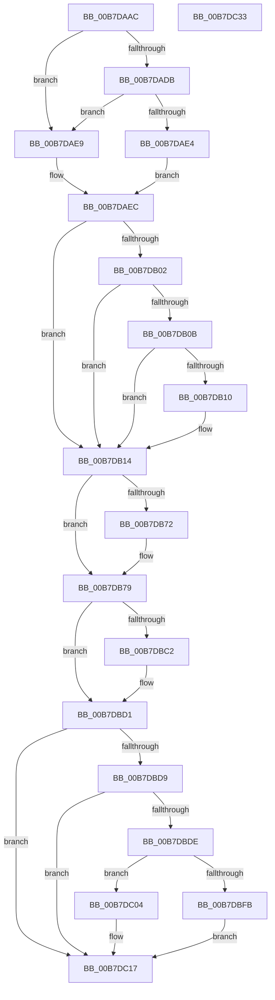

# PopNotifyDevice

- RVA: `0x00B7DAAC`–`0x00B7DC34` (길이 `392` bytes)
- VA: `0x0000000140B7DAAC`
- 실행 섹션: `PAGELK`
- PDB 이름 있음: `예`; PDB Function 태그: `아니요`
- unwind 정보 RVA: `0x000BE274`
- 디코드: `103`개 명령, `392/392` bytes 표시
- 미해석 바이트: `0` (있으면 어셈블리에 `.byte`로 보존)

> 이 문서는 커널 이미지의 기계어와 PDB 기호를 분석해 생성했습니다. 4번과 5번은 함수 원형과 자료형을 바이너리 사용 방식에서 추정한 C 해석이며 원본 소스 복구 결과는 아닙니다.

## 1. Dependencies

- 직접 호출 지점: **9**; 고유 호출 대상: **7**
- 직접 호출자로 확인된 함수: **2**
- RIP 상대 이미지 참조: **4**

### Outgoing calls
- `0x00B7DAF5` → [PopMapInternalActionToIrpAction](../../text/49/PopMapInternalActionToIrpAction_function_0049FE48.md) (function, `0x0049FE48`)
- `0x00B7DB55` → [PopAllocateIrp](../../text/27/PopAllocateIrp_function_0027116C.md) (function, `0x0027116C`)
- `0x00B7DB69` → [Feature_Sx_PEP_Notification_Synchronization__private_IsEnabledNoReportingNoInline](../../text/4F/Feature_Sx_PEP_Notification_Synchronization__private_IsEnabledNoReportingNoInline_function_004F4E70.md) (function, `0x004F4E70`)
- `0x00B7DBCC` → [PopLogNotifyDevice](../../text/27/PopLogNotifyDevice_function_00270400.md) (function, `0x00270400`)
- `0x00B7DBE7` → [IoGetDeviceAttachmentBaseRefWithTag](../../text/27/IoGetDeviceAttachmentBaseRefWithTag_function_00272788.md) (function, `0x00272788`)
- `0x00B7DBEF` → [Feature_Sx_PEP_Notification_Synchronization__private_IsEnabledNoReportingNoInline](../../text/4F/Feature_Sx_PEP_Notification_Synchronization__private_IsEnabledNoReportingNoInline_function_004F4E70.md) (function, `0x004F4E70`)
- `0x00B7DBFD` → [PoFxActivateDeviceForSystemTransition](../../text/4A/PoFxActivateDeviceForSystemTransition_function_004A0D90.md) (function, `0x004A0D90`)
- `0x00B7DC0A` → [PoFxActivateDeviceForSystemTransition](../../text/4A/PoFxActivateDeviceForSystemTransition_function_004A0D90.md) (function, `0x004A0D90`)
- `0x00B7DC1A` → [PopQueueQuerySetIrp](../../text/2B/PopQueueQuerySetIrp_function_002BEF18.md) (function, `0x002BEF18`)

### Direct callers
- [PopWakeDeviceList](../../text/43/PopWakeDeviceList_function_00430238.md) at `0x00430446`
- [PopSleepDeviceList](../../text/43/PopSleepDeviceList_function_00430460.md) at `0x004306CF`

### Static image references
- `0x00B7DAEF` → RVA `0x00F0BCC8` (`.data`; read)
- `0x00B7DB93` → RVA `0x00F0BCC4` (`.data`; read)
- `0x00B7DB9C` → RVA `0x00B70CC0` (`PopSystemIrpCompletion`; read)
- `0x00B7DBB6` → RVA `0x00FC6B10` (`ALMOSTRO`; read)

## 2. Other-region calls and transfers

- 다른 실행 섹션으로 향하는 call: **9**
  - `0x00B7DAF5` → [PopMapInternalActionToIrpAction](../../text/49/PopMapInternalActionToIrpAction_function_0049FE48.md) (`PAGELK` → `.text`)
  - `0x00B7DB55` → [PopAllocateIrp](../../text/27/PopAllocateIrp_function_0027116C.md) (`PAGELK` → `.text`)
  - `0x00B7DB69` → [Feature_Sx_PEP_Notification_Synchronization__private_IsEnabledNoReportingNoInline](../../text/4F/Feature_Sx_PEP_Notification_Synchronization__private_IsEnabledNoReportingNoInline_function_004F4E70.md) (`PAGELK` → `.text`)
  - `0x00B7DBCC` → [PopLogNotifyDevice](../../text/27/PopLogNotifyDevice_function_00270400.md) (`PAGELK` → `.text`)
  - `0x00B7DBE7` → [IoGetDeviceAttachmentBaseRefWithTag](../../text/27/IoGetDeviceAttachmentBaseRefWithTag_function_00272788.md) (`PAGELK` → `.text`)
  - `0x00B7DBEF` → [Feature_Sx_PEP_Notification_Synchronization__private_IsEnabledNoReportingNoInline](../../text/4F/Feature_Sx_PEP_Notification_Synchronization__private_IsEnabledNoReportingNoInline_function_004F4E70.md) (`PAGELK` → `.text`)
  - `0x00B7DBFD` → [PoFxActivateDeviceForSystemTransition](../../text/4A/PoFxActivateDeviceForSystemTransition_function_004A0D90.md) (`PAGELK` → `.text`)
  - `0x00B7DC0A` → [PoFxActivateDeviceForSystemTransition](../../text/4A/PoFxActivateDeviceForSystemTransition_function_004A0D90.md) (`PAGELK` → `.text`)
  - `0x00B7DC1A` → [PopQueueQuerySetIrp](../../text/2B/PopQueueQuerySetIrp_function_002BEF18.md) (`PAGELK` → `.text`)
- 별도 외부 분기/꼬리 이동을 확인하지 못했습니다.

## 3. Assembly (complete function range)

```asm
00B7DAAC  48 8B C4                        mov rax, rsp
00B7DAAF  48 89 58 18                     mov qword ptr [rax + 0x18], rbx
00B7DAB3  55                              push rbp
00B7DAB4  56                              push rsi
00B7DAB5  57                              push rdi
00B7DAB6  41 56                           push r14
00B7DAB8  41 57                           push r15
00B7DABA  48 83 EC 60                     sub rsp, 0x60
00B7DABE  48 83 60 10 00                  and qword ptr [rax + 0x10], 0
00B7DAC3  48 8B F2                        mov rsi, rdx
00B7DAC6  48 83 60 08 00                  and qword ptr [rax + 8], 0
00B7DACB  48 8B F9                        mov rdi, rcx
00B7DACE  80 B9 D0 01 00 00 00            cmp byte ptr [rcx + 0x1d0], 0
00B7DAD5  4C 8B 51 38                     mov r10, qword ptr [rcx + 0x38]
00B7DAD9  75 0E                           jne 0x140b7dae9
00B7DADB  48 8B 42 40                     mov rax, qword ptr [rdx + 0x40]
00B7DADF  49 39 02                        cmp qword ptr [r10], rax
00B7DAE2  75 05                           jne 0x140b7dae9
00B7DAE4  45 33 C0                        xor r8d, r8d
00B7DAE7  EB 03                           jmp 0x140b7daec
00B7DAE9  41 B0 01                        mov r8b, 1
00B7DAEC  8B 51 04                        mov edx, dword ptr [rcx + 4]
00B7DAEF  8B 0D D3 E1 38 00               mov ecx, dword ptr [rip + 0x38e1d3]
00B7DAF5  E8 4E 23 92 FF                  call 0x14049fe48
00B7DAFA  44 8B F8                        mov r15d, eax
00B7DAFD  83 F8 07                        cmp eax, 7
00B7DB00  75 12                           jne 0x140b7db14
00B7DB02  48 8B 4E 40                     mov rcx, qword ptr [rsi + 0x40]
00B7DB06  49 39 0A                        cmp qword ptr [r10], rcx
00B7DB09  75 09                           jne 0x140b7db14
00B7DB0B  80 3F 02                        cmp byte ptr [rdi], 2
00B7DB0E  75 04                           jne 0x140b7db14
00B7DB10  49 83 22 00                     and qword ptr [r10], 0
00B7DB14  8B 5F 04                        mov ebx, dword ptr [rdi + 4]
00B7DB17  48 8D 84 24 90 00 00 00         lea rax, [rsp + 0x90]
00B7DB1F  44 8A 07                        mov r8b, byte ptr [rdi]
00B7DB22  45 33 C9                        xor r9d, r9d
00B7DB25  48 8B 4E 30                     mov rcx, qword ptr [rsi + 0x30]
00B7DB29  48 89 44 24 50                  mov qword ptr [rsp + 0x50], rax
00B7DB2E  48 8D 84 24 98 00 00 00         lea rax, [rsp + 0x98]
00B7DB36  48 89 44 24 48                  mov qword ptr [rsp + 0x48], rax
00B7DB3B  48 83 64 24 40 00               and qword ptr [rsp + 0x40], 0
00B7DB41  48 83 64 24 38 00               and qword ptr [rsp + 0x38], 0
00B7DB47  C6 44 24 30 00                  mov byte ptr [rsp + 0x30], 0
00B7DB4C  C6 44 24 28 01                  mov byte ptr [rsp + 0x28], 1
00B7DB51  89 5C 24 20                     mov dword ptr [rsp + 0x20], ebx
00B7DB55  E8 12 36 6F FF                  call 0x14027116c
00B7DB5A  4C 8B B4 24 90 00 00 00         mov r14, qword ptr [rsp + 0x90]
00B7DB62  49 89 B6 D8 00 00 00            mov qword ptr [r14 + 0xd8], rsi
00B7DB69  E8 02 73 97 FF                  call 0x1404f4e70
00B7DB6E  85 C0                           test eax, eax
00B7DB70  75 07                           jne 0x140b7db79
00B7DB72  41 88 86 E0 00 00 00            mov byte ptr [r14 + 0xe0], al
00B7DB79  48 8B AC 24 98 00 00 00         mov rbp, qword ptr [rsp + 0x98]
00B7DB81  48 8B 8D B8 00 00 00            mov rcx, qword ptr [rbp + 0xb8]
00B7DB88  83 61 C8 00                     and dword ptr [rcx - 0x38], 0
00B7DB8C  89 59 D0                        mov dword ptr [rcx - 0x30], ebx
00B7DB8F  44 89 79 D8                     mov dword ptr [rcx - 0x28], r15d
00B7DB93  8B 05 2B E1 38 00               mov eax, dword ptr [rip + 0x38e12b]
00B7DB99  89 41 C0                        mov dword ptr [rcx - 0x40], eax
00B7DB9C  48 8D 0D 1D 31 FF FF            lea rcx, [rip - 0xcee3]
00B7DBA3  48 8B 85 B8 00 00 00            mov rax, qword ptr [rbp + 0xb8]
00B7DBAA  48 89 48 F0                     mov qword ptr [rax - 0x10], rcx
00B7DBAE  4C 89 70 F8                     mov qword ptr [rax - 8], r14
00B7DBB2  C6 40 BB E0                     mov byte ptr [rax - 0x45], 0xe0
00B7DBB6  F7 05 50 8F 44 00 00 80 00 00   test dword ptr [rip + 0x448f50], 0x8000
00B7DBC0  74 0F                           je 0x140b7dbd1
00B7DBC2  48 8B 4E 30                     mov rcx, qword ptr [rsi + 0x30]
00B7DBC6  4C 8B C5                        mov r8, rbp
00B7DBC9  48 8B D6                        mov rdx, rsi
00B7DBCC  E8 2F 28 6F FF                  call 0x140270400
00B7DBD1  8A 07                           mov al, byte ptr [rdi]
00B7DBD3  2C 02                           sub al, 2
00B7DBD5  3C 01                           cmp al, 1
00B7DBD7  77 3E                           ja 0x140b7dc17
00B7DBD9  83 FB 01                        cmp ebx, 1
00B7DBDC  7E 39                           jle 0x140b7dc17
00B7DBDE  48 8B 4E 30                     mov rcx, qword ptr [rsi + 0x30]
00B7DBE2  BA 50 6F 49 72                  mov edx, 0x72496f50
00B7DBE7  E8 9C 4B 6F FF                  call 0x140272788
00B7DBEC  48 8B D8                        mov rbx, rax
00B7DBEF  E8 7C 72 97 FF                  call 0x1404f4e70
00B7DBF4  48 8B CB                        mov rcx, rbx
00B7DBF7  85 C0                           test eax, eax
00B7DBF9  74 09                           je 0x140b7dc04
00B7DBFB  33 D2                           xor edx, edx
00B7DBFD  E8 8E 31 92 FF                  call 0x1404a0d90
00B7DC02  EB 13                           jmp 0x140b7dc17
00B7DC04  80 3F 02                        cmp byte ptr [rdi], 2
00B7DC07  0F 94 C2                        sete dl
00B7DC0A  E8 81 31 92 FF                  call 0x1404a0d90
00B7DC0F  41 C6 86 E0 00 00 00 01         mov byte ptr [r14 + 0xe0], 1
00B7DC17  48 8B CD                        mov rcx, rbp
00B7DC1A  E8 F9 12 74 FF                  call 0x1402bef18
00B7DC1F  48 8B 9C 24 A0 00 00 00         mov rbx, qword ptr [rsp + 0xa0]
00B7DC27  48 83 C4 60                     add rsp, 0x60
00B7DC2B  41 5F                           pop r15
00B7DC2D  41 5E                           pop r14
00B7DC2F  5F                              pop rdi
00B7DC30  5E                              pop rsi
00B7DC31  5D                              pop rbp
00B7DC32  C3                              ret
00B7DC33  CC                              int3
```

## 4. C-style interpretation (structured pseudocode)

```c
__int64 __fastcall PopNotifyDevice(__int64 a1, __int64 a2, int a3, int a4)
{
    __int64 result;
    __int64 v_rsp;
    unsigned __int64 v_stack_m38;
    unsigned __int64 v_stack_m40;
    unsigned __int64 v_stack_m48;
    unsigned __int64 v_stack_m50;
    unsigned __int8 v_stack_m58;
    unsigned __int8 v_stack_m60;
    unsigned int v_stack_m68;
    unsigned __int64 v_stack_p10;
    unsigned __int64 v_stack_p18;
    unsigned __int64 v_stack_p8;

    *(unsigned __int64 *)(v_rsp + 24) = v_rbx;
    v_rsp = (v_rsp) - (96);
    if ((*(unsigned __int8 *)(a1 + 464)) != 0) goto loc_00B7DAE9;
    if ((*(unsigned __int64 *)(*(unsigned __int64 *)(a1 + 56))) != (*(unsigned __int64 *)(a2 + 64))) goto loc_00B7DAE9;
    a3 = 0;
    goto loc_00B7DAEC;
loc_00B7DAE9:
loc_00B7DAEC:
    result = PopMapInternalActionToIrpAction((unsigned int)(*(unsigned int *)(v_rip + 3727827)), (unsigned int)(*(unsigned int *)(a1 + 4)), 1, a4);
    if (((unsigned int)(result)) != 7) goto loc_00B7DB14;
    if ((*(unsigned __int64 *)(*(unsigned __int64 *)(a1 + 56))) != (*(unsigned __int64 *)(a2 + 64))) goto loc_00B7DB14;
    if ((*(unsigned __int8 *)(a1)) == 2) {
    }
    a4 = 0;
    v_stack_m38 = v_stack_p8;
    v_stack_m40 = v_stack_p10;
    v_stack_m58 = 0;
    v_stack_m60 = 1;
    v_stack_m68 = (unsigned int)((unsigned int)(*(unsigned int *)(a1 + 4)));
    result = PopAllocateIrp(*(unsigned __int64 *)(a2 + 48), (unsigned int)(*(unsigned int *)(a1 + 4)), *(unsigned __int8 *)(a1), a4);
    *(unsigned __int64 *)(v_stack_p8 + 216) = a2;
    result = Feature_Sx_PEP_Notification_Synchronization__private_IsEnabledNoReportingNoInline(*(unsigned __int64 *)(a2 + 48), (unsigned int)(*(unsigned int *)(a1 + 4)), *(unsigned __int8 *)(a1), a4);
    if ((unsigned int)(result) == 0) {
        *(unsigned __int8 *)(v_stack_p8 + 224) = (unsigned __int8)(result);
    }
    *(unsigned int *)(*(unsigned __int64 *)(v_stack_p10 + 184) - 48) = (unsigned int)((unsigned int)(*(unsigned int *)(a1 + 4)));
    *(unsigned int *)(*(unsigned __int64 *)(v_stack_p10 + 184) - 40) = (unsigned int)((unsigned int)((unsigned int)(result)));
    *(unsigned int *)(*(unsigned __int64 *)(v_stack_p10 + 184) - 64) = (unsigned int)((unsigned int)(*(unsigned int *)(v_rip + 3727659)));
    *(unsigned __int64 *)(*(unsigned __int64 *)(v_stack_p10 + 184) - 16) = v_rip - 52963;
    *(unsigned __int64 *)(*(unsigned __int64 *)(v_stack_p10 + 184) - 8) = v_stack_p8;
    *(unsigned __int8 *)(*(unsigned __int64 *)(v_stack_p10 + 184) - 69) = 224;
    result = *(unsigned __int64 *)(v_stack_p10 + 184);
    if (((*(unsigned int *)(v_rip + 4493136)) & (0x8000ULL)) != 0) {
        a1 = *(unsigned __int64 *)(a2 + 48);
        a3 = v_stack_p10;
        a2 = a2;
        result = PopLogNotifyDevice(a1, a2, a3, a4);
    }
    result = (unsigned __int8)((*(unsigned __int8 *)(a1)) - (2));
    if (((unsigned __int8)(result)) > 1) goto loc_00B7DC17;
    if (((unsigned int)((unsigned int)(*(unsigned int *)(a1 + 4)))) <= 1) goto loc_00B7DC17;
    result = IoGetDeviceAttachmentBaseRefWithTag(*(unsigned __int64 *)(a2 + 48), (unsigned int)(0x72496F50ULL), a3, a4);
    result = Feature_Sx_PEP_Notification_Synchronization__private_IsEnabledNoReportingNoInline(*(unsigned __int64 *)(a2 + 48), (unsigned int)(0x72496F50ULL), a3, a4);
    if ((unsigned int)(result) == 0) goto loc_00B7DC04;
    a2 = 0;
    result = PoFxActivateDeviceForSystemTransition(result, a2, a3, a4);
    goto loc_00B7DC17;
loc_00B7DC04:
    a2 = ((*(unsigned __int8 *)(a1)) == 2) ? 1 : 0;
    result = PoFxActivateDeviceForSystemTransition(result, a2, a3, a4);
    *(unsigned __int8 *)(v_stack_p8 + 224) = 1;
loc_00B7DC17:
    result = PopQueueQuerySetIrp(v_stack_p10, a2, a3, a4);
    v_rsp = (v_rsp) + (96);
    return result;
}
```

## 5. (Beta) C Style

```c
int64_t PopNotifyDevice(void *Arg1, void *Arg2, int32_t Arg3, int32_t Arg4)
{
    uint8_t *arg1 = (uint8_t *)Arg1;
    uint8_t *arg2 = (uint8_t *)Arg2;

    int64_t result;
    int64_t local_rsp;
    uint64_t v_stack_m38;
    uint64_t v_stack_m40;
    uint64_t v_stack_m48;
    uint64_t v_stack_m50;
    uint8_t v_stack_m58;
    uint8_t v_stack_m60;
    uint32_t v_stack_m68;
    uint64_t v_stack_p10;
    uint64_t v_stack_p18;
    uint64_t v_stack_p8;

    *(uint64_t *)(local_rsp + 0x18) = local_rbx;
    local_rsp = (local_rsp) - (96);
    if ((*(uint8_t *)(arg1 + 0x1D0)) != 0) goto loc_00B7DAE9;
    if ((*(uint64_t *)(*(uint64_t *)(arg1 + 0x38))) != (*(uint64_t *)(arg2 + 0x40))) goto loc_00B7DAE9;
    Arg3 = 0;
    goto loc_00B7DAEC;
loc_00B7DAE9:
loc_00B7DAEC:
    result = PopMapInternalActionToIrpAction((uint32_t)(*(uint32_t *)(v_rip + 0x38E1D3)), (uint32_t)(*(uint32_t *)(arg1 + 0x4)), 1, Arg4);
    if (((uint32_t)(result)) != 7) goto loc_00B7DB14;
    if ((*(uint64_t *)(*(uint64_t *)(arg1 + 0x38))) != (*(uint64_t *)(arg2 + 0x40))) goto loc_00B7DB14;
    if ((*(uint8_t *)(arg1)) == 2) {
    }
    Arg4 = 0;
    v_stack_m38 = v_stack_p8;
    v_stack_m40 = v_stack_p10;
    v_stack_m58 = 0;
    v_stack_m60 = 1;
    v_stack_m68 = (uint32_t)((uint32_t)(*(uint32_t *)(arg1 + 0x4)));
    result = PopAllocateIrp(*(uint64_t *)(arg2 + 0x30), (uint32_t)(*(uint32_t *)(arg1 + 0x4)), *(uint8_t *)(arg1), Arg4);
    *(void **)(v_stack_p8 + 0xD8) = Arg2;
    result = Feature_Sx_PEP_Notification_Synchronization__private_IsEnabledNoReportingNoInline(*(uint64_t *)(arg2 + 0x30), (uint32_t)(*(uint32_t *)(arg1 + 0x4)), *(uint8_t *)(arg1), Arg4);
    if ((uint32_t)(result) == 0) {
        *(uint8_t *)(v_stack_p8 + 0xE0) = (uint8_t)(result);
    }
    *(uint32_t *)(*(uint64_t *)(v_stack_p10 + 0xB8) - 0x30) = (uint32_t)((uint32_t)(*(uint32_t *)(arg1 + 0x4)));
    *(uint32_t *)(*(uint64_t *)(v_stack_p10 + 0xB8) - 0x28) = (uint32_t)((uint32_t)((uint32_t)(result)));
    *(uint32_t *)(*(uint64_t *)(v_stack_p10 + 0xB8) - 0x40) = (uint32_t)((uint32_t)(*(uint32_t *)(v_rip + 0x38E12B)));
    *(uint64_t *)(*(uint64_t *)(v_stack_p10 + 0xB8) - 0x10) = v_rip - 52963;
    *(uint64_t *)(*(uint64_t *)(v_stack_p10 + 0xB8) - 0x8) = v_stack_p8;
    *(uint8_t *)(*(uint64_t *)(v_stack_p10 + 0xB8) - 0x45) = 224;
    result = *(uint64_t *)(v_stack_p10 + 0xB8);
    if (((*(uint32_t *)(v_rip + 0x448F50)) & (0x8000ULL)) != 0) {
        Arg1 = *(uint64_t *)(arg2 + 0x30);
        Arg3 = v_stack_p10;
        Arg2 = Arg2;
        result = PopLogNotifyDevice(Arg1, Arg2, Arg3, Arg4);
    }
    result = (uint8_t)((*(uint8_t *)(arg1)) - (2));
    if (((uint8_t)(result)) > 1) goto loc_00B7DC17;
    if (((uint32_t)((uint32_t)(*(uint32_t *)(arg1 + 0x4)))) <= 1) goto loc_00B7DC17;
    result = IoGetDeviceAttachmentBaseRefWithTag(*(uint64_t *)(arg2 + 0x30), (uint32_t)(0x72496F50ULL), Arg3, Arg4);
    result = Feature_Sx_PEP_Notification_Synchronization__private_IsEnabledNoReportingNoInline(*(uint64_t *)(arg2 + 0x30), (uint32_t)(0x72496F50ULL), Arg3, Arg4);
    if ((uint32_t)(result) == 0) goto loc_00B7DC04;
    Arg2 = 0;
    result = PoFxActivateDeviceForSystemTransition(result, Arg2, Arg3, Arg4);
    goto loc_00B7DC17;
loc_00B7DC04:
    Arg2 = ((*(uint8_t *)(arg1)) == 2) ? 1 : 0;
    result = PoFxActivateDeviceForSystemTransition(result, Arg2, Arg3, Arg4);
    *(uint8_t *)(v_stack_p8 + 0xE0) = 1;
loc_00B7DC17:
    result = PopQueueQuerySetIrp(v_stack_p10, Arg2, Arg3, Arg4);
    local_rsp = (local_rsp) + (96);
    return result;
}
```

### 관측된 메모리 오프셋

구조체 형식이 확인되지 않은 접근은 인자 기준의 오프셋으로만 기록했습니다.

| 기준 인자 | 오프셋 표현 | 폭 (bit) | 접근 |
|---|---:|---:|---|
| `Arg1` | `+ 0x0` | `8` | `R` |
| `Arg1` | `+ 0x4` | `32` | `R` |
| `Arg1` | `+ 0x38` | `64` | `R` |
| `Arg1` | `+ 0x1D0` | `8` | `R` |
| `Arg2` | `+ 0x30` | `64` | `R` |
| `Arg2` | `+ 0x40` | `64` | `R` |

## 6. Execution-region graph

[열기: 2D/3D 그래프와 함수 탐색 컨트롤 패널](../../../control-panel.html?section=pagelk&rva=0x00B7DAAC&view=graph)

- 2D 그래프는 위에서 아래로 흐르고, 3D 그래프는 빈 공간을 드래그해 회전합니다. Shift+드래그는 이동, 휠은 확대·축소, 함수 노드 선택은 대상 보고서 이동입니다.

### Static fallback


