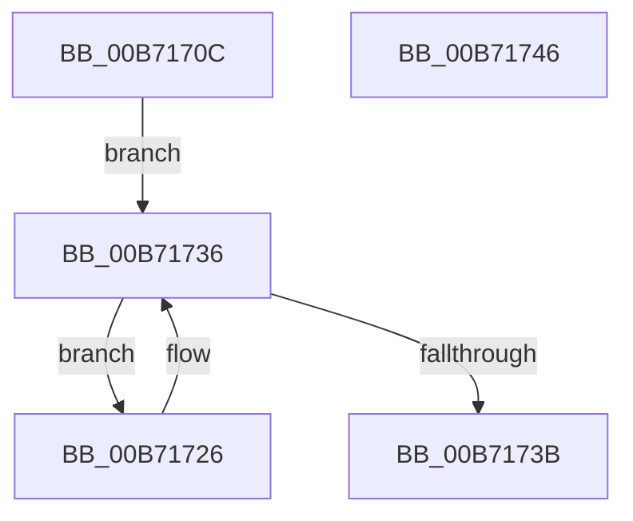

# PopNotifyShutdownListener

- RVA: `0x00B7170C`–`0x00B71747` (길이 `59` bytes)
- VA: `0x0000000140B7170C`
- 실행 섹션: `PAGELK`
- PDB 이름 있음: `예`; PDB Function 태그: `아니요`
- unwind 정보 RVA: `0x0005CAAC`
- 디코드: `17`개 명령, `59/59` bytes 표시
- 미해석 바이트: `0` (있으면 어셈블리에 `.byte`로 보존)

> 이 문서는 커널 이미지의 기계어와 PDB 기호를 분석해 생성했습니다. 4번과 5번은 함수 원형과 자료형을 바이너리 사용 방식에서 추정한 C 해석이며 원본 소스 복구 결과는 아닙니다.

## 1. Dependencies

- 직접 호출 지점: **1**; 고유 호출 대상: **1**
- 직접 호출자로 확인된 함수: **2**
- RIP 상대 이미지 참조: **1**

### Outgoing calls
- `0x00B7172E` → [guard_dispatch_icall](../../text/6B/guard_dispatch_icall_function_006BAAD0.md) (function, `0x006BAAD0`)

### Direct callers
- [PopSaveHiberContext](../B6/PopSaveHiberContext_function_00B6F050.md) at `0x00B6FA63`
- [PopShutdownSystem](PopShutdownSystem_function_00B71784.md) at `0x00B7178C`

### Static image references
- `0x00B71716` → RVA `0x00F092D0` (`.data`; read)

## 2. Other-region calls and transfers

- 다른 실행 섹션으로 향하는 call: **1**
  - `0x00B7172E` → [guard_dispatch_icall](../../text/6B/guard_dispatch_icall_function_006BAAD0.md) (`PAGELK` → `.text`)
- 별도 외부 분기/꼬리 이동을 확인하지 못했습니다.

## 3. Assembly (complete function range)

```asm
00B7170C  48 89 5C 24 08                  mov qword ptr [rsp + 8], rbx
00B71711  57                              push rdi
00B71712  48 83 EC 20                     sub rsp, 0x20
00B71716  48 8B 1D B3 7B 39 00            mov rbx, qword ptr [rip + 0x397bb3]
00B7171D  48 8D 3D AC 7B 39 00            lea rdi, [rip + 0x397bac]
00B71724  EB 10                           jmp 0x140b71736
00B71726  48 8B 43 18                     mov rax, qword ptr [rbx + 0x18]
00B7172A  48 8B 4B 20                     mov rcx, qword ptr [rbx + 0x20]
00B7172E  E8 9D 93 B4 FF                  call 0x1406baad0
00B71733  48 8B 1B                        mov rbx, qword ptr [rbx]
00B71736  48 3B DF                        cmp rbx, rdi
00B71739  75 EB                           jne 0x140b71726
00B7173B  48 8B 5C 24 30                  mov rbx, qword ptr [rsp + 0x30]
00B71740  48 83 C4 20                     add rsp, 0x20
00B71744  5F                              pop rdi
00B71745  C3                              ret
00B71746  CC                              int3
```

## 4. C-style interpretation (structured pseudocode)

```c
__int64 __fastcall PopNotifyShutdownListener(void)
{
    __int64 result;
    __int64 v_rsp;
    unsigned __int64 v_stack_p8;

    v_stack_p8 = v_rbx;
    v_rsp = (v_rsp) - (32);
    goto loc_00B71736;
loc_00B71726:
    result = guard_dispatch_icall(*(unsigned __int64 *)(*(unsigned __int64 *)(v_rip + 3767219) + 32), a2, a3, a4);
loc_00B71736:
    if ((*(unsigned __int64 *)(*(unsigned __int64 *)(v_rip + 3767219))) != (v_rip + 3767212)) goto loc_00B71726;
    v_rsp = (v_rsp) + (32);
    return result;
}
```

## 5. (Beta) C Style

```c
void PopNotifyShutdownListener(void)
{
    int64_t result;
    int64_t local_rsp;
    uint64_t v_stack_p8;

    v_stack_p8 = local_rbx;
    local_rsp = (local_rsp) - (32);
    goto loc_00B71736;
loc_00B71726:
    result = guard_dispatch_icall(*(uint64_t *)(*(uint64_t *)(v_rip + 0x397BB3) + 0x20), a2, a3, a4);
loc_00B71736:
    if ((*(uint64_t *)(*(uint64_t *)(v_rip + 0x397BB3))) != (v_rip + 3767212)) goto loc_00B71726;
    local_rsp = (local_rsp) + (32);
    return result;
}
```

## 6. Execution-region graph

[열기: 2D/3D 그래프와 함수 탐색 컨트롤 패널](../../../control-panel.html?section=pagelk&rva=0x00B7170C&view=graph)

- 2D 그래프는 위에서 아래로 흐르고, 3D 그래프는 빈 공간을 드래그해 회전합니다. Shift+드래그는 이동, 휠은 확대·축소, 함수 노드 선택은 대상 보고서 이동입니다.

### Static fallback


