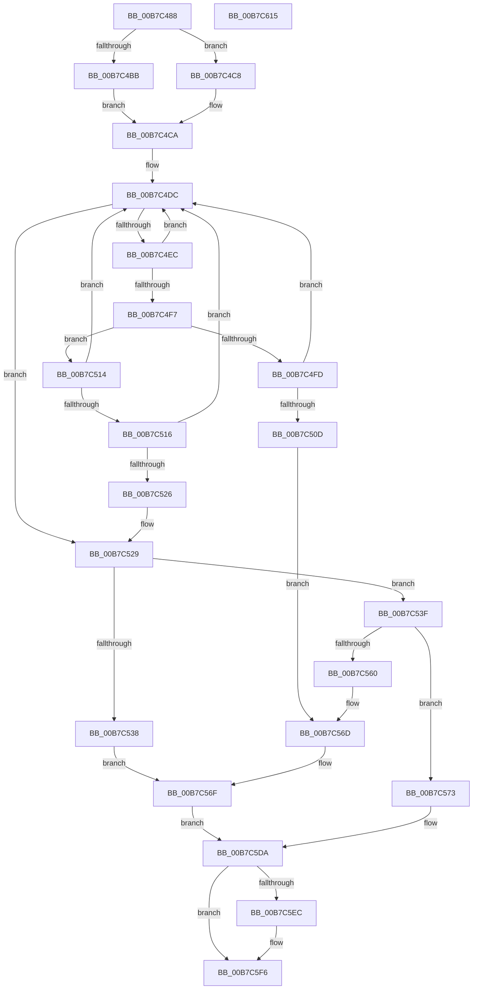

# PopProcessWakeSourceWork

- RVA: `0x00B7C488`–`0x00B7C616` (길이 `398` bytes)
- VA: `0x0000000140B7C488`
- 실행 섹션: `PAGELK`
- PDB 이름 있음: `예`; PDB Function 태그: `아니요`
- unwind 정보 RVA: `0x0008C20C`
- 디코드: `114`개 명령, `398/398` bytes 표시
- 미해석 바이트: `0` (있으면 어셈블리에 `.byte`로 보존)

> 이 문서는 커널 이미지의 기계어와 PDB 기호를 분석해 생성했습니다. 4번과 5번은 함수 원형과 자료형을 바이너리 사용 방식에서 추정한 C 해석이며 원본 소스 복구 결과는 아닙니다.

## 1. Dependencies

- 직접 호출 지점: **12**; 고유 호출 대상: **9**
- 직접 호출자로 확인된 함수: **1**
- RIP 상대 이미지 참조: **1**

### Outgoing calls
- `0x00B7C504` → [PopWakeSourceIsParent](../../page/75/PopWakeSourceIsParent_function_0075CB40.md) (function, `0x0075CB40`)
- `0x00B7C51D` → [PopWakeSourceIsChild](../../page/75/PopWakeSourceIsChild_function_0075CAD0.md) (function, `0x0075CAD0`)
- `0x00B7C52B` → [PopNewWakeSource](../../page/70/PopNewWakeSource_function_007026A4.md) (function, `0x007026A4`)
- `0x00B7C552` → [ExAllocatePool2](../../poolcode/B8/ExAllocatePool2_function_00B820F0.md) (function, `0x00B820F0`)
- `0x00B7C568` → [PopFreeWakeSource](../../page/AB/PopFreeWakeSource_function_00AB719C.md) (function, `0x00AB719C`)
- `0x00B7C583` → [RtlCopyUnicodeString](../../text/3F/RtlCopyUnicodeString_function_003FEF30.md) (function, `0x003FEF30`)
- `0x00B7C594` → [PopWakeSourceGetDeviceProperty](../../page/75/PopWakeSourceGetDeviceProperty_function_0075CA08.md) (function, `0x0075CA08`)
- `0x00B7C5A2` → [PopWakeSourceGetDeviceProperty](../../page/75/PopWakeSourceGetDeviceProperty_function_0075CA08.md) (function, `0x0075CA08`)
- `0x00B7C5B3` → [PopWakeSourceGetDeviceProperty](../../page/75/PopWakeSourceGetDeviceProperty_function_0075CA08.md) (function, `0x0075CA08`)
- `0x00B7C5C5` → [PopWakeSourceGetDeviceProperty](../../page/75/PopWakeSourceGetDeviceProperty_function_0075CA08.md) (function, `0x0075CA08`)
- `0x00B7C5D3` → [RtlGUIDFromString](../../page/8F/RtlGUIDFromString_function_008F1EF0.md) (function, `0x008F1EF0`)
- `0x00B7C5F1` → [ExFreePoolWithTag](../../poolcode/B8/ExFreePoolWithTag_function_00B82870.md) (function, `0x00B82870`)

### Direct callers
- [PopProcessDeviceWakeSource](../B6/PopProcessDeviceWakeSource_function_00B6C534.md) at `0x00B6C5B4`

### Static image references
- `0x00B7C4CA` → RVA `0x00F0DEB0` (`.data`; read)

## 2. Other-region calls and transfers

- 다른 실행 섹션으로 향하는 call: **12**
  - `0x00B7C504` → [PopWakeSourceIsParent](../../page/75/PopWakeSourceIsParent_function_0075CB40.md) (`PAGELK` → `PAGE`)
  - `0x00B7C51D` → [PopWakeSourceIsChild](../../page/75/PopWakeSourceIsChild_function_0075CAD0.md) (`PAGELK` → `PAGE`)
  - `0x00B7C52B` → [PopNewWakeSource](../../page/70/PopNewWakeSource_function_007026A4.md) (`PAGELK` → `PAGE`)
  - `0x00B7C552` → [ExAllocatePool2](../../poolcode/B8/ExAllocatePool2_function_00B820F0.md) (`PAGELK` → `POOLCODE`)
  - `0x00B7C568` → [PopFreeWakeSource](../../page/AB/PopFreeWakeSource_function_00AB719C.md) (`PAGELK` → `PAGE`)
  - `0x00B7C583` → [RtlCopyUnicodeString](../../text/3F/RtlCopyUnicodeString_function_003FEF30.md) (`PAGELK` → `.text`)
  - `0x00B7C594` → [PopWakeSourceGetDeviceProperty](../../page/75/PopWakeSourceGetDeviceProperty_function_0075CA08.md) (`PAGELK` → `PAGE`)
  - `0x00B7C5A2` → [PopWakeSourceGetDeviceProperty](../../page/75/PopWakeSourceGetDeviceProperty_function_0075CA08.md) (`PAGELK` → `PAGE`)
  - `0x00B7C5B3` → [PopWakeSourceGetDeviceProperty](../../page/75/PopWakeSourceGetDeviceProperty_function_0075CA08.md) (`PAGELK` → `PAGE`)
  - `0x00B7C5C5` → [PopWakeSourceGetDeviceProperty](../../page/75/PopWakeSourceGetDeviceProperty_function_0075CA08.md) (`PAGELK` → `PAGE`)
  - `0x00B7C5D3` → [RtlGUIDFromString](../../page/8F/RtlGUIDFromString_function_008F1EF0.md) (`PAGELK` → `PAGE`)
  - `0x00B7C5F1` → [ExFreePoolWithTag](../../poolcode/B8/ExFreePoolWithTag_function_00B82870.md) (`PAGELK` → `POOLCODE`)
- 별도 외부 분기/꼬리 이동을 확인하지 못했습니다.

## 3. Assembly (complete function range)

```asm
00B7C488  48 8B C4                        mov rax, rsp
00B7C48B  48 89 58 08                     mov qword ptr [rax + 8], rbx
00B7C48F  48 89 68 10                     mov qword ptr [rax + 0x10], rbp
00B7C493  48 89 70 18                     mov qword ptr [rax + 0x18], rsi
00B7C497  57                              push rdi
00B7C498  41 54                           push r12
00B7C49A  41 55                           push r13
00B7C49C  41 56                           push r14
00B7C49E  41 57                           push r15
00B7C4A0  48 83 EC 30                     sub rsp, 0x30
00B7C4A4  33 ED                           xor ebp, ebp
00B7C4A6  0F 57 C0                        xorps xmm0, xmm0
00B7C4A9  4D 8B E0                        mov r12, r8
00B7C4AC  4C 8B EA                        mov r13, rdx
00B7C4AF  4C 8B F1                        mov r14, rcx
00B7C4B2  0F 11 40 C8                     movups xmmword ptr [rax - 0x38], xmm0
00B7C4B6  48 85 C9                        test rcx, rcx
00B7C4B9  74 0D                           je 0x140b7c4c8
00B7C4BB  48 8B 81 38 01 00 00            mov rax, qword ptr [rcx + 0x138]
00B7C4C2  48 8B 78 28                     mov rdi, qword ptr [rax + 0x28]
00B7C4C6  EB 02                           jmp 0x140b7c4ca
00B7C4C8  33 FF                           xor edi, edi
00B7C4CA  48 8B 05 DF 19 39 00            mov rax, qword ptr [rip + 0x3919df]
00B7C4D1  44 8B BF 98 00 00 00            mov r15d, dword ptr [rdi + 0x98]
00B7C4D8  48 8B 70 18                     mov rsi, qword ptr [rax + 0x18]
00B7C4DC  48 8B 05 CD 19 39 00            mov rax, qword ptr [rip + 0x3919cd]
00B7C4E3  48 83 C0 18                     add rax, 0x18
00B7C4E7  48 3B F0                        cmp rsi, rax
00B7C4EA  74 3D                           je 0x140b7c529
00B7C4EC  48 8B DE                        mov rbx, rsi
00B7C4EF  48 8B 36                        mov rsi, qword ptr [rsi]
00B7C4F2  39 6B 10                        cmp dword ptr [rbx + 0x10], ebp
00B7C4F5  75 E5                           jne 0x140b7c4dc
00B7C4F7  44 39 7B 48                     cmp dword ptr [rbx + 0x48], r15d
00B7C4FB  76 17                           jbe 0x140b7c514
00B7C4FD  48 8D 53 18                     lea rdx, [rbx + 0x18]
00B7C501  48 8B CF                        mov rcx, rdi
00B7C504  E8 37 06 BE FF                  call 0x14075cb40
00B7C509  84 C0                           test al, al
00B7C50B  74 CF                           je 0x140b7c4dc
00B7C50D  BF 01 00 00 C0                  mov edi, 0xc0000001
00B7C512  EB 59                           jmp 0x140b7c56d
00B7C514  73 C6                           jae 0x140b7c4dc
00B7C516  48 8D 53 18                     lea rdx, [rbx + 0x18]
00B7C51A  48 8B CF                        mov rcx, rdi
00B7C51D  E8 AE 05 BE FF                  call 0x14075cad0
00B7C522  84 C0                           test al, al
00B7C524  74 B6                           je 0x140b7c4dc
00B7C526  48 8B EB                        mov rbp, rbx
00B7C529  33 C9                           xor ecx, ecx
00B7C52B  E8 74 61 B8 FF                  call 0x1407026a4
00B7C530  48 8B D8                        mov rbx, rax
00B7C533  48 85 C0                        test rax, rax
00B7C536  75 07                           jne 0x140b7c53f
00B7C538  BF 9A 00 00 C0                  mov edi, 0xc000009a
00B7C53D  EB 30                           jmp 0x140b7c56f
00B7C53F  44 89 78 48                     mov dword ptr [rax + 0x48], r15d
00B7C543  B9 00 01 00 00                  mov ecx, 0x100
00B7C548  0F B7 57 28                     movzx edx, word ptr [rdi + 0x28]
00B7C54C  41 B8 4D 65 6D 20               mov r8d, 0x206d654d
00B7C552  E8 99 5B 00 00                  call 0x140b820f0
00B7C557  48 89 43 20                     mov qword ptr [rbx + 0x20], rax
00B7C55B  48 85 C0                        test rax, rax
00B7C55E  75 13                           jne 0x140b7c573
00B7C560  48 8B CB                        mov rcx, rbx
00B7C563  BF 9A 00 00 C0                  mov edi, 0xc000009a
00B7C568  E8 2F AC F3 FF                  call 0x140ab719c
00B7C56D  33 DB                           xor ebx, ebx
00B7C56F  33 ED                           xor ebp, ebp
00B7C571  EB 67                           jmp 0x140b7c5da
00B7C573  0F B7 47 28                     movzx eax, word ptr [rdi + 0x28]
00B7C577  48 8D 4B 18                     lea rcx, [rbx + 0x18]
00B7C57B  48 8D 57 28                     lea rdx, [rdi + 0x28]
00B7C57F  66 89 43 1A                     mov word ptr [rbx + 0x1a], ax
00B7C583  E8 A8 29 88 FF                  call 0x1403fef30
00B7C588  48 8D 4B 28                     lea rcx, [rbx + 0x28]
00B7C58C  4D 8B C6                        mov r8, r14
00B7C58F  BA 09 00 00 00                  mov edx, 9
00B7C594  E8 6F 04 BE FF                  call 0x14075ca08
00B7C599  48 8D 4B 38                     lea rcx, [rbx + 0x38]
00B7C59D  4D 8B C6                        mov r8, r14
00B7C5A0  33 D2                           xor edx, edx
00B7C5A2  E8 61 04 BE FF                  call 0x14075ca08
00B7C5A7  48 8D 4B 60                     lea rcx, [rbx + 0x60]
00B7C5AB  4D 8B C6                        mov r8, r14
00B7C5AE  BA 05 00 00 00                  mov edx, 5
00B7C5B3  E8 50 04 BE FF                  call 0x14075ca08
00B7C5B8  4D 8B C6                        mov r8, r14
00B7C5BB  48 8D 4C 24 20                  lea rcx, [rsp + 0x20]
00B7C5C0  BA 06 00 00 00                  mov edx, 6
00B7C5C5  E8 3E 04 BE FF                  call 0x14075ca08
00B7C5CA  48 8D 53 4C                     lea rdx, [rbx + 0x4c]
00B7C5CE  48 8D 4C 24 20                  lea rcx, [rsp + 0x20]
00B7C5D3  E8 18 59 D7 FF                  call 0x1408f1ef0
00B7C5D8  33 FF                           xor edi, edi
00B7C5DA  48 8B 4C 24 28                  mov rcx, qword ptr [rsp + 0x28]
00B7C5DF  49 89 5D 00                     mov qword ptr [r13], rbx
00B7C5E3  49 89 2C 24                     mov qword ptr [r12], rbp
00B7C5E7  48 85 C9                        test rcx, rcx
00B7C5EA  74 0A                           je 0x140b7c5f6
00B7C5EC  BA 4D 65 6D 20                  mov edx, 0x206d654d
00B7C5F1  E8 7A 62 00 00                  call 0x140b82870
00B7C5F6  48 8B 5C 24 60                  mov rbx, qword ptr [rsp + 0x60]
00B7C5FB  8B C7                           mov eax, edi
00B7C5FD  48 8B 6C 24 68                  mov rbp, qword ptr [rsp + 0x68]
00B7C602  48 8B 74 24 70                  mov rsi, qword ptr [rsp + 0x70]
00B7C607  48 83 C4 30                     add rsp, 0x30
00B7C60B  41 5F                           pop r15
00B7C60D  41 5E                           pop r14
00B7C60F  41 5D                           pop r13
00B7C611  41 5C                           pop r12
00B7C613  5F                              pop rdi
00B7C614  C3                              ret
00B7C615  CC                              int3
```

## 4. C-style interpretation (structured pseudocode)

```c
__int64 __fastcall PopProcessWakeSourceWork(__int64 a1, __int64 a2, __int64 a3)
{
    __int64 result;
    __int64 v_rbp;
    __int64 v_rbx;
    __int64 v_rdi;
    __int64 v_rsp;
    unsigned __int64 v_stack_m30;
    unsigned __int64 v_stack_m38;
    unsigned __int64 v_stack_p10;
    unsigned __int64 v_stack_p18;
    unsigned __int64 v_stack_p8;

    *(unsigned __int64 *)(v_rsp + 8) = v_rbx;
    *(unsigned __int64 *)(v_rsp + 16) = v_rbp;
    *(unsigned __int64 *)(v_rsp + 24) = v_rsi;
    v_rsp = (v_rsp) - (48);
    v_rbp = 0;
    *(unsigned __int64 *)(v_rsp - 56) = v_xmm0;
    if (a1 == 0) goto loc_00B7C4C8;
    goto loc_00B7C4CA;
loc_00B7C4C8:
    v_rdi = 0;
loc_00B7C4CA:
loc_00B7C4DC:
    result = (*(unsigned __int64 *)(v_rip + 3742157)) + (24);
    if ((*(unsigned __int64 *)(*(unsigned __int64 *)(v_rip + 3742175) + 24)) == result) goto loc_00B7C529;
    if ((*(unsigned int *)(*(unsigned __int64 *)(*(unsigned __int64 *)(v_rip + 3742175) + 24) + 16)) != 0) goto loc_00B7C4DC;
    if ((*(unsigned int *)(*(unsigned __int64 *)(*(unsigned __int64 *)(v_rip + 3742175) + 24) + 72)) <= ((unsigned int)((unsigned int)(*(unsigned int *)(v_rdi + 152))))) goto loc_00B7C514;
    result = PopWakeSourceIsParent(0, *(unsigned __int64 *)(*(unsigned __int64 *)(v_rip + 3742175) + 24) + 24, a3, a4);
    if ((unsigned __int8)(result) == 0) goto loc_00B7C4DC;
    goto loc_00B7C56D;
loc_00B7C514:
    if (condition_is_above_or_equal) goto loc_00B7C4DC;
    result = PopWakeSourceIsChild((unsigned int)(0xC0000001ULL), *(unsigned __int64 *)(*(unsigned __int64 *)(v_rip + 3742175) + 24) + 24, a3, a4);
    if ((unsigned __int8)(result) == 0) goto loc_00B7C4DC;
loc_00B7C529:
    a1 = 0;
    result = PopNewWakeSource(a1, *(unsigned __int64 *)(*(unsigned __int64 *)(v_rip + 3742175) + 24) + 24, a3, a4);
    if (result != 0) goto loc_00B7C53F;
    goto loc_00B7C56F;
loc_00B7C53F:
    *(unsigned int *)(result + 72) = (unsigned int)((unsigned int)(*(unsigned int *)(v_rdi + 152)));
    result = ExAllocatePool2(256, *(unsigned __int16 *)((unsigned int)(0xC000009AULL) + 40), (unsigned int)(0x206D654DULL), a4);
    *(unsigned __int64 *)(result + 32) = result;
    if (result != 0) goto loc_00B7C573;
    result = PopFreeWakeSource(result, *(unsigned __int16 *)((unsigned int)(0xC000009AULL) + 40), (unsigned int)(0x206D654DULL), a4);
loc_00B7C56D:
    v_rbx = 0;
loc_00B7C56F:
    v_rbp = 0;
    goto loc_00B7C5DA;
loc_00B7C573:
    *(unsigned __int16 *)(v_rbx + 26) = (unsigned __int16)(*(unsigned __int16 *)((unsigned int)(0xC000009AULL) + 40));
    result = RtlCopyUnicodeString(v_rbx + 24, (unsigned int)(0xC000009AULL) + 40, (unsigned int)(0x206D654DULL), a4);
    result = PopWakeSourceGetDeviceProperty(v_rbx + 40, 9, 0, a4);
    a2 = 0;
    result = PopWakeSourceGetDeviceProperty(v_rbx + 56, a2, 0, a4);
    result = PopWakeSourceGetDeviceProperty(v_rbx + 96, 5, 0, a4);
    result = PopWakeSourceGetDeviceProperty(v_stack_m38, 6, 0, a4);
    result = RtlGUIDFromString(v_stack_m38, v_rbx + 76, 0, a4);
    v_rdi = 0;
loc_00B7C5DA:
    *(unsigned __int64 *)(a2) = 0;
    *(unsigned __int64 *)(a3) = 0;
    if (v_stack_m30 != 0) {
        a2 = 0x206D654DULL;
        result = ExFreePoolWithTag(v_stack_m30, a2, 0, a4);
    }
    v_rsp = (v_rsp) + (48);
    return 0;
}
```

## 5. (Beta) C Style

```c
int64_t PopProcessWakeSourceWork(int64_t Arg1, void *Arg2, void *Arg3)
{
    uint8_t *arg2 = (uint8_t *)Arg2;
    uint8_t *arg3 = (uint8_t *)Arg3;

    int64_t result;
    int64_t local_rbp;
    int64_t local_rbx;
    int64_t local_rdi;
    int64_t local_rsp;
    uint64_t v_stack_m30;
    uint64_t v_stack_m38;
    uint64_t v_stack_p10;
    uint64_t v_stack_p18;
    uint64_t v_stack_p8;

    *(uint64_t *)(local_rsp + 0x8) = local_rbx;
    *(uint64_t *)(local_rsp + 0x10) = local_rbp;
    *(uint64_t *)(local_rsp + 0x18) = local_rsi;
    local_rsp = (local_rsp) - (48);
    local_rbp = 0;
    *(uint64_t *)(local_rsp - 0x38) = v_xmm0;
    if (Arg1 == 0) goto loc_00B7C4C8;
    goto loc_00B7C4CA;
loc_00B7C4C8:
    local_rdi = 0;
loc_00B7C4CA:
loc_00B7C4DC:
    result = (*(uint64_t *)(v_rip + 0x3919CD)) + (24);
    if ((*(uint64_t *)(*(uint64_t *)(v_rip + 0x3919DF) + 0x18)) == result) goto loc_00B7C529;
    if ((*(uint32_t *)(*(uint64_t *)(*(uint64_t *)(v_rip + 0x3919DF) + 0x18) + 0x10)) != 0) goto loc_00B7C4DC;
    if ((*(uint32_t *)(*(uint64_t *)(*(uint64_t *)(v_rip + 0x3919DF) + 0x18) + 0x48)) <= ((uint32_t)((uint32_t)(*(uint32_t *)(local_rdi + 0x98))))) goto loc_00B7C514;
    result = PopWakeSourceIsParent(0, *(uint64_t *)(*(uint64_t *)(v_rip + 0x3919DF) + 0x18) + 24, Arg3, a4);
    if ((uint8_t)(result) == 0) goto loc_00B7C4DC;
    goto loc_00B7C56D;
loc_00B7C514:
    if (condition_is_above_or_equal) goto loc_00B7C4DC;
    result = PopWakeSourceIsChild((uint32_t)(0xC0000001ULL), *(uint64_t *)(*(uint64_t *)(v_rip + 0x3919DF) + 0x18) + 24, Arg3, a4);
    if ((uint8_t)(result) == 0) goto loc_00B7C4DC;
loc_00B7C529:
    Arg1 = 0;
    result = PopNewWakeSource(Arg1, *(uint64_t *)(*(uint64_t *)(v_rip + 0x3919DF) + 0x18) + 24, Arg3, a4);
    if (result != 0) goto loc_00B7C53F;
    goto loc_00B7C56F;
loc_00B7C53F:
    *(uint32_t *)(result + 0x48) = (uint32_t)((uint32_t)(*(uint32_t *)(local_rdi + 0x98)));
    result = ExAllocatePool2(256, *(uint16_t *)((uint32_t)(0xC000009AULL) + 0x28), (uint32_t)(0x206D654DULL), a4);
    *(uint64_t *)(result + 0x20) = result;
    if (result != 0) goto loc_00B7C573;
    result = PopFreeWakeSource(result, *(uint16_t *)((uint32_t)(0xC000009AULL) + 0x28), (uint32_t)(0x206D654DULL), a4);
loc_00B7C56D:
    local_rbx = 0;
loc_00B7C56F:
    local_rbp = 0;
    goto loc_00B7C5DA;
loc_00B7C573:
    *(uint16_t *)(local_rbx + 0x1A) = (uint16_t)(*(uint16_t *)((uint32_t)(0xC000009AULL) + 0x28));
    result = RtlCopyUnicodeString(local_rbx + 24, (uint32_t)(0xC000009AULL) + 40, (uint32_t)(0x206D654DULL), a4);
    result = PopWakeSourceGetDeviceProperty(local_rbx + 40, 9, 0, a4);
    Arg2 = 0;
    result = PopWakeSourceGetDeviceProperty(local_rbx + 56, Arg2, 0, a4);
    result = PopWakeSourceGetDeviceProperty(local_rbx + 96, 5, 0, a4);
    result = PopWakeSourceGetDeviceProperty(v_stack_m38, 6, 0, a4);
    result = RtlGUIDFromString(v_stack_m38, local_rbx + 76, 0, a4);
    local_rdi = 0;
loc_00B7C5DA:
    *(uint64_t *)(arg2) = 0;
    *(uint64_t *)(arg3) = 0;
    if (v_stack_m30 != 0) {
        Arg2 = 0x206D654DULL;
        result = ExFreePoolWithTag(v_stack_m30, Arg2, 0, a4);
    }
    local_rsp = (local_rsp) + (48);
    return 0;
}
```

### 관측된 메모리 오프셋

구조체 형식이 확인되지 않은 접근은 인자 기준의 오프셋으로만 기록했습니다.

| 기준 인자 | 오프셋 표현 | 폭 (bit) | 접근 |
|---|---:|---:|---|
| `Arg2` | `+ 0x0` | `64` | `W` |
| `Arg3` | `+ 0x0` | `64` | `W` |

## 6. Execution-region graph

[열기: 2D/3D 그래프와 함수 탐색 컨트롤 패널](../../../control-panel.html?section=pagelk&rva=0x00B7C488&view=graph)

- 2D 그래프는 위에서 아래로 흐르고, 3D 그래프는 빈 공간을 드래그해 회전합니다. Shift+드래그는 이동, 휠은 확대·축소, 함수 노드 선택은 대상 보고서 이동입니다.

### Static fallback


