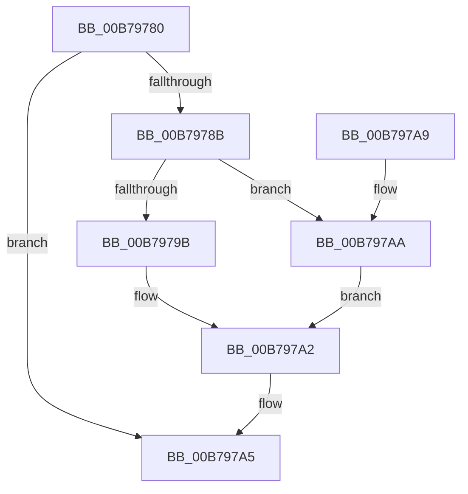

# PopQpcTimeInMs

- RVA: `0x00B79780`–`0x00B797D5` (길이 `85` bytes)
- VA: `0x0000000140B79780`
- 실행 섹션: `PAGELK`
- PDB 이름 있음: `예`; PDB Function 태그: `아니요`
- unwind 정보 RVA: `0x000DB714`
- 디코드: `25`개 명령, `85/85` bytes 표시
- 미해석 바이트: `0` (있으면 어셈블리에 `.byte`로 보존)

> 이 문서는 커널 이미지의 기계어와 PDB 기호를 분석해 생성했습니다. 4번과 5번은 함수 원형과 자료형을 바이너리 사용 방식에서 추정한 C 해석이며 원본 소스 복구 결과는 아닙니다.

## 1. Dependencies

- 직접 호출 지점: **0**; 고유 호출 대상: **0**
- 직접 호출자로 확인된 함수: **6**
- RIP 상대 이미지 참조: **1**

### Outgoing calls
- 직접 디코드된 call 명령이 없습니다.

### Direct callers
- [PopWriteBsdPoInfo](../../text/43/PopWriteBsdPoInfo_function_00430768.md) at `0x00430857`
- [PopPowerTransitionTimesInMs](../../text/4B/PopPowerTransitionTimesInMs_function_004B5C18.md) at `0x004B5C60`
- [PopPowerTransitionTimesInMs](../../text/4B/PopPowerTransitionTimesInMs_function_004B5C18.md) at `0x004B5C7B`
- [PopPowerTransitionTimesInMs](../../text/4B/PopPowerTransitionTimesInMs_function_004B5C18.md) at `0x004B5C9E`
- [PopDiagTraceHiberStats](../../page/A7/PopDiagTraceHiberStats_function_00A72FB4.md) at `0x00A7305B`
- [PopDiagTraceHiberStats](../../page/A7/PopDiagTraceHiberStats_function_00A72FB4.md) at `0x00A73074`
- [PopDiagTraceHiberStats](../../page/A7/PopDiagTraceHiberStats_function_00A72FB4.md) at `0x00A7333A`
- [PopDiagTracePerfTrackData](../../page/A7/PopDiagTracePerfTrackData_function_00A733CC.md) at `0x00A7345A`
- [PopDiagTracePerfTrackData](../../page/A7/PopDiagTracePerfTrackData_function_00A733CC.md) at `0x00A73470`
- [PopDiagTracePerfTrackData](../../page/A7/PopDiagTracePerfTrackData_function_00A733CC.md) at `0x00A734E7`
- [PopDiagTracePerfTrackData](../../page/A7/PopDiagTracePerfTrackData_function_00A733CC.md) at `0x00A73526`
- [sub_00B4042A](../../page/B4/Unknown_function_00B4042A.md) at `0x00B40439`
- [sub_00B4042A](../../page/B4/Unknown_function_00B4042A.md) at `0x00B40450`
- [PopTransitionSystemPowerStateEx](PopTransitionSystemPowerStateEx_function_00B7E8C0.md) at `0x00B7EEA4`

### Static image references
- `0x00B7979B` → RVA `0x00FC6BE0` (`ALMOSTRO`; read)

## 2. Other-region calls and transfers

- 다른 실행 섹션으로 향하는 call: **0**
- 별도 외부 분기/꼬리 이동을 확인하지 못했습니다.

## 3. Assembly (complete function range)

```asm
00B79780  4C 8B 0A                        mov r9, qword ptr [rdx]
00B79783  45 33 C0                        xor r8d, r8d
00B79786  4D 85 C9                        test r9, r9
00B79789  74 1A                           je 0x140b797a5
00B7978B  4C 2B 09                        sub r9, qword ptr [rcx]
00B7978E  B8 E8 03 00 00                  mov eax, 0x3e8
00B79793  49 F7 E1                        mul r9
00B79796  48 85 D2                        test rdx, rdx
00B79799  75 0F                           jne 0x140b797aa
00B7979B  48 F7 35 3E D4 44 00            div qword ptr [rip + 0x44d43e]
00B797A2  44 8B C0                        mov r8d, eax
00B797A5  41 8B C0                        mov eax, r8d
00B797A8  C3                              ret
00B797A9  CC                              int3
00B797AA  48 8B 0D 2F D4 44 00            mov rcx, qword ptr [rip + 0x44d42f]
00B797B1  48 B8 77 BE 9F 1A 2F DD 24 06   movabs rax, 0x624dd2f1a9fbe77
00B797BB  48 F7 E1                        mul rcx
00B797BE  49 8B C1                        mov rax, r9
00B797C1  48 2B CA                        sub rcx, rdx
00B797C4  48 D1 E9                        shr rcx, 1
00B797C7  48 03 CA                        add rcx, rdx
00B797CA  33 D2                           xor edx, edx
00B797CC  48 C1 E9 09                     shr rcx, 9
00B797D0  48 F7 F1                        div rcx
00B797D3  EB CD                           jmp 0x140b797a2
```

## 4. C-style interpretation (structured pseudocode)

```c
__int64 __fastcall PopQpcTimeInMs(__int64 a1, __int64 a2, int a3)
{
    a3 = 0;
    if (*(unsigned __int64 *)(a2) == 0) goto loc_00B797A5;
    a4 = (*(unsigned __int64 *)(a2)) - (*(unsigned __int64 *)(a1));
    if (a2 != 0) goto loc_00B797AA;
loc_00B797A2:
loc_00B797A5:
    return 1000;
loc_00B797AA:
    a1 = (*(unsigned __int64 *)(v_rip + 4510767)) - (a2);
    a1 = (a1) >> (1);
    a1 = (a1) + (a2);
    a2 = 0;
    a1 = (a1) >> (9);
    goto loc_00B797A2;
}
```

## 5. (Beta) C Style

```c
int64_t PopQpcTimeInMs(void *Arg1, void *Arg2, int32_t Arg3)
{
    uint8_t *arg1 = (uint8_t *)Arg1;
    uint8_t *arg2 = (uint8_t *)Arg2;

    Arg3 = 0;
    if (*(uint64_t *)(arg2) == 0) goto loc_00B797A5;
    a4 = (*(uint64_t *)(arg2)) - (*(uint64_t *)(arg1));
    if (Arg2 != NULL) goto loc_00B797AA;
loc_00B797A2:
loc_00B797A5:
    return 1000;
loc_00B797AA:
    Arg1 = (*(uint64_t *)(v_rip + 0x44D42F)) - (Arg2);
    Arg1 = (Arg1) >> (1);
    Arg1 = (Arg1) + (Arg2);
    Arg2 = 0;
    Arg1 = (Arg1) >> (9);
    goto loc_00B797A2;
}
```

### 관측된 메모리 오프셋

구조체 형식이 확인되지 않은 접근은 인자 기준의 오프셋으로만 기록했습니다.

| 기준 인자 | 오프셋 표현 | 폭 (bit) | 접근 |
|---|---:|---:|---|
| `Arg1` | `+ 0x0` | `64` | `R` |
| `Arg2` | `+ 0x0` | `64` | `R` |

## 6. Execution-region graph

[열기: 2D/3D 그래프와 함수 탐색 컨트롤 패널](../../../control-panel.html?section=pagelk&rva=0x00B79780&view=graph)

- 2D 그래프는 위에서 아래로 흐르고, 3D 그래프는 빈 공간을 드래그해 회전합니다. Shift+드래그는 이동, 휠은 확대·축소, 함수 노드 선택은 대상 보고서 이동입니다.

### Static fallback


