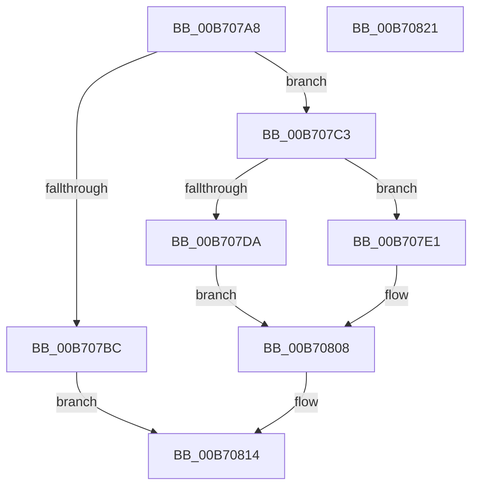

# PopQueryLastStateTransitionInfo

- RVA: `0x00B707A8`–`0x00B70822` (길이 `122` bytes)
- VA: `0x0000000140B707A8`
- 실행 섹션: `PAGELK`
- PDB 이름 있음: `예`; PDB Function 태그: `아니요`
- unwind 정보 RVA: `0x0005CAAC`
- 디코드: `33`개 명령, `122/122` bytes 표시
- 미해석 바이트: `0` (있으면 어셈블리에 `.byte`로 보존)

> 이 문서는 커널 이미지의 기계어와 PDB 기호를 분석해 생성했습니다. 4번과 5번은 함수 원형과 자료형을 바이너리 사용 방식에서 추정한 C 해석이며 원본 소스 복구 결과는 아닙니다.

## 1. Dependencies

- 직접 호출 지점: **2**; 고유 호출 대상: **2**
- 직접 호출자로 확인된 함수: **1**
- RIP 상대 이미지 참조: **3**

### Outgoing calls
- `0x00B707CA` → [PopAcquireRwLockShared](../../text/2D/PopAcquireRwLockShared_function_002D9A40.md) (function, `0x002D9A40`)
- `0x00B7080F` → [PopReleaseRwLock](../../text/2D/PopReleaseRwLock_function_002DFBBC.md) (function, `0x002DFBBC`)

### Direct callers
- [PopStateTransitionTimeoutDispatch](../../text/5D/PopStateTransitionTimeoutDispatch_function_005D51F0.md) at `0x005D526F`

### Static image references
- `0x00B707C3` → RVA `0x00F0DD88` (`.data`; read)
- `0x00B707CF` → RVA `0x00F0DD80` (`.data`; read)
- `0x00B707E8` → RVA `0x00F0D180` (`.data`; read)

## 2. Other-region calls and transfers

- 다른 실행 섹션으로 향하는 call: **2**
  - `0x00B707CA` → [PopAcquireRwLockShared](../../text/2D/PopAcquireRwLockShared_function_002D9A40.md) (`PAGELK` → `.text`)
  - `0x00B7080F` → [PopReleaseRwLock](../../text/2D/PopReleaseRwLock_function_002DFBBC.md) (`PAGELK` → `.text`)
- 별도 외부 분기/꼬리 이동을 확인하지 못했습니다.

## 3. Assembly (complete function range)

```asm
00B707A8  48 89 5C 24 08                  mov qword ptr [rsp + 8], rbx
00B707AD  57                              push rdi
00B707AE  48 83 EC 20                     sub rsp, 0x20
00B707B2  33 DB                           xor ebx, ebx
00B707B4  48 8B F9                        mov rdi, rcx
00B707B7  48 85 C9                        test rcx, rcx
00B707BA  75 07                           jne 0x140b707c3
00B707BC  BB 0D 00 00 C0                  mov ebx, 0xc000000d
00B707C1  EB 51                           jmp 0x140b70814
00B707C3  48 8D 0D BE D5 39 00            lea rcx, [rip + 0x39d5be]
00B707CA  E8 71 92 76 FF                  call 0x1402d9a40
00B707CF  8B 05 AB D5 39 00               mov eax, dword ptr [rip + 0x39d5ab]
00B707D5  83 F8 FF                        cmp eax, -1
00B707D8  75 07                           jne 0x140b707e1
00B707DA  BB 01 00 00 C0                  mov ebx, 0xc0000001
00B707DF  EB 27                           jmp 0x140b70808
00B707E1  48 8D 14 40                     lea rdx, [rax + rax*2]
00B707E5  48 03 D2                        add rdx, rdx
00B707E8  48 8D 05 91 C9 39 00            lea rax, [rip + 0x39c991]
00B707EF  0F 10 04 D0                     movups xmm0, xmmword ptr [rax + rdx*8]
00B707F3  0F 11 07                        movups xmmword ptr [rdi], xmm0
00B707F6  0F 10 4C D0 10                  movups xmm1, xmmword ptr [rax + rdx*8 + 0x10]
00B707FB  0F 11 4F 10                     movups xmmword ptr [rdi + 0x10], xmm1
00B707FF  0F 10 44 D0 20                  movups xmm0, xmmword ptr [rax + rdx*8 + 0x20]
00B70804  0F 11 47 20                     movups xmmword ptr [rdi + 0x20], xmm0
00B70808  48 8D 0D 79 D5 39 00            lea rcx, [rip + 0x39d579]
00B7080F  E8 A8 F3 76 FF                  call 0x1402dfbbc
00B70814  8B C3                           mov eax, ebx
00B70816  48 8B 5C 24 30                  mov rbx, qword ptr [rsp + 0x30]
00B7081B  48 83 C4 20                     add rsp, 0x20
00B7081F  5F                              pop rdi
00B70820  C3                              ret
00B70821  CC                              int3
```

## 4. C-style interpretation (structured pseudocode)

```c
__int64 __fastcall PopQueryLastStateTransitionInfo(__int64 a1)
{
    __int64 result;
    __int64 v_rbx;
    __int64 v_rsp;
    unsigned __int64 v_stack_p8;

    v_stack_p8 = v_rbx;
    v_rsp = (v_rsp) - (32);
    v_rbx = 0;
    if (a1 != 0) goto loc_00B707C3;
    goto loc_00B70814;
loc_00B707C3:
    result = PopAcquireRwLockShared(v_rip + 3790270, a2, a3, a4);
    if (((unsigned int)((unsigned int)(*(unsigned int *)(v_rip + 3790251)))) != -1) goto loc_00B707E1;
    goto loc_00B70808;
loc_00B707E1:
    a2 = ((unsigned int)(*(unsigned int *)(v_rip + 3790251)) + (unsigned int)(*(unsigned int *)(v_rip + 3790251)) * 2) + ((unsigned int)(*(unsigned int *)(v_rip + 3790251)) + (unsigned int)(*(unsigned int *)(v_rip + 3790251)) * 2);
    *(unsigned __int64 *)(a1) = v_xmm0;
    *(unsigned __int64 *)(a1 + 16) = v_xmm1;
    *(unsigned __int64 *)(a1 + 32) = v_xmm0;
loc_00B70808:
    result = PopReleaseRwLock(v_rip + 3790201, a2, a3, a4);
loc_00B70814:
    v_rsp = (v_rsp) + (32);
    return (unsigned int)((unsigned int)((unsigned int)(0xC0000001ULL)));
}
```

## 5. (Beta) C Style

```c
int64_t PopQueryLastStateTransitionInfo(void *Arg1)
{
    uint8_t *arg1 = (uint8_t *)Arg1;

    int64_t result;
    int64_t local_rbx;
    int64_t local_rsp;
    uint64_t v_stack_p8;

    v_stack_p8 = local_rbx;
    local_rsp = (local_rsp) - (32);
    local_rbx = 0;
    if (Arg1 != NULL) goto loc_00B707C3;
    goto loc_00B70814;
loc_00B707C3:
    result = PopAcquireRwLockShared(v_rip + 3790270, a2, a3, a4);
    if (((uint32_t)((uint32_t)(*(uint32_t *)(v_rip + 0x39D5AB)))) != -1) goto loc_00B707E1;
    goto loc_00B70808;
loc_00B707E1:
    a2 = ((uint32_t)(*(uint32_t *)(v_rip + 0x39D5AB)) + (uint32_t)(*(uint32_t *)(v_rip + 0x39D5AB)) * 2) + ((uint32_t)(*(uint32_t *)(v_rip + 0x39D5AB)) + (uint32_t)(*(uint32_t *)(v_rip + 0x39D5AB)) * 2);
    *(uint64_t *)(arg1) = v_xmm0;
    *(uint64_t *)(arg1 + 0x10) = v_xmm1;
    *(uint64_t *)(arg1 + 0x20) = v_xmm0;
loc_00B70808:
    result = PopReleaseRwLock(v_rip + 3790201, a2, a3, a4);
loc_00B70814:
    local_rsp = (local_rsp) + (32);
    return (uint32_t)((uint32_t)((uint32_t)(0xC0000001ULL)));
}
```

### 관측된 메모리 오프셋

구조체 형식이 확인되지 않은 접근은 인자 기준의 오프셋으로만 기록했습니다.

| 기준 인자 | 오프셋 표현 | 폭 (bit) | 접근 |
|---|---:|---:|---|
| `Arg1` | `+ 0x0` | `128` | `R` |
| `Arg1` | `+ 0x10` | `128` | `R` |
| `Arg1` | `+ 0x20` | `128` | `R` |

## 6. Execution-region graph

[열기: 2D/3D 그래프와 함수 탐색 컨트롤 패널](../../../control-panel.html?section=pagelk&rva=0x00B707A8&view=graph)

- 2D 그래프는 위에서 아래로 흐르고, 3D 그래프는 빈 공간을 드래그해 회전합니다. Shift+드래그는 이동, 휠은 확대·축소, 함수 노드 선택은 대상 보고서 이동입니다.

### Static fallback


