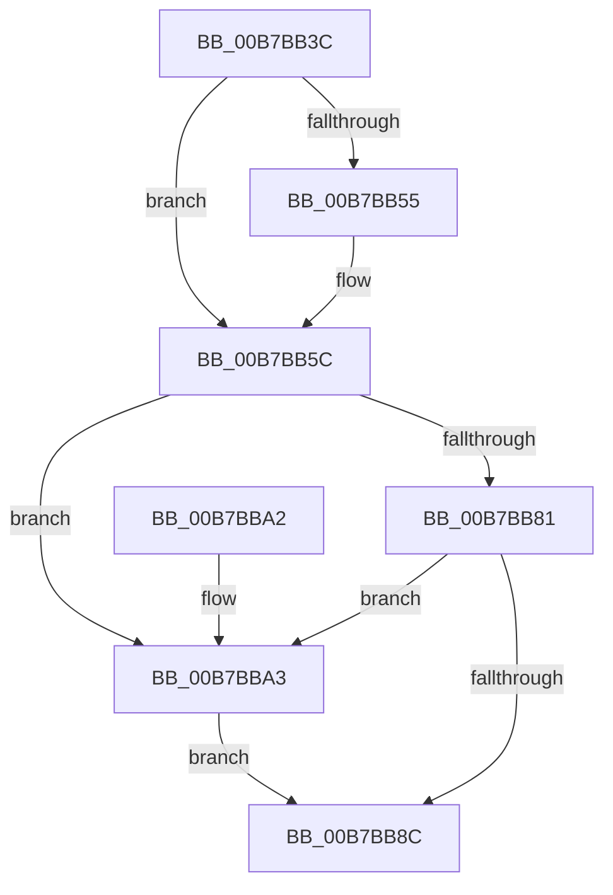

# PopReleaseAwaymodeLock

- RVA: `0x00B7BB3C`–`0x00B7BBB1` (길이 `117` bytes)
- VA: `0x0000000140B7BB3C`
- 실행 섹션: `PAGELK`
- PDB 이름 있음: `예`; PDB Function 태그: `아니요`
- unwind 정보 RVA: `0x00064C74`
- 디코드: `26`개 명령, `117/117` bytes 표시
- 미해석 바이트: `0` (있으면 어셈블리에 `.byte`로 보존)

> 이 문서는 커널 이미지의 기계어와 PDB 기호를 분석해 생성했습니다. 4번과 5번은 함수 원형과 자료형을 바이너리 사용 방식에서 추정한 C 해석이며 원본 소스 복구 결과는 아닙니다.

## 1. Dependencies

- 직접 호출 지점: **3**; 고유 호출 대상: **3**
- 직접 호출자로 확인된 함수: **2**
- RIP 상대 이미지 참조: **3**

### Outgoing calls
- `0x00B7BB93` → [KeAbPostRelease](../../text/2E/KeAbPostRelease_function_002E1600.md) (function, `0x002E1600`)
- `0x00B7BB98` → [KeLeaveCriticalRegion](../../text/25/KeLeaveCriticalRegion_function_0025D8B0.md) (function, `0x0025D8B0`)
- `0x00B7BBAA` → [ExfReleasePushLock](../../text/26/ExfReleasePushLock_function_002638D0.md) (function, `0x002638D0`)

### Direct callers
- [PopIssueActionRequest](../../page/A9/PopIssueActionRequest_function_00A9CE54.md) at `0x00A9CF17`
- [PopIssueActionRequest](../../page/A9/PopIssueActionRequest_function_00A9CE54.md) at `0x00A9CF23`
- [PopPowerRequestCallbackAwayModeRequired](../../page/AA/PopPowerRequestCallbackAwayModeRequired_function_00AACA00.md) at `0x00AACA14`

### Static image references
- `0x00B7BB4C` → RVA `0x00F0C8F0` (`.data`; read)
- `0x00B7BB55` → RVA `0x00F0C8F0` (`.data`; write)
- `0x00B7BB5C` → RVA `0x00F0CAD8` (`.data`; read)

## 2. Other-region calls and transfers

- 다른 실행 섹션으로 향하는 call: **3**
  - `0x00B7BB93` → [KeAbPostRelease](../../text/2E/KeAbPostRelease_function_002E1600.md) (`PAGELK` → `.text`)
  - `0x00B7BB98` → [KeLeaveCriticalRegion](../../text/25/KeLeaveCriticalRegion_function_0025D8B0.md) (`PAGELK` → `.text`)
  - `0x00B7BBAA` → [ExfReleasePushLock](../../text/26/ExfReleasePushLock_function_002638D0.md) (`PAGELK` → `.text`)
- 별도 외부 분기/꼬리 이동을 확인하지 못했습니다.

## 3. Assembly (complete function range)

```asm
00B7BB3C  48 83 EC 28                     sub rsp, 0x28
00B7BB40  65 48 8B 04 25 88 01 00 00      mov rax, qword ptr gs:[0x188]
00B7BB49  45 33 C0                        xor r8d, r8d
00B7BB4C  48 39 05 9D 0D 39 00            cmp qword ptr [rip + 0x390d9d], rax
00B7BB53  75 07                           jne 0x140b7bb5c
00B7BB55  4C 89 05 94 0D 39 00            mov qword ptr [rip + 0x390d94], r8
00B7BB5C  0F 0D 0D 75 0F 39 00            prefetchw byte ptr [rip + 0x390f75]
00B7BB63  48 8B 05 6E 0F 39 00            mov rax, qword ptr [rip + 0x390f6e]
00B7BB6A  48 8B C8                        mov rcx, rax
00B7BB6D  48 83 E1 F0                     and rcx, 0xfffffffffffffff0
00B7BB71  48 83 F9 10                     cmp rcx, 0x10
00B7BB75  48 8D 50 F0                     lea rdx, [rax - 0x10]
00B7BB79  49 0F 46 D0                     cmovbe rdx, r8
00B7BB7D  A8 02                           test al, 2
00B7BB7F  75 22                           jne 0x140b7bba3
00B7BB81  F0 48 0F B1 15 4E 0F 39 00      lock cmpxchg qword ptr [rip + 0x390f4e], rdx
00B7BB8A  75 17                           jne 0x140b7bba3
00B7BB8C  48 8D 0D 45 0F 39 00            lea rcx, [rip + 0x390f45]
00B7BB93  E8 68 5A 76 FF                  call 0x1402e1600
00B7BB98  E8 13 1D 6E FF                  call 0x14025d8b0
00B7BB9D  48 83 C4 28                     add rsp, 0x28
00B7BBA1  C3                              ret
00B7BBA2  CC                              int3
00B7BBA3  48 8D 0D 2E 0F 39 00            lea rcx, [rip + 0x390f2e]
00B7BBAA  E8 21 7D 6E FF                  call 0x1402638d0
00B7BBAF  EB DB                           jmp 0x140b7bb8c
```

## 4. C-style interpretation (structured pseudocode)

```c
__int64 __fastcall PopReleaseAwaymodeLock(__int64 a1, __int64 a2, int a3)
{
    __int64 result;
    __int64 v_rsp;

    v_rsp = (v_rsp) - (40);
    a3 = 0;
    if ((*(unsigned __int64 *)(v_rip + 3739037)) == (*(unsigned __int64 *)(gs_base + (0 + 392)))) {
        *(unsigned __int64 *)(v_rip + 3739028) = 0;
    }
    a1 = (*(unsigned __int64 *)(v_rip + 3739502)) & (-16);
    a2 = *(unsigned __int64 *)(v_rip + 3739502) - 16;
    if (a1 <= 16) { a2 = 0; }
    if ((((unsigned __int8)(*(unsigned __int64 *)(v_rip + 3739502))) & (2)) != 0) goto loc_00B7BBA3;
    if ((((unsigned __int8)(*(unsigned __int64 *)(v_rip + 3739502))) & (2)) != 0) goto loc_00B7BBA3;
loc_00B7BB8C:
    result = KeAbPostRelease(v_rip + 3739461, a2, a3, a4);
    result = KeLeaveCriticalRegion(v_rip + 3739461, a2, a3, a4);
    v_rsp = (v_rsp) + (40);
    return result;
loc_00B7BBA3:
    result = ExfReleasePushLock(v_rip + 3739438, a2, a3, a4);
    goto loc_00B7BB8C;
}
```

## 5. (Beta) C Style

```c
int64_t PopReleaseAwaymodeLock(int64_t Arg1, int64_t Arg2, int32_t Arg3)
{
    int64_t result;
    int64_t local_rsp;

    local_rsp = (local_rsp) - (40);
    Arg3 = 0;
    if ((*(uint64_t *)(v_rip + 0x390D9D)) == (*(uint64_t *)(gs_base + (0 + 0x188)))) {
        *(uint64_t *)(v_rip + 0x390D94) = 0;
    }
    Arg1 = (*(uint64_t *)(v_rip + 0x390F6E)) & (-16);
    Arg2 = *(uint64_t *)(v_rip + 0x390F6E) - 16;
    if (Arg1 <= 16) { Arg2 = 0; }
    if ((((uint8_t)(*(uint64_t *)(v_rip + 0x390F6E))) & (2)) != 0) goto loc_00B7BBA3;
    if ((((uint8_t)(*(uint64_t *)(v_rip + 0x390F6E))) & (2)) != 0) goto loc_00B7BBA3;
loc_00B7BB8C:
    result = KeAbPostRelease(v_rip + 3739461, Arg2, Arg3, a4);
    result = KeLeaveCriticalRegion(v_rip + 3739461, Arg2, Arg3, a4);
    local_rsp = (local_rsp) + (40);
    return result;
loc_00B7BBA3:
    result = ExfReleasePushLock(v_rip + 3739438, Arg2, Arg3, a4);
    goto loc_00B7BB8C;
}
```

## 6. Execution-region graph

[열기: 2D/3D 그래프와 함수 탐색 컨트롤 패널](../../../control-panel.html?section=pagelk&rva=0x00B7BB3C&view=graph)

- 2D 그래프는 위에서 아래로 흐르고, 3D 그래프는 빈 공간을 드래그해 회전합니다. Shift+드래그는 이동, 휠은 확대·축소, 함수 노드 선택은 대상 보고서 이동입니다.

### Static fallback


