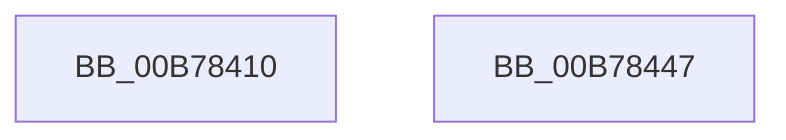

# PopReleasePolicyLock

- RVA: `0x00B78410`–`0x00B78448` (길이 `56` bytes)
- VA: `0x0000000140B78410`
- 실행 섹션: `PAGELK`
- PDB 이름 있음: `예`; PDB Function 태그: `아니요`
- unwind 정보 RVA: `0x0005C788`
- 디코드: `12`개 명령, `56/56` bytes 표시
- 미해석 바이트: `0` (있으면 어셈블리에 `.byte`로 보존)

> 이 문서는 커널 이미지의 기계어와 PDB 기호를 분석해 생성했습니다. 4번과 5번은 함수 원형과 자료형을 바이너리 사용 방식에서 추정한 C 해석이며 원본 소스 복구 결과는 아닙니다.

## 1. Dependencies

- 직접 호출 지점: **4**; 고유 호출 대상: **4**
- 직접 호출자로 확인된 함수: **104**
- RIP 상대 이미지 참조: **2**

### Outgoing calls
- `0x00B78423` → [ExReleaseResourceLite](../../text/25/ExReleaseResourceLite_function_0025FA10.md) (function, `0x0025FA10`)
- `0x00B78428` → [PopCheckForWork](../../text/48/PopCheckForWork_function_00482CAC.md) (function, `0x00482CAC`)
- `0x00B7842D` → [KeLeaveCriticalRegion](../../text/25/KeLeaveCriticalRegion_function_0025D8B0.md) (function, `0x0025D8B0`)
- `0x00B7843D` → [PsBoostThreadIo](../../text/39/PsBoostThreadIo_function_003927C0.md) (function, `0x003927C0`)

### Direct callers
- [PopCaptureSleepStudyStatistics](../../text/43/PopCaptureSleepStudyStatistics_function_004399F4.md) at `0x00439FEF`
- [PoSetUserPresent](../../text/48/PoSetUserPresent_function_004829A0.md) at `0x00482A36`
- [PoSetSystemState](../../text/48/PoSetSystemState_function_00482A50.md) at `0x00482A89`
- [PopUserPresentSetWorker](../../text/49/PopUserPresentSetWorker_function_0049D4F0.md) at `0x0049D5F8`
- [PopCheckAndHandleThermalConditions](../../text/4A/PopCheckAndHandleThermalConditions_function_004A8C00.md) at `0x004A8CD5`
- [PopVideoBrightnessSettingsCallback](../../text/4B/PopVideoBrightnessSettingsCallback_function_004B3290.md) at `0x004B332C`
- [PopNetEvaluationWorkerCallback](../../text/4B/PopNetEvaluationWorkerCallback_function_004BE0B0.md) at `0x004BE159`
- [PopPowerSourceChangeCallback](../../text/4C/PopPowerSourceChangeCallback_function_004C3A60.md) at `0x004C3C48`
- [PopVideoPowerSettingCallback](../../text/4C/PopVideoPowerSettingCallback_function_004C9F50.md) at `0x004CA055`
- [PdcPoLowPower](../../text/4D/PdcPoLowPower_function_004D3F20.md) at `0x004D3F46`
- [PopSwitchForcedShutdownSettingCallback](../../text/5D/PopSwitchForcedShutdownSettingCallback_function_005D1350.md) at `0x005D13A9`
- [PdcPoCurrentPdcPhase](../../text/5D/PdcPoCurrentPdcPhase_function_005D9E70.md) at `0x005D9F63`
- [PopPowerAggregatorNotifyAcDcStateChange](../../page/6F/PopPowerAggregatorNotifyAcDcStateChange_function_006FE41C.md) at `0x006FE44C`
- [PopPowerAggregatorDisengageAggressiveStandbyActions](../../page/6F/PopPowerAggregatorDisengageAggressiveStandbyActions_function_006FEB30.md) at `0x006FEB92`
- [PopPdcRegister](../../page/70/PopPdcRegister_function_00704AD0.md) at `0x00704C92`
- [PopPdcRegister](../../page/70/PopPdcRegister_function_00704AD0.md) at `0x00704CA7`
- [PoInitHiberServices](../../page/75/PoInitHiberServices_function_007537C4.md) at `0x00753830`
- [PopUpdateUpgradeInProgress](../../page/75/PopUpdateUpgradeInProgress_function_00754880.md) at `0x00754A07`
- [PopAllowAwayModeSettingCallback](../../page/75/PopAllowAwayModeSettingCallback_function_00758000.md) at `0x0075807A`
- [PopBatteryAlarmPowerSettingCallback](../../page/75/PopBatteryAlarmPowerSettingCallback_function_007580A0.md) at `0x007580B9`
- [PopConsoleLockPowerSettingCallback](../../page/75/PopConsoleLockPowerSettingCallback_function_007580D0.md) at `0x007581D2`
- [PopPowerButtonSettingCallback](../../page/75/PopPowerButtonSettingCallback_function_00758340.md) at `0x007584EC`
- [PopWnfUserAwayPredictionCallback](../../page/75/PopWnfUserAwayPredictionCallback_function_00758640.md) at `0x0075868A`
- [PopCoalescingNotify](../../page/75/PopCoalescingNotify_function_0075C0E0.md) at `0x0075C140`
- [PopCoalescingPowerSettingCallback](../../page/75/PopCoalescingPowerSettingCallback_function_0075C170.md) at `0x0075C1E7`
- [PopWnfHibernatePolicyCallback](../../page/75/PopWnfHibernatePolicyCallback_function_0075E3C0.md) at `0x0075E411`
- [PopSwitchUpdateUserShutdownScenarioState](../../page/75/PopSwitchUpdateUserShutdownScenarioState_function_0075F260.md) at `0x0075F2B4`
- [PopSwitchUpdateUserShutdownScenarioState](../../page/75/PopSwitchUpdateUserShutdownScenarioState_function_0075F260.md) at `0x0075F39C`
- [PopThermalStateTransitionWorker](../../page/75/PopThermalStateTransitionWorker_function_0075F820.md) at `0x0075F946`
- [PopThermalZoneAdd](../../page/75/PopThermalZoneAdd_function_0075F980.md) at `0x0075FA9D`
- [PopThermalZoneRemove](../../page/75/PopThermalZoneRemove_function_0075FAD0.md) at `0x0075FBF2`
- [PopUpdateOverThrottledCount](../../page/75/PopUpdateOverThrottledCount_function_0075FC24.md) at `0x0075FC90`
- [NtInitiatePowerAction](../../page/75/NtInitiatePowerAction_function_0075FCB0.md) at `0x0075FEA4`
- [NtInitiatePowerAction](../../page/75/NtInitiatePowerAction_function_0075FCB0.md) at `0x0075FF28`
- [PopDiagTracePreSleepNotification](../../page/76/PopDiagTracePreSleepNotification_function_00762BE4.md) at `0x00762CF8`
- [PopPreCriticalBatteryNotify](../../page/76/PopPreCriticalBatteryNotify_function_007639C0.md) at `0x007639D3`
- [PopPowerAggregatorDozeTimerWorker](../../page/76/PopPowerAggregatorDozeTimerWorker_function_00764490.md) at `0x007645CE`
- [PopPowerAggregatorEngageAggressiveStandbyActions](../../page/76/PopPowerAggregatorEngageAggressiveStandbyActions_function_0076460C.md) at `0x00764759`
- [PopPowerAggregatorNotifyPdcPhaseState](../../page/76/PopPowerAggregatorNotifyPdcPhaseState_function_00764C54.md) at `0x00764D5D`
- [PopPowerAggregatorScreenOffEnterStateHandler](../../page/76/PopPowerAggregatorScreenOffEnterStateHandler_function_00764E90.md) at `0x00764F86`
- [PopDeepSleepPowerSettingCallback](../../page/76/PopDeepSleepPowerSettingCallback_function_00765360.md) at `0x007653AA`
- [PopEvaluateInputSuppressionAction](../../page/76/PopEvaluateInputSuppressionAction_function_00765454.md) at `0x00765573`
- [PopUsb4DisplayPresenceUpdatedWorker](../../page/76/PopUsb4DisplayPresenceUpdatedWorker_function_00765690.md) at `0x007656A1`
- [PopUsb4DisplayPresenceUpdatedWorker](../../page/76/PopUsb4DisplayPresenceUpdatedWorker_function_00765690.md) at `0x007656CD`
- [PopWnfUsb4DisplayPresenceCallback](../../page/76/PopWnfUsb4DisplayPresenceCallback_function_007656E0.md) at `0x007657A1`
- [PopWnfUsb4DisplayPresenceCallback](../../page/76/PopWnfUsb4DisplayPresenceCallback_function_007656E0.md) at `0x007657C7`
- [PopNotifyPolicyDevice](../../page/76/PopNotifyPolicyDevice_function_00765FF0.md) at `0x00766058`
- [PopPolicyDeviceHandleWakeAlarmNotification](../../page/76/PopPolicyDeviceHandleWakeAlarmNotification_function_007660A4.md) at `0x007663D9`
- [PopBatteryAdd](../../page/76/PopBatteryAdd_function_00766580.md) at `0x007665CE`
- [PopBatteryRemove](../../page/76/PopBatteryRemove_function_00766D40.md) at `0x00766DEA`
- [PopBatteryUpdateTestExempt](../../page/76/PopBatteryUpdateTestExempt_function_00766F54.md) at `0x00767166`
- [PopBatteryUpdateTestExempt](../../page/76/PopBatteryUpdateTestExempt_function_00766F54.md) at `0x0076723A`
- [PopIdleAoAcDozeToS4](../../page/76/PopIdleAoAcDozeToS4_function_00768790.md) at `0x00768848`
- [PopNetConnectivityInStandbyCallback](../../page/76/PopNetConnectivityInStandbyCallback_function_00768A90.md) at `0x00768AB7`
- [PopNetDisconnectedStandbyModeCallback](../../page/76/PopNetDisconnectedStandbyModeCallback_function_00768B40.md) at `0x00768B67`
- [PopNetRefreshTimerWorkerCallback](../../page/76/PopNetRefreshTimerWorkerCallback_function_00768D10.md) at `0x00768DC4`
- [PopNetResiliencyPhaseStateChanged](../../page/76/PopNetResiliencyPhaseStateChanged_function_00768DD8.md) at `0x00768E77`
- [PdcPoNetworkResiliency](../../page/76/PdcPoNetworkResiliency_function_007693A0.md) at `0x007693B4`
- [PdcPoReportButton](../../page/76/PdcPoReportButton_function_007694A0.md) at `0x00769507`
- [PdcPoSetPowerAction](../../page/76/PdcPoSetPowerAction_function_00769520.md) at `0x0076955C`
- [PdcPoVerifyActionPolicy](../../page/76/PdcPoVerifyActionPolicy_function_00769580.md) at `0x00769596`
- [PdcPoVerifyPowerState](../../page/76/PdcPoVerifyPowerState_function_007695B0.md) at `0x007695CE`
- [PoTtmInitiatePowerStateTransition](../../page/76/PoTtmInitiatePowerStateTransition_function_007695E8.md) at `0x007696BE`
- [PopMonitorInvocation](../../page/76/PopMonitorInvocation_function_00769710.md) at `0x0076979A`
- [PopAdaptiveUpdateIdleContextWorker](../../page/76/PopAdaptiveUpdateIdleContextWorker_function_0076BA80.md) at `0x0076BA93`
- [PopUpdateExternalDisplayState](../../page/76/PopUpdateExternalDisplayState_function_0076C0DC.md) at `0x0076C11F`
- [PopDripsWatchdogCallbackWorker](../../page/76/PopDripsWatchdogCallbackWorker_function_0076C360.md) at `0x0076C4BC`
- [PopDripsWatchdogCallbackWorker](../../page/76/PopDripsWatchdogCallbackWorker_function_0076C360.md) at `0x0076C4EC`
- [PopAdaptiveStandbyActionWorker](../../page/76/PopAdaptiveStandbyActionWorker_function_0076C9B0.md) at `0x0076CAAD`
- [PopWnfSprActiveSessionChangeCallback](../../page/90/PopWnfSprActiveSessionChangeCallback_function_0090C930.md) at `0x0090C9E5`
- [PopBatteryUpdateCompositeInformation](../../page/90/PopBatteryUpdateCompositeInformation_function_0090FDD0.md) at `0x0090FF0B`
- [PopSleepPowerSettingCallback](../../page/91/PopSleepPowerSettingCallback_function_009103E0.md) at `0x00910604`
- [NtPowerInformation](../../page/95/NtPowerInformation_function_00955D80.md) at `0x00956620`
- [NtPowerInformation](../../page/95/NtPowerInformation_function_00955D80.md) at `0x00956BCF`
- [NtPowerInformation](../../page/95/NtPowerInformation_function_00955D80.md) at `0x00956CD8`
- [NtPowerInformation](../../page/95/NtPowerInformation_function_00955D80.md) at `0x00956FE9`
- [NtPowerInformation](../../page/95/NtPowerInformation_function_00955D80.md) at `0x00957332`
- [NtPowerInformation](../../page/95/NtPowerInformation_function_00955D80.md) at `0x00957CCE`
- [PopPowerAggregatorEnterScreenOff](../../page/98/PopPowerAggregatorEnterScreenOff_function_00989F38.md) at `0x0098A083`
- [PdcPoResiliencyClient](../../page/A3/PdcPoResiliencyClient_function_00A314B0.md) at `0x00A314EE`
- [PopPdcIdleResiliencyCallback](../../page/A3/PopPdcIdleResiliencyCallback_function_00A31518.md) at `0x00A315E1`
- [PopPowerRequestCallbackExecutionRequired](../../page/A3/PopPowerRequestCallbackExecutionRequired_function_00A31660.md) at `0x00A316D5`
- [PopDiagTraceControlCallback](../../page/A3/PopDiagTraceControlCallback_function_00A38CB0.md) at `0x00A38DB4`
- [PopDiagTraceControlCallback](../../page/A3/PopDiagTraceControlCallback_function_00A38CB0.md) at `0x00A38E17`
- [PopNetWnfLowPowerEpochCallback](../../page/A4/PopNetWnfLowPowerEpochCallback_function_00A49FB0.md) at `0x00A4A0B4`
- [PopWnfAudioCallback](../../page/A4/PopWnfAudioCallback_function_00A4A0E0.md) at `0x00A4A1C2`
- [PopDirectedDripsInitializeBroadcast](../../page/A4/PopDirectedDripsInitializeBroadcast_function_00A4D634.md) at `0x00A4D84E`
- [PopS0LowPowerIdleInfo](../../page/A7/PopS0LowPowerIdleInfo_function_00A7C330.md) at `0x00A7C419`
- [PopPowerInformationInternal](../../page/A8/PopPowerInformationInternal_function_00A8B7C0.md) at `0x00A8BD17`
- [PopCoalescingCallbackWorker](../../page/A8/PopCoalescingCallbackWorker_function_00A8DA40.md) at `0x00A8DA5F`
- [PopCoalescingCallbackWorker](../../page/A8/PopCoalescingCallbackWorker_function_00A8DA40.md) at `0x00A8DA7A`
- [PopCoalescingCallbackWorker](../../page/A8/PopCoalescingCallbackWorker_function_00A8DA40.md) at `0x00A8DA8D`
- [PopCoalescingCallbackWorker](../../page/A8/PopCoalescingCallbackWorker_function_00A8DA40.md) at `0x00A8DAB4`
- [PopPolicyWorkerAction](../../page/A9/PopPolicyWorkerAction_function_00A9CC40.md) at `0x00A9CD19`
- [PopIssueActionRequest](../../page/A9/PopIssueActionRequest_function_00A9CE54.md) at `0x00A9CF03`
- [PopIssueActionRequest](../../page/A9/PopIssueActionRequest_function_00A9CE54.md) at `0x00A9CF75`
- [PopIssueActionRequest](../../page/A9/PopIssueActionRequest_function_00A9CE54.md) at `0x00A9D013`
- [PopIssueActionRequest](../../page/A9/PopIssueActionRequest_function_00A9CE54.md) at `0x00A9D1A0`
- [PopIssueActionRequest](../../page/A9/PopIssueActionRequest_function_00A9CE54.md) at `0x00A9D218`
- [PopIssueActionRequest](../../page/A9/PopIssueActionRequest_function_00A9CE54.md) at `0x00A9D237`
- [PopPdcCsDeviceNotification](../../page/AA/PopPdcCsDeviceNotification_function_00AA1B28.md) at `0x00AA1C69`
- [PopPdcUpdateDeviceCompliance](../../page/AA/PopPdcUpdateDeviceCompliance_function_00AA1CE4.md) at `0x00AA1D42`
- [PopExternalMonitorUpdatedWorker](../../page/AB/PopExternalMonitorUpdatedWorker_function_00AB0B20.md) at `0x00AB0B31`
- [PopExternalMonitorUpdatedWorker](../../page/AB/PopExternalMonitorUpdatedWorker_function_00AB0B20.md) at `0x00AB0B64`
- [PopUserPresencePredictionModeCallback](../../page/AB/PopUserPresencePredictionModeCallback_function_00AB0D20.md) at `0x00AB0D66`
- [PopHardDiskPowerSettingCallback](../../page/AB/PopHardDiskPowerSettingCallback_function_00AB6F60.md) at `0x00AB708E`
- [PopNetSetResiliencyPhaseBias](../../page/AB/PopNetSetResiliencyPhaseBias_function_00ABD9F0.md) at `0x00ABD9F8`
- [PopPolicyWorkerActionPromote](../../page/AB/PopPolicyWorkerActionPromote_function_00ABFE10.md) at `0x00ABFE9D`
- [NtSetThreadExecutionState](../../page/AC/NtSetThreadExecutionState_function_00AC0A40.md) at `0x00AC0BF5`
- [NtSetThreadExecutionState](../../page/AC/NtSetThreadExecutionState_function_00AC0A40.md) at `0x00AC0C28`
- [NtSetThreadExecutionState](../../page/AC/NtSetThreadExecutionState_function_00AC0A40.md) at `0x00AC0C8D`
- [NtSetThreadExecutionState](../../page/AC/NtSetThreadExecutionState_function_00AC0A40.md) at `0x00AC0CEE`
- [PdcPoReportLidState](../../page/AC/PdcPoReportLidState_function_00AC3480.md) at `0x00AC3494`
- [PopSleepstudyStartNextSession](../../page/AC/PopSleepstudyStartNextSession_function_00AC4720.md) at `0x00AC47D9`
- [PopRecordLidStateWorker](../../page/AC/PopRecordLidStateWorker_function_00ACD4D0.md) at `0x00ACD4FD`
- [PopIdleGlobalUserPresenceCallback](../../page/AD/PopIdleGlobalUserPresenceCallback_function_00AD89F0.md) at `0x00AD8A45`
- [PopSmartSuspendMakePredictions](../../page/AD/PopSmartSuspendMakePredictions_function_00AD9168.md) at `0x00AD925D`
- [PopIdleCsStateChanged](../../page/AD/PopIdleCsStateChanged_function_00AD9DE0.md) at `0x00AD9E4F`
- [PopNetUpdateStandbyRequest](../../page/AD/PopNetUpdateStandbyRequest_function_00ADB704.md) at `0x00ADB763`
- [PopBatteryApplyCompositeState](../../page/AE/PopBatteryApplyCompositeState_function_00AE0CD0.md) at `0x00AE0DE4`
- [PopBatteryApplyCompositeState](../../page/AE/PopBatteryApplyCompositeState_function_00AE0CD0.md) at `0x00AE1410`
- [PopBatteryWorker](../../page/AE/PopBatteryWorker_function_00AE1650.md) at `0x00AE1854`
- [PopRecalculateCBTriggerLevels](../../page/AE/PopRecalculateCBTriggerLevels_function_00AE3018.md) at `0x00AE3108`
- [NtSetSystemPowerState](NtSetSystemPowerState_function_00B70890.md) at `0x00B70A0F`
- [NtSetSystemPowerState](NtSetSystemPowerState_function_00B70890.md) at `0x00B70A57`
- [PopUnlockAfterSleepWorker](PopUnlockAfterSleepWorker_function_00B782A0.md) at `0x00B78374`
- [PopTransitionSystemPowerStateEx](PopTransitionSystemPowerStateEx_function_00B7E8C0.md) at `0x00B7EA8F`
- [PopTransitionSystemPowerStateEx](PopTransitionSystemPowerStateEx_function_00B7E8C0.md) at `0x00B7EC2D`
- [PopTransitionSystemPowerStateEx](PopTransitionSystemPowerStateEx_function_00B7E8C0.md) at `0x00B7EDAC`
- [PopTransitionSystemPowerStateEx](PopTransitionSystemPowerStateEx_function_00B7E8C0.md) at `0x00B7EE7A`
- [PopTransitionSystemPowerStateEx](PopTransitionSystemPowerStateEx_function_00B7E8C0.md) at `0x00B7F077`
- [PopTransitionSystemPowerStateEx](PopTransitionSystemPowerStateEx_function_00B7E8C0.md) at `0x00B7F88A`
- [PopTransitionSystemPowerStateEx](PopTransitionSystemPowerStateEx_function_00B7E8C0.md) at `0x00B7FB26`
- [PopInitPlatformSettings](../../init/C3/PopInitPlatformSettings_function_00C3D40C.md) at `0x00C3D4A0`
- [PopInitPlatformSettings](../../init/C3/PopInitPlatformSettings_function_00C3D40C.md) at `0x00C3D613`
- [PopInitPlatformSettings](../../init/C3/PopInitPlatformSettings_function_00C3D40C.md) at `0x00C3D61A`
- [PopPdcCsCheckSystemVolumeDevice](../../init/C4/PopPdcCsCheckSystemVolumeDevice_function_00C42D9C.md) at `0x00C42EF9`
- [PopWatchdogInit](../../init/C4/PopWatchdogInit_function_00C43330.md) at `0x00C433D2`
- [PoInitSystem](../../init/C7/PoInitSystem_function_00C72358.md) at `0x00C73146`
- [PoInitSystem](../../init/C7/PoInitSystem_function_00C72358.md) at `0x00C731B1`

### Static image references
- `0x00B78414` → RVA `0x00F0C8D0` (`.data`; read/write)
- `0x00B7841C` → RVA `0x00F0CAE0` (`.data`; read)

## 2. Other-region calls and transfers

- 다른 실행 섹션으로 향하는 call: **4**
  - `0x00B78423` → [ExReleaseResourceLite](../../text/25/ExReleaseResourceLite_function_0025FA10.md) (`PAGELK` → `.text`)
  - `0x00B78428` → [PopCheckForWork](../../text/48/PopCheckForWork_function_00482CAC.md) (`PAGELK` → `.text`)
  - `0x00B7842D` → [KeLeaveCriticalRegion](../../text/25/KeLeaveCriticalRegion_function_0025D8B0.md) (`PAGELK` → `.text`)
  - `0x00B7843D` → [PsBoostThreadIo](../../text/39/PsBoostThreadIo_function_003927C0.md) (`PAGELK` → `.text`)
- 별도 외부 분기/꼬리 이동을 확인하지 못했습니다.

## 3. Assembly (complete function range)

```asm
00B78410  48 83 EC 28                     sub rsp, 0x28
00B78414  48 83 25 B4 44 39 00 00         and qword ptr [rip + 0x3944b4], 0
00B7841C  48 8D 0D BD 46 39 00            lea rcx, [rip + 0x3946bd]
00B78423  E8 E8 75 6E FF                  call 0x14025fa10
00B78428  E8 7F A8 90 FF                  call 0x140482cac
00B7842D  E8 7E 54 6E FF                  call 0x14025d8b0
00B78432  65 48 8B 0C 25 88 01 00 00      mov rcx, qword ptr gs:[0x188]
00B7843B  B2 01                           mov dl, 1
00B7843D  E8 7E A3 81 FF                  call 0x1403927c0
00B78442  48 83 C4 28                     add rsp, 0x28
00B78446  C3                              ret
00B78447  CC                              int3
```

## 4. C-style interpretation (structured pseudocode)

```c
__int64 __fastcall PopReleasePolicyLock(void)
{
    __int64 result;
    __int64 v_rsp;

    v_rsp = (v_rsp) - (40);
    result = ExReleaseResourceLite(v_rip + 3753661, a2, a3, a4);
    result = PopCheckForWork(v_rip + 3753661, a2, a3, a4);
    result = KeLeaveCriticalRegion(v_rip + 3753661, a2, a3, a4);
    result = PsBoostThreadIo(*(unsigned __int64 *)(gs_base + (0 + 392)), 1, a3, a4);
    v_rsp = (v_rsp) + (40);
    return result;
}
```

## 5. (Beta) C Style

```c
void PopReleasePolicyLock(void)
{
    int64_t result;
    int64_t local_rsp;

    local_rsp = (local_rsp) - (40);
    result = ExReleaseResourceLite(v_rip + 3753661, a2, a3, a4);
    result = PopCheckForWork(v_rip + 3753661, a2, a3, a4);
    result = KeLeaveCriticalRegion(v_rip + 3753661, a2, a3, a4);
    result = PsBoostThreadIo(*(uint64_t *)(gs_base + (0 + 0x188)), 1, a3, a4);
    local_rsp = (local_rsp) + (40);
    return result;
}
```

## 6. Execution-region graph

[열기: 2D/3D 그래프와 함수 탐색 컨트롤 패널](../../../control-panel.html?section=pagelk&rva=0x00B78410&view=graph)

- 2D 그래프는 위에서 아래로 흐르고, 3D 그래프는 빈 공간을 드래그해 회전합니다. Shift+드래그는 이동, 휠은 확대·축소, 함수 노드 선택은 대상 보고서 이동입니다.

### Static fallback


