# PopRestoreHiberContext

- RVA: `0x00B777F0`–`0x00B77C89` (길이 `1,177` bytes)
- VA: `0x0000000140B777F0`
- 실행 섹션: `PAGELK`
- PDB 이름 있음: `예`; PDB Function 태그: `아니요`
- unwind 정보 RVA: `0x000A11A4`
- 디코드: `271`개 명령, `1,177/1,177` bytes 표시
- 미해석 바이트: `0` (있으면 어셈블리에 `.byte`로 보존)

> 이 문서는 커널 이미지의 기계어와 PDB 기호를 분석해 생성했습니다. 4번과 5번은 함수 원형과 자료형을 바이너리 사용 방식에서 추정한 C 해석이며 원본 소스 복구 결과는 아닙니다.

## 1. Dependencies

- 직접 호출 지점: **16**; 고유 호출 대상: **11**
- 직접 호출자로 확인된 함수: **1**
- RIP 상대 이미지 참조: **18**

### Outgoing calls
- `0x00B77871` → [BgLibraryInitialize](../../pagebgfx/BC/BgLibraryInitialize_function_00BC0760.md) (function, `0x00BC0760`)
- `0x00B778FE` → [memset](../../text/6C/memset_function_006C6C40.md) (function, `0x006C6C40`)
- `0x00B7791A` → [IoNotifyDump](../../text/59/IoNotifyDump_function_00592B60.md) (function, `0x00592B60`)
- `0x00B77962` → [guard_dispatch_icall](../../text/6B/guard_dispatch_icall_function_006BAAD0.md) (function, `0x006BAAD0`)
- `0x00B7796E` → [IoInitializeDumpStack](../../text/59/IoInitializeDumpStack_function_00592A50.md) (function, `0x00592A50`)
- `0x00B779CB` → [PopHiberReadChecksums](../B6/PopHiberReadChecksums_function_00B6DD54.md) (function, `0x00B6DD54`)
- `0x00B77A17` → [PopRequestRead](../B6/PopRequestRead_function_00B6E6DC.md) (function, `0x00B6E6DC`)
- `0x00B77A34` → [PopDecompressHiberBlocks](../B6/PopDecompressHiberBlocks_function_00B6D074.md) (function, `0x00B6D074`)
- `0x00B77A65` → [PopDecompressHiberBlocks](../B6/PopDecompressHiberBlocks_function_00B6D074.md) (function, `0x00B6D074`)
- `0x00B77A7A` → [guard_dispatch_icall](../../text/6B/guard_dispatch_icall_function_006BAAD0.md) (function, `0x006BAAD0`)
- `0x00B77A9C` → [PopDecompressHiberBlocks](../B6/PopDecompressHiberBlocks_function_00B6D074.md) (function, `0x00B6D074`)
- `0x00B77AB0` → [PopCheckpointSystemSleep](PopCheckpointSystemSleep_function_00B77C90.md) (function, `0x00B77C90`)
- `0x00B77AC4` → [PopInternalAddToDumpFile](../../text/5C/PopInternalAddToDumpFile_function_005CE634.md) (function, `0x005CE634`)
- `0x00B77AE2` → [KeBugCheckEx](../../text/4F/KeBugCheckEx_function_004FD660.md) (function, `0x004FD660`)
- `0x00B77AF0` → [IoNotifyDump](../../text/59/IoNotifyDump_function_00592B60.md) (function, `0x00592B60`)
- `0x00B77AFE` → [guard_dispatch_icall](../../text/6B/guard_dispatch_icall_function_006BAAD0.md) (function, `0x006BAAD0`)

### Direct callers
- [PopHandleNextState](PopHandleNextState_function_00B77350.md) at `0x00B775E7`

### Static image references
- `0x00B77851` → RVA `0x00E65E90` (`.data`; read)
- `0x00B7785F` → RVA `0x00E65EB9` (`.data`; write)
- `0x00B7788C` → RVA `0x00F0C500` (`.data`; read/write)
- `0x00B7789B` → RVA `0x00F0BFC8` (`.data`; read)
- `0x00B77945` → RVA `0x00F0BF38` (`.data`; read)
- `0x00B77956` → RVA `0x00E00AB8` (`.data`; read)
- `0x00B7797E` → RVA `0x00F0C2E0` (`.data`; read)
- `0x00B7799C` → RVA `0x00F0C4E0` (`.data`; write)
- `0x00B77A1C` → RVA `0x00B6D050` (`PopDecompressCallback`; read)
- `0x00B77B34` → RVA `0x00F0C670` (`.data`; write)
- `0x00B77B64` → RVA `0x00F0C4C0` (`.data`; read/write)
- `0x00B77B77` → RVA `0x00F0C4D0` (`.data`; read/write)
- `0x00B77B8A` → RVA `0x00F0C4F8` (`.data`; read/write)
- `0x00B77C06` → RVA `0x00F0C4C8` (`.data`; read)
- `0x00B77C2B` → RVA `0x00F0BF64` (`.data`; write)
- `0x00B77C58` → RVA `0x00F0C4E8` (`.data`; write)
- `0x00B77C5F` → RVA `0x00F0C4E0` (`.data`; read)
- `0x00B77C69` → RVA `0x00F0C4B8` (`.data`; write)

## 2. Other-region calls and transfers

- 다른 실행 섹션으로 향하는 call: **10**
  - `0x00B77871` → [BgLibraryInitialize](../../pagebgfx/BC/BgLibraryInitialize_function_00BC0760.md) (`PAGELK` → `PAGEBGFX`)
  - `0x00B778FE` → [memset](../../text/6C/memset_function_006C6C40.md) (`PAGELK` → `.text`)
  - `0x00B7791A` → [IoNotifyDump](../../text/59/IoNotifyDump_function_00592B60.md) (`PAGELK` → `.text`)
  - `0x00B77962` → [guard_dispatch_icall](../../text/6B/guard_dispatch_icall_function_006BAAD0.md) (`PAGELK` → `.text`)
  - `0x00B7796E` → [IoInitializeDumpStack](../../text/59/IoInitializeDumpStack_function_00592A50.md) (`PAGELK` → `.text`)
  - `0x00B77A7A` → [guard_dispatch_icall](../../text/6B/guard_dispatch_icall_function_006BAAD0.md) (`PAGELK` → `.text`)
  - `0x00B77AC4` → [PopInternalAddToDumpFile](../../text/5C/PopInternalAddToDumpFile_function_005CE634.md) (`PAGELK` → `.text`)
  - `0x00B77AE2` → [KeBugCheckEx](../../text/4F/KeBugCheckEx_function_004FD660.md) (`PAGELK` → `.text`)
  - `0x00B77AF0` → [IoNotifyDump](../../text/59/IoNotifyDump_function_00592B60.md) (`PAGELK` → `.text`)
  - `0x00B77AFE` → [guard_dispatch_icall](../../text/6B/guard_dispatch_icall_function_006BAAD0.md) (`PAGELK` → `.text`)
- 별도 외부 분기/꼬리 이동을 확인하지 못했습니다.

## 3. Assembly (complete function range)

```asm
00B777F0  48 89 5C 24 18                  mov qword ptr [rsp + 0x18], rbx
00B777F5  55                              push rbp
00B777F6  56                              push rsi
00B777F7  57                              push rdi
00B777F8  41 54                           push r12
00B777FA  41 55                           push r13
00B777FC  41 56                           push r14
00B777FE  41 57                           push r15
00B77800  48 83 EC 50                     sub rsp, 0x50
00B77804  33 C0                           xor eax, eax
00B77806  0F 57 C0                        xorps xmm0, xmm0
00B77809  0F 11 44 24 30                  movups xmmword ptr [rsp + 0x30], xmm0
00B7780E  48 89 44 24 40                  mov qword ptr [rsp + 0x40], rax
00B77813  4C 8B F1                        mov r14, rcx
00B77816  65 48 8B 04 25 20 00 00 00      mov rax, qword ptr gs:[0x20]
00B7781F  8B 78 24                        mov edi, dword ptr [rax + 0x24]
00B77822  3B B9 20 01 00 00               cmp edi, dword ptr [rcx + 0x120]
00B77828  0F 83 42 04 00 00               jae 0x140b77c70
00B7782E  45 33 FF                        xor r15d, r15d
00B77831  4C 69 EF A8 00 00 00            imul r13, rdi, 0xa8
00B77838  41 8D 5F 01                     lea ebx, [r15 + 1]
00B7783C  4C 03 A9 28 01 00 00            add r13, qword ptr [rcx + 0x128]
00B77843  4D 89 7D 50                     mov qword ptr [r13 + 0x50], r15
00B77847  3B B9 D0 00 00 00               cmp edi, dword ptr [rcx + 0xd0]
00B7784D  75 44                           jne 0x140b77893
00B7784F  0F 31                           rdtsc
00B77851  48 8B 0D 38 E6 2E 00            mov rcx, qword ptr [rip + 0x2ee638]
00B77858  48 C1 E2 20                     shl rdx, 0x20
00B7785C  48 0B C2                        or rax, rdx
00B7785F  44 88 3D 53 E6 2E 00            mov byte ptr [rip + 0x2ee653], r15b
00B77866  48 8B F0                        mov rsi, rax
00B77869  48 85 C9                        test rcx, rcx
00B7786C  74 12                           je 0x140b77880
00B7786E  83 CA FF                        or edx, 0xffffffff
00B77871  E8 EA 8E 04 00                  call 0x140bc0760
00B77876  85 C0                           test eax, eax
00B77878  78 06                           js 0x140b77880
00B7787A  88 1D 39 E6 2E 00               mov byte ptr [rip + 0x2ee639], bl
00B77880  0F 31                           rdtsc
00B77882  48 C1 E2 20                     shl rdx, 0x20
00B77886  48 0B C2                        or rax, rdx
00B77889  48 2B C6                        sub rax, rsi
00B7788C  48 01 05 6D 4C 39 00            add qword ptr [rip + 0x394c6d], rax
00B77893  85 FF                           test edi, edi
00B77895  0F 85 E8 01 00 00               jne 0x140b77a83
00B7789B  48 8B 05 26 47 39 00            mov rax, qword ptr [rip + 0x394726]
00B778A2  48 89 84 24 98 00 00 00         mov qword ptr [rsp + 0x98], rax
00B778AA  0F 31                           rdtsc
00B778AC  48 C1 E2 20                     shl rdx, 0x20
00B778B0  4D 8B E7                        mov r12, r15
00B778B3  48 0B C2                        or rax, rdx
00B778B6  49 8B 96 D8 00 00 00            mov rdx, qword ptr [r14 + 0xd8]
00B778BD  48 89 84 24 90 00 00 00         mov qword ptr [rsp + 0x90], rax
00B778C5  48 8B 8A 48 02 00 00            mov rcx, qword ptr [rdx + 0x248]
00B778CC  48 39 4A 58                     cmp qword ptr [rdx + 0x58], rcx
00B778D0  75 07                           jne 0x140b778d9
00B778D2  4C 8B A2 60 02 00 00            mov r12, qword ptr [rdx + 0x260]
00B778D9  4D 89 A6 B0 01 00 00            mov qword ptr [r14 + 0x1b0], r12
00B778E0  33 D2                           xor edx, edx
00B778E2  48 8B 35 DF 46 39 00            mov rsi, qword ptr [rip + 0x3946df]
00B778E9  41 8B AE 38 01 00 00            mov ebp, dword ptr [r14 + 0x138]
00B778F0  48 8B CE                        mov rcx, rsi
00B778F3  49 8B BE 30 01 00 00            mov rdi, qword ptr [r14 + 0x130]
00B778FA  44 8D 42 40                     lea r8d, [rdx + 0x40]
00B778FE  E8 3D F3 B4 FF                  call 0x1406c6c40
00B77903  44 89 7E 18                     mov dword ptr [rsi + 0x18], r15d
00B77907  B9 02 00 00 00                  mov ecx, 2
00B7790C  48 89 3E                        mov qword ptr [rsi], rdi
00B7790F  89 6E 08                        mov dword ptr [rsi + 8], ebp
00B77912  4C 89 66 10                     mov qword ptr [rsi + 0x10], r12
00B77916  41 88 5E 03                     mov byte ptr [r14 + 3], bl
00B7791A  E8 41 B2 A1 FF                  call 0x140592b60
00B7791F  4D 39 BE B0 01 00 00            cmp qword ptr [r14 + 0x1b0], r15
00B77926  0F 84 BC 01 00 00               je 0x140b77ae8
00B7792C  41 C7 86 C8 00 00 00 09 00 00 00  mov dword ptr [r14 + 0xc8], 9
00B77937  48 8D 44 24 30                  lea rax, [rsp + 0x30]
00B7793C  49 89 86 B0 00 00 00            mov qword ptr [r14 + 0xb0], rax
00B77943  33 C9                           xor ecx, ecx
00B77945  48 8B 05 EC 45 39 00            mov rax, qword ptr [rip + 0x3945ec]
00B7794C  48 89 44 24 30                  mov qword ptr [rsp + 0x30], rax
00B77951  48 89 44 24 38                  mov qword ptr [rsp + 0x38], rax
00B77956  48 8B 05 5B 91 28 00            mov rax, qword ptr [rip + 0x28915b]
00B7795D  4C 89 7C 24 40                  mov qword ptr [rsp + 0x40], r15
00B77962  E8 69 31 B4 FF                  call 0x1406baad0
00B77967  49 8B 8E B8 00 00 00            mov rcx, qword ptr [r14 + 0xb8]
00B7796E  E8 DD B0 A1 FF                  call 0x140592a50
00B77973  48 63 F8                        movsxd rdi, eax
00B77976  85 C0                           test eax, eax
00B77978  0F 88 2D 01 00 00               js 0x140b77aab
00B7797E  83 3D 5B 49 39 00 04            cmp dword ptr [rip + 0x39495b], 4
00B77985  0F 84 20 01 00 00               je 0x140b77aab
00B7798B  0F 31                           rdtsc
00B7798D  48 C1 E2 20                     shl rdx, 0x20
00B77991  48 0B C2                        or rax, rdx
00B77994  48 2B 84 24 90 00 00 00         sub rax, qword ptr [rsp + 0x90]
00B7799C  48 89 05 3D 4B 39 00            mov qword ptr [rip + 0x394b3d], rax
00B779A3  49 8B 86 B8 00 00 00            mov rax, qword ptr [r14 + 0xb8]
00B779AA  45 89 BE 68 01 00 00            mov dword ptr [r14 + 0x168], r15d
00B779B1  4D 89 BE 78 01 00 00            mov qword ptr [r14 + 0x178], r15
00B779B8  4C 39 B8 80 00 00 00            cmp qword ptr [rax + 0x80], r15
00B779BF  74 07                           je 0x140b779c8
00B779C1  41 88 9E A8 01 00 00            mov byte ptr [r14 + 0x1a8], bl
00B779C8  49 8B CE                        mov rcx, r14
00B779CB  E8 84 63 FF FF                  call 0x140b6dd54
00B779D0  49 8B 86 D8 00 00 00            mov rax, qword ptr [r14 + 0xd8]
00B779D7  41 C7 86 C8 00 00 00 0A 00 00 00  mov dword ptr [r14 + 0xc8], 0xa
00B779E2  48 8B 48 70                     mov rcx, qword ptr [rax + 0x70]
00B779E6  48 C1 E1 0C                     shl rcx, 0xc
00B779EA  49 89 8E 98 01 00 00            mov qword ptr [r14 + 0x198], rcx
00B779F1  0F 31                           rdtsc
00B779F3  48 C1 E2 20                     shl rdx, 0x20
00B779F7  48 0B C2                        or rax, rdx
00B779FA  4C 8B E0                        mov r12, rax
00B779FD  4D 39 BE B0 01 00 00            cmp qword ptr [r14 + 0x1b0], r15
00B77A04  74 4E                           je 0x140b77a54
00B77A06  48 8B BC 24 98 00 00 00         mov rdi, qword ptr [rsp + 0x98]
00B77A0E  44 8B C3                        mov r8d, ebx
00B77A11  48 8B D7                        mov rdx, rdi
00B77A14  49 8B CE                        mov rcx, r14
00B77A17  E8 C0 6C FF FF                  call 0x140b6e6dc
00B77A1C  48 8D 05 2D 56 FF FF            lea rax, [rip - 0xa9d3]
00B77A23  45 33 C9                        xor r9d, r9d
00B77A26  44 8B C3                        mov r8d, ebx
00B77A29  48 89 44 24 20                  mov qword ptr [rsp + 0x20], rax
00B77A2E  49 8B D5                        mov rdx, r13
00B77A31  49 8B CE                        mov rcx, r14
00B77A34  E8 3B 56 FF FF                  call 0x140b6d074
00B77A39  3D 22 00 00 80                  cmp eax, 0x80000022
00B77A3E  75 0B                           jne 0x140b77a4b
00B77A40  45 39 BE 68 01 00 00            cmp dword ptr [r14 + 0x168], r15d
00B77A47  75 02                           jne 0x140b77a4b
00B77A49  F3 90                           pause
00B77A4B  4D 39 BE B0 01 00 00            cmp qword ptr [r14 + 0x1b0], r15
00B77A52  75 BA                           jne 0x140b77a0e
00B77A54  44 8A CB                        mov r9b, bl
00B77A57  4C 89 7C 24 20                  mov qword ptr [rsp + 0x20], r15
00B77A5C  44 8B C3                        mov r8d, ebx
00B77A5F  49 8B D5                        mov rdx, r13
00B77A62  49 8B CE                        mov rcx, r14
00B77A65  E8 0A 56 FF FF                  call 0x140b6d074
00B77A6A  49 8B 86 B8 00 00 00            mov rax, qword ptr [r14 + 0xb8]
00B77A71  48 8B 40 48                     mov rax, qword ptr [rax + 0x48]
00B77A75  48 85 C0                        test rax, rax
00B77A78  74 71                           je 0x140b77aeb
00B77A7A  E8 51 30 B4 FF                  call 0x1406baad0
00B77A7F  EB 6A                           jmp 0x140b77aeb
00B77A81  F3 90                           pause
00B77A83  41 8A 46 03                     mov al, byte ptr [r14 + 3]
00B77A87  84 C0                           test al, al
00B77A89  74 F6                           je 0x140b77a81
00B77A8B  44 8A CB                        mov r9b, bl
00B77A8E  4C 89 7C 24 20                  mov qword ptr [rsp + 0x20], r15
00B77A93  45 8B C7                        mov r8d, r15d
00B77A96  49 8B D5                        mov rdx, r13
00B77A99  49 8B CE                        mov rcx, r14
00B77A9C  E8 D3 55 FF FF                  call 0x140b6d074
00B77AA1  F0 41 01 5E 0C                  lock add dword ptr [r14 + 0xc], ebx
00B77AA6  E9 C5 01 00 00                  jmp 0x140b77c70
00B77AAB  B9 1C 00 00 00                  mov ecx, 0x1c
00B77AB0  E8 DB 01 00 00                  call 0x140b77c90
00B77AB5  49 8B 8E B8 00 00 00            mov rcx, qword ptr [r14 + 0xb8]
00B77ABC  45 33 C0                        xor r8d, r8d
00B77ABF  BA 78 01 00 00                  mov edx, 0x178
00B77AC4  E8 6B 6B A5 FF                  call 0x1405ce634
00B77AC9  4D 8B 8E B8 00 00 00            mov r9, qword ptr [r14 + 0xb8]
00B77AD0  4C 8B C7                        mov r8, rdi
00B77AD3  BA 0C 00 00 00                  mov edx, 0xc
00B77AD8  4C 89 7C 24 20                  mov qword ptr [rsp + 0x20], r15
00B77ADD  B9 A0 00 00 00                  mov ecx, 0xa0
00B77AE2  E8 79 5B 98 FF                  call 0x1404fd660
00B77AE7  CC                              int3
00B77AE8  4D 8B E7                        mov r12, r15
00B77AEB  B9 03 00 00 00                  mov ecx, 3
00B77AF0  E8 6B B0 A1 FF                  call 0x140592b60
00B77AF5  48 8B 05 BC 8F 28 00            mov rax, qword ptr [rip + 0x288fbc]
00B77AFC  8B CB                           mov ecx, ebx
00B77AFE  E8 CD 2F B4 FF                  call 0x1406baad0
00B77B03  F0 41 01 5E 0C                  lock add dword ptr [r14 + 0xc], ebx
00B77B08  EB 02                           jmp 0x140b77b0c
00B77B0A  F3 90                           pause
00B77B0C  41 8B 46 0C                     mov eax, dword ptr [r14 + 0xc]
00B77B10  41 3B 86 20 01 00 00            cmp eax, dword ptr [r14 + 0x120]
00B77B17  75 F1                           jne 0x140b77b0a
00B77B19  49 8B F7                        mov rsi, r15
00B77B1C  49 8B EF                        mov rbp, r15
00B77B1F  4D 8B DF                        mov r11, r15
00B77B22  49 8B FF                        mov rdi, r15
00B77B25  0F 31                           rdtsc
00B77B27  48 C1 E2 20                     shl rdx, 0x20
00B77B2B  48 0B C2                        or rax, rdx
00B77B2E  49 2B C4                        sub rax, r12
00B77B31  45 8B E7                        mov r12d, r15d
00B77B34  48 89 05 35 4B 39 00            mov qword ptr [rip + 0x394b35], rax
00B77B3B  45 8B 96 20 01 00 00            mov r10d, dword ptr [r14 + 0x120]
00B77B42  45 85 D2                        test r10d, r10d
00B77B45  0F 84 91 00 00 00               je 0x140b77bdc
00B77B4B  4D 8B 8E 28 01 00 00            mov r9, qword ptr [r14 + 0x128]
00B77B52  41 8B C4                        mov eax, r12d
00B77B55  49 8B D7                        mov rdx, r15
00B77B58  4C 69 C0 A8 00 00 00            imul r8, rax, 0xa8
00B77B5F  4B 8B 44 08 40                  mov rax, qword ptr [r8 + r9 + 0x40]
00B77B64  48 01 05 55 49 39 00            add qword ptr [rip + 0x394955], rax
00B77B6B  49 8B 86 28 01 00 00            mov rax, qword ptr [r14 + 0x128]
00B77B72  4A 8B 4C 00 48                  mov rcx, qword ptr [rax + r8 + 0x48]
00B77B77  48 01 0D 52 49 39 00            add qword ptr [rip + 0x394952], rcx
00B77B7E  49 8B 86 28 01 00 00            mov rax, qword ptr [r14 + 0x128]
00B77B85  4A 8B 4C 00 50                  mov rcx, qword ptr [rax + r8 + 0x50]
00B77B8A  48 01 0D 67 49 39 00            add qword ptr [rip + 0x394967], rcx
00B77B91  4D 8B 8E 28 01 00 00            mov r9, qword ptr [r14 + 0x128]
00B77B98  45 8B 96 20 01 00 00            mov r10d, dword ptr [r14 + 0x120]
00B77B9F  4F 8B 7C 01 48                  mov r15, qword ptr [r9 + r8 + 0x48]
00B77BA4  4F 03 7C 01 40                  add r15, qword ptr [r9 + r8 + 0x40]
00B77BA9  4C 3B FA                        cmp r15, rdx
00B77BAC  4C 0F 46 FA                     cmovbe r15, rdx
00B77BB0  4B 03 B4 01 80 00 00 00         add rsi, qword ptr [r9 + r8 + 0x80]
00B77BB8  4B 03 AC 01 88 00 00 00         add rbp, qword ptr [r9 + r8 + 0x88]
00B77BC0  44 03 E3                        add r12d, ebx
00B77BC3  4F 03 9C 01 90 00 00 00         add r11, qword ptr [r9 + r8 + 0x90]
00B77BCB  4B 03 BC 01 98 00 00 00         add rdi, qword ptr [r9 + r8 + 0x98]
00B77BD3  45 3B E2                        cmp r12d, r10d
00B77BD6  0F 82 76 FF FF FF               jb 0x140b77b52
00B77BDC  49 8D 4B 01                     lea rcx, [r11 + 1]
00B77BE0  48 8B C6                        mov rax, rsi
00B77BE3  48 99                           cqo
00B77BE5  48 F7 F9                        idiv rcx
00B77BE8  48 8D 4F 01                     lea rcx, [rdi + 1]
00B77BEC  4C 8B C8                        mov r9, rax
00B77BEF  48 8B C5                        mov rax, rbp
00B77BF2  48 99                           cqo
00B77BF4  48 F7 F9                        idiv rcx
00B77BF7  4C 8B C0                        mov r8, rax
00B77BFA  49 3B C1                        cmp rax, r9
00B77BFD  7E 42                           jle 0x140b77c41
00B77BFF  41 8B C2                        mov eax, r10d
00B77C02  48 8D 4F 01                     lea rcx, [rdi + 1]
00B77C06  48 0F AF 05 BA 48 39 00         imul rax, qword ptr [rip + 0x3948ba]
00B77C0E  49 03 CB                        add rcx, r11
00B77C11  4D 2B C1                        sub r8, r9
00B77C14  48 99                           cqo
00B77C16  48 F7 F9                        idiv rcx
00B77C19  49 2B C1                        sub rax, r9
00B77C1C  48 6B C0 64                     imul rax, rax, 0x64
00B77C20  48 99                           cqo
00B77C22  49 F7 F8                        idiv r8
00B77C25  48 83 F8 63                     cmp rax, 0x63
00B77C29  7E 0C                           jle 0x140b77c37
00B77C2B  C7 05 2F 43 39 00 63 00 00 00   mov dword ptr [rip + 0x39432f], 0x63
00B77C35  EB 10                           jmp 0x140b77c47
00B77C37  89 05 27 43 39 00               mov dword ptr [rip + 0x394327], eax
00B77C3D  3B C3                           cmp eax, ebx
00B77C3F  7D 06                           jge 0x140b77c47
00B77C41  89 1D 1D 43 39 00               mov dword ptr [rip + 0x39431d], ebx
00B77C47  0F 31                           rdtsc
00B77C49  48 C1 E2 20                     shl rdx, 0x20
00B77C4D  48 0B C2                        or rax, rdx
00B77C50  48 2B 84 24 90 00 00 00         sub rax, qword ptr [rsp + 0x90]
00B77C58  48 89 05 89 48 39 00            mov qword ptr [rip + 0x394889], rax
00B77C5F  48 2B 05 7A 48 39 00            sub rax, qword ptr [rip + 0x39487a]
00B77C66  49 2B C7                        sub rax, r15
00B77C69  48 89 05 48 48 39 00            mov qword ptr [rip + 0x394848], rax
00B77C70  48 8B 9C 24 A0 00 00 00         mov rbx, qword ptr [rsp + 0xa0]
00B77C78  48 83 C4 50                     add rsp, 0x50
00B77C7C  41 5F                           pop r15
00B77C7E  41 5E                           pop r14
00B77C80  41 5D                           pop r13
00B77C82  41 5C                           pop r12
00B77C84  5F                              pop rdi
00B77C85  5E                              pop rsi
00B77C86  5D                              pop rbp
00B77C87  C3                              ret
00B77C88  CC                              int3
```

## 4. C-style interpretation (structured pseudocode)

```c
__int64 __fastcall PopRestoreHiberContext(__int64 a1, __int64 a2, __int64 a3, int a4)
{
    __int64 result;
    __int64 v_r11;
    __int64 v_r12;
    __int64 v_r13;
    __int64 v_r15;
    __int64 v_rbp;
    __int64 v_rdi;
    __int64 v_rsi;
    __int64 v_rsp;
    unsigned __int64 v_stack_m48;
    unsigned __int64 v_stack_m50;
    unsigned __int64 v_stack_m58;
    unsigned __int64 v_stack_m68;
    unsigned __int64 v_stack_p10;
    unsigned __int64 v_stack_p18;
    unsigned __int64 v_stack_p8;

    v_stack_p18 = v_rbx;
    v_rsp = (v_rsp) - (80);
    result = 0;
    v_stack_m58 = v_xmm0;
    v_stack_m48 = 0;
    if (((unsigned int)((unsigned int)(*(unsigned int *)(*(unsigned __int64 *)(gs_base + (0 + 32)) + 36)))) >= (*(unsigned int *)(a1 + 288))) goto loc_00B77C70;
    v_r15 = 0;
    v_r13 = (v_r13) * ((unsigned int)(*(unsigned int *)(*(unsigned __int64 *)(gs_base + (0 + 32)) + 36)));
    v_r13 = (v_r13) + (*(unsigned __int64 *)(a1 + 296));
    *(unsigned __int64 *)(v_r13 + 80) = 0;
    if (((unsigned int)((unsigned int)(*(unsigned int *)(*(unsigned __int64 *)(gs_base + (0 + 32)) + 36)))) != (*(unsigned int *)(a1 + 208))) goto loc_00B77893;
    a2 = (a2) << (32);
    result = (*(unsigned __int64 *)(gs_base + (0 + 32))) | (a2);
    *(unsigned __int8 *)(v_rip + 3073619) = 0;
    if (*(unsigned __int64 *)(v_rip + 3073592) == 0) goto loc_00B77880;
    a2 = (unsigned int)((a2) | (0xFFFFFFFFULL));
    result = BgLibraryInitialize(*(unsigned __int64 *)(v_rip + 3073592), a2, a3, a4);
    if (!(sign_flag)) {
        *(unsigned __int8 *)(v_rip + 3073593) = (unsigned __int8)(v_r15 + 1);
    }
    a2 = (a2) << (32);
    result = (result) | (a2);
    result = (result) - (result);
loc_00B77893:
    if ((unsigned int)((unsigned int)(*(unsigned int *)(*(unsigned __int64 *)(gs_base + (0 + 32)) + 36))) != 0) goto loc_00B77A83;
    v_stack_p10 = *(unsigned __int64 *)(v_rip + 3753766);
    a2 = (a2) << (32);
    result = (*(unsigned __int64 *)(v_rip + 3753766)) | (a2);
    v_stack_p8 = result;
    v_r12 = 0;
    if ((*(unsigned __int64 *)(*(unsigned __int64 *)(a1 + 216) + 88)) == (*(unsigned __int64 *)(*(unsigned __int64 *)(a1 + 216) + 584))) {
        v_r12 = *(unsigned __int64 *)(*(unsigned __int64 *)(a1 + 216) + 608);
    }
    *(unsigned __int64 *)(a1 + 432) = v_r12;
    a2 = 0;
    result = memset(*(unsigned __int64 *)(v_rip + 3753695), a2, a2 + 64, a4);
    *(unsigned int *)(*(unsigned __int64 *)(v_rip + 3753695) + 24) = 0;
    *(unsigned __int64 *)(*(unsigned __int64 *)(v_rip + 3753695)) = *(unsigned __int64 *)(a1 + 304);
    *(unsigned int *)(*(unsigned __int64 *)(v_rip + 3753695) + 8) = (unsigned int)((unsigned int)(*(unsigned int *)(a1 + 312)));
    *(unsigned __int64 *)(*(unsigned __int64 *)(v_rip + 3753695) + 16) = v_r12;
    *(unsigned __int8 *)(a1 + 3) = (unsigned __int8)(v_r15 + 1);
    result = IoNotifyDump(2, a2, a2 + 64, a4);
    if ((*(unsigned __int64 *)(a1 + 432)) == 0) goto loc_00B77AE8;
    *(unsigned int *)(a1 + 200) = 9;
    *(unsigned __int64 *)(a1 + 176) = v_stack_m58;
    a1 = 0;
    v_stack_m58 = *(unsigned __int64 *)(v_rip + 3753452);
    v_stack_m50 = *(unsigned __int64 *)(v_rip + 3753452);
    v_stack_m48 = 0;
    result = guard_dispatch_icall(a1, a2, a2 + 64, a4);
    result = IoInitializeDumpStack(*(unsigned __int64 *)(a1 + 184), a2, a2 + 64, a4);
    if (sign_flag) goto loc_00B77AAB;
    if ((*(unsigned int *)(v_rip + 3754331)) == 4) goto loc_00B77AAB;
    a2 = (a2) << (32);
    result = (result) | (a2);
    result = (result) - (v_stack_p8);
    *(unsigned __int64 *)(v_rip + 3754813) = result;
    *(unsigned int *)(a1 + 360) = 0;
    *(unsigned __int64 *)(a1 + 376) = 0;
    if ((*(unsigned __int64 *)(*(unsigned __int64 *)(a1 + 184) + 128)) != 0) {
        *(unsigned __int8 *)(a1 + 424) = (unsigned __int8)(v_r15 + 1);
    }
    result = PopHiberReadChecksums(0, a2, a2 + 64, a4);
    *(unsigned int *)(a1 + 200) = 10;
    a1 = (*(unsigned __int64 *)(*(unsigned __int64 *)(a1 + 216) + 112)) << (12);
    *(unsigned __int64 *)(a1 + 408) = a1;
    a2 = (a2) << (32);
    result = (*(unsigned __int64 *)(a1 + 216)) | (a2);
    if ((*(unsigned __int64 *)(a1 + 432)) == 0) goto loc_00B77A54;
loc_00B77A0E:
    result = PopRequestRead(a1, v_stack_p10, (unsigned int)((unsigned int)(v_r15 + 1)), a4);
    a4 = 0;
    v_stack_m68 = v_rip - 43475;
    result = PopDecompressHiberBlocks(a1, v_r13, (unsigned int)((unsigned int)(v_r15 + 1)), a4);
    if (((unsigned int)(result)) != 0x80000022ULL) goto loc_00B77A4B;
    if ((*(unsigned int *)(a1 + 360)) == 0) {
    }
    if ((*(unsigned __int64 *)(a1 + 432)) != 0) goto loc_00B77A0E;
loc_00B77A54:
    v_stack_m68 = 0;
    result = PopDecompressHiberBlocks(a1, v_r13, (unsigned int)((unsigned int)(v_r15 + 1)), (unsigned __int8)(v_r15 + 1));
    if (*(unsigned __int64 *)(*(unsigned __int64 *)(a1 + 184) + 72) == 0) goto loc_00B77AEB;
    result = guard_dispatch_icall(a1, v_r13, (unsigned int)((unsigned int)(v_r15 + 1)), (unsigned __int8)(v_r15 + 1));
    goto loc_00B77AEB;
loc_00B77A81:
loc_00B77A83:
    if ((unsigned __int8)(*(unsigned __int8 *)(a1 + 3)) == 0) goto loc_00B77A81;
    v_stack_m68 = 0;
    result = PopDecompressHiberBlocks(a1, v_r13, 0, (unsigned __int8)(v_r15 + 1));
    goto loc_00B77C70;
loc_00B77AAB:
    result = PopCheckpointSystemSleep(28, v_r13, 0, (unsigned __int8)(v_r15 + 1));
    a3 = 0;
    result = PopInternalAddToDumpFile(*(unsigned __int64 *)(a1 + 184), 376, a3, (unsigned __int8)(v_r15 + 1));
    v_stack_m68 = 0;
    result = KeBugCheckEx(160, 12, v_stack_p10, *(unsigned __int64 *)(a1 + 184));
loc_00B77AE8:
loc_00B77AEB:
    result = IoNotifyDump(3, 12, v_stack_p10, *(unsigned __int64 *)(a1 + 184));
    result = guard_dispatch_icall((unsigned int)((unsigned int)(v_r15 + 1)), 12, v_stack_p10, *(unsigned __int64 *)(a1 + 184));
    goto loc_00B77B0C;
loc_00B77B0A:
loc_00B77B0C:
    if (((unsigned int)((unsigned int)(*(unsigned int *)(a1 + 12)))) != (*(unsigned int *)(a1 + 288))) goto loc_00B77B0A;
    a2 = (12) << (32);
    result = ((unsigned int)(*(unsigned int *)(a1 + 12))) | (a2);
    result = (result) - (0);
    *(unsigned __int64 *)(v_rip + 3754805) = result;
    if ((unsigned int)((unsigned int)(*(unsigned int *)(a1 + 288))) == 0) goto loc_00B77BDC;
loc_00B77B52:
    a3 = (v_stack_p10) * (0);
    v_r15 = (*(unsigned __int64 *)(*(unsigned __int64 *)(a1 + 296) + a3 * 1 + 72)) + (*(unsigned __int64 *)(*(unsigned __int64 *)(a1 + 296) + a3 * 1 + 64));
    if (v_r15 <= 0) { v_r15 = 0; }
    v_rsi = (0) + (*(unsigned __int64 *)(*(unsigned __int64 *)(a1 + 296) + a3 * 1 + 128));
    v_rbp = (0) + (*(unsigned __int64 *)(*(unsigned __int64 *)(a1 + 296) + a3 * 1 + 136));
    v_r12 = (unsigned int)((0) + ((unsigned int)(v_r15 + 1)));
    v_r11 = (0) + (*(unsigned __int64 *)(*(unsigned __int64 *)(a1 + 296) + a3 * 1 + 144));
    v_rdi = (0) + (*(unsigned __int64 *)(*(unsigned __int64 *)(a1 + 296) + a3 * 1 + 152));
    if (((unsigned int)(v_r12)) < ((unsigned int)((unsigned int)(*(unsigned int *)(a1 + 288))))) goto loc_00B77B52;
loc_00B77BDC:
    if (v_rbp <= v_rsi) goto loc_00B77C41;
    result = ((unsigned int)((unsigned int)((unsigned int)(*(unsigned int *)(a1 + 288))))) * (*(unsigned __int64 *)(v_rip + 3754170));
    a1 = (v_rdi + 1) + (v_r11);
    a3 = (v_rbp) - (v_rsi);
    result = (result) - (v_rsi);
    result = (result) * (result);
    if (result <= 99) goto loc_00B77C37;
    *(unsigned int *)(v_rip + 3752751) = 99;
    goto loc_00B77C47;
loc_00B77C37:
    *(unsigned int *)(v_rip + 3752743) = (unsigned int)(result);
    if (((unsigned int)(result)) < ((unsigned int)(v_r15 + 1))) {
        *(unsigned int *)(v_rip + 3752733) = (unsigned int)(v_r15 + 1);
    }
    a2 = (0) << (32);
    result = (result) | (a2);
    result = (result) - (v_stack_p8);
    *(unsigned __int64 *)(v_rip + 3754121) = result;
    result = (result) - (*(unsigned __int64 *)(v_rip + 3754106));
    result = (result) - (v_r15);
    *(unsigned __int64 *)(v_rip + 3754056) = result;
loc_00B77C70:
    v_rsp = (v_rsp) + (80);
    return result;
}
```

## 5. (Beta) C Style

```c
int64_t PopRestoreHiberContext(void *Arg1, int64_t Arg2, int64_t Arg3, int32_t Arg4)
{
    uint8_t *arg1 = (uint8_t *)Arg1;

    int64_t result;
    int64_t local_r11;
    int64_t local_r12;
    int64_t local_r13;
    int64_t local_r15;
    int64_t local_rbp;
    int64_t local_rdi;
    int64_t local_rsi;
    int64_t local_rsp;
    uint64_t v_stack_m48;
    uint64_t v_stack_m50;
    uint64_t v_stack_m58;
    uint64_t v_stack_m68;
    uint64_t v_stack_p10;
    uint64_t v_stack_p18;
    uint64_t v_stack_p8;

    v_stack_p18 = local_rbx;
    local_rsp = (local_rsp) - (80);
    result = 0;
    v_stack_m58 = v_xmm0;
    v_stack_m48 = 0;
    if (((uint32_t)((uint32_t)(*(uint32_t *)(*(uint64_t *)(gs_base + (0 + 0x20)) + 0x24)))) >= (*(uint32_t *)(arg1 + 0x120))) goto loc_00B77C70;
    local_r15 = 0;
    local_r13 = (local_r13) * ((uint32_t)(*(uint32_t *)(*(uint64_t *)(gs_base + (0 + 0x20)) + 0x24)));
    local_r13 = (local_r13) + (*(uint64_t *)(arg1 + 0x128));
    *(uint64_t *)(local_r13 + 0x50) = 0;
    if (((uint32_t)((uint32_t)(*(uint32_t *)(*(uint64_t *)(gs_base + (0 + 0x20)) + 0x24)))) != (*(uint32_t *)(arg1 + 0xD0))) goto loc_00B77893;
    Arg2 = (Arg2) << (32);
    result = (*(uint64_t *)(gs_base + (0 + 0x20))) | (Arg2);
    *(uint8_t *)(v_rip + 0x2EE653) = 0;
    if (*(uint64_t *)(v_rip + 0x2EE638) == 0) goto loc_00B77880;
    Arg2 = (uint32_t)((Arg2) | (0xFFFFFFFFULL));
    result = BgLibraryInitialize(*(uint64_t *)(v_rip + 0x2EE638), Arg2, Arg3, Arg4);
    if (!(sign_flag)) {
        *(uint8_t *)(v_rip + 0x2EE639) = (uint8_t)(local_r15 + 1);
    }
    Arg2 = (Arg2) << (32);
    result = (result) | (Arg2);
    result = (result) - (result);
loc_00B77893:
    if ((uint32_t)((uint32_t)(*(uint32_t *)(*(uint64_t *)(gs_base + (0 + 0x20)) + 0x24))) != 0) goto loc_00B77A83;
    v_stack_p10 = *(uint64_t *)(v_rip + 0x394726);
    Arg2 = (Arg2) << (32);
    result = (*(uint64_t *)(v_rip + 0x394726)) | (Arg2);
    v_stack_p8 = result;
    local_r12 = 0;
    if ((*(uint64_t *)(*(uint64_t *)(arg1 + 0xD8) + 0x58)) == (*(uint64_t *)(*(uint64_t *)(arg1 + 0xD8) + 0x248))) {
        local_r12 = *(uint64_t *)(*(uint64_t *)(arg1 + 0xD8) + 0x260);
    }
    *(uint64_t *)(arg1 + 0x1B0) = local_r12;
    Arg2 = 0;
    result = memset(*(uint64_t *)(v_rip + 0x3946DF), Arg2, Arg2 + 64, Arg4);
    *(uint32_t *)(*(uint64_t *)(v_rip + 0x3946DF) + 0x18) = 0;
    *(uint64_t *)(*(uint64_t *)(v_rip + 0x3946DF)) = *(uint64_t *)(arg1 + 0x130);
    *(uint32_t *)(*(uint64_t *)(v_rip + 0x3946DF) + 0x8) = (uint32_t)((uint32_t)(*(uint32_t *)(arg1 + 0x138)));
    *(uint64_t *)(*(uint64_t *)(v_rip + 0x3946DF) + 0x10) = local_r12;
    *(uint8_t *)(arg1 + 0x3) = (uint8_t)(local_r15 + 1);
    result = IoNotifyDump(2, Arg2, Arg2 + 64, Arg4);
    if ((*(uint64_t *)(arg1 + 0x1B0)) == 0) goto loc_00B77AE8;
    *(uint32_t *)(arg1 + 0xC8) = 9;
    *(uint64_t *)(arg1 + 0xB0) = v_stack_m58;
    Arg1 = 0;
    v_stack_m58 = *(uint64_t *)(v_rip + 0x3945EC);
    v_stack_m50 = *(uint64_t *)(v_rip + 0x3945EC);
    v_stack_m48 = 0;
    result = guard_dispatch_icall(Arg1, Arg2, Arg2 + 64, Arg4);
    result = IoInitializeDumpStack(*(uint64_t *)(arg1 + 0xB8), Arg2, Arg2 + 64, Arg4);
    if (sign_flag) goto loc_00B77AAB;
    if ((*(uint32_t *)(v_rip + 0x39495B)) == 4) goto loc_00B77AAB;
    Arg2 = (Arg2) << (32);
    result = (result) | (Arg2);
    result = (result) - (v_stack_p8);
    *(uint64_t *)(v_rip + 0x394B3D) = result;
    *(uint32_t *)(arg1 + 0x168) = 0;
    *(uint64_t *)(arg1 + 0x178) = 0;
    if ((*(uint64_t *)(*(uint64_t *)(arg1 + 0xB8) + 0x80)) != 0) {
        *(uint8_t *)(arg1 + 0x1A8) = (uint8_t)(local_r15 + 1);
    }
    result = PopHiberReadChecksums(0, Arg2, Arg2 + 64, Arg4);
    *(uint32_t *)(arg1 + 0xC8) = 10;
    Arg1 = (*(uint64_t *)(*(uint64_t *)(arg1 + 0xD8) + 0x70)) << (12);
    *(void **)(arg1 + 0x198) = Arg1;
    Arg2 = (Arg2) << (32);
    result = (*(uint64_t *)(arg1 + 0xD8)) | (Arg2);
    if ((*(uint64_t *)(arg1 + 0x1B0)) == 0) goto loc_00B77A54;
loc_00B77A0E:
    result = PopRequestRead(Arg1, v_stack_p10, (uint32_t)((uint32_t)(local_r15 + 1)), Arg4);
    Arg4 = 0;
    v_stack_m68 = v_rip - 43475;
    result = PopDecompressHiberBlocks(Arg1, local_r13, (uint32_t)((uint32_t)(local_r15 + 1)), Arg4);
    if (((uint32_t)(result)) != 0x80000022ULL) goto loc_00B77A4B;
    if ((*(uint32_t *)(arg1 + 0x168)) == 0) {
    }
    if ((*(uint64_t *)(arg1 + 0x1B0)) != 0) goto loc_00B77A0E;
loc_00B77A54:
    v_stack_m68 = 0;
    result = PopDecompressHiberBlocks(Arg1, local_r13, (uint32_t)((uint32_t)(local_r15 + 1)), (uint8_t)(local_r15 + 1));
    if (*(uint64_t *)(*(uint64_t *)(arg1 + 0xB8) + 0x48) == 0) goto loc_00B77AEB;
    result = guard_dispatch_icall(Arg1, local_r13, (uint32_t)((uint32_t)(local_r15 + 1)), (uint8_t)(local_r15 + 1));
    goto loc_00B77AEB;
loc_00B77A81:
loc_00B77A83:
    if ((uint8_t)(*(uint8_t *)(arg1 + 0x3)) == 0) goto loc_00B77A81;
    v_stack_m68 = 0;
    result = PopDecompressHiberBlocks(Arg1, local_r13, 0, (uint8_t)(local_r15 + 1));
    goto loc_00B77C70;
loc_00B77AAB:
    result = PopCheckpointSystemSleep(28, local_r13, 0, (uint8_t)(local_r15 + 1));
    Arg3 = 0;
    result = PopInternalAddToDumpFile(*(uint64_t *)(arg1 + 0xB8), 376, Arg3, (uint8_t)(local_r15 + 1));
    v_stack_m68 = 0;
    result = KeBugCheckEx(160, 12, v_stack_p10, *(uint64_t *)(arg1 + 0xB8));
loc_00B77AE8:
loc_00B77AEB:
    result = IoNotifyDump(3, 12, v_stack_p10, *(uint64_t *)(arg1 + 0xB8));
    result = guard_dispatch_icall((uint32_t)((uint32_t)(local_r15 + 1)), 12, v_stack_p10, *(uint64_t *)(arg1 + 0xB8));
    goto loc_00B77B0C;
loc_00B77B0A:
loc_00B77B0C:
    if (((uint32_t)((uint32_t)(*(uint32_t *)(arg1 + 0xC)))) != (*(uint32_t *)(arg1 + 0x120))) goto loc_00B77B0A;
    Arg2 = (12) << (32);
    result = ((uint32_t)(*(uint32_t *)(arg1 + 0xC))) | (Arg2);
    result = (result) - (0);
    *(uint64_t *)(v_rip + 0x394B35) = result;
    if ((uint32_t)((uint32_t)(*(uint32_t *)(arg1 + 0x120))) == 0) goto loc_00B77BDC;
loc_00B77B52:
    Arg3 = (v_stack_p10) * (0);
    local_r15 = (*(uint64_t *)(*(uint64_t *)(arg1 + 0x128) + Arg3 * 1 + 0x48)) + (*(uint64_t *)(*(uint64_t *)(arg1 + 0x128) + Arg3 * 1 + 0x40));
    if (local_r15 <= 0) { local_r15 = 0; }
    local_rsi = (0) + (*(uint64_t *)(*(uint64_t *)(arg1 + 0x128) + Arg3 * 1 + 0x80));
    local_rbp = (0) + (*(uint64_t *)(*(uint64_t *)(arg1 + 0x128) + Arg3 * 1 + 0x88));
    local_r12 = (uint32_t)((0) + ((uint32_t)(local_r15 + 1)));
    local_r11 = (0) + (*(uint64_t *)(*(uint64_t *)(arg1 + 0x128) + Arg3 * 1 + 0x90));
    local_rdi = (0) + (*(uint64_t *)(*(uint64_t *)(arg1 + 0x128) + Arg3 * 1 + 0x98));
    if (((uint32_t)(local_r12)) < ((uint32_t)((uint32_t)(*(uint32_t *)(arg1 + 0x120))))) goto loc_00B77B52;
loc_00B77BDC:
    if (local_rbp <= local_rsi) goto loc_00B77C41;
    result = ((uint32_t)((uint32_t)((uint32_t)(*(uint32_t *)(arg1 + 0x120))))) * (*(uint64_t *)(v_rip + 0x3948BA));
    Arg1 = (local_rdi + 1) + (local_r11);
    Arg3 = (local_rbp) - (local_rsi);
    result = (result) - (local_rsi);
    result = (result) * (result);
    if (result <= 99) goto loc_00B77C37;
    *(uint32_t *)(v_rip + 0x39432F) = 99;
    goto loc_00B77C47;
loc_00B77C37:
    *(uint32_t *)(v_rip + 0x394327) = (uint32_t)(result);
    if (((uint32_t)(result)) < ((uint32_t)(local_r15 + 1))) {
        *(uint32_t *)(v_rip + 0x39431D) = (uint32_t)(local_r15 + 1);
    }
    Arg2 = (0) << (32);
    result = (result) | (Arg2);
    result = (result) - (v_stack_p8);
    *(uint64_t *)(v_rip + 0x394889) = result;
    result = (result) - (*(uint64_t *)(v_rip + 0x39487A));
    result = (result) - (local_r15);
    *(uint64_t *)(v_rip + 0x394848) = result;
loc_00B77C70:
    local_rsp = (local_rsp) + (80);
    return result;
}
```

### 관측된 메모리 오프셋

구조체 형식이 확인되지 않은 접근은 인자 기준의 오프셋으로만 기록했습니다.

| 기준 인자 | 오프셋 표현 | 폭 (bit) | 접근 |
|---|---:|---:|---|
| `Arg1` | `+ 0x3` | `8` | `R` |
| `Arg1` | `+ 0x3` | `8` | `W` |
| `Arg1` | `+ 0xC` | `32` | `R` |
| `Arg1` | `+ 0xC` | `32` | `R/W` |
| `Arg1` | `+ 0xB0` | `64` | `W` |
| `Arg1` | `+ 0xB8` | `64` | `R` |
| `Arg1` | `+ 0xC8` | `32` | `W` |
| `Arg1` | `+ 0xD0` | `32` | `R` |
| `Arg1` | `+ 0xD8` | `64` | `R` |
| `Arg1` | `+ 0x120` | `32` | `R` |
| `Arg1` | `+ 0x128` | `64` | `R` |
| `Arg1` | `+ 0x130` | `64` | `R` |
| `Arg1` | `+ 0x138` | `32` | `R` |
| `Arg1` | `+ 0x168` | `32` | `R` |
| `Arg1` | `+ 0x168` | `32` | `W` |
| `Arg1` | `+ 0x178` | `64` | `W` |
| `Arg1` | `+ 0x198` | `64` | `W` |
| `Arg1` | `+ 0x1A8` | `8` | `W` |
| `Arg1` | `+ 0x1B0` | `64` | `R` |
| `Arg1` | `+ 0x1B0` | `64` | `W` |

## 6. Execution-region graph

[열기: 2D/3D 그래프와 함수 탐색 컨트롤 패널](../../../control-panel.html?section=pagelk&rva=0x00B777F0&view=graph)

- 2D 그래프는 위에서 아래로 흐르고, 3D 그래프는 빈 공간을 드래그해 회전합니다. Shift+드래그는 이동, 휠은 확대·축소, 함수 노드 선택은 대상 보고서 이동입니다.

### Static fallback

```mermaid
flowchart TD
  bb_00B777F0[BB_00B777F0]
  bb_00B7782E[BB_00B7782E]
  bb_00B7784F[BB_00B7784F]
  bb_00B7786E[BB_00B7786E]
  bb_00B7787A[BB_00B7787A]
  bb_00B77880[BB_00B77880]
  bb_00B77893[BB_00B77893]
  bb_00B7789B[BB_00B7789B]
  bb_00B778D2[BB_00B778D2]
  bb_00B778D9[BB_00B778D9]
  bb_00B7792C[BB_00B7792C]
  bb_00B7797E[BB_00B7797E]
  bb_00B7798B[BB_00B7798B]
  bb_00B779C1[BB_00B779C1]
  bb_00B779C8[BB_00B779C8]
  bb_00B77A06[BB_00B77A06]
  bb_00B77A0E[BB_00B77A0E]
  bb_00B77A40[BB_00B77A40]
  bb_00B77A49[BB_00B77A49]
  bb_00B77A4B[BB_00B77A4B]
  bb_00B77A54[BB_00B77A54]
  bb_00B77A7A[BB_00B77A7A]
  bb_00B77A81[BB_00B77A81]
  bb_00B77A83[BB_00B77A83]
  bb_00B77A8B[BB_00B77A8B]
  bb_00B77AAB[BB_00B77AAB]
  bb_00B77AE8[BB_00B77AE8]
  bb_00B77AEB[BB_00B77AEB]
  bb_00B77B0A[BB_00B77B0A]
  bb_00B77B0C[BB_00B77B0C]
  bb_00B77B19[BB_00B77B19]
  bb_00B77B4B[BB_00B77B4B]
  bb_00B77B52[BB_00B77B52]
  bb_00B77BDC[BB_00B77BDC]
  bb_00B77BFF[BB_00B77BFF]
  bb_00B77C2B[BB_00B77C2B]
  bb_00B77C37[BB_00B77C37]
  bb_00B77C41[BB_00B77C41]
  bb_00B77C47[BB_00B77C47]
  bb_00B77C70[BB_00B77C70]
  bb_00B77C88[BB_00B77C88]
  bb_00B777F0 -->|branch| bb_00B77C70
  bb_00B777F0 -->|fallthrough| bb_00B7782E
  bb_00B7782E -->|branch| bb_00B77893
  bb_00B7782E -->|fallthrough| bb_00B7784F
  bb_00B7784F -->|branch| bb_00B77880
  bb_00B7784F -->|fallthrough| bb_00B7786E
  bb_00B7786E -->|branch| bb_00B77880
  bb_00B7786E -->|fallthrough| bb_00B7787A
  bb_00B7787A -->|flow| bb_00B77880
  bb_00B77880 -->|flow| bb_00B77893
  bb_00B77893 -->|branch| bb_00B77A83
  bb_00B77893 -->|fallthrough| bb_00B7789B
  bb_00B7789B -->|branch| bb_00B778D9
  bb_00B7789B -->|fallthrough| bb_00B778D2
  bb_00B778D2 -->|flow| bb_00B778D9
  bb_00B778D9 -->|branch| bb_00B77AE8
  bb_00B778D9 -->|fallthrough| bb_00B7792C
  bb_00B7792C -->|branch| bb_00B77AAB
  bb_00B7792C -->|fallthrough| bb_00B7797E
  bb_00B7797E -->|branch| bb_00B77AAB
  bb_00B7797E -->|fallthrough| bb_00B7798B
  bb_00B7798B -->|branch| bb_00B779C8
  bb_00B7798B -->|fallthrough| bb_00B779C1
  bb_00B779C1 -->|flow| bb_00B779C8
  bb_00B779C8 -->|branch| bb_00B77A54
  bb_00B779C8 -->|fallthrough| bb_00B77A06
  bb_00B77A06 -->|flow| bb_00B77A0E
  bb_00B77A0E -->|branch| bb_00B77A4B
  bb_00B77A0E -->|fallthrough| bb_00B77A40
  bb_00B77A40 -->|branch| bb_00B77A4B
  bb_00B77A40 -->|fallthrough| bb_00B77A49
  bb_00B77A49 -->|flow| bb_00B77A4B
  bb_00B77A4B -->|branch| bb_00B77A0E
  bb_00B77A4B -->|fallthrough| bb_00B77A54
  bb_00B77A54 -->|branch| bb_00B77AEB
  bb_00B77A54 -->|fallthrough| bb_00B77A7A
  bb_00B77A7A -->|branch| bb_00B77AEB
  bb_00B77A81 -->|flow| bb_00B77A83
  bb_00B77A83 -->|branch| bb_00B77A81
  bb_00B77A83 -->|fallthrough| bb_00B77A8B
  bb_00B77A8B -->|branch| bb_00B77C70
  bb_00B77AAB -->|flow| bb_00B77AE8
  bb_00B77AE8 -->|flow| bb_00B77AEB
  bb_00B77AEB -->|branch| bb_00B77B0C
  bb_00B77B0A -->|flow| bb_00B77B0C
  bb_00B77B0C -->|branch| bb_00B77B0A
  bb_00B77B0C -->|fallthrough| bb_00B77B19
  bb_00B77B19 -->|branch| bb_00B77BDC
  bb_00B77B19 -->|fallthrough| bb_00B77B4B
  bb_00B77B4B -->|flow| bb_00B77B52
  bb_00B77B52 -->|branch| bb_00B77B52
  bb_00B77B52 -->|fallthrough| bb_00B77BDC
  bb_00B77BDC -->|branch| bb_00B77C41
  bb_00B77BDC -->|fallthrough| bb_00B77BFF
  bb_00B77BFF -->|branch| bb_00B77C37
  bb_00B77BFF -->|fallthrough| bb_00B77C2B
  bb_00B77C2B -->|branch| bb_00B77C47
  bb_00B77C37 -->|branch| bb_00B77C47
  bb_00B77C37 -->|fallthrough| bb_00B77C41
  bb_00B77C41 -->|flow| bb_00B77C47
  bb_00B77C47 -->|flow| bb_00B77C70
```


