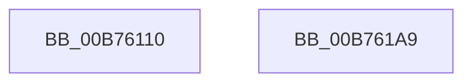

# PopSetDevicesSystemState

- RVA: `0x00B76110`–`0x00B761AA` (길이 `154` bytes)
- VA: `0x0000000140B76110`
- 실행 섹션: `PAGELK`
- PDB 이름 있음: `예`; PDB Function 태그: `아니요`
- unwind 정보 RVA: `0x00060904`
- 디코드: `34`개 명령, `154/154` bytes 표시
- 미해석 바이트: `0` (있으면 어셈블리에 `.byte`로 보존)

> 이 문서는 커널 이미지의 기계어와 PDB 기호를 분석해 생성했습니다. 4번과 5번은 함수 원형과 자료형을 바이너리 사용 방식에서 추정한 C 해석이며 원본 소스 복구 결과는 아닙니다.

## 1. Dependencies

- 직접 호출 지점: **2**; 고유 호출 대상: **2**
- 직접 호출자로 확인된 함수: **2**
- RIP 상대 이미지 참조: **10**

### Outgoing calls
- `0x00B76192` → [PoBroadcastSystemState](PoBroadcastSystemState_function_00B761B0.md) (function, `0x00B761B0`)
- `0x00B7619F` → [_security_check_cookie](../../text/6A/_security_check_cookie_function_006AC640.md) (function, `0x006AC640`)

### Direct callers
- [PopGracefulShutdown](../B6/PopGracefulShutdown_function_00B6BEC8.md) at `0x00B6C198`
- [PopTransitionSystemPowerStateEx](PopTransitionSystemPowerStateEx_function_00B7E8C0.md) at `0x00B7EDCE`
- [PopTransitionSystemPowerStateEx](PopTransitionSystemPowerStateEx_function_00B7E8C0.md) at `0x00B7EF50`
- [PopTransitionSystemPowerStateEx](PopTransitionSystemPowerStateEx_function_00B7E8C0.md) at `0x00B7F689`

### Static image references
- `0x00B76114` → RVA `0x00E0A740` (`.data`; read)
- `0x00B76123` → RVA `0x00F0BD69` (`.data`; read)
- `0x00B7612E` → RVA `0x00F0BD4C` (`.data`; read)
- `0x00B7613B` → RVA `0x00F0BD42` (`.data`; read)
- `0x00B76145` → RVA `0x00F0BD68` (`.data`; read)
- `0x00B7614F` → RVA `0x00F0BD78` (`.data`; read)
- `0x00B76159` → RVA `0x00F0BD74` (`.data`; read)
- `0x00B76163` → RVA `0x00F0BD6C` (`.data`; read)
- `0x00B76179` → RVA `0x00F0BD70` (`.data`; read)
- `0x00B76183` → RVA `0x00F0BD44` (`.data`; read)

## 2. Other-region calls and transfers

- 다른 실행 섹션으로 향하는 call: **1**
  - `0x00B7619F` → [_security_check_cookie](../../text/6A/_security_check_cookie_function_006AC640.md) (`PAGELK` → `.text`)
- 별도 외부 분기/꼬리 이동을 확인하지 못했습니다.

## 3. Assembly (complete function range)

```asm
00B76110  48 83 EC 58                     sub rsp, 0x58
00B76114  48 8B 05 25 46 29 00            mov rax, qword ptr [rip + 0x294625]
00B7611B  48 33 C4                        xor rax, rsp
00B7611E  48 89 44 24 40                  mov qword ptr [rsp + 0x40], rax
00B76123  8A 05 40 5C 39 00               mov al, byte ptr [rip + 0x395c40]
00B76129  BA 06 00 00 00                  mov edx, 6
00B7612E  8B 0D 18 5C 39 00               mov ecx, dword ptr [rip + 0x395c18]
00B76134  F6 C1 08                        test cl, 8
00B76137  88 44 24 39                     mov byte ptr [rsp + 0x39], al
00B7613B  8A 05 01 5C 39 00               mov al, byte ptr [rip + 0x395c01]
00B76141  88 44 24 38                     mov byte ptr [rsp + 0x38], al
00B76145  8A 05 1D 5C 39 00               mov al, byte ptr [rip + 0x395c1d]
00B7614B  88 44 24 3A                     mov byte ptr [rsp + 0x3a], al
00B7614F  8B 05 23 5C 39 00               mov eax, dword ptr [rip + 0x395c23]
00B76155  89 44 24 20                     mov dword ptr [rsp + 0x20], eax
00B76159  8B 05 15 5C 39 00               mov eax, dword ptr [rip + 0x395c15]
00B7615F  89 44 24 24                     mov dword ptr [rsp + 0x24], eax
00B76163  8B 05 03 5C 39 00               mov eax, dword ptr [rip + 0x395c03]
00B76169  0F 45 C2                        cmovne eax, edx
00B7616C  89 4C 24 34                     mov dword ptr [rsp + 0x34], ecx
00B76170  89 44 24 28                     mov dword ptr [rsp + 0x28], eax
00B76174  48 8D 4C 24 20                  lea rcx, [rsp + 0x20]
00B76179  8B 05 F1 5B 39 00               mov eax, dword ptr [rip + 0x395bf1]
00B7617F  89 44 24 2C                     mov dword ptr [rsp + 0x2c], eax
00B76183  8B 05 BB 5B 39 00               mov eax, dword ptr [rip + 0x395bbb]
00B76189  89 44 24 30                     mov dword ptr [rsp + 0x30], eax
00B7618D  C6 44 24 3B 00                  mov byte ptr [rsp + 0x3b], 0
00B76192  E8 19 00 00 00                  call 0x140b761b0
00B76197  48 8B 4C 24 40                  mov rcx, qword ptr [rsp + 0x40]
00B7619C  48 33 CC                        xor rcx, rsp
00B7619F  E8 9C 64 B3 FF                  call 0x1406ac640
00B761A4  48 83 C4 58                     add rsp, 0x58
00B761A8  C3                              ret
00B761A9  CC                              int3
```

## 4. C-style interpretation (structured pseudocode)

```c
__int64 __fastcall PopSetDevicesSystemState(void)
{
    __int64 result;
    __int64 v_rsp;
    unsigned __int64 v_stack_m18;
    unsigned __int8 v_stack_m1D;
    unsigned __int8 v_stack_m1E;
    unsigned __int8 v_stack_m1F;
    unsigned __int8 v_stack_m20;
    unsigned int v_stack_m24;
    unsigned int v_stack_m28;
    unsigned int v_stack_m2C;
    unsigned int v_stack_m30;
    unsigned int v_stack_m34;
    unsigned int v_stack_m38;

    v_rsp = (v_rsp) - (88);
    result = (*(unsigned __int64 *)(v_rip + 2704933)) ^ (v_rsp);
    v_stack_m18 = result;
    v_stack_m1F = (unsigned __int8)(*(unsigned __int8 *)(v_rip + 3759168));
    v_stack_m20 = (unsigned __int8)(*(unsigned __int8 *)(v_rip + 3759105));
    v_stack_m1E = (unsigned __int8)(*(unsigned __int8 *)(v_rip + 3759133));
    v_stack_m38 = (unsigned int)((unsigned int)(*(unsigned int *)(v_rip + 3759139)));
    v_stack_m34 = (unsigned int)((unsigned int)(*(unsigned int *)(v_rip + 3759125)));
    result = (unsigned int)(*(unsigned int *)(v_rip + 3759107));
    if ((((unsigned __int8)((unsigned int)(*(unsigned int *)(v_rip + 3759128)))) & (8)) != 0) { result = 6; }
    v_stack_m24 = (unsigned int)((unsigned int)(*(unsigned int *)(v_rip + 3759128)));
    v_stack_m30 = (unsigned int)(result);
    v_stack_m2C = (unsigned int)((unsigned int)(*(unsigned int *)(v_rip + 3759089)));
    v_stack_m28 = (unsigned int)((unsigned int)(*(unsigned int *)(v_rip + 3759035)));
    v_stack_m1D = 0;
    result = PoBroadcastSystemState(v_stack_m38, 6, a3, a4);
    a1 = (v_stack_m18) ^ (v_rsp);
    result = _security_check_cookie(a1, 6, a3, a4);
    v_rsp = (v_rsp) + (88);
    return result;
}
```

## 5. (Beta) C Style

```c
void PopSetDevicesSystemState(void)
{
    int64_t result;
    int64_t local_rsp;
    uint64_t v_stack_m18;
    uint8_t v_stack_m1D;
    uint8_t v_stack_m1E;
    uint8_t v_stack_m1F;
    uint8_t v_stack_m20;
    uint32_t v_stack_m24;
    uint32_t v_stack_m28;
    uint32_t v_stack_m2C;
    uint32_t v_stack_m30;
    uint32_t v_stack_m34;
    uint32_t v_stack_m38;

    local_rsp = (local_rsp) - (88);
    result = (*(uint64_t *)(v_rip + 0x294625)) ^ (local_rsp);
    v_stack_m18 = result;
    v_stack_m1F = (uint8_t)(*(uint8_t *)(v_rip + 0x395C40));
    v_stack_m20 = (uint8_t)(*(uint8_t *)(v_rip + 0x395C01));
    v_stack_m1E = (uint8_t)(*(uint8_t *)(v_rip + 0x395C1D));
    v_stack_m38 = (uint32_t)((uint32_t)(*(uint32_t *)(v_rip + 0x395C23)));
    v_stack_m34 = (uint32_t)((uint32_t)(*(uint32_t *)(v_rip + 0x395C15)));
    result = (uint32_t)(*(uint32_t *)(v_rip + 0x395C03));
    if ((((uint8_t)((uint32_t)(*(uint32_t *)(v_rip + 0x395C18)))) & (8)) != 0) { result = 6; }
    v_stack_m24 = (uint32_t)((uint32_t)(*(uint32_t *)(v_rip + 0x395C18)));
    v_stack_m30 = (uint32_t)(result);
    v_stack_m2C = (uint32_t)((uint32_t)(*(uint32_t *)(v_rip + 0x395BF1)));
    v_stack_m28 = (uint32_t)((uint32_t)(*(uint32_t *)(v_rip + 0x395BBB)));
    v_stack_m1D = 0;
    result = PoBroadcastSystemState(v_stack_m38, 6, a3, a4);
    a1 = (v_stack_m18) ^ (local_rsp);
    result = _security_check_cookie(a1, 6, a3, a4);
    local_rsp = (local_rsp) + (88);
    return result;
}
```

## 6. Execution-region graph

[열기: 2D/3D 그래프와 함수 탐색 컨트롤 패널](../../../control-panel.html?section=pagelk&rva=0x00B76110&view=graph)

- 2D 그래프는 위에서 아래로 흐르고, 3D 그래프는 빈 공간을 드래그해 회전합니다. Shift+드래그는 이동, 휠은 확대·축소, 함수 노드 선택은 대상 보고서 이동입니다.

### Static fallback


