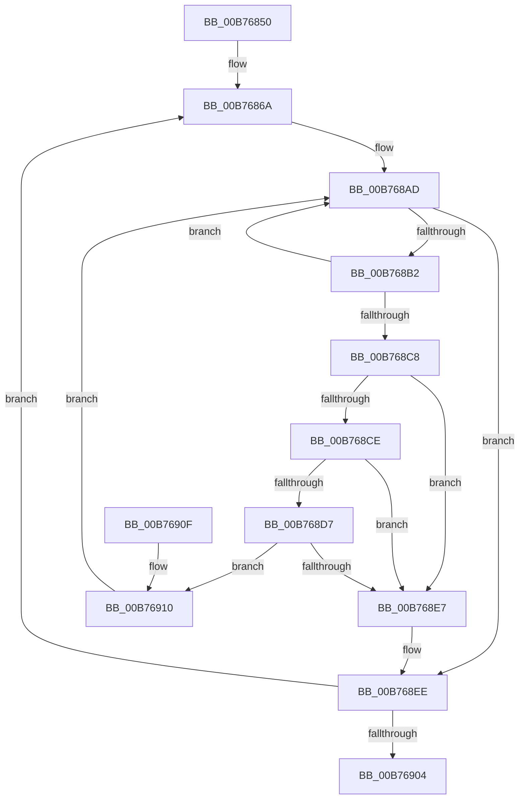

# PopSetupSleepNotifies

- RVA: `0x00B76850`–`0x00B76920` (길이 `208` bytes)
- VA: `0x0000000140B76850`
- 실행 섹션: `PAGELK`
- PDB 이름 있음: `예`; PDB Function 태그: `아니요`
- unwind 정보 RVA: `0x0009D5D8`
- 디코드: `60`개 명령, `208/208` bytes 표시
- 미해석 바이트: `0` (있으면 어셈블리에 `.byte`로 보존)

> 이 문서는 커널 이미지의 기계어와 PDB 기호를 분석해 생성했습니다. 4번과 5번은 함수 원형과 자료형을 바이너리 사용 방식에서 추정한 C 해석이며 원본 소스 복구 결과는 아닙니다.

## 1. Dependencies

- 직접 호출 지점: **3**; 고유 호출 대상: **1**
- 직접 호출자로 확인된 함수: **1**
- RIP 상대 이미지 참조: **0**

### Outgoing calls
- `0x00B76884` → [PopMoveList](PopMoveList_function_00B76928.md) (function, `0x00B76928`)
- `0x00B76894` → [PopMoveList](PopMoveList_function_00B76928.md) (function, `0x00B76928`)
- `0x00B768A4` → [PopMoveList](PopMoveList_function_00B76928.md) (function, `0x00B76928`)

### Direct callers
- [PoBroadcastSystemState](PoBroadcastSystemState_function_00B761B0.md) at `0x00B7648F`

### Static image references
- 디코드된 RIP-relative 메모리 참조가 없습니다.

## 2. Other-region calls and transfers

- 다른 실행 섹션으로 향하는 call: **0**
- 별도 외부 분기/꼬리 이동을 확인하지 못했습니다.

## 3. Assembly (complete function range)

```asm
00B76850  48 89 5C 24 08                  mov qword ptr [rsp + 8], rbx
00B76855  57                              push rdi
00B76856  48 83 EC 20                     sub rsp, 0x20
00B7685A  48 8B D9                        mov rbx, rcx
00B7685D  4C 8D 91 78 01 00 00            lea r10, [rcx + 0x178]
00B76864  41 BB 04 00 00 00               mov r11d, 4
00B7686A  49 63 C3                        movsxd rax, r11d
00B7686D  48 8D 7B 48                     lea rdi, [rbx + 0x48]
00B76871  48 8D 53 58                     lea rdx, [rbx + 0x58]
00B76875  4C 8D 0C C0                     lea r9, [rax + rax*8]
00B76879  4A 8D 3C CF                     lea rdi, [rdi + r9*8]
00B7687D  48 8B CF                        mov rcx, rdi
00B76880  4A 8D 14 CA                     lea rdx, [rdx + r9*8]
00B76884  E8 9F 00 00 00                  call 0x140b76928
00B76889  48 8D 53 78                     lea rdx, [rbx + 0x78]
00B7688D  48 8B CF                        mov rcx, rdi
00B76890  4A 8D 14 CA                     lea rdx, [rdx + r9*8]
00B76894  E8 8F 00 00 00                  call 0x140b76928
00B76899  48 8D 53 68                     lea rdx, [rbx + 0x68]
00B7689D  48 8B CF                        mov rcx, rdi
00B768A0  4A 8D 14 CA                     lea rdx, [rdx + r9*8]
00B768A4  E8 7F 00 00 00                  call 0x140b76928
00B768A9  49 8B 52 F0                     mov rdx, qword ptr [r10 - 0x10]
00B768AD  48 3B D7                        cmp rdx, rdi
00B768B0  74 3C                           je 0x140b768ee
00B768B2  48 8B CA                        mov rcx, rdx
00B768B5  48 8B 12                        mov rdx, qword ptr [rdx]
00B768B8  8B 41 60                        mov eax, dword ptr [rcx + 0x60]
00B768BB  89 41 64                        mov dword ptr [rcx + 0x64], eax
00B768BE  8B 41 58                        mov eax, dword ptr [rcx + 0x58]
00B768C1  89 41 5C                        mov dword ptr [rcx + 0x5c], eax
00B768C4  85 C0                           test eax, eax
00B768C6  75 E5                           jne 0x140b768ad
00B768C8  48 39 4A 08                     cmp qword ptr [rdx + 8], rcx
00B768CC  75 19                           jne 0x140b768e7
00B768CE  48 8B 41 08                     mov rax, qword ptr [rcx + 8]
00B768D2  48 39 08                        cmp qword ptr [rax], rcx
00B768D5  75 10                           jne 0x140b768e7
00B768D7  48 89 10                        mov qword ptr [rax], rdx
00B768DA  48 89 42 08                     mov qword ptr [rdx + 8], rax
00B768DE  49 8B 42 08                     mov rax, qword ptr [r10 + 8]
00B768E2  4C 39 10                        cmp qword ptr [rax], r10
00B768E5  74 29                           je 0x140b76910
00B768E7  B9 03 00 00 00                  mov ecx, 3
00B768EC  CD 29                           int 0x29
00B768EE  41 8B 42 E8                     mov eax, dword ptr [r10 - 0x18]
00B768F2  41 89 42 EC                     mov dword ptr [r10 - 0x14], eax
00B768F6  49 83 EA 48                     sub r10, 0x48
00B768FA  41 83 EB 01                     sub r11d, 1
00B768FE  0F 89 66 FF FF FF               jns 0x140b7686a
00B76904  48 8B 5C 24 30                  mov rbx, qword ptr [rsp + 0x30]
00B76909  48 83 C4 20                     add rsp, 0x20
00B7690D  5F                              pop rdi
00B7690E  C3                              ret
00B7690F  CC                              int3
00B76910  4C 89 11                        mov qword ptr [rcx], r10
00B76913  48 89 41 08                     mov qword ptr [rcx + 8], rax
00B76917  48 89 08                        mov qword ptr [rax], rcx
00B7691A  49 89 4A 08                     mov qword ptr [r10 + 8], rcx
00B7691E  EB 8D                           jmp 0x140b768ad
```

## 4. C-style interpretation (structured pseudocode)

```c
__int64 __fastcall PopSetupSleepNotifies(__int64 a1)
{
    __int64 result;
    __int64 v_r10;
    __int64 v_r11;
    __int64 v_rsp;
    unsigned __int64 v_stack_p8;

    v_stack_p8 = v_rbx;
    v_rsp = (v_rsp) - (32);
loc_00B7686A:
    result = PopMoveList(a1 + 72 + (int)(4) + (int)(4) * 8 * 8, a1 + 88 + (int)(4) + (int)(4) * 8 * 8, a3, (int)(4) + (int)(4) * 8);
    result = PopMoveList(a1 + 72 + (int)(4) + (int)(4) * 8 * 8, a1 + 120 + (int)(4) + (int)(4) * 8 * 8, a3, (int)(4) + (int)(4) * 8);
    result = PopMoveList(a1 + 72 + (int)(4) + (int)(4) * 8 * 8, a1 + 104 + (int)(4) + (int)(4) * 8 * 8, a3, (int)(4) + (int)(4) * 8);
loc_00B768AD:
    if ((*(unsigned __int64 *)(a1 + 376 - 16)) == (a1 + 72 + (int)(4) + (int)(4) * 8 * 8)) goto loc_00B768EE;
    *(unsigned int *)(*(unsigned __int64 *)(a1 + 376 - 16) + 100) = (unsigned int)((unsigned int)(*(unsigned int *)(*(unsigned __int64 *)(a1 + 376 - 16) + 96)));
    *(unsigned int *)(*(unsigned __int64 *)(a1 + 376 - 16) + 92) = (unsigned int)((unsigned int)(*(unsigned int *)(*(unsigned __int64 *)(a1 + 376 - 16) + 88)));
    if ((unsigned int)((unsigned int)(*(unsigned int *)(*(unsigned __int64 *)(a1 + 376 - 16) + 88))) != 0) goto loc_00B768AD;
    if ((*(unsigned __int64 *)(*(unsigned __int64 *)(*(unsigned __int64 *)(a1 + 376 - 16)) + 8)) != (*(unsigned __int64 *)(a1 + 376 - 16))) goto loc_00B768E7;
    if ((*(unsigned __int64 *)(*(unsigned __int64 *)(*(unsigned __int64 *)(a1 + 376 - 16) + 8))) != (*(unsigned __int64 *)(a1 + 376 - 16))) goto loc_00B768E7;
    *(unsigned __int64 *)(*(unsigned __int64 *)(*(unsigned __int64 *)(a1 + 376 - 16) + 8)) = *(unsigned __int64 *)(*(unsigned __int64 *)(a1 + 376 - 16));
    *(unsigned __int64 *)(*(unsigned __int64 *)(*(unsigned __int64 *)(a1 + 376 - 16)) + 8) = *(unsigned __int64 *)(*(unsigned __int64 *)(a1 + 376 - 16) + 8);
    if ((*(unsigned __int64 *)(*(unsigned __int64 *)(a1 + 376 + 8))) == (a1 + 376)) goto loc_00B76910;
loc_00B768E7:
loc_00B768EE:
    *(unsigned int *)(a1 + 376 - 20) = (unsigned int)((unsigned int)(*(unsigned int *)(a1 + 376 - 24)));
    v_r10 = (a1 + 376) - (72);
    v_r11 = (unsigned int)((4) - (1));
    if (!sign_flag) goto loc_00B7686A;
    v_rsp = (v_rsp) + (32);
    return (unsigned int)(*(unsigned int *)(a1 + 376 - 24));
loc_00B76910:
    *(unsigned __int64 *)(3) = v_r10;
    *(unsigned __int64 *)(3 + 8) = (unsigned int)(*(unsigned int *)(a1 + 376 - 24));
    *(unsigned __int64 *)((unsigned int)(*(unsigned int *)(a1 + 376 - 24))) = 3;
    *(unsigned __int64 *)(v_r10 + 8) = 3;
    goto loc_00B768AD;
}
```

## 5. (Beta) C Style

```c
int64_t PopSetupSleepNotifies(void *Arg1)
{
    uint8_t *arg1 = (uint8_t *)Arg1;

    int64_t result;
    int64_t local_r10;
    int64_t local_r11;
    int64_t local_rsp;
    uint64_t v_stack_p8;

    v_stack_p8 = local_rbx;
    local_rsp = (local_rsp) - (32);
loc_00B7686A:
    result = PopMoveList(Arg1 + 72 + (int32_t)(4) + (int32_t)(4) * 8 * 8, Arg1 + 88 + (int32_t)(4) + (int32_t)(4) * 8 * 8, a3, (int32_t)(4) + (int32_t)(4) * 8);
    result = PopMoveList(Arg1 + 72 + (int32_t)(4) + (int32_t)(4) * 8 * 8, Arg1 + 120 + (int32_t)(4) + (int32_t)(4) * 8 * 8, a3, (int32_t)(4) + (int32_t)(4) * 8);
    result = PopMoveList(Arg1 + 72 + (int32_t)(4) + (int32_t)(4) * 8 * 8, Arg1 + 104 + (int32_t)(4) + (int32_t)(4) * 8 * 8, a3, (int32_t)(4) + (int32_t)(4) * 8);
loc_00B768AD:
    if ((*(uint64_t *)(arg1 + 0x178 - 0x10)) == (Arg1 + 72 + (int32_t)(4) + (int32_t)(4) * 8 * 8)) goto loc_00B768EE;
    *(uint32_t *)(*(uint64_t *)(arg1 + 0x178 - 0x10) + 0x64) = (uint32_t)((uint32_t)(*(uint32_t *)(*(uint64_t *)(arg1 + 0x178 - 0x10) + 0x60)));
    *(uint32_t *)(*(uint64_t *)(arg1 + 0x178 - 0x10) + 0x5C) = (uint32_t)((uint32_t)(*(uint32_t *)(*(uint64_t *)(arg1 + 0x178 - 0x10) + 0x58)));
    if ((uint32_t)((uint32_t)(*(uint32_t *)(*(uint64_t *)(arg1 + 0x178 - 0x10) + 0x58))) != 0) goto loc_00B768AD;
    if ((*(uint64_t *)(*(uint64_t *)(*(uint64_t *)(arg1 + 0x178 - 0x10)) + 0x8)) != (*(uint64_t *)(arg1 + 0x178 - 0x10))) goto loc_00B768E7;
    if ((*(uint64_t *)(*(uint64_t *)(*(uint64_t *)(arg1 + 0x178 - 0x10) + 0x8))) != (*(uint64_t *)(arg1 + 0x178 - 0x10))) goto loc_00B768E7;
    *(uint64_t *)(*(uint64_t *)(*(uint64_t *)(arg1 + 0x178 - 0x10) + 0x8)) = *(uint64_t *)(*(uint64_t *)(arg1 + 0x178 - 0x10));
    *(uint64_t *)(*(uint64_t *)(*(uint64_t *)(arg1 + 0x178 - 0x10)) + 0x8) = *(uint64_t *)(*(uint64_t *)(arg1 + 0x178 - 0x10) + 0x8);
    if ((*(uint64_t *)(*(uint64_t *)(arg1 + 0x178 + 0x8))) == (Arg1 + 376)) goto loc_00B76910;
loc_00B768E7:
loc_00B768EE:
    *(uint32_t *)(arg1 + 0x178 - 0x14) = (uint32_t)((uint32_t)(*(uint32_t *)(arg1 + 0x178 - 0x18)));
    local_r10 = (Arg1 + 376) - (72);
    local_r11 = (uint32_t)((4) - (1));
    if (!sign_flag) goto loc_00B7686A;
    local_rsp = (local_rsp) + (32);
    return (uint32_t)(*(uint32_t *)(arg1 + 0x178 - 0x18));
loc_00B76910:
    *(uint64_t *)(3) = local_r10;
    *(uint64_t *)(3 + 0x8) = (uint32_t)(*(uint32_t *)(arg1 + 0x178 - 0x18));
    *(uint64_t *)((uint32_t)(*(uint32_t *)(arg1 + 0x178 - 0x18))) = 3;
    *(uint64_t *)(local_r10 + 0x8) = 3;
    goto loc_00B768AD;
}
```

### 관측된 메모리 오프셋

구조체 형식이 확인되지 않은 접근은 인자 기준의 오프셋으로만 기록했습니다.

| 기준 인자 | 오프셋 표현 | 폭 (bit) | 접근 |
|---|---:|---:|---|
| `Arg1` | `+ 0x0 + r9*8` | `64` | `R` |
| `Arg1` | `+ 0x48` | `64` | `R` |
| `Arg1` | `+ 0x58` | `64` | `R` |
| `Arg1` | `+ 0x68` | `64` | `R` |
| `Arg1` | `+ 0x78` | `64` | `R` |
| `Arg1` | `+ 0x178` | `64` | `R` |

## 6. Execution-region graph

[열기: 2D/3D 그래프와 함수 탐색 컨트롤 패널](../../../control-panel.html?section=pagelk&rva=0x00B76850&view=graph)

- 2D 그래프는 위에서 아래로 흐르고, 3D 그래프는 빈 공간을 드래그해 회전합니다. Shift+드래그는 이동, 휠은 확대·축소, 함수 노드 선택은 대상 보고서 이동입니다.

### Static fallback


