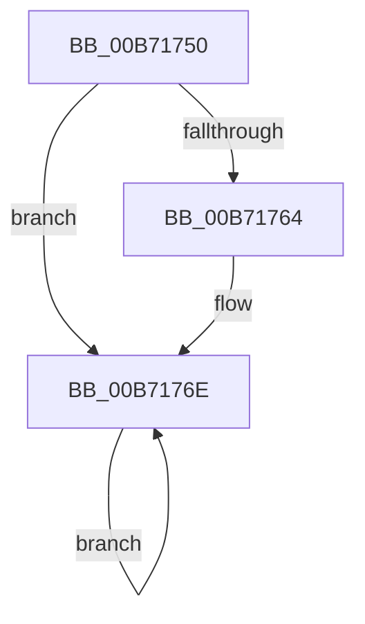

# PopShutdownHandler

- RVA: `0x00B71750`–`0x00B7177C` (길이 `44` bytes)
- VA: `0x0000000140B71750`
- 실행 섹션: `PAGELK`
- PDB 이름 있음: `예`; PDB Function 태그: `아니요`
- unwind 정보 RVA: `0x0007E574`
- 디코드: `10`개 명령, `44/44` bytes 표시
- 미해석 바이트: `0` (있으면 어셈블리에 `.byte`로 보존)

> 이 문서는 커널 이미지의 기계어와 PDB 기호를 분석해 생성했습니다. 4번과 5번은 함수 원형과 자료형을 바이너리 사용 방식에서 추정한 C 해석이며 원본 소스 복구 결과는 아닙니다.

## 1. Dependencies

- 직접 호출 지점: **3**; 고유 호출 대상: **3**
- 직접 호출자로 확인된 함수: **0**
- RIP 상대 이미지 참조: **1**

### Outgoing calls
- `0x00B71764` → [InbvAcquireDisplayOwnership](../../text/59/InbvAcquireDisplayOwnership_function_00590100.md) (function, `0x00590100`)
- `0x00B71769` → [BgDisplaySafeToPowerOffScreen](../../text/69/BgDisplaySafeToPowerOffScreen_function_0069E994.md) (function, `0x0069E994`)
- `0x00B71775` → [guard_dispatch_icall](../../text/6B/guard_dispatch_icall_function_006BAAD0.md) (function, `0x006BAAD0`)

### Direct callers
- 이 함수 시작 RVA로 연결되는 직접 call은 확인되지 않았습니다. 간접 호출은 완전히 역산할 수 없습니다.

### Static image references
- `0x00B7176E` → RVA `0x00E00838` (`.data`; read)

## 2. Other-region calls and transfers

- 다른 실행 섹션으로 향하는 call: **3**
  - `0x00B71764` → [InbvAcquireDisplayOwnership](../../text/59/InbvAcquireDisplayOwnership_function_00590100.md) (`PAGELK` → `.text`)
  - `0x00B71769` → [BgDisplaySafeToPowerOffScreen](../../text/69/BgDisplaySafeToPowerOffScreen_function_0069E994.md) (`PAGELK` → `.text`)
  - `0x00B71775` → [guard_dispatch_icall](../../text/6B/guard_dispatch_icall_function_006BAAD0.md) (`PAGELK` → `.text`)
- 별도 외부 분기/꼬리 이동을 확인하지 못했습니다.

## 3. Assembly (complete function range)

```asm
00B71750  48 83 EC 28                     sub rsp, 0x28
00B71754  FA                              cli
00B71755  65 48 8B 04 25 20 00 00 00      mov rax, qword ptr gs:[0x20]
00B7175E  83 78 24 00                     cmp dword ptr [rax + 0x24], 0
00B71762  75 0A                           jne 0x140b7176e
00B71764  E8 97 E9 A1 FF                  call 0x140590100
00B71769  E8 26 D2 B2 FF                  call 0x14069e994
00B7176E  48 8B 05 C3 F0 28 00            mov rax, qword ptr [rip + 0x28f0c3]
00B71775  E8 56 93 B4 FF                  call 0x1406baad0
00B7177A  EB F2                           jmp 0x140b7176e
```

## 4. C-style interpretation (structured pseudocode)

```c
__int64 __fastcall PopShutdownHandler(void)
{
    __int64 result;
    __int64 v_rsp;

    v_rsp = (v_rsp) - (40);
    result = *(unsigned __int64 *)(gs_base + (0 + 32));
    if ((*(unsigned int *)(*(unsigned __int64 *)(gs_base + (0 + 32)) + 36)) == 0) {
        result = InbvAcquireDisplayOwnership(a1, a2, a3, a4);
        result = BgDisplaySafeToPowerOffScreen(a1, a2, a3, a4);
    }
    result = guard_dispatch_icall(a1, a2, a3, a4);
    goto loc_00B7176E;
}
```

## 5. (Beta) C Style

```c
void PopShutdownHandler(void)
{
    int64_t result;
    int64_t local_rsp;

    local_rsp = (local_rsp) - (40);
    result = *(uint64_t *)(gs_base + (0 + 0x20));
    if ((*(uint32_t *)(*(uint64_t *)(gs_base + (0 + 0x20)) + 0x24)) == 0) {
        result = InbvAcquireDisplayOwnership(a1, a2, a3, a4);
        result = BgDisplaySafeToPowerOffScreen(a1, a2, a3, a4);
    }
    result = guard_dispatch_icall(a1, a2, a3, a4);
    goto loc_00B7176E;
}
```

## 6. Execution-region graph

[열기: 2D/3D 그래프와 함수 탐색 컨트롤 패널](../../../control-panel.html?section=pagelk&rva=0x00B71750&view=graph)

- 2D 그래프는 위에서 아래로 흐르고, 3D 그래프는 빈 공간을 드래그해 회전합니다. Shift+드래그는 이동, 휠은 확대·축소, 함수 노드 선택은 대상 보고서 이동입니다.

### Static fallback


