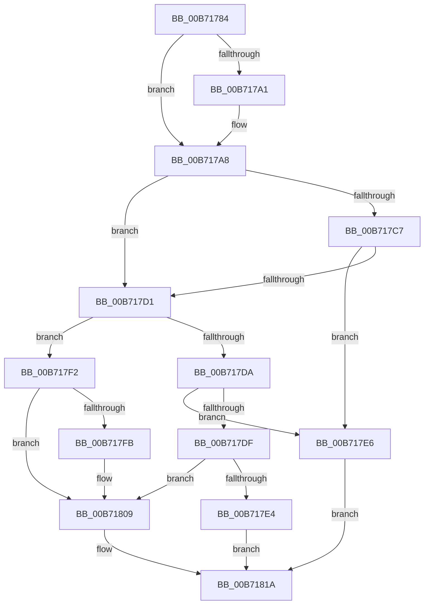

# PopShutdownSystem

- RVA: `0x00B71784`–`0x00B7183F` (길이 `187` bytes)
- VA: `0x0000000140B71784`
- 실행 섹션: `PAGELK`
- PDB 이름 있음: `예`; PDB Function 태그: `아니요`
- unwind 정보 RVA: `0x000C8648`
- 디코드: `49`개 명령, `187/187` bytes 표시
- 미해석 바이트: `0` (있으면 어셈블리에 `.byte`로 보존)

> 이 문서는 커널 이미지의 기계어와 PDB 기호를 분석해 생성했습니다. 4번과 5번은 함수 원형과 자료형을 바이너리 사용 방식에서 추정한 C 해석이며 원본 소스 복구 결과는 아닙니다.

## 1. Dependencies

- 직접 호출 지점: **10**; 고유 호출 대상: **8**
- 직접 호출자로 확인된 함수: **1**
- RIP 상대 이미지 참조: **5**

### Outgoing calls
- `0x00B7178C` → [PopNotifyShutdownListener](PopNotifyShutdownListener_function_00B7170C.md) (function, `0x00B7170C`)
- `0x00B71793` → [VslNotifyShutdown](../../text/58/VslNotifyShutdown_function_0058EBC8.md) (function, `0x0058EBC8`)
- `0x00B717A3` → [HvlConfigureMemoryZeroingOnReset](../../text/58/HvlConfigureMemoryZeroingOnReset_function_00583760.md) (function, `0x00583760`)
- `0x00B717A8` → [PopSetMemoryOverwriteRequestAction](../B6/PopSetMemoryOverwriteRequestAction_function_00B6BE14.md) (function, `0x00B6BE14`)
- `0x00B717B6` → [DbgUnLoadImageSymbols](../../text/4C/DbgUnLoadImageSymbols_function_004C6690.md) (function, `0x004C6690`)
- `0x00B717EB` → [PopInvokeSystemStateHandler](PopInvokeSystemStateHandler_function_00B76A6C.md) (function, `0x00B76A6C`)
- `0x00B7180B` → [PopInvokeSystemStateHandler](PopInvokeSystemStateHandler_function_00B76A6C.md) (function, `0x00B76A6C`)
- `0x00B71815` → [HalReturnToFirmware](../../text/54/HalReturnToFirmware_function_00546550.md) (function, `0x00546550`)
- `0x00B7181F` → [HalReturnToFirmware](../../text/54/HalReturnToFirmware_function_00546550.md) (function, `0x00546550`)
- `0x00B71839` → [KeBugCheckEx](../../text/4F/KeBugCheckEx_function_004FD660.md) (function, `0x004FD660`)

### Direct callers
- [PopGracefulShutdown](../B6/PopGracefulShutdown_function_00B6BEC8.md) at `0x00B6C1C2`

### Static image references
- `0x00B71798` → RVA `0x00FC6A97` (`ALMOSTRO`; read)
- `0x00B717BB` → RVA `0x00F0CF0C` (`.data`; read)
- `0x00B717F2` → RVA `0x00F0C2E4` (`.data`; read)
- `0x00B717FB` → RVA `0x00B71750` (`PopShutdownHandler`; read)
- `0x00B71802` → RVA `0x00F0CCA8` (`.data`; write)

## 2. Other-region calls and transfers

- 다른 실행 섹션으로 향하는 call: **6**
  - `0x00B71793` → [VslNotifyShutdown](../../text/58/VslNotifyShutdown_function_0058EBC8.md) (`PAGELK` → `.text`)
  - `0x00B717A3` → [HvlConfigureMemoryZeroingOnReset](../../text/58/HvlConfigureMemoryZeroingOnReset_function_00583760.md) (`PAGELK` → `.text`)
  - `0x00B717B6` → [DbgUnLoadImageSymbols](../../text/4C/DbgUnLoadImageSymbols_function_004C6690.md) (`PAGELK` → `.text`)
  - `0x00B71815` → [HalReturnToFirmware](../../text/54/HalReturnToFirmware_function_00546550.md) (`PAGELK` → `.text`)
  - `0x00B7181F` → [HalReturnToFirmware](../../text/54/HalReturnToFirmware_function_00546550.md) (`PAGELK` → `.text`)
  - `0x00B71839` → [KeBugCheckEx](../../text/4F/KeBugCheckEx_function_004FD660.md) (`PAGELK` → `.text`)
- 별도 외부 분기/꼬리 이동을 확인하지 못했습니다.

## 3. Assembly (complete function range)

```asm
00B71784  40 53                           push rbx
00B71786  48 83 EC 30                     sub rsp, 0x30
00B7178A  8B D9                           mov ebx, ecx
00B7178C  E8 7B FF FF FF                  call 0x140b7170c
00B71791  33 C9                           xor ecx, ecx
00B71793  E8 30 D4 A1 FF                  call 0x14058ebc8
00B71798  80 3D F8 52 45 00 00            cmp byte ptr [rip + 0x4552f8], 0
00B7179F  74 07                           je 0x140b717a8
00B717A1  33 C9                           xor ecx, ecx
00B717A3  E8 B8 1F A1 FF                  call 0x140583760
00B717A8  E8 67 A6 FF FF                  call 0x140b6be14
00B717AD  45 33 C0                        xor r8d, r8d
00B717B0  48 83 CA FF                     or rdx, 0xffffffffffffffff
00B717B4  33 C9                           xor ecx, ecx
00B717B6  E8 D5 4E 95 FF                  call 0x1404c6690
00B717BB  F7 05 47 B7 39 00 00 08 00 00   test dword ptr [rip + 0x39b747], 0x800
00B717C5  74 0A                           je 0x140b717d1
00B717C7  8D 43 FC                        lea eax, [rbx - 4]
00B717CA  A9 FD FF FF FF                  test eax, 0xfffffffd
00B717CF  74 15                           je 0x140b717e6
00B717D1  B9 04 00 00 00                  mov ecx, 4
00B717D6  2B D9                           sub ebx, ecx
00B717D8  74 18                           je 0x140b717f2
00B717DA  83 EB 01                        sub ebx, 1
00B717DD  74 07                           je 0x140b717e6
00B717DF  83 FB 01                        cmp ebx, 1
00B717E2  74 25                           je 0x140b71809
00B717E4  EB 34                           jmp 0x140b7181a
00B717E6  33 D2                           xor edx, edx
00B717E8  8D 4A 05                        lea ecx, [rdx + 5]
00B717EB  E8 7C 52 00 00                  call 0x140b76a6c
00B717F0  EB 28                           jmp 0x140b7181a
00B717F2  80 3D EB AA 39 00 00            cmp byte ptr [rip + 0x39aaeb], 0
00B717F9  74 0E                           je 0x140b71809
00B717FB  48 8D 05 4E FF FF FF            lea rax, [rip - 0xb2]
00B71802  48 89 05 9F B4 39 00            mov qword ptr [rip + 0x39b49f], rax
00B71809  33 D2                           xor edx, edx
00B7180B  E8 5C 52 00 00                  call 0x140b76a6c
00B71810  B9 01 00 00 00                  mov ecx, 1
00B71815  E8 36 4D 9D FF                  call 0x140546550
00B7181A  B9 03 00 00 00                  mov ecx, 3
00B7181F  E8 2C 4D 9D FF                  call 0x140546550
00B71824  48 83 64 24 20 00               and qword ptr [rsp + 0x20], 0
00B7182A  45 33 C9                        xor r9d, r9d
00B7182D  45 33 C0                        xor r8d, r8d
00B71830  B9 A0 00 00 00                  mov ecx, 0xa0
00B71835  41 8D 51 05                     lea edx, [r9 + 5]
00B71839  E8 22 BE 98 FF                  call 0x1404fd660
00B7183E  CC                              int3
```

## 4. C-style interpretation (structured pseudocode)

```c
__int64 __fastcall PopShutdownSystem(int a1, __int64 a2, int a3, int a4)
{
    __int64 result;
    __int64 v_rbx;
    __int64 v_rsp;
    unsigned __int64 v_stack_m18;

    v_rsp = (v_rsp) - (48);
    result = PopNotifyShutdownListener(a1, a2, a3, a4);
    a1 = 0;
    result = VslNotifyShutdown(a1, a2, a3, a4);
    if ((*(unsigned __int8 *)(v_rip + 4543224)) != 0) {
        a1 = 0;
        result = HvlConfigureMemoryZeroingOnReset(a1, a2, a3, a4);
    }
    result = PopSetMemoryOverwriteRequestAction(a1, a2, a3, a4);
    a3 = 0;
    a2 = (a2) | (-1);
    a1 = 0;
    result = DbgUnLoadImageSymbols(a1, a2, a3, a4);
    if (((*(unsigned int *)(v_rip + 3782471)) & (0x800ULL)) == 0) goto loc_00B717D1;
    if ((((unsigned int)((unsigned int)(a1) - 4)) & (0xFFFFFFFDULL)) == 0) goto loc_00B717E6;
loc_00B717D1:
    v_rbx = (unsigned int)(((unsigned int)(a1)) - (4));
    if (condition_is_equal) goto loc_00B717F2;
    v_rbx = (unsigned int)((v_rbx) - (1));
    if (condition_is_equal) goto loc_00B717E6;
    if (((unsigned int)(v_rbx)) == 1) goto loc_00B71809;
    goto loc_00B7181A;
loc_00B717E6:
    a2 = 0;
    result = PopInvokeSystemStateHandler(a2 + 5, a2, a3, a4);
    goto loc_00B7181A;
loc_00B717F2:
    if ((*(unsigned __int8 *)(v_rip + 3779307)) != 0) {
        result = v_rip - 178;
        *(unsigned __int64 *)(v_rip + 3781791) = result;
    }
    a2 = 0;
    result = PopInvokeSystemStateHandler(a2 + 5, a2, a3, a4);
    result = HalReturnToFirmware(1, a2, a3, a4);
loc_00B7181A:
    result = HalReturnToFirmware(3, a2, a3, a4);
    a4 = 0;
    a3 = 0;
    result = KeBugCheckEx(160, a4 + 5, a3, a4);
    return result;
}
```

## 5. (Beta) C Style

```c
int64_t PopShutdownSystem(void *Arg1, int64_t Arg2, int32_t Arg3, int32_t Arg4)
{
    uint8_t *arg1 = (uint8_t *)Arg1;

    int64_t result;
    int64_t local_rbx;
    int64_t local_rsp;
    uint64_t v_stack_m18;

    local_rsp = (local_rsp) - (48);
    result = PopNotifyShutdownListener(Arg1, Arg2, Arg3, Arg4);
    Arg1 = 0;
    result = VslNotifyShutdown(Arg1, Arg2, Arg3, Arg4);
    if ((*(uint8_t *)(v_rip + 0x4552F8)) != 0) {
        Arg1 = 0;
        result = HvlConfigureMemoryZeroingOnReset(Arg1, Arg2, Arg3, Arg4);
    }
    result = PopSetMemoryOverwriteRequestAction(Arg1, Arg2, Arg3, Arg4);
    Arg3 = 0;
    Arg2 = (Arg2) | (-1);
    Arg1 = 0;
    result = DbgUnLoadImageSymbols(Arg1, Arg2, Arg3, Arg4);
    if (((*(uint32_t *)(v_rip + 0x39B747)) & (0x800ULL)) == 0) goto loc_00B717D1;
    if ((((uint32_t)((uint32_t)(Arg1) - 4)) & (0xFFFFFFFDULL)) == 0) goto loc_00B717E6;
loc_00B717D1:
    local_rbx = (uint32_t)(((uint32_t)(Arg1)) - (4));
    if (condition_is_equal) goto loc_00B717F2;
    local_rbx = (uint32_t)((local_rbx) - (1));
    if (condition_is_equal) goto loc_00B717E6;
    if (((uint32_t)(local_rbx)) == 1) goto loc_00B71809;
    goto loc_00B7181A;
loc_00B717E6:
    Arg2 = 0;
    result = PopInvokeSystemStateHandler(Arg2 + 5, Arg2, Arg3, Arg4);
    goto loc_00B7181A;
loc_00B717F2:
    if ((*(uint8_t *)(v_rip + 0x39AAEB)) != 0) {
        result = v_rip - 178;
        *(uint64_t *)(v_rip + 0x39B49F) = result;
    }
    Arg2 = 0;
    result = PopInvokeSystemStateHandler(Arg2 + 5, Arg2, Arg3, Arg4);
    result = HalReturnToFirmware(1, Arg2, Arg3, Arg4);
loc_00B7181A:
    result = HalReturnToFirmware(3, Arg2, Arg3, Arg4);
    Arg4 = 0;
    Arg3 = 0;
    result = KeBugCheckEx(160, Arg4 + 5, Arg3, Arg4);
    return result;
}
```

### 관측된 메모리 오프셋

구조체 형식이 확인되지 않은 접근은 인자 기준의 오프셋으로만 기록했습니다.

| 기준 인자 | 오프셋 표현 | 폭 (bit) | 접근 |
|---|---:|---:|---|
| `Arg1` | `- 0x4` | `32` | `R` |

## 6. Execution-region graph

[열기: 2D/3D 그래프와 함수 탐색 컨트롤 패널](../../../control-panel.html?section=pagelk&rva=0x00B71784&view=graph)

- 2D 그래프는 위에서 아래로 흐르고, 3D 그래프는 빈 공간을 드래그해 회전합니다. Shift+드래그는 이동, 휠은 확대·축소, 함수 노드 선택은 대상 보고서 이동입니다.

### Static fallback


