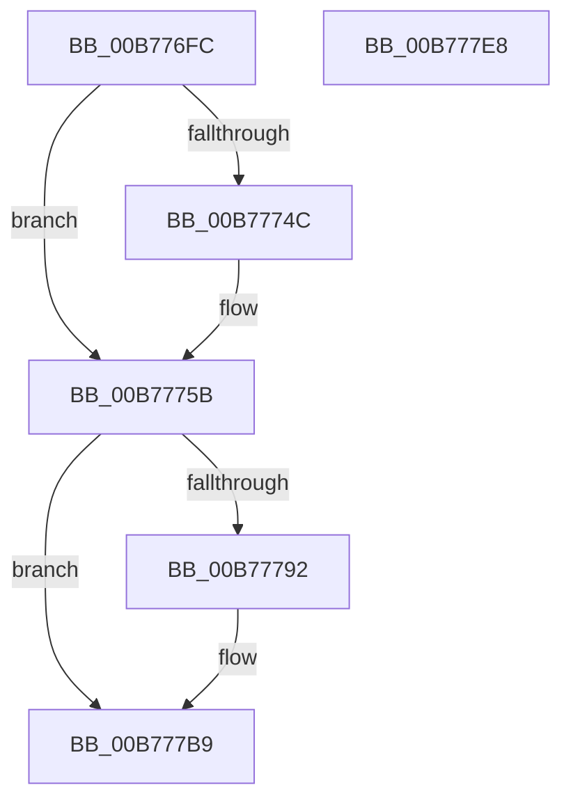

# PopSstDiagInitializeResumeTimer

- RVA: `0x00B776FC`–`0x00B777E9` (길이 `237` bytes)
- VA: `0x0000000140B776FC`
- 실행 섹션: `PAGELK`
- PDB 이름 있음: `예`; PDB Function 태그: `아니요`
- unwind 정보 RVA: `0x000A118C`
- 디코드: `57`개 명령, `237/237` bytes 표시
- 미해석 바이트: `0` (있으면 어셈블리에 `.byte`로 보존)

> 이 문서는 커널 이미지의 기계어와 PDB 기호를 분석해 생성했습니다. 4번과 5번은 함수 원형과 자료형을 바이너리 사용 방식에서 추정한 C 해석이며 원본 소스 복구 결과는 아닙니다.

## 1. Dependencies

- 직접 호출 지점: **5**; 고유 호출 대상: **4**
- 직접 호출자로 확인된 함수: **1**
- RIP 상대 이미지 참조: **7**

### Outgoing calls
- `0x00B7773C` → [guard_dispatch_icall](../../text/6B/guard_dispatch_icall_function_006BAAD0.md) (function, `0x006BAAD0`)
- `0x00B7775D` → [KeQueryPerformanceCounter](../../text/37/KeQueryPerformanceCounter_function_0037E7E0.md) (function, `0x0037E7E0`)
- `0x00B77785` → [PpmConvertTime](../../text/44/PpmConvertTime_function_00447530.md) (function, `0x00447530`)
- `0x00B77792` → [HvlQueryHypervisorTscAdjustment](../../text/58/HvlQueryHypervisorTscAdjustment_function_0058424C.md) (function, `0x0058424C`)
- `0x00B777B1` → [PpmConvertTime](../../text/44/PpmConvertTime_function_00447530.md) (function, `0x00447530`)

### Direct callers
- [PopHandleNextState](PopHandleNextState_function_00B77350.md) at `0x00B77538`

### Static image references
- `0x00B7772A` → RVA `0x00E00900` (`.data`; read)
- `0x00B77741` → RVA `0x00F0C680` (`.data`; read)
- `0x00B7774C` → RVA `0x00F07760` (`.data`; read)
- `0x00B77767` → RVA `0x00FC6BE0` (`ALMOSTRO`; read)
- `0x00B777C8` → RVA `0x00F07768` (`.data`; write)
- `0x00B777D4` → RVA `0x00F07760` (`.data`; write)
- `0x00B777DB` → RVA `0x00F07770` (`.data`; write)

## 2. Other-region calls and transfers

- 다른 실행 섹션으로 향하는 call: **5**
  - `0x00B7773C` → [guard_dispatch_icall](../../text/6B/guard_dispatch_icall_function_006BAAD0.md) (`PAGELK` → `.text`)
  - `0x00B7775D` → [KeQueryPerformanceCounter](../../text/37/KeQueryPerformanceCounter_function_0037E7E0.md) (`PAGELK` → `.text`)
  - `0x00B77785` → [PpmConvertTime](../../text/44/PpmConvertTime_function_00447530.md) (`PAGELK` → `.text`)
  - `0x00B77792` → [HvlQueryHypervisorTscAdjustment](../../text/58/HvlQueryHypervisorTscAdjustment_function_0058424C.md) (`PAGELK` → `.text`)
  - `0x00B777B1` → [PpmConvertTime](../../text/44/PpmConvertTime_function_00447530.md) (`PAGELK` → `.text`)
- 별도 외부 분기/꼬리 이동을 확인하지 못했습니다.

## 3. Assembly (complete function range)

```asm
00B776FC  4C 8B DC                        mov r11, rsp
00B776FF  49 89 5B 10                     mov qword ptr [r11 + 0x10], rbx
00B77703  49 89 6B 18                     mov qword ptr [r11 + 0x18], rbp
00B77707  49 89 73 20                     mov qword ptr [r11 + 0x20], rsi
00B7770B  57                              push rdi
00B7770C  48 83 EC 30                     sub rsp, 0x30
00B77710  33 DB                           xor ebx, ebx
00B77712  49 8D 53 E8                     lea rdx, [r11 - 0x18]
00B77716  49 89 5B 08                     mov qword ptr [r11 + 8], rbx
00B7771A  49 89 5B E8                     mov qword ptr [r11 - 0x18], rbx
00B7771E  65 48 8B 04 25 20 00 00 00      mov rax, qword ptr gs:[0x20]
00B77727  8B 48 44                        mov ecx, dword ptr [rax + 0x44]
00B7772A  48 8B 05 CF 91 28 00            mov rax, qword ptr [rip + 0x2891cf]
00B77731  48 69 E9 40 42 0F 00            imul rbp, rcx, 0xf4240
00B77738  49 8D 4B 08                     lea rcx, [r11 + 8]
00B7773C  E8 8F 33 B4 FF                  call 0x1406baad0
00B77741  38 1D 39 4F 39 00               cmp byte ptr [rip + 0x394f39], bl
00B77747  40 8A F0                        mov sil, al
00B7774A  74 0F                           je 0x140b7775b
00B7774C  48 8B 05 0D 00 39 00            mov rax, qword ptr [rip + 0x39000d]
00B77753  40 B6 01                        mov sil, 1
00B77756  48 89 44 24 40                  mov qword ptr [rsp + 0x40], rax
00B7775B  33 C9                           xor ecx, ecx
00B7775D  E8 7E 70 80 FF                  call 0x14037e7e0
00B77762  48 8B F8                        mov rdi, rax
00B77765  0F 31                           rdtsc
00B77767  4C 8B 05 72 F4 44 00            mov r8, qword ptr [rip + 0x44f472]
00B7776E  48 C1 E2 20                     shl rdx, 0x20
00B77772  48 0B C2                        or rax, rdx
00B77775  48 8B D5                        mov rdx, rbp
00B77778  48 2B 44 24 20                  sub rax, qword ptr [rsp + 0x20]
00B7777D  48 2B 44 24 40                  sub rax, qword ptr [rsp + 0x40]
00B77782  48 8B C8                        mov rcx, rax
00B77785  E8 A6 FD 8C FF                  call 0x140447530
00B7778A  48 2B F8                        sub rdi, rax
00B7778D  40 84 F6                        test sil, sil
00B77790  74 27                           je 0x140b777b9
00B77792  E8 B5 CA A0 FF                  call 0x14058424c
00B77797  48 8B 4C 24 40                  mov rcx, qword ptr [rsp + 0x40]
00B7779C  48 8B D5                        mov rdx, rbp
00B7779F  4C 8B 05 3A F4 44 00            mov r8, qword ptr [rip + 0x44f43a]
00B777A6  48 2B C8                        sub rcx, rax
00B777A9  48 89 4C 24 40                  mov qword ptr [rsp + 0x40], rcx
00B777AE  48 8B D8                        mov rbx, rax
00B777B1  E8 7A FD 8C FF                  call 0x140447530
00B777B6  48 2B F8                        sub rdi, rax
00B777B9  48 8B 44 24 40                  mov rax, qword ptr [rsp + 0x40]
00B777BE  48 8B 6C 24 50                  mov rbp, qword ptr [rsp + 0x50]
00B777C3  48 8B 74 24 58                  mov rsi, qword ptr [rsp + 0x58]
00B777C8  48 89 1D 99 FF 38 00            mov qword ptr [rip + 0x38ff99], rbx
00B777CF  48 8B 5C 24 48                  mov rbx, qword ptr [rsp + 0x48]
00B777D4  48 89 05 85 FF 38 00            mov qword ptr [rip + 0x38ff85], rax
00B777DB  48 89 3D 8E FF 38 00            mov qword ptr [rip + 0x38ff8e], rdi
00B777E2  48 83 C4 30                     add rsp, 0x30
00B777E6  5F                              pop rdi
00B777E7  C3                              ret
00B777E8  CC                              int3
```

## 4. C-style interpretation (structured pseudocode)

```c
__int64 __fastcall PopSstDiagInitializeResumeTimer(void)
{
    __int64 result;
    __int64 v_rbp;
    __int64 v_rbx;
    __int64 v_rdi;
    __int64 v_rsi;
    __int64 v_rsp;
    unsigned __int64 v_stack_m18;
    unsigned __int64 v_stack_p10;
    unsigned __int64 v_stack_p18;
    unsigned __int64 v_stack_p20;
    unsigned __int64 v_stack_p8;

    *(unsigned __int64 *)(v_rsp + 16) = v_rbx;
    *(unsigned __int64 *)(v_rsp + 24) = v_rbp;
    *(unsigned __int64 *)(v_rsp + 32) = v_rsi;
    v_rsp = (v_rsp) - (48);
    v_rbx = 0;
    *(unsigned __int64 *)(v_rsp + 8) = 0;
    *(unsigned __int64 *)(v_rsp - 24) = 0;
    v_rbp = (v_rbp) * ((unsigned int)(*(unsigned int *)(*(unsigned __int64 *)(gs_base + (0 + 32)) + 68)));
    result = guard_dispatch_icall(v_rsp + 8, v_rsp - 24, a3, a4);
    v_rsi = (unsigned __int8)(result);
    if ((*(unsigned __int8 *)(v_rip + 3755833)) != 0) {
        result = *(unsigned __int64 *)(v_rip + 3735565);
        v_rsi = 1;
        v_stack_p8 = result;
    }
    a1 = 0;
    result = KeQueryPerformanceCounter(a1, v_rsp - 24, a3, a4);
    a2 = (v_rsp - 24) << (32);
    result = (result) | (a2);
    result = (result) - (v_stack_m18);
    result = (result) - (v_stack_p8);
    result = PpmConvertTime(result, v_rbp, *(unsigned __int64 *)(v_rip + 4519026), a4);
    v_rdi = (result) - (result);
    if ((unsigned __int8)(v_rsi) != 0) {
        result = HvlQueryHypervisorTscAdjustment(result, v_rbp, *(unsigned __int64 *)(v_rip + 4519026), a4);
        a1 = v_stack_p8;
        a2 = v_rbp;
        a3 = *(unsigned __int64 *)(v_rip + 4518970);
        a1 = (a1) - (result);
        v_stack_p8 = a1;
        v_rbx = result;
        result = PpmConvertTime(a1, a2, a3, a4);
        v_rdi = (v_rdi) - (result);
    }
    *(unsigned __int64 *)(v_rip + 3735449) = v_rbx;
    *(unsigned __int64 *)(v_rip + 3735429) = v_stack_p8;
    *(unsigned __int64 *)(v_rip + 3735438) = v_rdi;
    v_rsp = (v_rsp) + (48);
    return v_stack_p8;
}
```

## 5. (Beta) C Style

```c
void PopSstDiagInitializeResumeTimer(void)
{
    int64_t result;
    int64_t local_rbp;
    int64_t local_rbx;
    int64_t local_rdi;
    int64_t local_rsi;
    int64_t local_rsp;
    uint64_t v_stack_m18;
    uint64_t v_stack_p10;
    uint64_t v_stack_p18;
    uint64_t v_stack_p20;
    uint64_t v_stack_p8;

    *(uint64_t *)(local_rsp + 0x10) = local_rbx;
    *(uint64_t *)(local_rsp + 0x18) = local_rbp;
    *(uint64_t *)(local_rsp + 0x20) = local_rsi;
    local_rsp = (local_rsp) - (48);
    local_rbx = 0;
    *(uint64_t *)(local_rsp + 0x8) = 0;
    *(uint64_t *)(local_rsp - 0x18) = 0;
    local_rbp = (local_rbp) * ((uint32_t)(*(uint32_t *)(*(uint64_t *)(gs_base + (0 + 0x20)) + 0x44)));
    result = guard_dispatch_icall(local_rsp + 8, local_rsp - 24, a3, a4);
    local_rsi = (uint8_t)(result);
    if ((*(uint8_t *)(v_rip + 0x394F39)) != 0) {
        result = *(uint64_t *)(v_rip + 0x39000D);
        local_rsi = 1;
        v_stack_p8 = result;
    }
    a1 = 0;
    result = KeQueryPerformanceCounter(a1, local_rsp - 24, a3, a4);
    a2 = (local_rsp - 24) << (32);
    result = (result) | (a2);
    result = (result) - (v_stack_m18);
    result = (result) - (v_stack_p8);
    result = PpmConvertTime(result, local_rbp, *(uint64_t *)(v_rip + 0x44F472), a4);
    local_rdi = (result) - (result);
    if ((uint8_t)(local_rsi) != 0) {
        result = HvlQueryHypervisorTscAdjustment(result, local_rbp, *(uint64_t *)(v_rip + 0x44F472), a4);
        a1 = v_stack_p8;
        a2 = local_rbp;
        a3 = *(uint64_t *)(v_rip + 0x44F43A);
        a1 = (a1) - (result);
        v_stack_p8 = a1;
        local_rbx = result;
        result = PpmConvertTime(a1, a2, a3, a4);
        local_rdi = (local_rdi) - (result);
    }
    *(uint64_t *)(v_rip + 0x38FF99) = local_rbx;
    *(uint64_t *)(v_rip + 0x38FF85) = v_stack_p8;
    *(uint64_t *)(v_rip + 0x38FF8E) = local_rdi;
    local_rsp = (local_rsp) + (48);
    return v_stack_p8;
}
```

## 6. Execution-region graph

[열기: 2D/3D 그래프와 함수 탐색 컨트롤 패널](../../../control-panel.html?section=pagelk&rva=0x00B776FC&view=graph)

- 2D 그래프는 위에서 아래로 흐르고, 3D 그래프는 빈 공간을 드래그해 회전합니다. Shift+드래그는 이동, 휠은 확대·축소, 함수 노드 선택은 대상 보고서 이동입니다.

### Static fallback


