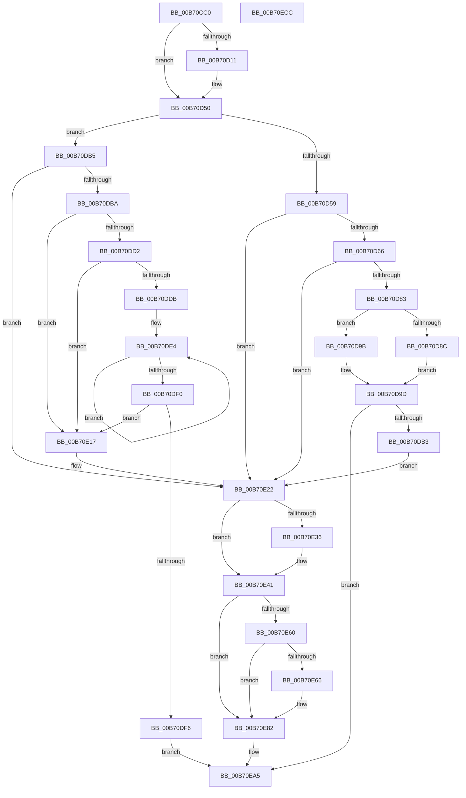

# PopSystemIrpCompletion

- RVA: `0x00B70CC0`–`0x00B70ECD` (길이 `525` bytes)
- VA: `0x0000000140B70CC0`
- 실행 섹션: `PAGELK`
- PDB 이름 있음: `예`; PDB Function 태그: `아니요`
- unwind 정보 RVA: `0x000CC6BC`
- 디코드: `135`개 명령, `525/525` bytes 표시
- 미해석 바이트: `0` (있으면 어셈블리에 `.byte`로 보존)

> 이 문서는 커널 이미지의 기계어와 PDB 기호를 분석해 생성했습니다. 4번과 5번은 함수 원형과 자료형을 바이너리 사용 방식에서 추정한 C 해석이며 원본 소스 복구 결과는 아닙니다.

## 1. Dependencies

- 직접 호출 지점: **18**; 고유 호출 대상: **16**
- 직접 호출자로 확인된 함수: **3**
- RIP 상대 이미지 참조: **4**

### Outgoing calls
- `0x00B70D4B` → [EtwTraceKernelEvent](../../text/23/EtwTraceKernelEvent_function_00235350.md) (function, `0x00235350`)
- `0x00B70D50` → [Feature_Sx_PEP_Notification_Synchronization__private_IsEnabledNoReportingNoInline](../../text/4F/Feature_Sx_PEP_Notification_Synchronization__private_IsEnabledNoReportingNoInline_function_004F4E70.md) (function, `0x004F4E70`)
- `0x00B70D72` → [PopFxLockDevice](../../text/26/PopFxLockDevice_function_0026F950.md) (function, `0x0026F950`)
- `0x00B70D92` → [PopFxNotifyPostSIrpCompletion](../../text/5D/PopFxNotifyPostSIrpCompletion_function_005D2F68.md) (function, `0x005D2F68`)
- `0x00B70DA2` → [PopFxDereferenceDevice](../../text/27/PopFxDereferenceDevice_function_0027038C.md) (function, `0x0027038C`)
- `0x00B70DC1` → [ExAcquireSpinLockExclusive](../../text/24/ExAcquireSpinLockExclusive_function_00248690.md) (function, `0x00248690`)
- `0x00B70E02` → [PopDiagTraceIrpPended](../../text/4D/PopDiagTraceIrpPended_function_004DF56C.md) (function, `0x004DF56C`)
- `0x00B70E0D` → [ExReleaseSpinLockExclusive](../../text/2C/ExReleaseSpinLockExclusive_function_002C0EF0.md) (function, `0x002C0EF0`)
- `0x00B70E1D` → [ExReleaseSpinLockExclusive](../../text/2C/ExReleaseSpinLockExclusive_function_002C0EF0.md) (function, `0x002C0EF0`)
- `0x00B70E39` → [IoFindDeviceThatFailedIrp](../../text/26/IoFindDeviceThatFailedIrp_function_0026E95C.md) (function, `0x0026E95C`)
- `0x00B70E44` → [PopDequeueQuerySetIrp](../../text/26/PopDequeueQuerySetIrp_function_0026EC34.md) (function, `0x0026EC34`)
- `0x00B70E4C` → [PopFreeIrp](../../text/26/PopFreeIrp_function_0026FAA0.md) (function, `0x0026FAA0`)
- `0x00B70E66` → [Feature_Sx_PEP_Notification_Synchronization__private_IsEnabledNoReportingNoInline](../../text/4F/Feature_Sx_PEP_Notification_Synchronization__private_IsEnabledNoReportingNoInline_function_004F4E70.md) (function, `0x004F4E70`)
- `0x00B70E6F` → [PopFxIncrementDeviceSleepCount](../../text/49/PopFxIncrementDeviceSleepCount_function_0049C040.md) (function, `0x0049C040`)
- `0x00B70E7D` → [ObfDereferenceObjectWithTag](../../text/2F/ObfDereferenceObjectWithTag_function_002F78E0.md) (function, `0x002F78E0`)
- `0x00B70E8E` → [PopCompleteNotifyTransitionCommon](../../text/48/PopCompleteNotifyTransitionCommon_function_00483B4C.md) (function, `0x00483B4C`)
- `0x00B70EA0` → [KeReleaseSemaphore](../../text/39/KeReleaseSemaphore_function_00397080.md) (function, `0x00397080`)
- `0x00B70EB2` → [_security_check_cookie](../../text/6A/_security_check_cookie_function_006AC640.md) (function, `0x006AC640`)

### Direct callers
- [PopFxHandleReportDevicePoweredOn](../../text/26/PopFxHandleReportDevicePoweredOn_function_0026D980.md) at `0x0026DB61`
- [PopFxNotifyPendingSIrpReady](../../text/4F/PopFxNotifyPendingSIrpReady_function_004F5918.md) at `0x004F5956`
- [PopFxUnregisterDevice](../../page/A8/PopFxUnregisterDevice_function_00A8AE84.md) at `0x00A8AF8B`

### Static image references
- `0x00B70CD3` → RVA `0x00E0A740` (`.data`; read)
- `0x00B70CE9` → RVA `0x00FC6B10` (`ALMOSTRO`; read)
- `0x00B70E22` → RVA `0x00F0BCC4` (`.data`; read)
- `0x00B70E51` → RVA `0x00F0BCD0` (`.data`; read)

## 2. Other-region calls and transfers

- 다른 실행 섹션으로 향하는 call: **18**
  - `0x00B70D4B` → [EtwTraceKernelEvent](../../text/23/EtwTraceKernelEvent_function_00235350.md) (`PAGELK` → `.text`)
  - `0x00B70D50` → [Feature_Sx_PEP_Notification_Synchronization__private_IsEnabledNoReportingNoInline](../../text/4F/Feature_Sx_PEP_Notification_Synchronization__private_IsEnabledNoReportingNoInline_function_004F4E70.md) (`PAGELK` → `.text`)
  - `0x00B70D72` → [PopFxLockDevice](../../text/26/PopFxLockDevice_function_0026F950.md) (`PAGELK` → `.text`)
  - `0x00B70D92` → [PopFxNotifyPostSIrpCompletion](../../text/5D/PopFxNotifyPostSIrpCompletion_function_005D2F68.md) (`PAGELK` → `.text`)
  - `0x00B70DA2` → [PopFxDereferenceDevice](../../text/27/PopFxDereferenceDevice_function_0027038C.md) (`PAGELK` → `.text`)
  - `0x00B70DC1` → [ExAcquireSpinLockExclusive](../../text/24/ExAcquireSpinLockExclusive_function_00248690.md) (`PAGELK` → `.text`)
  - `0x00B70E02` → [PopDiagTraceIrpPended](../../text/4D/PopDiagTraceIrpPended_function_004DF56C.md) (`PAGELK` → `.text`)
  - `0x00B70E0D` → [ExReleaseSpinLockExclusive](../../text/2C/ExReleaseSpinLockExclusive_function_002C0EF0.md) (`PAGELK` → `.text`)
  - `0x00B70E1D` → [ExReleaseSpinLockExclusive](../../text/2C/ExReleaseSpinLockExclusive_function_002C0EF0.md) (`PAGELK` → `.text`)
  - `0x00B70E39` → [IoFindDeviceThatFailedIrp](../../text/26/IoFindDeviceThatFailedIrp_function_0026E95C.md) (`PAGELK` → `.text`)
  - `0x00B70E44` → [PopDequeueQuerySetIrp](../../text/26/PopDequeueQuerySetIrp_function_0026EC34.md) (`PAGELK` → `.text`)
  - `0x00B70E4C` → [PopFreeIrp](../../text/26/PopFreeIrp_function_0026FAA0.md) (`PAGELK` → `.text`)
  - `0x00B70E66` → [Feature_Sx_PEP_Notification_Synchronization__private_IsEnabledNoReportingNoInline](../../text/4F/Feature_Sx_PEP_Notification_Synchronization__private_IsEnabledNoReportingNoInline_function_004F4E70.md) (`PAGELK` → `.text`)
  - `0x00B70E6F` → [PopFxIncrementDeviceSleepCount](../../text/49/PopFxIncrementDeviceSleepCount_function_0049C040.md) (`PAGELK` → `.text`)
  - `0x00B70E7D` → [ObfDereferenceObjectWithTag](../../text/2F/ObfDereferenceObjectWithTag_function_002F78E0.md) (`PAGELK` → `.text`)
  - `0x00B70E8E` → [PopCompleteNotifyTransitionCommon](../../text/48/PopCompleteNotifyTransitionCommon_function_00483B4C.md) (`PAGELK` → `.text`)
  - `0x00B70EA0` → [KeReleaseSemaphore](../../text/39/KeReleaseSemaphore_function_00397080.md) (`PAGELK` → `.text`)
  - `0x00B70EB2` → [_security_check_cookie](../../text/6A/_security_check_cookie_function_006AC640.md) (`PAGELK` → `.text`)
- 별도 외부 분기/꼬리 이동을 확인하지 못했습니다.

## 3. Assembly (complete function range)

```asm
00B70CC0  4C 8B DC                        mov r11, rsp
00B70CC3  49 89 5B 08                     mov qword ptr [r11 + 8], rbx
00B70CC7  49 89 6B 20                     mov qword ptr [r11 + 0x20], rbp
00B70CCB  56                              push rsi
00B70CCC  57                              push rdi
00B70CCD  41 56                           push r14
00B70CCF  48 83 EC 60                     sub rsp, 0x60
00B70CD3  48 8B 05 66 9A 29 00            mov rax, qword ptr [rip + 0x299a66]
00B70CDA  48 33 C4                        xor rax, rsp
00B70CDD  48 89 44 24 50                  mov qword ptr [rsp + 0x50], rax
00B70CE2  48 0F BE 42 42                  movsx rax, byte ptr [rdx + 0x42]
00B70CE7  33 FF                           xor edi, edi
00B70CE9  F7 05 1D 5E 45 00 00 80 00 00   test dword ptr [rip + 0x455e1d], 0x8000
00B70CF3  48 8B F2                        mov rsi, rdx
00B70CF6  4D 8B B0 D8 00 00 00            mov r14, qword ptr [r8 + 0xd8]
00B70CFD  48 8D 0C C0                     lea rcx, [rax + rax*8]
00B70D01  48 8B AC CA C8 00 00 00         mov rbp, qword ptr [rdx + rcx*8 + 0xc8]
00B70D09  8B 9D C0 00 00 00               mov ebx, dword ptr [rbp + 0xc0]
00B70D0F  74 3F                           je 0x140b70d50
00B70D11  8B 42 30                        mov eax, dword ptr [rdx + 0x30]
00B70D14  49 8D 4B C8                     lea rcx, [r11 - 0x38]
00B70D18  89 7C 24 3C                     mov dword ptr [rsp + 0x3c], edi
00B70D1C  41 B9 27 12 00 00               mov r9d, 0x1227
00B70D22  49 89 53 B8                     mov qword ptr [r11 - 0x48], rdx
00B70D26  41 B8 00 80 00 80               mov r8d, 0x80008000
00B70D2C  89 44 24 38                     mov dword ptr [rsp + 0x38], eax
00B70D30  8D 57 01                        lea edx, [rdi + 1]
00B70D33  49 8D 43 B8                     lea rax, [r11 - 0x48]
00B70D37  49 C7 43 D0 10 00 00 00         mov qword ptr [r11 - 0x30], 0x10
00B70D3F  49 89 43 C8                     mov qword ptr [r11 - 0x38], rax
00B70D43  C7 44 24 20 02 18 50 00         mov dword ptr [rsp + 0x20], 0x501802
00B70D4B  E8 00 46 6C FF                  call 0x140235350
00B70D50  E8 1B 41 98 FF                  call 0x1404f4e70
00B70D55  85 C0                           test eax, eax
00B70D57  74 5C                           je 0x140b70db5
00B70D59  80 BD B8 00 00 00 02            cmp byte ptr [rbp + 0xb8], 2
00B70D60  0F 85 BC 00 00 00               jne 0x140b70e22
00B70D66  49 8D 8E 60 FF FF FF            lea rcx, [r14 - 0xa0]
00B70D6D  45 33 C0                        xor r8d, r8d
00B70D70  33 D2                           xor edx, edx
00B70D72  E8 D9 EB 6F FF                  call 0x14026f950
00B70D77  48 8B D8                        mov rbx, rax
00B70D7A  48 85 C0                        test rax, rax
00B70D7D  0F 84 9F 00 00 00               je 0x140b70e22
00B70D83  48 39 B8 88 00 00 00            cmp qword ptr [rax + 0x88], rdi
00B70D8A  74 0F                           je 0x140b70d9b
00B70D8C  48 8B D6                        mov rdx, rsi
00B70D8F  48 8B C8                        mov rcx, rax
00B70D92  E8 D1 21 A6 FF                  call 0x1405d2f68
00B70D97  8B E8                           mov ebp, eax
00B70D99  EB 02                           jmp 0x140b70d9d
00B70D9B  8B EF                           mov ebp, edi
00B70D9D  33 D2                           xor edx, edx
00B70D9F  48 8B CB                        mov rcx, rbx
00B70DA2  E8 E5 F5 6F FF                  call 0x14027038c
00B70DA7  81 FD 03 01 00 00               cmp ebp, 0x103
00B70DAD  0F 84 F2 00 00 00               je 0x140b70ea5
00B70DB3  EB 6D                           jmp 0x140b70e22
00B70DB5  83 FB 01                        cmp ebx, 1
00B70DB8  75 68                           jne 0x140b70e22
00B70DBA  49 8D 5E B8                     lea rbx, [r14 - 0x48]
00B70DBE  48 8B CB                        mov rcx, rbx
00B70DC1  E8 CA 78 6D FF                  call 0x140248690
00B70DC6  4D 8B 46 B0                     mov r8, qword ptr [r14 - 0x50]
00B70DCA  40 8A E8                        mov bpl, al
00B70DCD  4D 85 C0                        test r8, r8
00B70DD0  74 45                           je 0x140b70e17
00B70DD2  49 39 B8 88 00 00 00            cmp qword ptr [r8 + 0x88], rdi
00B70DD9  74 3C                           je 0x140b70e17
00B70DDB  41 0F 0D 48 20                  prefetchw byte ptr [r8 + 0x20]
00B70DE0  41 8B 40 20                     mov eax, dword ptr [r8 + 0x20]
00B70DE4  8B D0                           mov edx, eax
00B70DE6  0B D7                           or edx, edi
00B70DE8  F0 41 0F B1 50 20               lock cmpxchg dword ptr [r8 + 0x20], edx
00B70DEE  75 F4                           jne 0x140b70de4
00B70DF0  0F BA E0 0B                     bt eax, 0xb
00B70DF4  73 21                           jae 0x140b70e17
00B70DF6  F0 41 81 48 20 00 04 00 00      lock or dword ptr [r8 + 0x20], 0x400
00B70DFF  48 8B CE                        mov rcx, rsi
00B70E02  E8 65 E7 96 FF                  call 0x1404df56c
00B70E07  40 8A D5                        mov dl, bpl
00B70E0A  48 8B CB                        mov rcx, rbx
00B70E0D  E8 DE 00 75 FF                  call 0x1402c0ef0
00B70E12  E9 8E 00 00 00                  jmp 0x140b70ea5
00B70E17  40 8A D5                        mov dl, bpl
00B70E1A  48 8B CB                        mov rcx, rbx
00B70E1D  E8 CE 00 75 FF                  call 0x1402c0ef0
00B70E22  F7 05 98 AE 39 00 00 00 80 00   test dword ptr [rip + 0x39ae98], 0x800000
00B70E2C  8B EF                           mov ebp, edi
00B70E2E  0F 44 6E 30                     cmove ebp, dword ptr [rsi + 0x30]
00B70E32  85 ED                           test ebp, ebp
00B70E34  79 0B                           jns 0x140b70e41
00B70E36  48 8B CE                        mov rcx, rsi
00B70E39  E8 1E DB 6F FF                  call 0x14026e95c
00B70E3E  48 8B F8                        mov rdi, rax
00B70E41  48 8B CE                        mov rcx, rsi
00B70E44  E8 EB DD 6F FF                  call 0x14026ec34
00B70E49  48 8B CE                        mov rcx, rsi
00B70E4C  E8 4F EC 6F FF                  call 0x14026faa0
00B70E51  48 8B 1D 78 AE 39 00            mov rbx, qword ptr [rip + 0x39ae78]
00B70E58  8A 03                           mov al, byte ptr [rbx]
00B70E5A  2C 02                           sub al, 2
00B70E5C  3C 01                           cmp al, 1
00B70E5E  77 22                           ja 0x140b70e82
00B70E60  83 7B 04 01                     cmp dword ptr [rbx + 4], 1
00B70E64  7E 1C                           jle 0x140b70e82
00B70E66  E8 05 40 98 FF                  call 0x1404f4e70
00B70E6B  49 8B 4E 80                     mov rcx, qword ptr [r14 - 0x80]
00B70E6F  E8 CC B1 92 FF                  call 0x14049c040
00B70E74  49 8B 4E 80                     mov rcx, qword ptr [r14 - 0x80]
00B70E78  BA 50 6F 49 72                  mov edx, 0x72496f50
00B70E7D  E8 5E 6A 78 FF                  call 0x1402f78e0
00B70E82  4C 8B CF                        mov r9, rdi
00B70E85  44 8B C5                        mov r8d, ebp
00B70E88  49 8B D6                        mov rdx, r14
00B70E8B  48 8B CB                        mov rcx, rbx
00B70E8E  E8 B9 2C 91 FF                  call 0x140483b4c
00B70E93  48 8B 4B 28                     mov rcx, qword ptr [rbx + 0x28]
00B70E97  45 33 C9                        xor r9d, r9d
00B70E9A  33 D2                           xor edx, edx
00B70E9C  45 8D 41 01                     lea r8d, [r9 + 1]
00B70EA0  E8 DB 61 82 FF                  call 0x140397080
00B70EA5  B8 16 00 00 C0                  mov eax, 0xc0000016
00B70EAA  48 8B 4C 24 50                  mov rcx, qword ptr [rsp + 0x50]
00B70EAF  48 33 CC                        xor rcx, rsp
00B70EB2  E8 89 B7 B3 FF                  call 0x1406ac640
00B70EB7  4C 8D 5C 24 60                  lea r11, [rsp + 0x60]
00B70EBC  49 8B 5B 20                     mov rbx, qword ptr [r11 + 0x20]
00B70EC0  49 8B 6B 38                     mov rbp, qword ptr [r11 + 0x38]
00B70EC4  49 8B E3                        mov rsp, r11
00B70EC7  41 5E                           pop r14
00B70EC9  5F                              pop rdi
00B70ECA  5E                              pop rsi
00B70ECB  C3                              ret
00B70ECC  CC                              int3
```

## 4. C-style interpretation (structured pseudocode)

```c
__int64 __fastcall PopSystemIrpCompletion(__int64 a1, __int64 a2, __int64 a3)
{
    __int64 result;
    __int64 v_rbp;
    __int64 v_rdi;
    __int64 v_rsp;
    unsigned __int64 v_stack_m18;
    unsigned __int64 v_stack_m28;
    unsigned int v_stack_m3C;
    unsigned int v_stack_m40;
    unsigned int v_stack_m58;

    *(unsigned __int64 *)(v_rsp + 8) = v_rbx;
    *(unsigned __int64 *)(v_rsp + 32) = v_rbp;
    v_rsp = (v_rsp) - (96);
    result = (*(unsigned __int64 *)(v_rip + 2726502)) ^ (v_rsp);
    v_stack_m28 = result;
    v_rdi = 0;
    result = (__int8)(*(unsigned __int8 *)(a2 + 66));
    if (((*(unsigned int *)(v_rip + 4546077)) & (0x8000ULL)) != 0) {
        result = *(unsigned int *)(a2 + 48);
        a1 = v_rsp - 56;
        v_stack_m3C = 0;
        a4 = 0x1227ULL;
        *(unsigned __int64 *)(v_rsp - 72) = a2;
        a3 = 0x80008000ULL;
        v_stack_m40 = (unsigned int)(result);
        a2 = v_rdi + 1;
        result = v_rsp - 72;
        *(unsigned __int64 *)(v_rsp - 48) = 16;
        *(unsigned __int64 *)(v_rsp - 56) = result;
        v_stack_m58 = 0x501802ULL;
        result = EtwTraceKernelEvent(a1, a2, a3, a4);
    }
    result = Feature_Sx_PEP_Notification_Synchronization__private_IsEnabledNoReportingNoInline(a1, a2, a3, a4);
    if ((unsigned int)(result) == 0) goto loc_00B70DB5;
    if ((*(unsigned __int8 *)(*(unsigned __int64 *)(a2 + (__int8)(*(unsigned __int8 *)(a2 + 66)) + (__int8)(*(unsigned __int8 *)(a2 + 66)) * 8 * 8 + 200) + 184)) != 2) goto loc_00B70E22;
    a3 = 0;
    a2 = 0;
    result = PopFxLockDevice(*(unsigned __int64 *)(a3 + 216) - 160, a2, a3, a4);
    if (result == 0) goto loc_00B70E22;
    if ((*(unsigned __int64 *)(result + 136)) == 0) goto loc_00B70D9B;
    result = PopFxNotifyPostSIrpCompletion(result, 0, a3, a4);
    goto loc_00B70D9D;
loc_00B70D9B:
loc_00B70D9D:
    a2 = 0;
    result = PopFxDereferenceDevice(result, a2, a3, a4);
    if (0 == 259) goto loc_00B70EA5;
    goto loc_00B70E22;
loc_00B70DB5:
    if (((unsigned int)(result)) != 1) goto loc_00B70E22;
    result = ExAcquireSpinLockExclusive(*(unsigned __int64 *)(a3 + 216) - 72, a2, a3, a4);
    if (*(unsigned __int64 *)(*(unsigned __int64 *)(a3 + 216) - 80) == 0) goto loc_00B70E17;
    if ((*(unsigned __int64 *)(*(unsigned __int64 *)(*(unsigned __int64 *)(a3 + 216) - 80) + 136)) == 0) goto loc_00B70E17;
loc_00B70DE4:
    a2 = (unsigned int)(((unsigned int)((unsigned int)((unsigned int)(*(unsigned int *)(*(unsigned __int64 *)(*(unsigned __int64 *)(a3 + 216) - 80) + 32))))) | (0));
    if (condition_is_not_equal) goto loc_00B70DE4;
    if (condition_is_above_or_equal) goto loc_00B70E17;
    result = PopDiagTraceIrpPended(a2, a2, *(unsigned __int64 *)(*(unsigned __int64 *)(a3 + 216) - 80), a4);
    result = ExReleaseSpinLockExclusive(*(unsigned __int64 *)(a3 + 216) - 72, (unsigned __int8)((unsigned __int8)(result)), *(unsigned __int64 *)(*(unsigned __int64 *)(a3 + 216) - 80), a4);
    goto loc_00B70EA5;
loc_00B70E17:
    result = ExReleaseSpinLockExclusive(*(unsigned __int64 *)(a3 + 216) - 72, (unsigned __int8)((unsigned __int8)(result)), *(unsigned __int64 *)(*(unsigned __int64 *)(a3 + 216) - 80), a4);
loc_00B70E22:
    v_rbp = 0;
    if (((*(unsigned int *)(v_rip + 3780248)) & (0x800000ULL)) == 0) { v_rbp = *(unsigned int *)(a2 + 48); }
    if (sign_flag) {
        a1 = a2;
        result = IoFindDeviceThatFailedIrp(a1, (unsigned __int8)((unsigned __int8)(result)), *(unsigned __int64 *)(*(unsigned __int64 *)(a3 + 216) - 80), a4);
        v_rdi = result;
    }
    result = PopDequeueQuerySetIrp(a2, (unsigned __int8)((unsigned __int8)(result)), *(unsigned __int64 *)(*(unsigned __int64 *)(a3 + 216) - 80), a4);
    result = PopFreeIrp(a2, (unsigned __int8)((unsigned __int8)(result)), *(unsigned __int64 *)(*(unsigned __int64 *)(a3 + 216) - 80), a4);
    result = (unsigned __int8)((*(unsigned __int8 *)(*(unsigned __int64 *)(v_rip + 3780216))) - (2));
    if (((unsigned __int8)(result)) > 1) goto loc_00B70E82;
    if ((*(unsigned int *)(*(unsigned __int64 *)(v_rip + 3780216) + 4)) >= = 1) {
        result = Feature_Sx_PEP_Notification_Synchronization__private_IsEnabledNoReportingNoInline(a2, (unsigned __int8)((unsigned __int8)(result)), *(unsigned __int64 *)(*(unsigned __int64 *)(a3 + 216) - 80), a4);
        a1 = *(unsigned __int64 *)(*(unsigned __int64 *)(a3 + 216) - 128);
        result = PopFxIncrementDeviceSleepCount(a1, (unsigned __int8)((unsigned __int8)(result)), *(unsigned __int64 *)(*(unsigned __int64 *)(a3 + 216) - 80), a4);
        a1 = *(unsigned __int64 *)(*(unsigned __int64 *)(a3 + 216) - 128);
        a2 = 0x72496F50ULL;
        result = ObfDereferenceObjectWithTag(a1, a2, *(unsigned __int64 *)(*(unsigned __int64 *)(a3 + 216) - 80), a4);
    }
    result = PopCompleteNotifyTransitionCommon(*(unsigned __int64 *)(v_rip + 3780216), *(unsigned __int64 *)(a3 + 216), (unsigned int)((unsigned int)(v_rbp)), v_rdi);
    a4 = 0;
    a2 = 0;
    result = KeReleaseSemaphore(*(unsigned __int64 *)(*(unsigned __int64 *)(v_rip + 3780216) + 40), a2, a4 + 1, a4);
loc_00B70EA5:
    a1 = (v_stack_m28) ^ (v_rsp);
    result = _security_check_cookie(a1, a2, a4 + 1, a4);
    return result;
}
```

## 5. (Beta) C Style

```c
int64_t PopSystemIrpCompletion(int64_t Arg1, void *Arg2, void *Arg3)
{
    uint8_t *arg2 = (uint8_t *)Arg2;
    uint8_t *arg3 = (uint8_t *)Arg3;

    int64_t result;
    int64_t local_rbp;
    int64_t local_rdi;
    int64_t local_rsp;
    uint64_t v_stack_m18;
    uint64_t v_stack_m28;
    uint32_t v_stack_m3C;
    uint32_t v_stack_m40;
    uint32_t v_stack_m58;

    *(uint64_t *)(local_rsp + 0x8) = local_rbx;
    *(uint64_t *)(local_rsp + 0x20) = local_rbp;
    local_rsp = (local_rsp) - (96);
    result = (*(uint64_t *)(v_rip + 0x299A66)) ^ (local_rsp);
    v_stack_m28 = result;
    local_rdi = 0;
    result = (int8_t)(*(uint8_t *)(arg2 + 0x42));
    if (((*(uint32_t *)(v_rip + 0x455E1D)) & (0x8000ULL)) != 0) {
        result = *(uint32_t *)(arg2 + 0x30);
        Arg1 = local_rsp - 56;
        v_stack_m3C = 0;
        a4 = 0x1227ULL;
        *(void **)(local_rsp - 0x48) = Arg2;
        Arg3 = 0x80008000ULL;
        v_stack_m40 = (uint32_t)(result);
        Arg2 = local_rdi + 1;
        result = local_rsp - 72;
        *(uint64_t *)(local_rsp - 0x30) = 16;
        *(uint64_t *)(local_rsp - 0x38) = result;
        v_stack_m58 = 0x501802ULL;
        result = EtwTraceKernelEvent(Arg1, Arg2, Arg3, a4);
    }
    result = Feature_Sx_PEP_Notification_Synchronization__private_IsEnabledNoReportingNoInline(Arg1, Arg2, Arg3, a4);
    if ((uint32_t)(result) == 0) goto loc_00B70DB5;
    if ((*(uint8_t *)(*(uint64_t *)(arg2 + (int8_t)(*(uint8_t *)(arg2 + 0x42)) + (int8_t)(*(uint8_t *)(arg2 + 0x42)) * 8 * 8 + 0xC8) + 0xB8)) != 2) goto loc_00B70E22;
    Arg3 = 0;
    Arg2 = 0;
    result = PopFxLockDevice(*(uint64_t *)(arg3 + 0xD8) - 160, Arg2, Arg3, a4);
    if (result == 0) goto loc_00B70E22;
    if ((*(uint64_t *)(result + 0x88)) == 0) goto loc_00B70D9B;
    result = PopFxNotifyPostSIrpCompletion(result, 0, Arg3, a4);
    goto loc_00B70D9D;
loc_00B70D9B:
loc_00B70D9D:
    Arg2 = 0;
    result = PopFxDereferenceDevice(result, Arg2, Arg3, a4);
    if (0 == 259) goto loc_00B70EA5;
    goto loc_00B70E22;
loc_00B70DB5:
    if (((uint32_t)(result)) != 1) goto loc_00B70E22;
    result = ExAcquireSpinLockExclusive(*(uint64_t *)(arg3 + 0xD8) - 72, Arg2, Arg3, a4);
    if (*(uint64_t *)(*(uint64_t *)(arg3 + 0xD8) - 0x50) == 0) goto loc_00B70E17;
    if ((*(uint64_t *)(*(uint64_t *)(*(uint64_t *)(arg3 + 0xD8) - 0x50) + 0x88)) == 0) goto loc_00B70E17;
loc_00B70DE4:
    Arg2 = (uint32_t)(((uint32_t)((uint32_t)((uint32_t)(*(uint32_t *)(*(uint64_t *)(*(uint64_t *)(arg3 + 0xD8) - 0x50) + 0x20))))) | (0));
    if (condition_is_not_equal) goto loc_00B70DE4;
    if (condition_is_above_or_equal) goto loc_00B70E17;
    result = PopDiagTraceIrpPended(Arg2, Arg2, *(uint64_t *)(*(uint64_t *)(arg3 + 0xD8) - 0x50), a4);
    result = ExReleaseSpinLockExclusive(*(uint64_t *)(arg3 + 0xD8) - 72, (uint8_t)((uint8_t)(result)), *(uint64_t *)(*(uint64_t *)(arg3 + 0xD8) - 0x50), a4);
    goto loc_00B70EA5;
loc_00B70E17:
    result = ExReleaseSpinLockExclusive(*(uint64_t *)(arg3 + 0xD8) - 72, (uint8_t)((uint8_t)(result)), *(uint64_t *)(*(uint64_t *)(arg3 + 0xD8) - 0x50), a4);
loc_00B70E22:
    local_rbp = 0;
    if (((*(uint32_t *)(v_rip + 0x39AE98)) & (0x800000ULL)) == 0) { local_rbp = *(uint32_t *)(arg2 + 0x30); }
    if (sign_flag) {
        Arg1 = Arg2;
        result = IoFindDeviceThatFailedIrp(Arg1, (uint8_t)((uint8_t)(result)), *(uint64_t *)(*(uint64_t *)(arg3 + 0xD8) - 0x50), a4);
        local_rdi = result;
    }
    result = PopDequeueQuerySetIrp(Arg2, (uint8_t)((uint8_t)(result)), *(uint64_t *)(*(uint64_t *)(arg3 + 0xD8) - 0x50), a4);
    result = PopFreeIrp(Arg2, (uint8_t)((uint8_t)(result)), *(uint64_t *)(*(uint64_t *)(arg3 + 0xD8) - 0x50), a4);
    result = (uint8_t)((*(uint8_t *)(*(uint64_t *)(v_rip + 0x39AE78))) - (2));
    if (((uint8_t)(result)) > 1) goto loc_00B70E82;
    if ((*(uint32_t *)(*(uint64_t *)(v_rip + 0x39AE78) + 0x4)) >= = 1) {
        result = Feature_Sx_PEP_Notification_Synchronization__private_IsEnabledNoReportingNoInline(Arg2, (uint8_t)((uint8_t)(result)), *(uint64_t *)(*(uint64_t *)(arg3 + 0xD8) - 0x50), a4);
        Arg1 = *(uint64_t *)(*(uint64_t *)(arg3 + 0xD8) - 0x80);
        result = PopFxIncrementDeviceSleepCount(Arg1, (uint8_t)((uint8_t)(result)), *(uint64_t *)(*(uint64_t *)(arg3 + 0xD8) - 0x50), a4);
        Arg1 = *(uint64_t *)(*(uint64_t *)(arg3 + 0xD8) - 0x80);
        Arg2 = 0x72496F50ULL;
        result = ObfDereferenceObjectWithTag(Arg1, Arg2, *(uint64_t *)(*(uint64_t *)(arg3 + 0xD8) - 0x50), a4);
    }
    result = PopCompleteNotifyTransitionCommon(*(uint64_t *)(v_rip + 0x39AE78), *(uint64_t *)(arg3 + 0xD8), (uint32_t)((uint32_t)(local_rbp)), local_rdi);
    a4 = 0;
    Arg2 = 0;
    result = KeReleaseSemaphore(*(uint64_t *)(*(uint64_t *)(v_rip + 0x39AE78) + 0x28), Arg2, a4 + 1, a4);
loc_00B70EA5:
    Arg1 = (v_stack_m28) ^ (local_rsp);
    result = _security_check_cookie(Arg1, Arg2, a4 + 1, a4);
    return result;
}
```

### 관측된 메모리 오프셋

구조체 형식이 확인되지 않은 접근은 인자 기준의 오프셋으로만 기록했습니다.

| 기준 인자 | 오프셋 표현 | 폭 (bit) | 접근 |
|---|---:|---:|---|
| `Arg2` | `+ 0x30` | `32` | `R` |
| `Arg2` | `+ 0x42` | `8` | `R` |
| `Arg2` | `+ 0xC8 + rcx*8` | `64` | `R` |
| `Arg3` | `+ 0xD8` | `64` | `R` |

## 6. Execution-region graph

[열기: 2D/3D 그래프와 함수 탐색 컨트롤 패널](../../../control-panel.html?section=pagelk&rva=0x00B70CC0&view=graph)

- 2D 그래프는 위에서 아래로 흐르고, 3D 그래프는 빈 공간을 드래그해 회전합니다. Shift+드래그는 이동, 휠은 확대·축소, 함수 노드 선택은 대상 보고서 이동입니다.

### Static fallback


