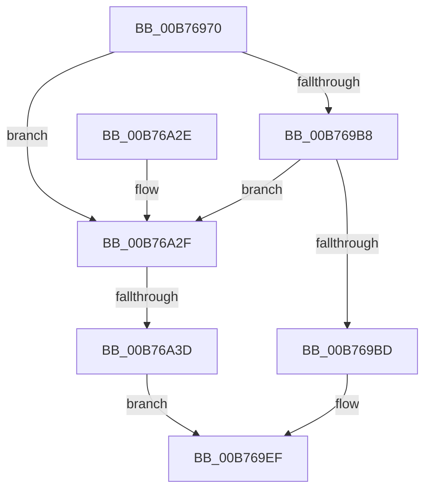

# PopTransitionToSleep

- RVA: `0x00B76970`–`0x00B76A63` (길이 `243` bytes)
- VA: `0x0000000140B76970`
- 실행 섹션: `PAGELK`
- PDB 이름 있음: `예`; PDB Function 태그: `예`
- unwind 정보 RVA: `0x000A1104`
- 디코드: `70`개 명령, `243/243` bytes 표시
- 미해석 바이트: `0` (있으면 어셈블리에 `.byte`로 보존)

> 이 문서는 커널 이미지의 기계어와 PDB 기호를 분석해 생성했습니다. 4번과 5번은 함수 원형과 자료형을 바이너리 사용 방식에서 추정한 C 해석이며 원본 소스 복구 결과는 아닙니다.

## 1. Dependencies

- 직접 호출 지점: **7**; 고유 호출 대상: **4**
- 직접 호출자로 확인된 함수: **0**
- RIP 상대 이미지 참조: **5**

### Outgoing calls
- `0x00B769C3` → [KeSetEvent](../../text/33/KeSetEvent_function_0033F310.md) (function, `0x0033F310`)
- `0x00B769DA` → [KeWaitForSingleObject](../../text/20/KeWaitForSingleObject_function_0020E6B0.md) (function, `0x0020E6B0`)
- `0x00B769E8` → [PopInvokeSystemStateHandler](PopInvokeSystemStateHandler_function_00B76A6C.md) (function, `0x00B76A6C`)
- `0x00B769F1` → [KeQueryPerformanceCounter](../../text/37/KeQueryPerformanceCounter_function_0037E7E0.md) (function, `0x0037E7E0`)
- `0x00B76A10` → [KeSetEvent](../../text/33/KeSetEvent_function_0033F310.md) (function, `0x0033F310`)
- `0x00B76A43` → [KeSetEvent](../../text/33/KeSetEvent_function_0033F310.md) (function, `0x0033F310`)
- `0x00B76A5A` → [KeWaitForSingleObject](../../text/20/KeWaitForSingleObject_function_0020E6B0.md) (function, `0x0020E6B0`)

### Direct callers
- 이 함수 시작 RVA로 연결되는 직접 call은 확인되지 않았습니다. 간접 호출은 완전히 역산할 수 없습니다.

### Static image references
- `0x00B769AC` → RVA `0x00F0C000` (`.data`; write)
- `0x00B769DF` → RVA `0x00F0BD90` (`.data`; read)
- `0x00B769F6` → RVA `0x00F07770` (`.data`; read)
- `0x00B76A01` → RVA `0x00F0C4A0` (`.data`; write)
- `0x00B76A2F` → RVA `0x00F0C2E0` (`.data`; read)

## 2. Other-region calls and transfers

- 다른 실행 섹션으로 향하는 call: **6**
  - `0x00B769C3` → [KeSetEvent](../../text/33/KeSetEvent_function_0033F310.md) (`PAGELK` → `.text`)
  - `0x00B769DA` → [KeWaitForSingleObject](../../text/20/KeWaitForSingleObject_function_0020E6B0.md) (`PAGELK` → `.text`)
  - `0x00B769F1` → [KeQueryPerformanceCounter](../../text/37/KeQueryPerformanceCounter_function_0037E7E0.md) (`PAGELK` → `.text`)
  - `0x00B76A10` → [KeSetEvent](../../text/33/KeSetEvent_function_0033F310.md) (`PAGELK` → `.text`)
  - `0x00B76A43` → [KeSetEvent](../../text/33/KeSetEvent_function_0033F310.md) (`PAGELK` → `.text`)
  - `0x00B76A5A` → [KeWaitForSingleObject](../../text/20/KeWaitForSingleObject_function_0020E6B0.md) (`PAGELK` → `.text`)
- call이 아닌 외부 분기/꼬리 이동: **1**
  - `0x00B76A37` → [sub_00B8053E](../B8/Unknown_function_00B8053E.md) (`tail-transfer`)

## 3. Assembly (complete function range)

```asm
00B76970  48 89 5C 24 10                  mov qword ptr [rsp + 0x10], rbx
00B76975  48 89 74 24 18                  mov qword ptr [rsp + 0x18], rsi
00B7697A  55                              push rbp
00B7697B  57                              push rdi
00B7697C  41 54                           push r12
00B7697E  41 56                           push r14
00B76980  41 57                           push r15
00B76982  48 8B EC                        mov rbp, rsp
00B76985  48 83 EC 60                     sub rsp, 0x60
00B76989  8B 71 48                        mov esi, dword ptr [rcx + 0x48]
00B7698C  33 C0                           xor eax, eax
00B7698E  48 89 45 F0                     mov qword ptr [rbp - 0x10], rax
00B76992  0F 57 C0                        xorps xmm0, xmm0
00B76995  88 45 30                        mov byte ptr [rbp + 0x30], al
00B76998  48 8B F9                        mov rdi, rcx
00B7699B  0F 11 45 D0                     movups xmmword ptr [rbp - 0x30], xmm0
00B7699F  0F 11 45 E0                     movups xmmword ptr [rbp - 0x20], xmm0
00B769A3  65 48 8B 04 25 88 01 00 00      mov rax, qword ptr gs:[0x188]
00B769AC  48 89 05 4D 56 39 00            mov qword ptr [rip + 0x39564d], rax
00B769B3  83 FE 03                        cmp esi, 3
00B769B6  74 77                           je 0x140b76a2f
00B769B8  83 FE 06                        cmp esi, 6
00B769BB  74 72                           je 0x140b76a2f
00B769BD  33 D2                           xor edx, edx
00B769BF  44 8D 42 01                     lea r8d, [rdx + 1]
00B769C3  E8 48 89 7C FF                  call 0x14033f310
00B769C8  48 83 64 24 20 00               and qword ptr [rsp + 0x20], 0
00B769CE  48 8D 4F 18                     lea rcx, [rdi + 0x18]
00B769D2  45 33 C9                        xor r9d, r9d
00B769D5  45 33 C0                        xor r8d, r8d
00B769D8  33 D2                           xor edx, edx
00B769DA  E8 D1 7C 69 FF                  call 0x14020e6b0
00B769DF  48 8B 15 AA 53 39 00            mov rdx, qword ptr [rip + 0x3953aa]
00B769E6  8B CE                           mov ecx, esi
00B769E8  E8 7F 00 00 00                  call 0x140b76a6c
00B769ED  8B D8                           mov ebx, eax
00B769EF  33 C9                           xor ecx, ecx
00B769F1  E8 EA 7D 80 FF                  call 0x14037e7e0
00B769F6  48 2B 05 73 0D 39 00            sub rax, qword ptr [rip + 0x390d73]
00B769FD  48 8D 4F 30                     lea rcx, [rdi + 0x30]
00B76A01  48 89 05 98 5A 39 00            mov qword ptr [rip + 0x395a98], rax
00B76A08  45 33 C0                        xor r8d, r8d
00B76A0B  33 D2                           xor edx, edx
00B76A0D  89 5F 4C                        mov dword ptr [rdi + 0x4c], ebx
00B76A10  E8 FB 88 7C FF                  call 0x14033f310
00B76A15  4C 8D 5C 24 60                  lea r11, [rsp + 0x60]
00B76A1A  49 8B 5B 38                     mov rbx, qword ptr [r11 + 0x38]
00B76A1E  49 8B 73 40                     mov rsi, qword ptr [r11 + 0x40]
00B76A22  49 8B E3                        mov rsp, r11
00B76A25  41 5F                           pop r15
00B76A27  41 5E                           pop r14
00B76A29  41 5C                           pop r12
00B76A2B  5F                              pop rdi
00B76A2C  5D                              pop rbp
00B76A2D  C3                              ret
00B76A2E  CC                              int3
00B76A2F  8B 05 AB 58 39 00               mov eax, dword ptr [rip + 0x3958ab]
00B76A35  A8 20                           test al, 0x20
00B76A37  0F 84 01 9B 00 00               je 0x140b8053e
00B76A3D  33 D2                           xor edx, edx
00B76A3F  44 8D 42 01                     lea r8d, [rdx + 1]
00B76A43  E8 C8 88 7C FF                  call 0x14033f310
00B76A48  48 83 64 24 20 00               and qword ptr [rsp + 0x20], 0
00B76A4E  48 8D 4F 18                     lea rcx, [rdi + 0x18]
00B76A52  45 33 C9                        xor r9d, r9d
00B76A55  45 33 C0                        xor r8d, r8d
00B76A58  33 D2                           xor edx, edx
00B76A5A  E8 51 7C 69 FF                  call 0x14020e6b0
00B76A5F  33 DB                           xor ebx, ebx
00B76A61  EB 8C                           jmp 0x140b769ef
```

## 4. C-style interpretation (structured pseudocode)

```c
__int64 __fastcall PopTransitionToSleep(__int64 a1, int a2, __int64 a3, int a4)
{
    __int64 result;
    __int64 v_rbx;
    __int64 v_rsp;
    unsigned __int64 v_stack_m28;
    unsigned __int64 v_stack_m38;
    unsigned __int64 v_stack_m40;
    unsigned __int64 v_stack_m48;
    unsigned __int64 v_stack_m58;
    unsigned __int64 v_stack_m68;
    unsigned __int64 v_stack_p10;
    unsigned __int64 v_stack_p18;
    unsigned __int8 v_stack_p8;

    v_stack_p10 = v_rbx;
    v_stack_p18 = v_rsi;
    v_rsp = (v_rsp) - (96);
    result = 0;
    v_stack_m38 = 0;
    v_stack_p8 = 0;
    v_stack_m58 = v_xmm0;
    v_stack_m48 = v_xmm0;
    *(unsigned __int64 *)(v_rip + 3757645) = *(unsigned __int64 *)(gs_base + (0 + 392));
    if (((unsigned int)((unsigned int)(*(unsigned int *)(a1 + 72)))) == 3) goto loc_00B76A2F;
    if (((unsigned int)((unsigned int)(*(unsigned int *)(a1 + 72)))) == 6) goto loc_00B76A2F;
    a2 = 0;
    result = KeSetEvent(a1, a2, a2 + 1, a4);
    a4 = 0;
    a3 = 0;
    a2 = 0;
    result = KeWaitForSingleObject(a1 + 24, a2, a3, a4);
    result = PopInvokeSystemStateHandler((unsigned int)((unsigned int)((unsigned int)(*(unsigned int *)(a1 + 72)))), *(unsigned __int64 *)(v_rip + 3756970), a3, a4);
loc_00B769EF:
    a1 = 0;
    result = KeQueryPerformanceCounter(a1, *(unsigned __int64 *)(v_rip + 3756970), a3, a4);
    result = (result) - (*(unsigned __int64 *)(v_rip + 3738995));
    *(unsigned __int64 *)(v_rip + 3758744) = result;
    a3 = 0;
    a2 = 0;
    *(unsigned int *)(a1 + 76) = (unsigned int)((unsigned int)((unsigned int)(result)));
    result = KeSetEvent(a1 + 48, a2, a3, a4);
    return result;
loc_00B76A2F:
    a2 = 0;
    result = KeSetEvent(a1 + 48, a2, a2 + 1, a4);
    a4 = 0;
    a3 = 0;
    a2 = 0;
    result = KeWaitForSingleObject(a1 + 24, a2, a3, a4);
    v_rbx = 0;
    goto loc_00B769EF;
}
```

## 5. (Beta) C Style

```c
int64_t PopTransitionToSleep(void *Arg1, int32_t Arg2, int64_t Arg3, int32_t Arg4)
{
    uint8_t *arg1 = (uint8_t *)Arg1;

    int64_t result;
    int64_t local_rbx;
    int64_t local_rsp;
    uint64_t v_stack_m28;
    uint64_t v_stack_m38;
    uint64_t v_stack_m40;
    uint64_t v_stack_m48;
    uint64_t v_stack_m58;
    uint64_t v_stack_m68;
    uint64_t v_stack_p10;
    uint64_t v_stack_p18;
    uint8_t v_stack_p8;

    v_stack_p10 = local_rbx;
    v_stack_p18 = local_rsi;
    local_rsp = (local_rsp) - (96);
    result = 0;
    v_stack_m38 = 0;
    v_stack_p8 = 0;
    v_stack_m58 = v_xmm0;
    v_stack_m48 = v_xmm0;
    *(uint64_t *)(v_rip + 0x39564D) = *(uint64_t *)(gs_base + (0 + 0x188));
    if (((uint32_t)((uint32_t)(*(uint32_t *)(arg1 + 0x48)))) == 3) goto loc_00B76A2F;
    if (((uint32_t)((uint32_t)(*(uint32_t *)(arg1 + 0x48)))) == 6) goto loc_00B76A2F;
    Arg2 = 0;
    result = KeSetEvent(Arg1, Arg2, Arg2 + 1, Arg4);
    Arg4 = 0;
    Arg3 = 0;
    Arg2 = 0;
    result = KeWaitForSingleObject(Arg1 + 24, Arg2, Arg3, Arg4);
    result = PopInvokeSystemStateHandler((uint32_t)((uint32_t)((uint32_t)(*(uint32_t *)(arg1 + 0x48)))), *(uint64_t *)(v_rip + 0x3953AA), Arg3, Arg4);
loc_00B769EF:
    Arg1 = 0;
    result = KeQueryPerformanceCounter(Arg1, *(uint64_t *)(v_rip + 0x3953AA), Arg3, Arg4);
    result = (result) - (*(uint64_t *)(v_rip + 0x390D73));
    *(uint64_t *)(v_rip + 0x395A98) = result;
    Arg3 = 0;
    Arg2 = 0;
    *(uint32_t *)(arg1 + 0x4C) = (uint32_t)((uint32_t)((uint32_t)(result)));
    result = KeSetEvent(Arg1 + 48, Arg2, Arg3, Arg4);
    return result;
loc_00B76A2F:
    Arg2 = 0;
    result = KeSetEvent(Arg1 + 48, Arg2, Arg2 + 1, Arg4);
    Arg4 = 0;
    Arg3 = 0;
    Arg2 = 0;
    result = KeWaitForSingleObject(Arg1 + 24, Arg2, Arg3, Arg4);
    local_rbx = 0;
    goto loc_00B769EF;
}
```

### 관측된 메모리 오프셋

구조체 형식이 확인되지 않은 접근은 인자 기준의 오프셋으로만 기록했습니다.

| 기준 인자 | 오프셋 표현 | 폭 (bit) | 접근 |
|---|---:|---:|---|
| `Arg1` | `+ 0x18` | `64` | `R` |
| `Arg1` | `+ 0x30` | `64` | `R` |
| `Arg1` | `+ 0x48` | `32` | `R` |
| `Arg1` | `+ 0x4C` | `32` | `W` |

## 6. Execution-region graph

[열기: 2D/3D 그래프와 함수 탐색 컨트롤 패널](../../../control-panel.html?section=pagelk&rva=0x00B76970&view=graph)

- 2D 그래프는 위에서 아래로 흐르고, 3D 그래프는 빈 공간을 드래그해 회전합니다. Shift+드래그는 이동, 휠은 확대·축소, 함수 노드 선택은 대상 보고서 이동입니다.

### Static fallback


