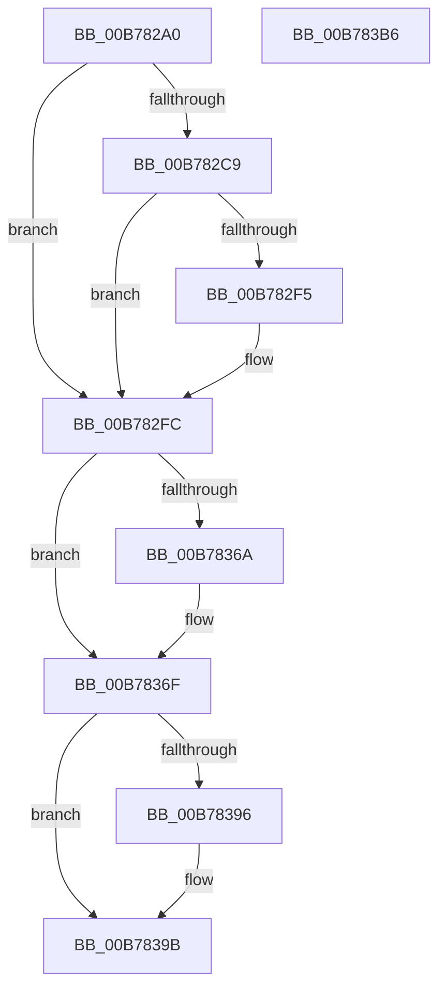

# PopUnlockAfterSleepWorker

- RVA: `0x00B782A0`–`0x00B783B7` (길이 `279` bytes)
- VA: `0x0000000140B782A0`
- 실행 섹션: `PAGELK`
- PDB 이름 있음: `예`; PDB Function 태그: `아니요`
- unwind 정보 RVA: `0x0005D2F4`
- 디코드: `56`개 명령, `279/279` bytes 표시
- 미해석 바이트: `0` (있으면 어셈블리에 `.byte`로 보존)

> 이 문서는 커널 이미지의 기계어와 PDB 기호를 분석해 생성했습니다. 4번과 5번은 함수 원형과 자료형을 바이너리 사용 방식에서 추정한 C 해석이며 원본 소스 복구 결과는 아닙니다.

## 1. Dependencies

- 직접 호출 지점: **22**; 고유 호출 대상: **20**
- 직접 호출자로 확인된 함수: **0**
- RIP 상대 이미지 참조: **9**

### Outgoing calls
- `0x00B782AB` → [PopAcquireRwLockExclusive](../../text/43/PopAcquireRwLockExclusive_function_00430B44.md) (function, `0x00430B44`)
- `0x00B782EC` → [PopPushPowerStateTransitionRecordWithCallback](../../text/43/PopPushPowerStateTransitionRecordWithCallback_function_00430A04.md) (function, `0x00430A04`)
- `0x00B78303` → [PopReleaseRwLock](../../text/2D/PopReleaseRwLock_function_002DFBBC.md) (function, `0x002DFBBC`)
- `0x00B7830A` → [CmSetLazyFlushState](../../page/AB/CmSetLazyFlushState_function_00AB7824.md) (function, `0x00AB7824`)
- `0x00B78311` → [ExSwapinWorkerThreads](../../page/A6/ExSwapinWorkerThreads_function_00A68C40.md) (function, `0x00A68C40`)
- `0x00B78326` → [ExNotifyCallback](../../text/39/ExNotifyCallback_function_003926B0.md) (function, `0x003926B0`)
- `0x00B7832B` → [PopRunNormalIrpWorkers](../../text/4F/PopRunNormalIrpWorkers_function_004FB768.md) (function, `0x004FB768`)
- `0x00B78337` → [MmUnlockPagableImageSection](../../text/2A/MmUnlockPagableImageSection_function_002A39F0.md) (function, `0x002A39F0`)
- `0x00B7833C` → [PopClearTransitionCheckpoints](../../page/AB/PopClearTransitionCheckpoints_function_00ABC3FC.md) (function, `0x00ABC3FC`)
- `0x00B78341` → [PopClearSleepMarker](../../page/AC/PopClearSleepMarker_function_00AC5498.md) (function, `0x00AC5498`)
- `0x00B78348` → [PopClearSystemSleepCheckpoint](../../page/AB/PopClearSystemSleepCheckpoint_function_00AB29B4.md) (function, `0x00AB29B4`)
- `0x00B7834D` → [PopClearShutdownMarker](../../page/70/PopClearShutdownMarker_function_00705A54.md) (function, `0x00705A54`)
- `0x00B78352` → [PopClearSystemShutdownMarker](../../page/70/PopClearSystemShutdownMarker_function_007030BC.md) (function, `0x007030BC`)
- `0x00B78357` → [PopFreeHiberContext](../../page/70/PopFreeHiberContext_function_00704F1C.md) (function, `0x00704F1C`)
- `0x00B7835C` → [PopAcquirePolicyLock](PopAcquirePolicyLock_function_00B783C0.md) (function, `0x00B783C0`)
- `0x00B7836A` → [PopAdjustHiberFile](../../page/75/PopAdjustHiberFile_function_0075CBE8.md) (function, `0x0075CBE8`)
- `0x00B7836F` → [PopClearHibernateDiagnosticInfo](../../page/AC/PopClearHibernateDiagnosticInfo_function_00ACDE5C.md) (function, `0x00ACDE5C`)
- `0x00B78374` → [PopReleasePolicyLock](PopReleasePolicyLock_function_00B78410.md) (function, `0x00B78410`)
- `0x00B78380` → [PopAcquireRwLockExclusive](../../text/43/PopAcquireRwLockExclusive_function_00430B44.md) (function, `0x00430B44`)
- `0x00B78396` → [PoDelistPowerStateTransitionBlocker](PoDelistPowerStateTransitionBlocker_function_00B795D4.md) (function, `0x00B795D4`)
- `0x00B783A2` → [PopReleaseRwLock](../../text/2D/PopReleaseRwLock_function_002DFBBC.md) (function, `0x002DFBBC`)
- `0x00B783AC` → [PopReleaseTransitionLock](../../page/AB/PopReleaseTransitionLock_function_00ABDABC.md) (function, `0x00ABDABC`)

### Direct callers
- 이 함수 시작 RVA로 연결되는 직접 call은 확인되지 않았습니다. 간접 호출은 완전히 역산할 수 없습니다.

### Static image references
- `0x00B782A4` → RVA `0x00F0B920` (`.data`; read)
- `0x00B782B9` → RVA `0x00F09169` (`.data`; read)
- `0x00B782C0` → RVA `0x00F0BF18` (`.data`; write)
- `0x00B782D5` → RVA `0x00F0BF18` (`.data`; read)
- `0x00B782F5` → RVA `0x00F09169` (`.data`; write)
- `0x00B78316` → RVA `0x00EFEDA8` (`.data`; read)
- `0x00B78330` → RVA `0x00FC6C00` (`ALMOSTRO`; read)
- `0x00B78361` → RVA `0x00F0CEC8` (`.data`; read)
- `0x00B78385` → RVA `0x00F0BF18` (`.data`; read/write)

## 2. Other-region calls and transfers

- 다른 실행 섹션으로 향하는 call: **19**
  - `0x00B782AB` → [PopAcquireRwLockExclusive](../../text/43/PopAcquireRwLockExclusive_function_00430B44.md) (`PAGELK` → `.text`)
  - `0x00B782EC` → [PopPushPowerStateTransitionRecordWithCallback](../../text/43/PopPushPowerStateTransitionRecordWithCallback_function_00430A04.md) (`PAGELK` → `.text`)
  - `0x00B78303` → [PopReleaseRwLock](../../text/2D/PopReleaseRwLock_function_002DFBBC.md) (`PAGELK` → `.text`)
  - `0x00B7830A` → [CmSetLazyFlushState](../../page/AB/CmSetLazyFlushState_function_00AB7824.md) (`PAGELK` → `PAGE`)
  - `0x00B78311` → [ExSwapinWorkerThreads](../../page/A6/ExSwapinWorkerThreads_function_00A68C40.md) (`PAGELK` → `PAGE`)
  - `0x00B78326` → [ExNotifyCallback](../../text/39/ExNotifyCallback_function_003926B0.md) (`PAGELK` → `.text`)
  - `0x00B7832B` → [PopRunNormalIrpWorkers](../../text/4F/PopRunNormalIrpWorkers_function_004FB768.md) (`PAGELK` → `.text`)
  - `0x00B78337` → [MmUnlockPagableImageSection](../../text/2A/MmUnlockPagableImageSection_function_002A39F0.md) (`PAGELK` → `.text`)
  - `0x00B7833C` → [PopClearTransitionCheckpoints](../../page/AB/PopClearTransitionCheckpoints_function_00ABC3FC.md) (`PAGELK` → `PAGE`)
  - `0x00B78341` → [PopClearSleepMarker](../../page/AC/PopClearSleepMarker_function_00AC5498.md) (`PAGELK` → `PAGE`)
  - `0x00B78348` → [PopClearSystemSleepCheckpoint](../../page/AB/PopClearSystemSleepCheckpoint_function_00AB29B4.md) (`PAGELK` → `PAGE`)
  - `0x00B7834D` → [PopClearShutdownMarker](../../page/70/PopClearShutdownMarker_function_00705A54.md) (`PAGELK` → `PAGE`)
  - `0x00B78352` → [PopClearSystemShutdownMarker](../../page/70/PopClearSystemShutdownMarker_function_007030BC.md) (`PAGELK` → `PAGE`)
  - `0x00B78357` → [PopFreeHiberContext](../../page/70/PopFreeHiberContext_function_00704F1C.md) (`PAGELK` → `PAGE`)
  - `0x00B7836A` → [PopAdjustHiberFile](../../page/75/PopAdjustHiberFile_function_0075CBE8.md) (`PAGELK` → `PAGE`)
  - `0x00B7836F` → [PopClearHibernateDiagnosticInfo](../../page/AC/PopClearHibernateDiagnosticInfo_function_00ACDE5C.md) (`PAGELK` → `PAGE`)
  - `0x00B78380` → [PopAcquireRwLockExclusive](../../text/43/PopAcquireRwLockExclusive_function_00430B44.md) (`PAGELK` → `.text`)
  - `0x00B783A2` → [PopReleaseRwLock](../../text/2D/PopReleaseRwLock_function_002DFBBC.md) (`PAGELK` → `.text`)
  - `0x00B783AC` → [PopReleaseTransitionLock](../../page/AB/PopReleaseTransitionLock_function_00ABDABC.md) (`PAGELK` → `PAGE`)
- 별도 외부 분기/꼬리 이동을 확인하지 못했습니다.

## 3. Assembly (complete function range)

```asm
00B782A0  48 83 EC 38                     sub rsp, 0x38
00B782A4  48 8D 0D 75 36 39 00            lea rcx, [rip + 0x393675]
00B782AB  E8 94 88 8B FF                  call 0x140430b44
00B782B0  65 48 8B 04 25 88 01 00 00      mov rax, qword ptr gs:[0x188]
00B782B9  80 3D A9 0E 39 00 00            cmp byte ptr [rip + 0x390ea9], 0
00B782C0  48 89 05 51 3C 39 00            mov qword ptr [rip + 0x393c51], rax
00B782C7  74 33                           je 0x140b782fc
00B782C9  65 48 8B 04 25 88 01 00 00      mov rax, qword ptr gs:[0x188]
00B782D2  45 33 C9                        xor r9d, r9d
00B782D5  48 8B 15 3C 3C 39 00            mov rdx, qword ptr [rip + 0x393c3c]
00B782DC  45 33 C0                        xor r8d, r8d
00B782DF  48 83 64 24 20 00               and qword ptr [rsp + 0x20], 0
00B782E5  48 8B 88 B8 00 00 00            mov rcx, qword ptr [rax + 0xb8]
00B782EC  E8 13 87 8B FF                  call 0x140430a04
00B782F1  85 C0                           test eax, eax
00B782F3  79 07                           jns 0x140b782fc
00B782F5  C6 05 6D 0E 39 00 00            mov byte ptr [rip + 0x390e6d], 0
00B782FC  48 8D 0D 1D 36 39 00            lea rcx, [rip + 0x39361d]
00B78303  E8 B4 78 76 FF                  call 0x1402dfbbc
00B78308  B1 01                           mov cl, 1
00B7830A  E8 15 F5 F3 FF                  call 0x140ab7824
00B7830F  B1 01                           mov cl, 1
00B78311  E8 2A 09 EF FF                  call 0x140a68c40
00B78316  48 8B 0D 8B 6A 38 00            mov rcx, qword ptr [rip + 0x386a8b]
00B7831D  BA 03 00 00 00                  mov edx, 3
00B78322  44 8D 42 FE                     lea r8d, [rdx - 2]
00B78326  E8 85 A3 81 FF                  call 0x1403926b0
00B7832B  E8 38 34 98 FF                  call 0x1404fb768
00B78330  48 8B 0D C9 E8 44 00            mov rcx, qword ptr [rip + 0x44e8c9]
00B78337  E8 B4 B6 72 FF                  call 0x1402a39f0
00B7833C  E8 BB 40 F4 FF                  call 0x140abc3fc
00B78341  E8 52 D1 F4 FF                  call 0x140ac5498
00B78346  33 C9                           xor ecx, ecx
00B78348  E8 67 A6 F3 FF                  call 0x140ab29b4
00B7834D  E8 02 D7 B8 FF                  call 0x140705a54
00B78352  E8 65 AD B8 FF                  call 0x1407030bc
00B78357  E8 C0 CB B8 FF                  call 0x140704f1c
00B7835C  E8 5F 00 00 00                  call 0x140b783c0
00B78361  80 3D 60 4B 39 00 00            cmp byte ptr [rip + 0x394b60], 0
00B78368  74 05                           je 0x140b7836f
00B7836A  E8 79 48 BE FF                  call 0x14075cbe8
00B7836F  E8 E8 5A F5 FF                  call 0x140acde5c
00B78374  E8 97 00 00 00                  call 0x140b78410
00B78379  48 8D 0D A0 35 39 00            lea rcx, [rip + 0x3935a0]
00B78380  E8 BF 87 8B FF                  call 0x140430b44
00B78385  48 83 25 8B 3B 39 00 00         and qword ptr [rip + 0x393b8b], 0
00B7838D  80 3D D5 0D 39 00 00            cmp byte ptr [rip + 0x390dd5], 0
00B78394  74 05                           je 0x140b7839b
00B78396  E8 39 12 00 00                  call 0x140b795d4
00B7839B  48 8D 0D 7E 35 39 00            lea rcx, [rip + 0x39357e]
00B783A2  E8 15 78 76 FF                  call 0x1402dfbbc
00B783A7  B9 01 00 00 00                  mov ecx, 1
00B783AC  E8 0B 57 F4 FF                  call 0x140abdabc
00B783B1  48 83 C4 38                     add rsp, 0x38
00B783B5  C3                              ret
00B783B6  CC                              int3
```

## 4. C-style interpretation (structured pseudocode)

```c
__int64 __fastcall PopUnlockAfterSleepWorker(__int64 a1, __int64 a2, int a3, int a4)
{
    __int64 result;
    __int64 v_rsp;
    unsigned __int64 v_stack_m18;

    v_rsp = (v_rsp) - (56);
    result = PopAcquireRwLockExclusive(v_rip + 3749493, a2, a3, a4);
    *(unsigned __int64 *)(v_rip + 3750993) = *(unsigned __int64 *)(gs_base + (0 + 392));
    if ((*(unsigned __int8 *)(v_rip + 3739305)) == 0) goto loc_00B782FC;
    a4 = 0;
    a3 = 0;
    result = PopPushPowerStateTransitionRecordWithCallback(*(unsigned __int64 *)(*(unsigned __int64 *)(gs_base + (0 + 392)) + 184), *(unsigned __int64 *)(v_rip + 3750972), a3, a4);
    if (sign_flag) {
        *(unsigned __int8 *)(v_rip + 3739245) = 0;
    }
    result = PopReleaseRwLock(v_rip + 3749405, *(unsigned __int64 *)(v_rip + 3750972), a3, a4);
    result = CmSetLazyFlushState(1, *(unsigned __int64 *)(v_rip + 3750972), a3, a4);
    result = ExSwapinWorkerThreads(1, *(unsigned __int64 *)(v_rip + 3750972), a3, a4);
    result = ExNotifyCallback(*(unsigned __int64 *)(v_rip + 3697291), 3, 3 - 2, a4);
    result = PopRunNormalIrpWorkers(*(unsigned __int64 *)(v_rip + 3697291), 3, 3 - 2, a4);
    result = MmUnlockPagableImageSection(*(unsigned __int64 *)(v_rip + 4516041), 3, 3 - 2, a4);
    result = PopClearTransitionCheckpoints(*(unsigned __int64 *)(v_rip + 4516041), 3, 3 - 2, a4);
    result = PopClearSleepMarker(*(unsigned __int64 *)(v_rip + 4516041), 3, 3 - 2, a4);
    a1 = 0;
    result = PopClearSystemSleepCheckpoint(a1, 3, 3 - 2, a4);
    result = PopClearShutdownMarker(a1, 3, 3 - 2, a4);
    result = PopClearSystemShutdownMarker(a1, 3, 3 - 2, a4);
    result = PopFreeHiberContext(a1, 3, 3 - 2, a4);
    result = PopAcquirePolicyLock(a1, 3, 3 - 2, a4);
    if ((*(unsigned __int8 *)(v_rip + 3754848)) != 0) {
        result = PopAdjustHiberFile(a1, 3, 3 - 2, a4);
    }
    result = PopClearHibernateDiagnosticInfo(a1, 3, 3 - 2, a4);
    result = PopReleasePolicyLock(a1, 3, 3 - 2, a4);
    result = PopAcquireRwLockExclusive(v_rip + 3749280, 3, 3 - 2, a4);
    if ((*(unsigned __int8 *)(v_rip + 3739093)) != 0) {
        result = PoDelistPowerStateTransitionBlocker(v_rip + 3749280, 3, 3 - 2, a4);
    }
    result = PopReleaseRwLock(v_rip + 3749246, 3, 3 - 2, a4);
    result = PopReleaseTransitionLock(1, 3, 3 - 2, a4);
    v_rsp = (v_rsp) + (56);
    return result;
}
```

## 5. (Beta) C Style

```c
int64_t PopUnlockAfterSleepWorker(int64_t Arg1, int64_t Arg2, int32_t Arg3, int32_t Arg4)
{
    int64_t result;
    int64_t local_rsp;
    uint64_t v_stack_m18;

    local_rsp = (local_rsp) - (56);
    result = PopAcquireRwLockExclusive(v_rip + 3749493, Arg2, Arg3, Arg4);
    *(uint64_t *)(v_rip + 0x393C51) = *(uint64_t *)(gs_base + (0 + 0x188));
    if ((*(uint8_t *)(v_rip + 0x390EA9)) == 0) goto loc_00B782FC;
    Arg4 = 0;
    Arg3 = 0;
    result = PopPushPowerStateTransitionRecordWithCallback(*(uint64_t *)(*(uint64_t *)(gs_base + (0 + 0x188)) + 0xB8), *(uint64_t *)(v_rip + 0x393C3C), Arg3, Arg4);
    if (sign_flag) {
        *(uint8_t *)(v_rip + 0x390E6D) = 0;
    }
    result = PopReleaseRwLock(v_rip + 3749405, *(uint64_t *)(v_rip + 0x393C3C), Arg3, Arg4);
    result = CmSetLazyFlushState(1, *(uint64_t *)(v_rip + 0x393C3C), Arg3, Arg4);
    result = ExSwapinWorkerThreads(1, *(uint64_t *)(v_rip + 0x393C3C), Arg3, Arg4);
    result = ExNotifyCallback(*(uint64_t *)(v_rip + 0x386A8B), 3, 3 - 2, Arg4);
    result = PopRunNormalIrpWorkers(*(uint64_t *)(v_rip + 0x386A8B), 3, 3 - 2, Arg4);
    result = MmUnlockPagableImageSection(*(uint64_t *)(v_rip + 0x44E8C9), 3, 3 - 2, Arg4);
    result = PopClearTransitionCheckpoints(*(uint64_t *)(v_rip + 0x44E8C9), 3, 3 - 2, Arg4);
    result = PopClearSleepMarker(*(uint64_t *)(v_rip + 0x44E8C9), 3, 3 - 2, Arg4);
    Arg1 = 0;
    result = PopClearSystemSleepCheckpoint(Arg1, 3, 3 - 2, Arg4);
    result = PopClearShutdownMarker(Arg1, 3, 3 - 2, Arg4);
    result = PopClearSystemShutdownMarker(Arg1, 3, 3 - 2, Arg4);
    result = PopFreeHiberContext(Arg1, 3, 3 - 2, Arg4);
    result = PopAcquirePolicyLock(Arg1, 3, 3 - 2, Arg4);
    if ((*(uint8_t *)(v_rip + 0x394B60)) != 0) {
        result = PopAdjustHiberFile(Arg1, 3, 3 - 2, Arg4);
    }
    result = PopClearHibernateDiagnosticInfo(Arg1, 3, 3 - 2, Arg4);
    result = PopReleasePolicyLock(Arg1, 3, 3 - 2, Arg4);
    result = PopAcquireRwLockExclusive(v_rip + 3749280, 3, 3 - 2, Arg4);
    if ((*(uint8_t *)(v_rip + 0x390DD5)) != 0) {
        result = PoDelistPowerStateTransitionBlocker(v_rip + 3749280, 3, 3 - 2, Arg4);
    }
    result = PopReleaseRwLock(v_rip + 3749246, 3, 3 - 2, Arg4);
    result = PopReleaseTransitionLock(1, 3, 3 - 2, Arg4);
    local_rsp = (local_rsp) + (56);
    return result;
}
```

## 6. Execution-region graph

[열기: 2D/3D 그래프와 함수 탐색 컨트롤 패널](../../../control-panel.html?section=pagelk&rva=0x00B782A0&view=graph)

- 2D 그래프는 위에서 아래로 흐르고, 3D 그래프는 빈 공간을 드래그해 회전합니다. Shift+드래그는 이동, 휠은 확대·축소, 함수 노드 선택은 대상 보고서 이동입니다.

### Static fallback


