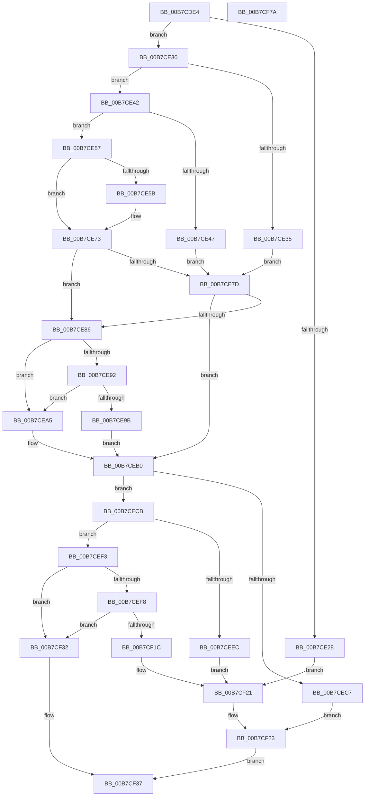

# PopValidateRTCWake

- RVA: `0x00B7CDE4`–`0x00B7CF7B` (길이 `407` bytes)
- VA: `0x0000000140B7CDE4`
- 실행 섹션: `PAGELK`
- PDB 이름 있음: `예`; PDB Function 태그: `아니요`
- unwind 정보 RVA: `0x000BD2A0`
- 디코드: `114`개 명령, `407/407` bytes 표시
- 미해석 바이트: `0` (있으면 어셈블리에 `.byte`로 보존)

> 이 문서는 커널 이미지의 기계어와 PDB 기호를 분석해 생성했습니다. 4번과 5번은 함수 원형과 자료형을 바이너리 사용 방식에서 추정한 C 해석이며 원본 소스 복구 결과는 아닙니다.

## 1. Dependencies

- 직접 호출 지점: **3**; 고유 호출 대상: **3**
- 직접 호출자로 확인된 함수: **1**
- RIP 상대 이미지 참조: **9**

### Outgoing calls
- `0x00B7CE62` → [PopCurrentPowerStatePrecise](../../page/A3/PopCurrentPowerStatePrecise_function_00A35624.md) (function, `0x00A35624`)
- `0x00B7CED2` → [PopCalculateWakeTimeAdjustment](../../page/75/PopCalculateWakeTimeAdjustment_function_0075C4EC.md) (function, `0x0075C4EC`)
- `0x00B7CF53` → [PopDiagTraceRtcWakeInfo](../../text/4D/PopDiagTraceRtcWakeInfo_function_004DEA14.md) (function, `0x004DEA14`)

### Direct callers
- [PopHandleWakeSources](../B6/PopHandleWakeSources_function_00B6C264.md) at `0x00B6C304`

### Static image references
- `0x00B7CE01` → RVA `0x00F0DEF4` (`.data`; read)
- `0x00B7CE14` → RVA `0x00F0CF0C` (`.data`; read)
- `0x00B7CE37` → RVA `0x00F0BDB0` (`.data`; write)
- `0x00B7CE67` → RVA `0x00F0CE0C` (`.data`; read)
- `0x00B7CE73` → RVA `0x00F0BDB0` (`.data`; read)
- `0x00B7CE86` → RVA `0x00F0BDD8` (`.data`; read)
- `0x00B7CE92` → RVA `0x00F0BDC0` (`.data`; read)
- `0x00B7CECB` → RVA `0x00F0BD98` (`.data`; read)
- `0x00B7CEF8` → RVA `0x00F0C684` (`.data`; read)

## 2. Other-region calls and transfers

- 다른 실행 섹션으로 향하는 call: **3**
  - `0x00B7CE62` → [PopCurrentPowerStatePrecise](../../page/A3/PopCurrentPowerStatePrecise_function_00A35624.md) (`PAGELK` → `PAGE`)
  - `0x00B7CED2` → [PopCalculateWakeTimeAdjustment](../../page/75/PopCalculateWakeTimeAdjustment_function_0075C4EC.md) (`PAGELK` → `PAGE`)
  - `0x00B7CF53` → [PopDiagTraceRtcWakeInfo](../../text/4D/PopDiagTraceRtcWakeInfo_function_004DEA14.md) (`PAGELK` → `.text`)
- 별도 외부 분기/꼬리 이동을 확인하지 못했습니다.

## 3. Assembly (complete function range)

```asm
00B7CDE4  48 8B C4                        mov rax, rsp
00B7CDE7  48 89 58 08                     mov qword ptr [rax + 8], rbx
00B7CDEB  48 89 68 10                     mov qword ptr [rax + 0x10], rbp
00B7CDEF  48 89 70 18                     mov qword ptr [rax + 0x18], rsi
00B7CDF3  48 89 78 20                     mov qword ptr [rax + 0x20], rdi
00B7CDF7  41 54                           push r12
00B7CDF9  41 56                           push r14
00B7CDFB  41 57                           push r15
00B7CDFD  48 83 EC 60                     sub rsp, 0x60
00B7CE01  8B 15 ED 10 39 00               mov edx, dword ptr [rip + 0x3910ed]
00B7CE07  33 ED                           xor ebp, ebp
00B7CE09  33 FF                           xor edi, edi
00B7CE0B  45 32 FF                        xor r15b, r15b
00B7CE0E  45 32 E4                        xor r12b, r12b
00B7CE11  83 E2 18                        and edx, 0x18
00B7CE14  F7 05 EE 00 39 00 00 00 10 00   test dword ptr [rip + 0x3900ee], 0x100000
00B7CE1E  4C 8B F1                        mov r14, rcx
00B7CE21  8D 5D 01                        lea ebx, [rbp + 1]
00B7CE24  88 19                           mov byte ptr [rcx], bl
00B7CE26  74 08                           je 0x140b7ce30
00B7CE28  8D 7D 04                        lea edi, [rbp + 4]
00B7CE2B  E9 F1 00 00 00                  jmp 0x140b7cf21
00B7CE30  83 FA 10                        cmp edx, 0x10
00B7CE33  75 0D                           jne 0x140b7ce42
00B7CE35  8B CB                           mov ecx, ebx
00B7CE37  89 1D 73 EF 38 00               mov dword ptr [rip + 0x38ef73], ebx
00B7CE3D  41 88 3E                        mov byte ptr [r14], dil
00B7CE40  EB 3B                           jmp 0x140b7ce7d
00B7CE42  83 FA 08                        cmp edx, 8
00B7CE45  75 10                           jne 0x140b7ce57
00B7CE47  33 C9                           xor ecx, ecx
00B7CE49  44 8A FB                        mov r15b, bl
00B7CE4C  89 0D 5E EF 38 00               mov dword ptr [rip + 0x38ef5e], ecx
00B7CE52  41 88 0E                        mov byte ptr [r14], cl
00B7CE55  EB 26                           jmp 0x140b7ce7d
00B7CE57  85 D2                           test edx, edx
00B7CE59  74 18                           je 0x140b7ce73
00B7CE5B  33 D2                           xor edx, edx
00B7CE5D  48 8D 4C 24 40                  lea rcx, [rsp + 0x40]
00B7CE62  E8 BD 87 EB FF                  call 0x140a35624
00B7CE67  8B 05 9F FF 38 00               mov eax, dword ptr [rip + 0x38ff9f]
00B7CE6D  89 05 3D EF 38 00               mov dword ptr [rip + 0x38ef3d], eax
00B7CE73  8B 0D 37 EF 38 00               mov ecx, dword ptr [rip + 0x38ef37]
00B7CE79  85 C9                           test ecx, ecx
00B7CE7B  78 09                           js 0x140b7ce86
00B7CE7D  48 63 C1                        movsxd rax, ecx
00B7CE80  48 83 F8 03                     cmp rax, 3
00B7CE84  72 2A                           jb 0x140b7ceb0
00B7CE86  48 8B 05 4B EF 38 00            mov rax, qword ptr [rip + 0x38ef4b]
00B7CE8D  48 85 C0                        test rax, rax
00B7CE90  74 13                           je 0x140b7cea5
00B7CE92  48 39 05 27 EF 38 00            cmp qword ptr [rip + 0x38ef27], rax
00B7CE99  76 0A                           jbe 0x140b7cea5
00B7CE9B  8B CB                           mov ecx, ebx
00B7CE9D  89 1D 0D EF 38 00               mov dword ptr [rip + 0x38ef0d], ebx
00B7CEA3  EB 0B                           jmp 0x140b7ceb0
00B7CEA5  33 C9                           xor ecx, ecx
00B7CEA7  44 8A FB                        mov r15b, bl
00B7CEAA  89 0D 00 EF 38 00               mov dword ptr [rip + 0x38ef00], ecx
00B7CEB0  48 63 C1                        movsxd rax, ecx
00B7CEB3  48 8D 35 06 EF 38 00            lea rsi, [rip + 0x38ef06]
00B7CEBA  48 8D 0C 40                     lea rcx, [rax + rax*2]
00B7CEBE  48 8B 34 CE                     mov rsi, qword ptr [rsi + rcx*8]
00B7CEC2  48 85 F6                        test rsi, rsi
00B7CEC5  75 04                           jne 0x140b7cecb
00B7CEC7  8B FB                           mov edi, ebx
00B7CEC9  EB 58                           jmp 0x140b7cf23
00B7CECB  48 8B 2D C6 EE 38 00            mov rbp, qword ptr [rip + 0x38eec6]
00B7CED2  E8 15 F6 BD FF                  call 0x14075c4ec
00B7CED7  69 C0 10 27 00 00               imul eax, eax, 0x2710
00B7CEDD  48 2B E8                        sub rbp, rax
00B7CEE0  48 8D 85 00 E1 F5 05            lea rax, [rbp + 0x5f5e100]
00B7CEE7  48 3B F0                        cmp rsi, rax
00B7CEEA  72 07                           jb 0x140b7cef3
00B7CEEC  BF 02 00 00 00                  mov edi, 2
00B7CEF1  EB 2E                           jmp 0x140b7cf21
00B7CEF3  48 3B EE                        cmp rbp, rsi
00B7CEF6  76 3A                           jbe 0x140b7cf32
00B7CEF8  8B 05 86 F7 38 00               mov eax, dword ptr [rip + 0x38f786]
00B7CEFE  F7 D8                           neg eax
00B7CF00  48 8B C5                        mov rax, rbp
00B7CF03  48 1B C9                        sbb rcx, rcx
00B7CF06  48 2B C6                        sub rax, rsi
00B7CF09  48 81 E1 00 55 6F BE            and rcx, 0xffffffffbe6f5500
00B7CF10  48 81 C1 00 8C 86 47            add rcx, 0x47868c00
00B7CF17  48 3B C1                        cmp rax, rcx
00B7CF1A  72 16                           jb 0x140b7cf32
00B7CF1C  BF 03 00 00 00                  mov edi, 3
00B7CF21  33 DB                           xor ebx, ebx
00B7CF23  C7 05 83 EE 38 00 03 00 00 00   mov dword ptr [rip + 0x38ee83], 3
00B7CF2D  45 88 26                        mov byte ptr [r14], r12b
00B7CF30  EB 05                           jmp 0x140b7cf37
00B7CF32  44 8A E3                        mov r12b, bl
00B7CF35  33 DB                           xor ebx, ebx
00B7CF37  45 0F B6 0E                     movzx r9d, byte ptr [r14]
00B7CF3B  44 8B C7                        mov r8d, edi
00B7CF3E  41 0F B6 CF                     movzx ecx, r15b
00B7CF42  48 89 6C 24 30                  mov qword ptr [rsp + 0x30], rbp
00B7CF47  89 4C 24 28                     mov dword ptr [rsp + 0x28], ecx
00B7CF4B  41 0F B6 D4                     movzx edx, r12b
00B7CF4F  89 5C 24 20                     mov dword ptr [rsp + 0x20], ebx
00B7CF53  E8 BC 1A 96 FF                  call 0x1404dea14
00B7CF58  4C 8D 5C 24 60                  lea r11, [rsp + 0x60]
00B7CF5D  41 8A C4                        mov al, r12b
00B7CF60  49 8B 5B 20                     mov rbx, qword ptr [r11 + 0x20]
00B7CF64  49 8B 6B 28                     mov rbp, qword ptr [r11 + 0x28]
00B7CF68  49 8B 73 30                     mov rsi, qword ptr [r11 + 0x30]
00B7CF6C  49 8B 7B 38                     mov rdi, qword ptr [r11 + 0x38]
00B7CF70  49 8B E3                        mov rsp, r11
00B7CF73  41 5F                           pop r15
00B7CF75  41 5E                           pop r14
00B7CF77  41 5C                           pop r12
00B7CF79  C3                              ret
00B7CF7A  CC                              int3
```

## 4. C-style interpretation (structured pseudocode)

```c
__int64 __fastcall PopValidateRTCWake(__int64 a1)
{
    __int64 result;
    __int64 v_r12;
    __int64 v_r15;
    __int64 v_rbp;
    __int64 v_rbx;
    __int64 v_rdi;
    __int64 v_rsp;
    unsigned __int64 v_stack_m18;
    unsigned __int64 v_stack_m38;
    unsigned __int64 v_stack_m48;
    unsigned int v_stack_m50;
    unsigned int v_stack_m58;

    *(unsigned __int64 *)(v_rsp + 8) = v_rbx;
    *(unsigned __int64 *)(v_rsp + 16) = v_rbp;
    *(unsigned __int64 *)(v_rsp + 24) = v_rsi;
    *(unsigned __int64 *)(v_rsp + 32) = v_rdi;
    v_rsp = (v_rsp) - (96);
    v_rbp = 0;
    v_rdi = 0;
    v_r15 = 0;
    v_r12 = 0;
    a2 = (unsigned int)(((unsigned int)(*(unsigned int *)(v_rip + 3739885))) & (24));
    *(unsigned __int8 *)(a1) = (unsigned __int8)(v_rbp + 1);
    if (((*(unsigned int *)(v_rip + 3735790)) & (0x100000ULL)) == 0) goto loc_00B7CE30;
    goto loc_00B7CF21;
loc_00B7CE30:
    if (((unsigned int)(a2)) != 16) goto loc_00B7CE42;
    *(unsigned int *)(v_rip + 3731315) = (unsigned int)(v_rbp + 1);
    *(unsigned __int8 *)(a1) = (unsigned __int8)(v_rbp + 4);
    goto loc_00B7CE7D;
loc_00B7CE42:
    if (((unsigned int)(a2)) != 8) goto loc_00B7CE57;
    a1 = 0;
    *(unsigned int *)(v_rip + 3731294) = 0;
    *(unsigned __int8 *)(a1) = 0;
    goto loc_00B7CE7D;
loc_00B7CE57:
    result = v_rsp;
    if ((unsigned int)(a2) != 0) {
        a2 = 0;
        a1 = v_stack_m38;
        result = PopCurrentPowerStatePrecise(a1, a2, a3, a4);
        result = *(unsigned int *)(v_rip + 3735455);
        *(unsigned int *)(v_rip + 3731261) = (unsigned int)(result);
    }
    if (sign_flag) goto loc_00B7CE86;
loc_00B7CE7D:
    if (((int)((unsigned int)((unsigned int)(*(unsigned int *)(v_rip + 3731255))))) < 3) goto loc_00B7CEB0;
loc_00B7CE86:
    if (*(unsigned __int64 *)(v_rip + 3731275) == 0) goto loc_00B7CEA5;
    if ((*(unsigned __int64 *)(v_rip + 3731239)) <= (*(unsigned __int64 *)(v_rip + 3731275))) goto loc_00B7CEA5;
    *(unsigned int *)(v_rip + 3731213) = (unsigned int)(v_rbp + 1);
    goto loc_00B7CEB0;
loc_00B7CEA5:
    a1 = 0;
    *(unsigned int *)(v_rip + 3731200) = 0;
loc_00B7CEB0:
    if (*(unsigned __int64 *)(v_rip + 3731206 + (int)(0) + (int)(0) * 2 * 8) != 0) goto loc_00B7CECB;
    goto loc_00B7CF23;
loc_00B7CECB:
    result = PopCalculateWakeTimeAdjustment((int)(0) + (int)(0) * 2, a2, a3, a4);
    result = (unsigned int)((result) * ((unsigned int)(result)));
    v_rbp = (*(unsigned __int64 *)(v_rip + 3731142)) - (result);
    if ((*(unsigned __int64 *)(v_rip + 3731206 + (int)(0) + (int)(0) * 2 * 8)) < (v_rbp + 100000000)) goto loc_00B7CEF3;
    goto loc_00B7CF21;
loc_00B7CEF3:
    if (v_rbp <= (*(unsigned __int64 *)(v_rip + 3731206 + (int)(0) + (int)(0) * 2 * 8))) goto loc_00B7CF32;
    result = (unsigned int)(-((unsigned int)(*(unsigned int *)(v_rip + 3733382))));
    result = (v_rbp) - (*(unsigned __int64 *)(v_rip + 3731206 + (int)(0) + (int)(0) * 2 * 8));
    a1 = ((int)(0) + (int)(0) * 2) & (0xFFFFFFFFBE6F5500ULL);
    a1 = (a1) + (0x47868C00ULL);
    if (result < a1) goto loc_00B7CF32;
loc_00B7CF21:
    v_rbx = 0;
loc_00B7CF23:
    *(unsigned int *)(v_rip + 3731075) = 3;
    *(unsigned __int8 *)(a1) = 0;
    goto loc_00B7CF37;
loc_00B7CF32:
    v_rbx = 0;
loc_00B7CF37:
    v_stack_m48 = v_rbp;
    v_stack_m50 = (unsigned int)((unsigned __int8)((unsigned __int8)(v_rbp + 1)));
    v_stack_m58 = 0;
    result = PopDiagTraceRtcWakeInfo((unsigned __int8)((unsigned __int8)(v_rbp + 1)), 0, 3, *(unsigned __int8 *)(a1));
    return 0;
}
```

## 5. (Beta) C Style

```c
int64_t PopValidateRTCWake(void *Arg1)
{
    uint8_t *arg1 = (uint8_t *)Arg1;

    int64_t result;
    int64_t local_r12;
    int64_t local_r15;
    int64_t local_rbp;
    int64_t local_rbx;
    int64_t local_rdi;
    int64_t local_rsp;
    uint64_t v_stack_m18;
    uint64_t v_stack_m38;
    uint64_t v_stack_m48;
    uint32_t v_stack_m50;
    uint32_t v_stack_m58;

    *(uint64_t *)(local_rsp + 0x8) = local_rbx;
    *(uint64_t *)(local_rsp + 0x10) = local_rbp;
    *(uint64_t *)(local_rsp + 0x18) = local_rsi;
    *(uint64_t *)(local_rsp + 0x20) = local_rdi;
    local_rsp = (local_rsp) - (96);
    local_rbp = 0;
    local_rdi = 0;
    local_r15 = 0;
    local_r12 = 0;
    a2 = (uint32_t)(((uint32_t)(*(uint32_t *)(v_rip + 0x3910ED))) & (24));
    *(uint8_t *)(arg1) = (uint8_t)(local_rbp + 1);
    if (((*(uint32_t *)(v_rip + 0x3900EE)) & (0x100000ULL)) == 0) goto loc_00B7CE30;
    goto loc_00B7CF21;
loc_00B7CE30:
    if (((uint32_t)(a2)) != 16) goto loc_00B7CE42;
    *(uint32_t *)(v_rip + 0x38EF73) = (uint32_t)(local_rbp + 1);
    *(uint8_t *)(arg1) = (uint8_t)(local_rbp + 4);
    goto loc_00B7CE7D;
loc_00B7CE42:
    if (((uint32_t)(a2)) != 8) goto loc_00B7CE57;
    Arg1 = 0;
    *(uint32_t *)(v_rip + 0x38EF5E) = 0;
    *(uint8_t *)(arg1) = 0;
    goto loc_00B7CE7D;
loc_00B7CE57:
    result = local_rsp;
    if ((uint32_t)(a2) != 0) {
        a2 = 0;
        Arg1 = v_stack_m38;
        result = PopCurrentPowerStatePrecise(Arg1, a2, a3, a4);
        result = *(uint32_t *)(v_rip + 0x38FF9F);
        *(uint32_t *)(v_rip + 0x38EF3D) = (uint32_t)(result);
    }
    if (sign_flag) goto loc_00B7CE86;
loc_00B7CE7D:
    if (((int32_t)((uint32_t)((uint32_t)(*(uint32_t *)(v_rip + 0x38EF37))))) < 3) goto loc_00B7CEB0;
loc_00B7CE86:
    if (*(uint64_t *)(v_rip + 0x38EF4B) == 0) goto loc_00B7CEA5;
    if ((*(uint64_t *)(v_rip + 0x38EF27)) <= (*(uint64_t *)(v_rip + 0x38EF4B))) goto loc_00B7CEA5;
    *(uint32_t *)(v_rip + 0x38EF0D) = (uint32_t)(local_rbp + 1);
    goto loc_00B7CEB0;
loc_00B7CEA5:
    Arg1 = 0;
    *(uint32_t *)(v_rip + 0x38EF00) = 0;
loc_00B7CEB0:
    if (*(uint64_t *)(v_rip + 0x38EF06 + (int32_t)(0) + (int32_t)(0) * 2 * 8) != 0) goto loc_00B7CECB;
    goto loc_00B7CF23;
loc_00B7CECB:
    result = PopCalculateWakeTimeAdjustment((int32_t)(0) + (int32_t)(0) * 2, a2, a3, a4);
    result = (uint32_t)((result) * ((uint32_t)(result)));
    local_rbp = (*(uint64_t *)(v_rip + 0x38EEC6)) - (result);
    if ((*(uint64_t *)(v_rip + 0x38EF06 + (int32_t)(0) + (int32_t)(0) * 2 * 8)) < (local_rbp + 100000000)) goto loc_00B7CEF3;
    goto loc_00B7CF21;
loc_00B7CEF3:
    if (local_rbp <= (*(uint64_t *)(v_rip + 0x38EF06 + (int32_t)(0) + (int32_t)(0) * 2 * 8))) goto loc_00B7CF32;
    result = (uint32_t)(-((uint32_t)(*(uint32_t *)(v_rip + 0x38F786))));
    result = (local_rbp) - (*(uint64_t *)(v_rip + 0x38EF06 + (int32_t)(0) + (int32_t)(0) * 2 * 8));
    Arg1 = ((int32_t)(0) + (int32_t)(0) * 2) & (0xFFFFFFFFBE6F5500ULL);
    Arg1 = (Arg1) + (0x47868C00ULL);
    if (result < Arg1) goto loc_00B7CF32;
loc_00B7CF21:
    local_rbx = 0;
loc_00B7CF23:
    *(uint32_t *)(v_rip + 0x38EE83) = 3;
    *(uint8_t *)(arg1) = 0;
    goto loc_00B7CF37;
loc_00B7CF32:
    local_rbx = 0;
loc_00B7CF37:
    v_stack_m48 = local_rbp;
    v_stack_m50 = (uint32_t)((uint8_t)((uint8_t)(local_rbp + 1)));
    v_stack_m58 = 0;
    result = PopDiagTraceRtcWakeInfo((uint8_t)((uint8_t)(local_rbp + 1)), 0, 3, *(uint8_t *)(arg1));
    return 0;
}
```

### 관측된 메모리 오프셋

구조체 형식이 확인되지 않은 접근은 인자 기준의 오프셋으로만 기록했습니다.

| 기준 인자 | 오프셋 표현 | 폭 (bit) | 접근 |
|---|---:|---:|---|
| `Arg1` | `+ 0x0` | `8` | `R` |
| `Arg1` | `+ 0x0` | `8` | `W` |

## 6. Execution-region graph

[열기: 2D/3D 그래프와 함수 탐색 컨트롤 패널](../../../control-panel.html?section=pagelk&rva=0x00B7CDE4&view=graph)

- 2D 그래프는 위에서 아래로 흐르고, 3D 그래프는 빈 공간을 드래그해 회전합니다. Shift+드래그는 이동, 휠은 확대·축소, 함수 노드 선택은 대상 보고서 이동입니다.

### Static fallback


