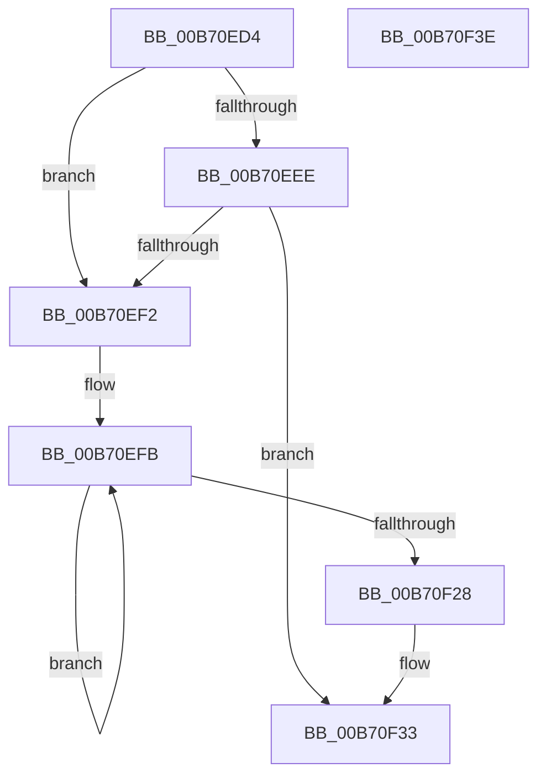

# PopVerifierFlushMemoryBeforeSleep

- RVA: `0x00B70ED4`–`0x00B70F3F` (길이 `107` bytes)
- VA: `0x0000000140B70ED4`
- 실행 섹션: `PAGELK`
- PDB 이름 있음: `예`; PDB Function 태그: `아니요`
- unwind 정보 RVA: `0x0005CAAC`
- 디코드: `30`개 명령, `107/107` bytes 표시
- 미해석 바이트: `0` (있으면 어셈블리에 `.byte`로 보존)

> 이 문서는 커널 이미지의 기계어와 PDB 기호를 분석해 생성했습니다. 4번과 5번은 함수 원형과 자료형을 바이너리 사용 방식에서 추정한 C 해석이며 원본 소스 복구 결과는 아닙니다.

## 1. Dependencies

- 직접 호출 지점: **4**; 고유 호출 대상: **1**
- 직접 호출자로 확인된 함수: **1**
- RIP 상대 이미지 참조: **2**

### Outgoing calls
- `0x00B70F03` → [MmPerformMemoryListCommand](MmPerformMemoryListCommand_function_00B7D730.md) (function, `0x00B7D730`)
- `0x00B70F10` → [MmPerformMemoryListCommand](MmPerformMemoryListCommand_function_00B7D730.md) (function, `0x00B7D730`)
- `0x00B70F1D` → [MmPerformMemoryListCommand](MmPerformMemoryListCommand_function_00B7D730.md) (function, `0x00B7D730`)
- `0x00B70F2E` → [MmPerformMemoryListCommand](MmPerformMemoryListCommand_function_00B7D730.md) (function, `0x00B7D730`)

### Direct callers
- [sub_00B80364](../B8/Unknown_function_00B80364.md) at `0x00B80376`

### Static image references
- `0x00B70EDE` → RVA `0x00F0CF0C` (`.data`; read)
- `0x00B70EE4` → RVA `0x00EF5120` (`.data`; read)

## 2. Other-region calls and transfers

- 다른 실행 섹션으로 향하는 call: **0**
- 별도 외부 분기/꼬리 이동을 확인하지 못했습니다.

## 3. Assembly (complete function range)

```asm
00B70ED4  48 89 5C 24 08                  mov qword ptr [rsp + 8], rbx
00B70ED9  57                              push rdi
00B70EDA  48 83 EC 20                     sub rsp, 0x20
00B70EDE  8B 05 28 C0 39 00               mov eax, dword ptr [rip + 0x39c028]
00B70EE4  8A 0D 36 42 38 00               mov cl, byte ptr [rip + 0x384236]
00B70EEA  84 C0                           test al, al
00B70EEC  78 04                           js 0x140b70ef2
00B70EEE  84 C9                           test cl, cl
00B70EF0  74 41                           je 0x140b70f33
00B70EF2  BB 02 00 00 00                  mov ebx, 2
00B70EF7  48 83 CF FF                     or rdi, 0xffffffffffffffff
00B70EFB  48 8B D7                        mov rdx, rdi
00B70EFE  B9 02 00 00 00                  mov ecx, 2
00B70F03  E8 28 C8 00 00                  call 0x140b7d730
00B70F08  48 8B D7                        mov rdx, rdi
00B70F0B  B9 03 00 00 00                  mov ecx, 3
00B70F10  E8 1B C8 00 00                  call 0x140b7d730
00B70F15  48 8B D7                        mov rdx, rdi
00B70F18  B9 03 00 00 00                  mov ecx, 3
00B70F1D  E8 0E C8 00 00                  call 0x140b7d730
00B70F22  48 83 EB 01                     sub rbx, 1
00B70F26  75 D3                           jne 0x140b70efb
00B70F28  48 8B D7                        mov rdx, rdi
00B70F2B  8D 4B 04                        lea ecx, [rbx + 4]
00B70F2E  E8 FD C7 00 00                  call 0x140b7d730
00B70F33  48 8B 5C 24 30                  mov rbx, qword ptr [rsp + 0x30]
00B70F38  48 83 C4 20                     add rsp, 0x20
00B70F3C  5F                              pop rdi
00B70F3D  C3                              ret
00B70F3E  CC                              int3
```

## 4. C-style interpretation (structured pseudocode)

```c
__int64 __fastcall PopVerifierFlushMemoryBeforeSleep(void)
{
    __int64 result;
    __int64 v_rbx;
    __int64 v_rdi;
    __int64 v_rsp;
    unsigned __int64 v_stack_p8;

    v_stack_p8 = v_rbx;
    v_rsp = (v_rsp) - (32);
    if (sign_flag) goto loc_00B70EF2;
    if ((unsigned __int8)(*(unsigned __int8 *)(v_rip + 3686966)) == 0) goto loc_00B70F33;
loc_00B70EF2:
    v_rdi = (v_rdi) | (-1);
loc_00B70EFB:
    result = MmPerformMemoryListCommand(2, v_rdi, a3, a4);
    result = MmPerformMemoryListCommand(3, v_rdi, a3, a4);
    result = MmPerformMemoryListCommand(3, v_rdi, a3, a4);
    v_rbx = (2) - (1);
    if (condition_is_not_equal) goto loc_00B70EFB;
    result = MmPerformMemoryListCommand(v_rbx + 4, v_rdi, a3, a4);
loc_00B70F33:
    v_rsp = (v_rsp) + (32);
    return result;
}
```

## 5. (Beta) C Style

```c
void PopVerifierFlushMemoryBeforeSleep(void)
{
    int64_t result;
    int64_t local_rbx;
    int64_t local_rdi;
    int64_t local_rsp;
    uint64_t v_stack_p8;

    v_stack_p8 = local_rbx;
    local_rsp = (local_rsp) - (32);
    if (sign_flag) goto loc_00B70EF2;
    if ((uint8_t)(*(uint8_t *)(v_rip + 0x384236)) == 0) goto loc_00B70F33;
loc_00B70EF2:
    local_rdi = (local_rdi) | (-1);
loc_00B70EFB:
    result = MmPerformMemoryListCommand(2, local_rdi, a3, a4);
    result = MmPerformMemoryListCommand(3, local_rdi, a3, a4);
    result = MmPerformMemoryListCommand(3, local_rdi, a3, a4);
    local_rbx = (2) - (1);
    if (condition_is_not_equal) goto loc_00B70EFB;
    result = MmPerformMemoryListCommand(local_rbx + 4, local_rdi, a3, a4);
loc_00B70F33:
    local_rsp = (local_rsp) + (32);
    return result;
}
```

## 6. Execution-region graph

[열기: 2D/3D 그래프와 함수 탐색 컨트롤 패널](../../../control-panel.html?section=pagelk&rva=0x00B70ED4&view=graph)

- 2D 그래프는 위에서 아래로 흐르고, 3D 그래프는 빈 공간을 드래그해 회전합니다. Shift+드래그는 이동, 휠은 확대·축소, 함수 노드 선택은 대상 보고서 이동입니다.

### Static fallback


