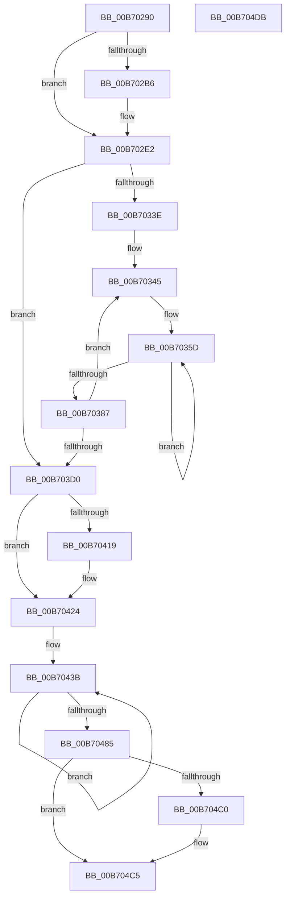

# PopWriteImageHeader

- RVA: `0x00B70290`–`0x00B704DC` (길이 `588` bytes)
- VA: `0x0000000140B70290`
- 실행 섹션: `PAGELK`
- PDB 이름 있음: `예`; PDB Function 태그: `아니요`
- unwind 정보 RVA: `0x0009B270`
- 디코드: `129`개 명령, `588/588` bytes 표시
- 미해석 바이트: `0` (있으면 어셈블리에 `.byte`로 보존)

> 이 문서는 커널 이미지의 기계어와 PDB 기호를 분석해 생성했습니다. 4번과 5번은 함수 원형과 자료형을 바이너리 사용 방식에서 추정한 C 해석이며 원본 소스 복구 결과는 아닙니다.

## 1. Dependencies

- 직접 호출 지점: **6**; 고유 호출 대상: **6**
- 직접 호출자로 확인된 함수: **1**
- RIP 상대 이미지 참조: **23**

### Outgoing calls
- `0x00B702C0` → [DbgPrint](../../text/35/DbgPrint_function_00358CB0.md) (function, `0x00358CB0`)
- `0x00B702DC` → [KeBugCheckEx](../../text/4F/KeBugCheckEx_function_004FD660.md) (function, `0x004FD660`)
- `0x00B70322` → [KeQueryPerformanceCounter](../../text/37/KeQueryPerformanceCounter_function_0037E7E0.md) (function, `0x0037E7E0`)
- `0x00B70496` → [tcpxsum](../../text/6B/tcpxsum_function_006BA210.md) (function, `0x006BA210`)
- `0x00B704AB` → [PopWriteHiberPages](../B6/PopWriteHiberPages_function_00B6FF78.md) (function, `0x00B6FF78`)
- `0x00B704C0` → [guard_dispatch_icall](../../text/6B/guard_dispatch_icall_function_006BAAD0.md) (function, `0x006BAAD0`)

### Direct callers
- [PopSaveHiberContext](../B6/PopSaveHiberContext_function_00B6F050.md) at `0x00B6F9DC`

### Static image references
- `0x00B702B9` → RVA `0x00B7FEB0` (` ?? ::OKHAJAOM::`string'`; read)
- `0x00B702E9` → RVA `0x00F0C490` (`.data`; write)
- `0x00B702F6` → RVA `0x00F0C498` (`.data`; write)
- `0x00B7030A` → RVA `0x00F0C390` (`.data`; write)
- `0x00B70311` → RVA `0x00F0BF40` (`.data`; read)
- `0x00B7031C` → RVA `0x00F0C574` (`.data`; write)
- `0x00B7032A` → RVA `0x00F0C3C8` (`.data`; write)
- `0x00B7033E` → RVA `0x00F0C620` (`.data`; read)
- `0x00B70396` → RVA `0x00F0C540` (`.data`; read/write)
- `0x00B703A9` → RVA `0x00F0C3A0` (`.data`; read/write)
- `0x00B703BC` → RVA `0x00F0C3A8` (`.data`; read/write)
- `0x00B703D0` → RVA `0x00F0C568` (`.data`; read)
- `0x00B703D7` → RVA `0x00F0C570` (`.data`; read)
- `0x00B703DD` → RVA `0x00F0C550` (`.data`; write)
- `0x00B703E4` → RVA `0x00F0C548` (`.data`; read)
- `0x00B703EB` → RVA `0x00F0C560` (`.data`; write)
- `0x00B703F2` → RVA `0x00F0C558` (`.data`; read)
- `0x00B703F8` → RVA `0x00F0C568` (`.data`; write)
- `0x00B703FF` → RVA `0x00F0C538` (`.data`; read)
- `0x00B70406` → RVA `0x00F0C570` (`.data`; write)
- `0x00B70410` → RVA `0x00F0BF61` (`.data`; read)
- `0x00B70419` → RVA `0x00F0C540` (`.data`; read)
- `0x00B70430` → RVA `0x00F0C378` (`.data`; read)

## 2. Other-region calls and transfers

- 다른 실행 섹션으로 향하는 call: **5**
  - `0x00B702C0` → [DbgPrint](../../text/35/DbgPrint_function_00358CB0.md) (`PAGELK` → `.text`)
  - `0x00B702DC` → [KeBugCheckEx](../../text/4F/KeBugCheckEx_function_004FD660.md) (`PAGELK` → `.text`)
  - `0x00B70322` → [KeQueryPerformanceCounter](../../text/37/KeQueryPerformanceCounter_function_0037E7E0.md) (`PAGELK` → `.text`)
  - `0x00B70496` → [tcpxsum](../../text/6B/tcpxsum_function_006BA210.md) (`PAGELK` → `.text`)
  - `0x00B704C0` → [guard_dispatch_icall](../../text/6B/guard_dispatch_icall_function_006BAAD0.md) (`PAGELK` → `.text`)
- 별도 외부 분기/꼬리 이동을 확인하지 못했습니다.

## 3. Assembly (complete function range)

```asm
00B70290  48 89 5C 24 08                  mov qword ptr [rsp + 8], rbx
00B70295  48 89 74 24 10                  mov qword ptr [rsp + 0x10], rsi
00B7029A  48 89 7C 24 18                  mov qword ptr [rsp + 0x18], rdi
00B7029F  41 56                           push r14
00B702A1  48 83 EC 30                     sub rsp, 0x30
00B702A5  48 8B DA                        mov rbx, rdx
00B702A8  41 8B F0                        mov esi, r8d
00B702AB  8B 52 50                        mov edx, dword ptr [rdx + 0x50]
00B702AE  48 8B F9                        mov rdi, rcx
00B702B1  41 3B D0                        cmp edx, r8d
00B702B4  74 2C                           je 0x140b702e2
00B702B6  44 8B C6                        mov r8d, esi
00B702B9  48 8D 0D F0 FB 00 00            lea rcx, [rip + 0xfbf0]
00B702C0  E8 EB 89 7E FF                  call 0x140358cb0
00B702C5  44 8B 4B 50                     mov r9d, dword ptr [rbx + 0x50]
00B702C9  BA 09 01 00 00                  mov edx, 0x109
00B702CE  41 B8 0A 00 00 00               mov r8d, 0xa
00B702D4  48 89 74 24 20                  mov qword ptr [rsp + 0x20], rsi
00B702D9  8D 4A 97                        lea ecx, [rdx - 0x69]
00B702DC  E8 7F D3 98 FF                  call 0x1404fd660
00B702E1  CC                              int3
00B702E2  48 8B 83 B0 04 00 00            mov rax, qword ptr [rbx + 0x4b0]
00B702E9  48 89 05 A0 C1 39 00            mov qword ptr [rip + 0x39c1a0], rax
00B702F0  8B 81 20 01 00 00               mov eax, dword ptr [rcx + 0x120]
00B702F6  89 05 9C C1 39 00               mov dword ptr [rip + 0x39c19c], eax
00B702FC  0F 31                           rdtsc
00B702FE  48 C1 E2 20                     shl rdx, 0x20
00B70302  33 C9                           xor ecx, ecx
00B70304  48 0B C2                        or rax, rdx
00B70307  49 2B C1                        sub rax, r9
00B7030A  48 89 05 7F C0 39 00            mov qword ptr [rip + 0x39c07f], rax
00B70311  8B 05 29 BC 39 00               mov eax, dword ptr [rip + 0x39bc29]
00B70317  C1 E8 04                        shr eax, 4
00B7031A  FF C8                           dec eax
00B7031C  89 05 52 C2 39 00               mov dword ptr [rip + 0x39c252], eax
00B70322  E8 B9 E4 80 FF                  call 0x14037e7e0
00B70327  45 33 D2                        xor r10d, r10d
00B7032A  48 89 05 97 C0 39 00            mov qword ptr [rip + 0x39c097], rax
00B70331  44 39 97 20 01 00 00            cmp dword ptr [rdi + 0x120], r10d
00B70338  0F 86 92 00 00 00               jbe 0x140b703d0
00B7033E  4C 8D 35 DB C2 39 00            lea r14, [rip + 0x39c2db]
00B70345  41 8B C2                        mov eax, r10d
00B70348  4D 8B C6                        mov r8, r14
00B7034B  4C 69 C8 A8 00 00 00            imul r9, rax, 0xa8
00B70352  BE 05 00 00 00                  mov esi, 5
00B70357  4D 8B D9                        mov r11, r9
00B7035A  4D 2B DE                        sub r11, r14
00B7035D  48 8B 87 28 01 00 00            mov rax, qword ptr [rdi + 0x128]
00B70364  4B 8D 14 03                     lea rdx, [r11 + r8]
00B70368  48 8B 4C 02 58                  mov rcx, qword ptr [rdx + rax + 0x58]
00B7036D  49 01 08                        add qword ptr [r8], rcx
00B70370  4D 8D 40 08                     lea r8, [r8 + 8]
00B70374  48 8B 87 28 01 00 00            mov rax, qword ptr [rdi + 0x128]
00B7037B  48 83 64 02 58 00               and qword ptr [rdx + rax + 0x58], 0
00B70381  48 83 EE 01                     sub rsi, 1
00B70385  75 D6                           jne 0x140b7035d
00B70387  48 8B 87 28 01 00 00            mov rax, qword ptr [rdi + 0x128]
00B7038E  41 FF C2                        inc r10d
00B70391  4A 8B 4C 08 38                  mov rcx, qword ptr [rax + r9 + 0x38]
00B70396  48 01 0D A3 C1 39 00            add qword ptr [rip + 0x39c1a3], rcx
00B7039D  48 8B 87 28 01 00 00            mov rax, qword ptr [rdi + 0x128]
00B703A4  4A 8B 4C 08 28                  mov rcx, qword ptr [rax + r9 + 0x28]
00B703A9  48 01 0D F0 BF 39 00            add qword ptr [rip + 0x39bff0], rcx
00B703B0  48 8B 87 28 01 00 00            mov rax, qword ptr [rdi + 0x128]
00B703B7  4A 8B 4C 08 50                  mov rcx, qword ptr [rax + r9 + 0x50]
00B703BC  48 01 0D E5 BF 39 00            add qword ptr [rip + 0x39bfe5], rcx
00B703C3  44 3B 97 20 01 00 00            cmp r10d, dword ptr [rdi + 0x120]
00B703CA  0F 82 75 FF FF FF               jb 0x140b70345
00B703D0  48 8B 0D 91 C1 39 00            mov rcx, qword ptr [rip + 0x39c191]
00B703D7  8B 15 93 C1 39 00               mov edx, dword ptr [rip + 0x39c193]
00B703DD  48 89 0D 6C C1 39 00            mov qword ptr [rip + 0x39c16c], rcx
00B703E4  48 03 0D 5D C1 39 00            add rcx, qword ptr [rip + 0x39c15d]
00B703EB  48 89 15 6E C1 39 00            mov qword ptr [rip + 0x39c16e], rdx
00B703F2  03 15 60 C1 39 00               add edx, dword ptr [rip + 0x39c160]
00B703F8  48 89 0D 69 C1 39 00            mov qword ptr [rip + 0x39c169], rcx
00B703FF  48 8B 0D 32 C1 39 00            mov rcx, qword ptr [rip + 0x39c132]
00B70406  89 15 64 C1 39 00               mov dword ptr [rip + 0x39c164], edx
00B7040C  48 89 4B 58                     mov qword ptr [rbx + 0x58], rcx
00B70410  80 3D 4A BB 39 00 00            cmp byte ptr [rip + 0x39bb4a], 0
00B70417  74 0B                           je 0x140b70424
00B70419  48 03 0D 20 C1 39 00            add rcx, qword ptr [rip + 0x39c120]
00B70420  48 89 4B 58                     mov qword ptr [rbx + 0x58], rcx
00B70424  BA 06 00 00 00                  mov edx, 6
00B70429  48 8D 83 88 00 00 00            lea rax, [rbx + 0x88]
00B70430  48 8D 0D 41 BF 39 00            lea rcx, [rip + 0x39bf41]
00B70437  44 8D 4A 7A                     lea r9d, [rdx + 0x7a]
00B7043B  0F 10 01                        movups xmm0, xmmword ptr [rcx]
00B7043E  0F 11 00                        movups xmmword ptr [rax], xmm0
00B70441  0F 10 49 10                     movups xmm1, xmmword ptr [rcx + 0x10]
00B70445  0F 11 48 10                     movups xmmword ptr [rax + 0x10], xmm1
00B70449  0F 10 41 20                     movups xmm0, xmmword ptr [rcx + 0x20]
00B7044D  0F 11 40 20                     movups xmmword ptr [rax + 0x20], xmm0
00B70451  0F 10 49 30                     movups xmm1, xmmword ptr [rcx + 0x30]
00B70455  0F 11 48 30                     movups xmmword ptr [rax + 0x30], xmm1
00B70459  0F 10 41 40                     movups xmm0, xmmword ptr [rcx + 0x40]
00B7045D  0F 11 40 40                     movups xmmword ptr [rax + 0x40], xmm0
00B70461  0F 10 49 50                     movups xmm1, xmmword ptr [rcx + 0x50]
00B70465  0F 11 48 50                     movups xmmword ptr [rax + 0x50], xmm1
00B70469  0F 10 41 60                     movups xmm0, xmmword ptr [rcx + 0x60]
00B7046D  0F 11 40 60                     movups xmmword ptr [rax + 0x60], xmm0
00B70471  49 03 C1                        add rax, r9
00B70474  0F 10 49 70                     movups xmm1, xmmword ptr [rcx + 0x70]
00B70478  49 03 C9                        add rcx, r9
00B7047B  0F 11 48 F0                     movups xmmword ptr [rax - 0x10], xmm1
00B7047F  48 83 EA 01                     sub rdx, 1
00B70483  75 B6                           jne 0x140b7043b
00B70485  41 B8 F0 04 00 00               mov r8d, 0x4f0
00B7048B  C7 03 48 49 42 52               mov dword ptr [rbx], 0x52424948
00B70491  48 8B D3                        mov rdx, rbx
00B70494  33 C9                           xor ecx, ecx
00B70496  E8 75 9D B4 FF                  call 0x1406ba210
00B7049B  45 33 C9                        xor r9d, r9d
00B7049E  89 43 08                        mov dword ptr [rbx + 8], eax
00B704A1  48 8B D3                        mov rdx, rbx
00B704A4  48 8B CF                        mov rcx, rdi
00B704A7  45 8D 41 01                     lea r8d, [r9 + 1]
00B704AB  E8 C8 FA FF FF                  call 0x140b6ff78
00B704B0  48 8B 87 B8 00 00 00            mov rax, qword ptr [rdi + 0xb8]
00B704B7  48 8B 40 48                     mov rax, qword ptr [rax + 0x48]
00B704BB  48 85 C0                        test rax, rax
00B704BE  74 05                           je 0x140b704c5
00B704C0  E8 0B A6 B4 FF                  call 0x1406baad0
00B704C5  48 8B 5C 24 40                  mov rbx, qword ptr [rsp + 0x40]
00B704CA  48 8B 74 24 48                  mov rsi, qword ptr [rsp + 0x48]
00B704CF  48 8B 7C 24 50                  mov rdi, qword ptr [rsp + 0x50]
00B704D4  48 83 C4 30                     add rsp, 0x30
00B704D8  41 5E                           pop r14
00B704DA  C3                              ret
00B704DB  CC                              int3
```

## 4. C-style interpretation (structured pseudocode)

```c
__int64 __fastcall PopWriteImageHeader(__int64 a1, __int64 a2, int a3)
{
    __int64 result;
    __int64 v_r10;
    __int64 v_r11;
    __int64 v_rsi;
    __int64 v_rsp;
    unsigned __int64 v_stack_m18;
    unsigned __int64 v_stack_p10;
    unsigned __int64 v_stack_p18;
    unsigned __int64 v_stack_p8;

    v_stack_p8 = v_rbx;
    v_stack_p10 = v_rsi;
    v_stack_p18 = v_rdi;
    v_rsp = (v_rsp) - (48);
    if (((unsigned int)((unsigned int)(*(unsigned int *)(a2 + 80)))) != a3) {
        a3 = (unsigned int)((unsigned int)(a3));
        a1 = v_rip + 64496;
        result = DbgPrint(a1, (unsigned int)(*(unsigned int *)(a2 + 80)), a3, a4);
        a4 = *(unsigned int *)(a2 + 80);
        a2 = 265;
        a3 = 10;
        v_stack_m18 = (unsigned int)(a3);
        a1 = a2 - 105;
        result = KeBugCheckEx(a1, a2, a3, a4);
    }
    *(unsigned __int64 *)(v_rip + 3785120) = *(unsigned __int64 *)(a2 + 1200);
    *(unsigned int *)(v_rip + 3785116) = (unsigned int)((unsigned int)(*(unsigned int *)(a1 + 288)));
    a2 = (a2) << (32);
    a1 = 0;
    result = ((unsigned int)(*(unsigned int *)(a1 + 288))) | (a2);
    result = (result) - (a4);
    *(unsigned __int64 *)(v_rip + 3784831) = result;
    result = (unsigned int)(((unsigned int)(*(unsigned int *)(v_rip + 3783721))) >> (4));
    result = (unsigned int)((result) - 1);
    *(unsigned int *)(v_rip + 3785298) = (unsigned int)(result);
    result = KeQueryPerformanceCounter(a1, a2, a3, a4);
    v_r10 = 0;
    *(unsigned __int64 *)(v_rip + 3784855) = result;
    if ((*(unsigned int *)(a1 + 288)) <= 0) goto loc_00B703D0;
loc_00B70345:
    a4 = (a4) * (0);
    v_r11 = (a4) - (v_rip + 3785435);
loc_00B7035D:
    v_rsi = (5) - (1);
    if (condition_is_not_equal) goto loc_00B7035D;
    v_r10 = (unsigned int)((v_r10) + 1);
    if (((unsigned int)(v_r10)) < (*(unsigned int *)(a1 + 288))) goto loc_00B70345;
loc_00B703D0:
    *(unsigned __int64 *)(v_rip + 3785068) = *(unsigned __int64 *)(v_rip + 3785105);
    a1 = (*(unsigned __int64 *)(v_rip + 3785105)) + (*(unsigned __int64 *)(v_rip + 3785053));
    *(unsigned __int64 *)(v_rip + 3785070) = (unsigned int)(*(unsigned int *)(v_rip + 3785107));
    a2 = (unsigned int)(((unsigned int)(*(unsigned int *)(v_rip + 3785107))) + (*(unsigned int *)(v_rip + 3785056)));
    *(unsigned __int64 *)(v_rip + 3785065) = a1;
    *(unsigned int *)(v_rip + 3785060) = (unsigned int)(a2);
    *(unsigned __int64 *)(a2 + 88) = *(unsigned __int64 *)(v_rip + 3785010);
    if ((*(unsigned __int8 *)(v_rip + 3783498)) != 0) {
        a1 = (*(unsigned __int64 *)(v_rip + 3785010)) + (*(unsigned __int64 *)(v_rip + 3784992));
        *(unsigned __int64 *)(a2 + 88) = a1;
    }
loc_00B7043B:
    *(unsigned __int64 *)(a2 + 136) = v_xmm0;
    *(unsigned __int64 *)(a2 + 136 + 16) = v_xmm1;
    *(unsigned __int64 *)(a2 + 136 + 32) = v_xmm0;
    *(unsigned __int64 *)(a2 + 136 + 48) = v_xmm1;
    *(unsigned __int64 *)(a2 + 136 + 64) = v_xmm0;
    *(unsigned __int64 *)(a2 + 136 + 80) = v_xmm1;
    *(unsigned __int64 *)(a2 + 136 + 96) = v_xmm0;
    result = (a2 + 136) + (6 + 122);
    a1 = (v_rip + 3784513) + (6 + 122);
    *(unsigned __int64 *)(result - 16) = v_xmm1;
    a2 = (6) - (1);
    if (condition_is_not_equal) goto loc_00B7043B;
    *(unsigned int *)(a2) = 0x52424948ULL;
    a1 = 0;
    result = tcpxsum(a1, a2, (unsigned int)(0x4F0ULL), 6 + 122);
    a4 = 0;
    *(unsigned int *)(a2 + 8) = (unsigned int)(result);
    result = PopWriteHiberPages(0, a2, a4 + 1, a4);
    result = *(unsigned __int64 *)(*(unsigned __int64 *)(a1 + 184) + 72);
    if (*(unsigned __int64 *)(*(unsigned __int64 *)(a1 + 184) + 72) != 0) {
        result = guard_dispatch_icall(0, a2, a4 + 1, a4);
    }
    v_rsp = (v_rsp) + (48);
    return result;
}
```

## 5. (Beta) C Style

```c
int64_t PopWriteImageHeader(void *Arg1, void *Arg2, int32_t Arg3)
{
    uint8_t *arg1 = (uint8_t *)Arg1;
    uint8_t *arg2 = (uint8_t *)Arg2;

    int64_t result;
    int64_t local_r10;
    int64_t local_r11;
    int64_t local_rsi;
    int64_t local_rsp;
    uint64_t v_stack_m18;
    uint64_t v_stack_p10;
    uint64_t v_stack_p18;
    uint64_t v_stack_p8;

    v_stack_p8 = local_rbx;
    v_stack_p10 = local_rsi;
    v_stack_p18 = local_rdi;
    local_rsp = (local_rsp) - (48);
    if (((uint32_t)((uint32_t)(*(uint32_t *)(arg2 + 0x50)))) != Arg3) {
        Arg3 = (uint32_t)((uint32_t)(Arg3));
        Arg1 = v_rip + 64496;
        result = DbgPrint(Arg1, (uint32_t)(*(uint32_t *)(arg2 + 0x50)), Arg3, a4);
        a4 = *(uint32_t *)(arg2 + 0x50);
        Arg2 = 265;
        Arg3 = 10;
        v_stack_m18 = (uint32_t)(Arg3);
        Arg1 = Arg2 - 105;
        result = KeBugCheckEx(Arg1, Arg2, Arg3, a4);
    }
    *(uint64_t *)(v_rip + 0x39C1A0) = *(uint64_t *)(arg2 + 0x4B0);
    *(uint32_t *)(v_rip + 0x39C19C) = (uint32_t)((uint32_t)(*(uint32_t *)(arg1 + 0x120)));
    Arg2 = (Arg2) << (32);
    Arg1 = 0;
    result = ((uint32_t)(*(uint32_t *)(arg1 + 0x120))) | (Arg2);
    result = (result) - (a4);
    *(uint64_t *)(v_rip + 0x39C07F) = result;
    result = (uint32_t)(((uint32_t)(*(uint32_t *)(v_rip + 0x39BC29))) >> (4));
    result = (uint32_t)((result) - 1);
    *(uint32_t *)(v_rip + 0x39C252) = (uint32_t)(result);
    result = KeQueryPerformanceCounter(Arg1, Arg2, Arg3, a4);
    local_r10 = 0;
    *(uint64_t *)(v_rip + 0x39C097) = result;
    if ((*(uint32_t *)(arg1 + 0x120)) <= 0) goto loc_00B703D0;
loc_00B70345:
    a4 = (a4) * (0);
    local_r11 = (a4) - (v_rip + 3785435);
loc_00B7035D:
    local_rsi = (5) - (1);
    if (condition_is_not_equal) goto loc_00B7035D;
    local_r10 = (uint32_t)((local_r10) + 1);
    if (((uint32_t)(local_r10)) < (*(uint32_t *)(arg1 + 0x120))) goto loc_00B70345;
loc_00B703D0:
    *(uint64_t *)(v_rip + 0x39C16C) = *(uint64_t *)(v_rip + 0x39C191);
    Arg1 = (*(uint64_t *)(v_rip + 0x39C191)) + (*(uint64_t *)(v_rip + 0x39C15D));
    *(uint64_t *)(v_rip + 0x39C16E) = (uint32_t)(*(uint32_t *)(v_rip + 0x39C193));
    Arg2 = (uint32_t)(((uint32_t)(*(uint32_t *)(v_rip + 0x39C193))) + (*(uint32_t *)(v_rip + 0x39C160)));
    *(void **)(v_rip + 0x39C169) = Arg1;
    *(uint32_t *)(v_rip + 0x39C164) = (uint32_t)(Arg2);
    *(uint64_t *)(arg2 + 0x58) = *(uint64_t *)(v_rip + 0x39C132);
    if ((*(uint8_t *)(v_rip + 0x39BB4A)) != 0) {
        Arg1 = (*(uint64_t *)(v_rip + 0x39C132)) + (*(uint64_t *)(v_rip + 0x39C120));
        *(void **)(arg2 + 0x58) = Arg1;
    }
loc_00B7043B:
    *(uint64_t *)(arg2 + 0x88) = v_xmm0;
    *(uint64_t *)(arg2 + 0x88 + 0x10) = v_xmm1;
    *(uint64_t *)(arg2 + 0x88 + 0x20) = v_xmm0;
    *(uint64_t *)(arg2 + 0x88 + 0x30) = v_xmm1;
    *(uint64_t *)(arg2 + 0x88 + 0x40) = v_xmm0;
    *(uint64_t *)(arg2 + 0x88 + 0x50) = v_xmm1;
    *(uint64_t *)(arg2 + 0x88 + 0x60) = v_xmm0;
    result = (Arg2 + 136) + (6 + 122);
    Arg1 = (v_rip + 3784513) + (6 + 122);
    *(uint64_t *)(result - 0x10) = v_xmm1;
    Arg2 = (6) - (1);
    if (condition_is_not_equal) goto loc_00B7043B;
    *(uint32_t *)(arg2) = 0x52424948ULL;
    Arg1 = 0;
    result = tcpxsum(Arg1, Arg2, (uint32_t)(0x4F0ULL), 6 + 122);
    a4 = 0;
    *(uint32_t *)(arg2 + 0x8) = (uint32_t)(result);
    result = PopWriteHiberPages(0, Arg2, a4 + 1, a4);
    result = *(uint64_t *)(*(uint64_t *)(arg1 + 0xB8) + 0x48);
    if (*(uint64_t *)(*(uint64_t *)(arg1 + 0xB8) + 0x48) != 0) {
        result = guard_dispatch_icall(0, Arg2, a4 + 1, a4);
    }
    local_rsp = (local_rsp) + (48);
    return result;
}
```

### 관측된 메모리 오프셋

구조체 형식이 확인되지 않은 접근은 인자 기준의 오프셋으로만 기록했습니다.

| 기준 인자 | 오프셋 표현 | 폭 (bit) | 접근 |
|---|---:|---:|---|
| `Arg1` | `+ 0xB8` | `64` | `R` |
| `Arg1` | `+ 0x120` | `32` | `R` |
| `Arg1` | `+ 0x128` | `64` | `R` |
| `Arg2` | `- 0x10` | `128` | `R` |
| `Arg2` | `+ 0x0` | `32` | `W` |
| `Arg2` | `+ 0x0` | `128` | `R` |
| `Arg2` | `+ 0x8` | `32` | `W` |
| `Arg2` | `+ 0x10` | `128` | `R` |
| `Arg2` | `+ 0x20` | `128` | `R` |
| `Arg2` | `+ 0x30` | `128` | `R` |
| `Arg2` | `+ 0x40` | `128` | `R` |
| `Arg2` | `+ 0x50` | `32` | `R` |
| `Arg2` | `+ 0x50` | `128` | `R` |
| `Arg2` | `+ 0x58` | `64` | `W` |
| `Arg2` | `+ 0x60` | `128` | `R` |
| `Arg2` | `+ 0x88` | `64` | `R` |
| `Arg2` | `+ 0x4B0` | `64` | `R` |

## 6. Execution-region graph

[열기: 2D/3D 그래프와 함수 탐색 컨트롤 패널](../../../control-panel.html?section=pagelk&rva=0x00B70290&view=graph)

- 2D 그래프는 위에서 아래로 흐르고, 3D 그래프는 빈 공간을 드래그해 회전합니다. Shift+드래그는 이동, 휠은 확대·축소, 함수 노드 선택은 대상 보고서 이동입니다.

### Static fallback


