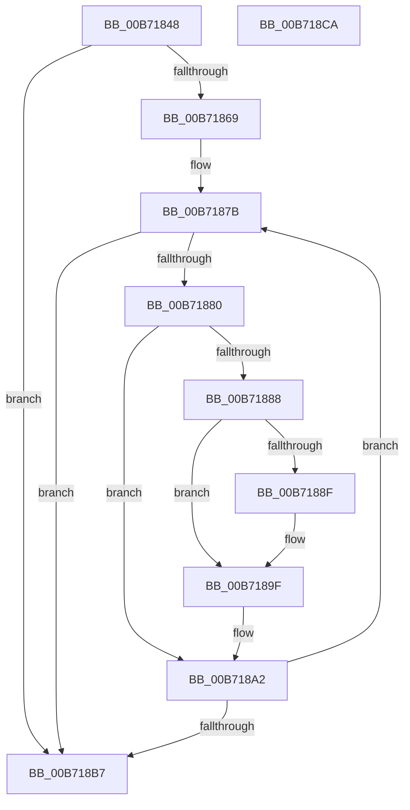

# PpmHeteroAmdProcessorInit

- RVA: `0x00B71848`–`0x00B718CB` (길이 `131` bytes)
- VA: `0x0000000140B71848`
- 실행 섹션: `PAGELK`
- PDB 이름 있음: `예`; PDB Function 태그: `아니요`
- unwind 정보 RVA: `0x000B64AC`
- 디코드: `39`개 명령, `131/131` bytes 표시
- 미해석 바이트: `0` (있으면 어셈블리에 `.byte`로 보존)

> 이 문서는 커널 이미지의 기계어와 PDB 기호를 분석해 생성했습니다. 4번과 5번은 함수 원형과 자료형을 바이너리 사용 방식에서 추정한 C 해석이며 원본 소스 복구 결과는 아닙니다.

## 1. Dependencies

- 직접 호출 지점: **1**; 고유 호출 대상: **1**
- 직접 호출자로 확인된 함수: **1**
- RIP 상대 이미지 참조: **1**

### Outgoing calls
- `0x00B718BF` → [_security_check_cookie](../../text/6A/_security_check_cookie_function_006AC640.md) (function, `0x006AC640`)

### Direct callers
- [PpmHeteroHgsProcessorInit](../../text/5D/PpmHeteroHgsProcessorInit_function_005D8C08.md) at `0x005D8C50`

### Static image references
- `0x00B7184E` → RVA `0x00E0A740` (`.data`; read)

## 2. Other-region calls and transfers

- 다른 실행 섹션으로 향하는 call: **1**
  - `0x00B718BF` → [_security_check_cookie](../../text/6A/_security_check_cookie_function_006AC640.md) (`PAGELK` → `.text`)
- 별도 외부 분기/꼬리 이동을 확인하지 못했습니다.

## 3. Assembly (complete function range)

```asm
00B71848  40 53                           push rbx
00B7184A  48 83 EC 20                     sub rsp, 0x20
00B7184E  48 8B 05 EB 8E 29 00            mov rax, qword ptr [rip + 0x298eeb]
00B71855  48 33 C4                        xor rax, rsp
00B71858  48 89 44 24 10                  mov qword ptr [rsp + 0x10], rax
00B7185D  80 B9 8D 00 00 00 01            cmp byte ptr [rcx + 0x8d], 1
00B71864  4C 8B C1                        mov r8, rcx
00B71867  75 4E                           jne 0x140b718b7
00B71869  45 33 DB                        xor r11d, r11d
00B7186C  45 32 C9                        xor r9b, r9b
00B7186F  33 C9                           xor ecx, ecx
00B71871  B8 26 00 00 80                  mov eax, 0x80000026
00B71876  0F A2                           cpuid
00B71878  44 8B D0                        mov r10d, eax
00B7187B  66 85 DB                        test bx, bx
00B7187E  74 37                           je 0x140b718b7
00B71880  C1 E9 08                        shr ecx, 8
00B71883  80 F9 01                        cmp cl, 1
00B71886  75 1A                           jne 0x140b718a2
00B71888  41 0F BA E2 1E                  bt r10d, 0x1e
00B7188D  73 10                           jae 0x140b7189f
00B7188F  F7 C3 00 00 00 F0               test ebx, 0xf0000000
00B71895  0F 94 C0                        sete al
00B71898  41 88 80 4D 8A 00 00            mov byte ptr [r8 + 0x8a4d], al
00B7189F  41 B1 01                        mov r9b, 1
00B718A2  41 FF C3                        inc r11d
00B718A5  B8 26 00 00 80                  mov eax, 0x80000026
00B718AA  41 8B CB                        mov ecx, r11d
00B718AD  0F A2                           cpuid
00B718AF  44 8B D0                        mov r10d, eax
00B718B2  45 84 C9                        test r9b, r9b
00B718B5  74 C4                           je 0x140b7187b
00B718B7  48 8B 4C 24 10                  mov rcx, qword ptr [rsp + 0x10]
00B718BC  48 33 CC                        xor rcx, rsp
00B718BF  E8 7C AD B3 FF                  call 0x1406ac640
00B718C4  48 83 C4 20                     add rsp, 0x20
00B718C8  5B                              pop rbx
00B718C9  C3                              ret
00B718CA  CC                              int3
```

## 4. C-style interpretation (structured pseudocode)

```c
__int64 __fastcall PpmHeteroAmdProcessorInit(__int64 a1, __int64 a2, __int64 a3, unsigned __int8 a4)
{
    __int64 result;
    __int64 v_r11;
    __int64 v_rsp;
    unsigned __int64 v_stack_m18;

    v_rsp = (v_rsp) - (32);
    result = (*(unsigned __int64 *)(v_rip + 2723563)) ^ (v_rsp);
    v_stack_m18 = result;
    if ((*(unsigned __int8 *)(a1 + 141)) != 1) goto loc_00B718B7;
    v_r11 = 0;
    a4 = 0;
    a1 = 0;
loc_00B7187B:
    if ((unsigned __int16)(v_rbx) == 0) goto loc_00B718B7;
    a1 = (unsigned int)((a1) >> (8));
    if (((unsigned __int8)(a1)) != 1) goto loc_00B718A2;
    result = (unsigned int)(0x80000026ULL);
    if (((unsigned __int8)(a1)) < 1) {
        result = ((((unsigned int)(v_rbx)) & (0xF0000000ULL)) == 0) ? 1 : 0;
        *(unsigned __int8 *)(a1 + 35405) = (unsigned __int8)(result);
    }
loc_00B718A2:
    v_r11 = (unsigned int)((v_r11) + 1);
    if (1 == 0) goto loc_00B7187B;
loc_00B718B7:
    a1 = (v_stack_m18) ^ (v_rsp);
    result = _security_check_cookie(a1, a2, a1, 1);
    v_rsp = (v_rsp) + (32);
    return result;
}
```

## 5. (Beta) C Style

```c
int64_t PpmHeteroAmdProcessorInit(void *Arg1, int64_t Arg2, int64_t Arg3, uint8_t Arg4)
{
    uint8_t *arg1 = (uint8_t *)Arg1;

    int64_t result;
    int64_t local_r11;
    int64_t local_rsp;
    uint64_t v_stack_m18;

    local_rsp = (local_rsp) - (32);
    result = (*(uint64_t *)(v_rip + 0x298EEB)) ^ (local_rsp);
    v_stack_m18 = result;
    if ((*(uint8_t *)(arg1 + 0x8D)) != 1) goto loc_00B718B7;
    local_r11 = 0;
    Arg4 = 0;
    Arg1 = 0;
loc_00B7187B:
    if ((uint16_t)(local_rbx) == 0) goto loc_00B718B7;
    Arg1 = (uint32_t)((Arg1) >> (8));
    if (((uint8_t)(Arg1)) != 1) goto loc_00B718A2;
    result = (uint32_t)(0x80000026ULL);
    if (((uint8_t)(Arg1)) < 1) {
        result = ((((uint32_t)(local_rbx)) & (0xF0000000ULL)) == 0) ? 1 : 0;
        *(uint8_t *)(arg1 + 0x8A4D) = (uint8_t)(result);
    }
loc_00B718A2:
    local_r11 = (uint32_t)((local_r11) + 1);
    if (1 == 0) goto loc_00B7187B;
loc_00B718B7:
    Arg1 = (v_stack_m18) ^ (local_rsp);
    result = _security_check_cookie(Arg1, Arg2, Arg1, 1);
    local_rsp = (local_rsp) + (32);
    return result;
}
```

### 관측된 메모리 오프셋

구조체 형식이 확인되지 않은 접근은 인자 기준의 오프셋으로만 기록했습니다.

| 기준 인자 | 오프셋 표현 | 폭 (bit) | 접근 |
|---|---:|---:|---|
| `Arg1` | `+ 0x8D` | `8` | `R` |
| `Arg1` | `+ 0x8A4D` | `8` | `W` |

## 6. Execution-region graph

[열기: 2D/3D 그래프와 함수 탐색 컨트롤 패널](../../../control-panel.html?section=pagelk&rva=0x00B71848&view=graph)

- 2D 그래프는 위에서 아래로 흐르고, 3D 그래프는 빈 공간을 드래그해 회전합니다. Shift+드래그는 이동, 휠은 확대·축소, 함수 노드 선택은 대상 보고서 이동입니다.

### Static fallback


