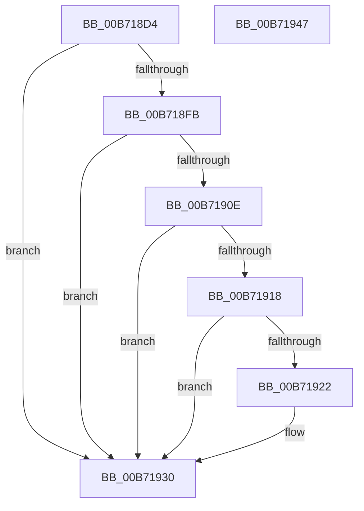

# PpmHeteroIntelProcessorInit

- RVA: `0x00B718D4`–`0x00B71948` (길이 `116` bytes)
- VA: `0x0000000140B718D4`
- 실행 섹션: `PAGELK`
- PDB 이름 있음: `예`; PDB Function 태그: `아니요`
- unwind 정보 RVA: `0x000CCC98`
- 디코드: `36`개 명령, `116/116` bytes 표시
- 미해석 바이트: `0` (있으면 어셈블리에 `.byte`로 보존)

> 이 문서는 커널 이미지의 기계어와 PDB 기호를 분석해 생성했습니다. 4번과 5번은 함수 원형과 자료형을 바이너리 사용 방식에서 추정한 C 해석이며 원본 소스 복구 결과는 아닙니다.

## 1. Dependencies

- 직접 호출 지점: **1**; 고유 호출 대상: **1**
- 직접 호출자로 확인된 함수: **1**
- RIP 상대 이미지 참조: **1**

### Outgoing calls
- `0x00B71937` → [_security_check_cookie](../../text/6A/_security_check_cookie_function_006AC640.md) (function, `0x006AC640`)

### Direct callers
- [PpmHeteroHgsProcessorInit](../../text/5D/PpmHeteroHgsProcessorInit_function_005D8C08.md) at `0x005D8C41`

### Static image references
- `0x00B718E1` → RVA `0x00E0A740` (`.data`; read)

## 2. Other-region calls and transfers

- 다른 실행 섹션으로 향하는 call: **1**
  - `0x00B71937` → [_security_check_cookie](../../text/6A/_security_check_cookie_function_006AC640.md) (`PAGELK` → `.text`)
- 별도 외부 분기/꼬리 이동을 확인하지 못했습니다.

## 3. Assembly (complete function range)

```asm
00B718D4  48 89 5C 24 10                  mov qword ptr [rsp + 0x10], rbx
00B718D9  55                              push rbp
00B718DA  48 8B EC                        mov rbp, rsp
00B718DD  48 83 EC 20                     sub rsp, 0x20
00B718E1  48 8B 05 58 8E 29 00            mov rax, qword ptr [rip + 0x298e58]
00B718E8  48 33 C4                        xor rax, rsp
00B718EB  48 89 45 F0                     mov qword ptr [rbp - 0x10], rax
00B718EF  80 B9 8D 00 00 00 02            cmp byte ptr [rcx + 0x8d], 2
00B718F6  4C 8B C1                        mov r8, rcx
00B718F9  75 35                           jne 0x140b71930
00B718FB  33 C0                           xor eax, eax
00B718FD  33 C9                           xor ecx, ecx
00B718FF  0F A2                           cpuid
00B71901  44 8B C8                        mov r9d, eax
00B71904  B8 07 00 00 00                  mov eax, 7
00B71909  44 3B C8                        cmp r9d, eax
00B7190C  72 22                           jb 0x140b71930
00B7190E  33 C9                           xor ecx, ecx
00B71910  0F A2                           cpuid
00B71912  0F BA E2 0F                     bt edx, 0xf
00B71916  73 18                           jae 0x140b71930
00B71918  B8 1A 00 00 00                  mov eax, 0x1a
00B7191D  44 3B C8                        cmp r9d, eax
00B71920  72 0E                           jb 0x140b71930
00B71922  33 C9                           xor ecx, ecx
00B71924  0F A2                           cpuid
00B71926  C1 E8 18                        shr eax, 0x18
00B71929  41 88 80 4D 8A 00 00            mov byte ptr [r8 + 0x8a4d], al
00B71930  48 8B 4D F0                     mov rcx, qword ptr [rbp - 0x10]
00B71934  48 33 CC                        xor rcx, rsp
00B71937  E8 04 AD B3 FF                  call 0x1406ac640
00B7193C  48 8B 5C 24 38                  mov rbx, qword ptr [rsp + 0x38]
00B71941  48 83 C4 20                     add rsp, 0x20
00B71945  5D                              pop rbp
00B71946  C3                              ret
00B71947  CC                              int3
```

## 4. C-style interpretation (structured pseudocode)

```c
__int64 __fastcall PpmHeteroIntelProcessorInit(__int64 a1, int a2)
{
    __int64 result;
    __int64 v_rsp;
    unsigned __int64 v_stack_m18;
    unsigned __int64 v_stack_p10;

    v_stack_p10 = v_rbx;
    v_rsp = (v_rsp) - (32);
    result = (*(unsigned __int64 *)(v_rip + 2723416)) ^ (v_rsp);
    v_stack_m18 = result;
    if ((*(unsigned __int8 *)(a1 + 141)) != 2) goto loc_00B71930;
    result = 0;
    a1 = 0;
    if (0 < 7) goto loc_00B71930;
    a1 = 0;
    if (condition_is_above_or_equal) goto loc_00B71930;
    result = 26;
    if (0 >= 26) {
        a1 = 0;
        result = (unsigned int)((26) >> (24));
        *(unsigned __int8 *)(a1 + 35405) = (unsigned __int8)(result);
    }
    a1 = (v_stack_m18) ^ (v_rsp);
    result = _security_check_cookie(a1, a2, a1, 0);
    v_rsp = (v_rsp) + (32);
    return result;
}
```

## 5. (Beta) C Style

```c
int64_t PpmHeteroIntelProcessorInit(void *Arg1, int32_t Arg2)
{
    uint8_t *arg1 = (uint8_t *)Arg1;

    int64_t result;
    int64_t local_rsp;
    uint64_t v_stack_m18;
    uint64_t v_stack_p10;

    v_stack_p10 = local_rbx;
    local_rsp = (local_rsp) - (32);
    result = (*(uint64_t *)(v_rip + 0x298E58)) ^ (local_rsp);
    v_stack_m18 = result;
    if ((*(uint8_t *)(arg1 + 0x8D)) != 2) goto loc_00B71930;
    result = 0;
    Arg1 = 0;
    if (0 < 7) goto loc_00B71930;
    Arg1 = 0;
    if (condition_is_above_or_equal) goto loc_00B71930;
    result = 26;
    if (0 >= 26) {
        Arg1 = 0;
        result = (uint32_t)((26) >> (24));
        *(uint8_t *)(arg1 + 0x8A4D) = (uint8_t)(result);
    }
    Arg1 = (v_stack_m18) ^ (local_rsp);
    result = _security_check_cookie(Arg1, Arg2, Arg1, 0);
    local_rsp = (local_rsp) + (32);
    return result;
}
```

### 관측된 메모리 오프셋

구조체 형식이 확인되지 않은 접근은 인자 기준의 오프셋으로만 기록했습니다.

| 기준 인자 | 오프셋 표현 | 폭 (bit) | 접근 |
|---|---:|---:|---|
| `Arg1` | `+ 0x8D` | `8` | `R` |
| `Arg1` | `+ 0x8A4D` | `8` | `W` |

## 6. Execution-region graph

[열기: 2D/3D 그래프와 함수 탐색 컨트롤 패널](../../../control-panel.html?section=pagelk&rva=0x00B718D4&view=graph)

- 2D 그래프는 위에서 아래로 흐르고, 3D 그래프는 빈 공간을 드래그해 회전합니다. Shift+드래그는 이동, 휠은 확대·축소, 함수 노드 선택은 대상 보고서 이동입니다.

### Static fallback


