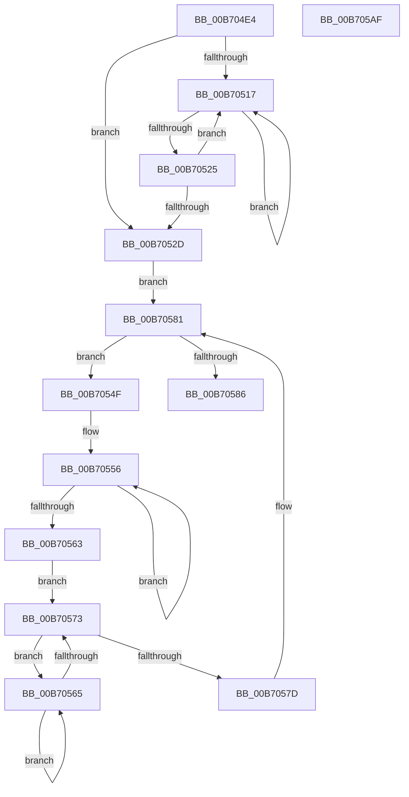

# ProducerConsumerBufferComplete

- RVA: `0x00B704E4`–`0x00B705B0` (길이 `204` bytes)
- VA: `0x0000000140B704E4`
- 실행 섹션: `PAGELK`
- PDB 이름 있음: `예`; PDB Function 태그: `아니요`
- unwind 정보 RVA: `0x0005E6B4`
- 디코드: `63`개 명령, `204/204` bytes 표시
- 미해석 바이트: `0` (있으면 어셈블리에 `.byte`로 보존)

> 이 문서는 커널 이미지의 기계어와 PDB 기호를 분석해 생성했습니다. 4번과 5번은 함수 원형과 자료형을 바이너리 사용 방식에서 추정한 C 해석이며 원본 소스 복구 결과는 아닙니다.

## 1. Dependencies

- 직접 호출 지점: **3**; 고유 호출 대상: **1**
- 직접 호출자로 확인된 함수: **4**
- RIP 상대 이미지 참조: **0**

### Outgoing calls
- `0x00B70519` → [PopHiberCheckForDebugBreak](PopHiberCheckForDebugBreak_function_00B78258.md) (function, `0x00B78258`)
- `0x00B70558` → [PopHiberCheckForDebugBreak](PopHiberCheckForDebugBreak_function_00B78258.md) (function, `0x00B78258`)
- `0x00B70567` → [PopHiberCheckForDebugBreak](PopHiberCheckForDebugBreak_function_00B78258.md) (function, `0x00B78258`)

### Direct callers
- [PopCountDataAsProduced](../B6/PopCountDataAsProduced_function_00B6CE5C.md) at `0x00B6CF1F`
- [PopDecompressHiberBlocks](../B6/PopDecompressHiberBlocks_function_00B6D074.md) at `0x00B6D31E`
- [PopDecompressHiberBlocks](../B6/PopDecompressHiberBlocks_function_00B6D074.md) at `0x00B6D37E`
- [PopRequestRead](../B6/PopRequestRead_function_00B6E6DC.md) at `0x00B6E7AC`
- [PopRequestWrite](../B6/PopRequestWrite_function_00B6EB14.md) at `0x00B6EB9F`

### Static image references
- 디코드된 RIP-relative 메모리 참조가 없습니다.

## 2. Other-region calls and transfers

- 다른 실행 섹션으로 향하는 call: **0**
- 별도 외부 분기/꼬리 이동을 확인하지 못했습니다.

## 3. Assembly (complete function range)

```asm
00B704E4  48 8B C4                        mov rax, rsp
00B704E7  48 89 58 08                     mov qword ptr [rax + 8], rbx
00B704EB  48 89 68 10                     mov qword ptr [rax + 0x10], rbp
00B704EF  48 89 70 18                     mov qword ptr [rax + 0x18], rsi
00B704F3  48 89 78 20                     mov qword ptr [rax + 0x20], rdi
00B704F7  41 56                           push r14
00B704F9  48 83 EC 20                     sub rsp, 0x20
00B704FD  33 C0                           xor eax, eax
00B704FF  41 8B E9                        mov ebp, r9d
00B70502  49 8B F0                        mov rsi, r8
00B70505  48 8B FA                        mov rdi, rdx
00B70508  48 8B D9                        mov rbx, rcx
00B7050B  44 8D 70 01                     lea r14d, [rax + 1]
00B7050F  F0 44 0F B1 71 18               lock cmpxchg dword ptr [rcx + 0x18], r14d
00B70515  74 16                           je 0x140b7052d
00B70517  F3 90                           pause
00B70519  E8 3A 7D 00 00                  call 0x140b78258
00B7051E  8B 43 18                        mov eax, dword ptr [rbx + 0x18]
00B70521  85 C0                           test eax, eax
00B70523  75 F2                           jne 0x140b70517
00B70525  F0 44 0F B1 73 18               lock cmpxchg dword ptr [rbx + 0x18], r14d
00B7052B  75 EA                           jne 0x140b70517
00B7052D  4C 8B 47 08                     mov r8, qword ptr [rdi + 8]
00B70531  33 D2                           xor edx, edx
00B70533  8B 4B 08                        mov ecx, dword ptr [rbx + 8]
00B70536  49 8B C0                        mov rax, r8
00B70539  2B 33                           sub esi, dword ptr [rbx]
00B7053B  48 F7 F1                        div rcx
00B7053E  8D 04 31                        lea eax, [rcx + rsi]
00B70541  3B D6                           cmp edx, esi
00B70543  0F 46 C6                        cmovbe eax, esi
00B70546  2B C2                           sub eax, edx
00B70548  8B F0                           mov esi, eax
00B7054A  49 03 F0                        add rsi, r8
00B7054D  EB 32                           jmp 0x140b70581
00B7054F  C7 43 18 00 00 00 00            mov dword ptr [rbx + 0x18], 0
00B70556  F3 90                           pause
00B70558  E8 FB 7C 00 00                  call 0x140b78258
00B7055D  48 3B 77 08                     cmp rsi, qword ptr [rdi + 8]
00B70561  75 F3                           jne 0x140b70556
00B70563  EB 0E                           jmp 0x140b70573
00B70565  F3 90                           pause
00B70567  E8 EC 7C 00 00                  call 0x140b78258
00B7056C  8B 43 18                        mov eax, dword ptr [rbx + 0x18]
00B7056F  85 C0                           test eax, eax
00B70571  75 F2                           jne 0x140b70565
00B70573  33 C0                           xor eax, eax
00B70575  F0 44 0F B1 73 18               lock cmpxchg dword ptr [rbx + 0x18], r14d
00B7057B  75 E8                           jne 0x140b70565
00B7057D  4C 8B 47 08                     mov r8, qword ptr [rdi + 8]
00B70581  49 3B F0                        cmp rsi, r8
00B70584  75 C9                           jne 0x140b7054f
00B70586  48 8B 74 24 40                  mov rsi, qword ptr [rsp + 0x40]
00B7058B  49 03 E8                        add rbp, r8
00B7058E  48 89 6F 08                     mov qword ptr [rdi + 8], rbp
00B70592  48 8B 6C 24 38                  mov rbp, qword ptr [rsp + 0x38]
00B70597  48 8B 7C 24 48                  mov rdi, qword ptr [rsp + 0x48]
00B7059C  C7 43 18 00 00 00 00            mov dword ptr [rbx + 0x18], 0
00B705A3  48 8B 5C 24 30                  mov rbx, qword ptr [rsp + 0x30]
00B705A8  48 83 C4 20                     add rsp, 0x20
00B705AC  41 5E                           pop r14
00B705AE  C3                              ret
00B705AF  CC                              int3
```

## 4. C-style interpretation (structured pseudocode)

```c
__int64 __fastcall ProducerConsumerBufferComplete(__int64 a1, __int64 a2, __int64 a3, int a4)
{
    __int64 result;
    __int64 v_rbp;
    __int64 v_rsi;
    __int64 v_rsp;
    unsigned __int64 v_stack_p10;
    unsigned __int64 v_stack_p18;
    unsigned __int64 v_stack_p20;
    unsigned __int64 v_stack_p8;

    *(unsigned __int64 *)(v_rsp + 8) = v_rbx;
    *(unsigned __int64 *)(v_rsp + 16) = v_rbp;
    *(unsigned __int64 *)(v_rsp + 24) = v_rsi;
    *(unsigned __int64 *)(v_rsp + 32) = v_rdi;
    v_rsp = (v_rsp) - (32);
    result = 0;
    if (condition_is_equal) goto loc_00B7052D;
loc_00B70517:
    result = PopHiberCheckForDebugBreak(a1, a2, a3, a4);
    if ((unsigned int)((unsigned int)(*(unsigned int *)(a1 + 24))) != 0) goto loc_00B70517;
    if ((unsigned int)((unsigned int)(*(unsigned int *)(a1 + 24))) != 0) goto loc_00B70517;
loc_00B7052D:
    a2 = 0;
    v_rsi = (unsigned int)((a3) - (*(unsigned int *)(a1)));
    result = (unsigned int)(*(unsigned int *)(a1 + 8)) + v_rsi * 1;
    if (0 <= ((unsigned int)(v_rsi))) { result = (unsigned int)(v_rsi); }
    result = (unsigned int)((result) - (0));
    v_rsi = ((unsigned int)((unsigned int)(result))) + (*(unsigned __int64 *)(a2 + 8));
    goto loc_00B70581;
loc_00B7054F:
    *(unsigned int *)(a1 + 24) = 0;
loc_00B70556:
    result = PopHiberCheckForDebugBreak((unsigned int)(*(unsigned int *)(a1 + 8)), a2, *(unsigned __int64 *)(a2 + 8), a4);
    if (v_rsi != (*(unsigned __int64 *)(a2 + 8))) goto loc_00B70556;
    goto loc_00B70573;
loc_00B70565:
    result = PopHiberCheckForDebugBreak((unsigned int)(*(unsigned int *)(a1 + 8)), a2, *(unsigned __int64 *)(a2 + 8), a4);
    if ((unsigned int)((unsigned int)(*(unsigned int *)(a1 + 24))) != 0) goto loc_00B70565;
loc_00B70573:
    result = 0;
    if (condition_is_not_equal) goto loc_00B70565;
loc_00B70581:
    if (v_rsi != (*(unsigned __int64 *)(a2 + 8))) goto loc_00B7054F;
    v_rbp = ((unsigned int)(a4)) + (*(unsigned __int64 *)(a2 + 8));
    *(unsigned __int64 *)(a2 + 8) = v_rbp;
    *(unsigned int *)(a1 + 24) = 0;
    v_rsp = (v_rsp) + (32);
    return result;
}
```

## 5. (Beta) C Style

```c
int64_t ProducerConsumerBufferComplete(void *Arg1, void *Arg2, int64_t Arg3, int32_t Arg4)
{
    uint8_t *arg1 = (uint8_t *)Arg1;
    uint8_t *arg2 = (uint8_t *)Arg2;

    int64_t result;
    int64_t local_rbp;
    int64_t local_rsi;
    int64_t local_rsp;
    uint64_t v_stack_p10;
    uint64_t v_stack_p18;
    uint64_t v_stack_p20;
    uint64_t v_stack_p8;

    *(uint64_t *)(local_rsp + 0x8) = local_rbx;
    *(uint64_t *)(local_rsp + 0x10) = local_rbp;
    *(uint64_t *)(local_rsp + 0x18) = local_rsi;
    *(uint64_t *)(local_rsp + 0x20) = local_rdi;
    local_rsp = (local_rsp) - (32);
    result = 0;
    if (condition_is_equal) goto loc_00B7052D;
loc_00B70517:
    result = PopHiberCheckForDebugBreak(Arg1, Arg2, Arg3, Arg4);
    if ((uint32_t)((uint32_t)(*(uint32_t *)(arg1 + 0x18))) != 0) goto loc_00B70517;
    if ((uint32_t)((uint32_t)(*(uint32_t *)(arg1 + 0x18))) != 0) goto loc_00B70517;
loc_00B7052D:
    Arg2 = 0;
    local_rsi = (uint32_t)((Arg3) - (*(uint32_t *)(arg1)));
    result = (uint32_t)(*(uint32_t *)(arg1 + 0x8)) + local_rsi * 1;
    if (0 <= ((uint32_t)(local_rsi))) { result = (uint32_t)(local_rsi); }
    result = (uint32_t)((result) - (0));
    local_rsi = ((uint32_t)((uint32_t)(result))) + (*(uint64_t *)(arg2 + 0x8));
    goto loc_00B70581;
loc_00B7054F:
    *(uint32_t *)(arg1 + 0x18) = 0;
loc_00B70556:
    result = PopHiberCheckForDebugBreak((uint32_t)(*(uint32_t *)(arg1 + 0x8)), Arg2, *(uint64_t *)(arg2 + 0x8), Arg4);
    if (local_rsi != (*(uint64_t *)(arg2 + 0x8))) goto loc_00B70556;
    goto loc_00B70573;
loc_00B70565:
    result = PopHiberCheckForDebugBreak((uint32_t)(*(uint32_t *)(arg1 + 0x8)), Arg2, *(uint64_t *)(arg2 + 0x8), Arg4);
    if ((uint32_t)((uint32_t)(*(uint32_t *)(arg1 + 0x18))) != 0) goto loc_00B70565;
loc_00B70573:
    result = 0;
    if (condition_is_not_equal) goto loc_00B70565;
loc_00B70581:
    if (local_rsi != (*(uint64_t *)(arg2 + 0x8))) goto loc_00B7054F;
    local_rbp = ((uint32_t)(Arg4)) + (*(uint64_t *)(arg2 + 0x8));
    *(uint64_t *)(arg2 + 0x8) = local_rbp;
    *(uint32_t *)(arg1 + 0x18) = 0;
    local_rsp = (local_rsp) + (32);
    return result;
}
```

### 관측된 메모리 오프셋

구조체 형식이 확인되지 않은 접근은 인자 기준의 오프셋으로만 기록했습니다.

| 기준 인자 | 오프셋 표현 | 폭 (bit) | 접근 |
|---|---:|---:|---|
| `Arg1` | `+ 0x0` | `32` | `R` |
| `Arg1` | `+ 0x8` | `32` | `R` |
| `Arg1` | `+ 0x18` | `32` | `R` |
| `Arg1` | `+ 0x18` | `32` | `W` |
| `Arg2` | `+ 0x8` | `64` | `R` |
| `Arg2` | `+ 0x8` | `64` | `W` |

## 6. Execution-region graph

[열기: 2D/3D 그래프와 함수 탐색 컨트롤 패널](../../../control-panel.html?section=pagelk&rva=0x00B704E4&view=graph)

- 2D 그래프는 위에서 아래로 흐르고, 3D 그래프는 빈 공간을 드래그해 회전합니다. Shift+드래그는 이동, 휠은 확대·축소, 함수 노드 선택은 대상 보고서 이동입니다.

### Static fallback


