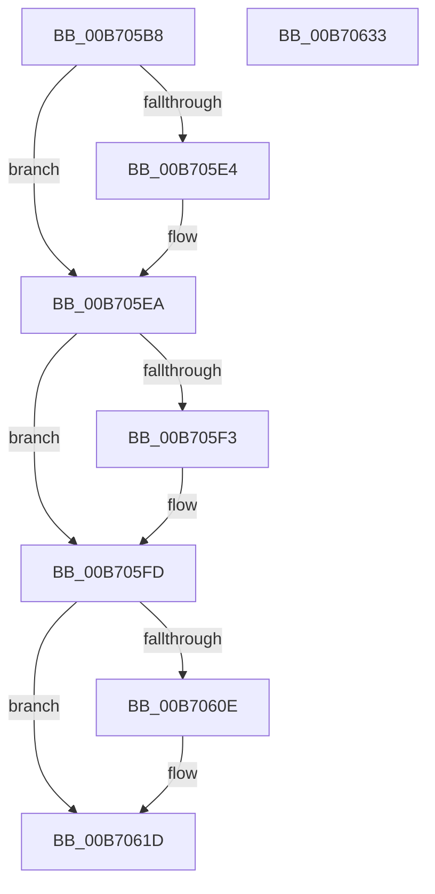

# ProducerConsumerCopyFromContextBuffer

- RVA: `0x00B705B8`–`0x00B70634` (길이 `124` bytes)
- VA: `0x0000000140B705B8`
- 실행 섹션: `PAGELK`
- PDB 이름 있음: `예`; PDB Function 태그: `아니요`
- unwind 정보 RVA: `0x0006F978`
- 디코드: `39`개 명령, `124/124` bytes 표시
- 미해석 바이트: `0` (있으면 어셈블리에 `.byte`로 보존)

> 이 문서는 커널 이미지의 기계어와 PDB 기호를 분석해 생성했습니다. 4번과 5번은 함수 원형과 자료형을 바이너리 사용 방식에서 추정한 C 해석이며 원본 소스 복구 결과는 아닙니다.

## 1. Dependencies

- 직접 호출 지점: **2**; 고유 호출 대상: **1**
- 직접 호출자로 확인된 함수: **2**
- RIP 상대 이미지 참조: **0**

### Outgoing calls
- `0x00B70605` → [memcpy](../../text/6C/memcpy_function_006C6840.md) (function, `0x006C6840`)
- `0x00B70618` → [memcpy](../../text/6C/memcpy_function_006C6840.md) (function, `0x006C6840`)

### Direct callers
- [PopDecompressHiberBlocks](../B6/PopDecompressHiberBlocks_function_00B6D074.md) at `0x00B6D2E5`
- [PopDecompressHiberBlocks](../B6/PopDecompressHiberBlocks_function_00B6D074.md) at `0x00B6D348`
- [PopReadProducerConsumerBuffer](../B6/PopReadProducerConsumerBuffer_function_00B6E570.md) at `0x00B6E5B4`

### Static image references
- 디코드된 RIP-relative 메모리 참조가 없습니다.

## 2. Other-region calls and transfers

- 다른 실행 섹션으로 향하는 call: **2**
  - `0x00B70605` → [memcpy](../../text/6C/memcpy_function_006C6840.md) (`PAGELK` → `.text`)
  - `0x00B70618` → [memcpy](../../text/6C/memcpy_function_006C6840.md) (`PAGELK` → `.text`)
- 별도 외부 분기/꼬리 이동을 확인하지 못했습니다.

## 3. Assembly (complete function range)

```asm
00B705B8  48 89 5C 24 08                  mov qword ptr [rsp + 8], rbx
00B705BD  48 89 74 24 10                  mov qword ptr [rsp + 0x10], rsi
00B705C2  48 89 7C 24 18                  mov qword ptr [rsp + 0x18], rdi
00B705C7  41 56                           push r14
00B705C9  48 83 EC 20                     sub rsp, 0x20
00B705CD  45 8B 58 08                     mov r11d, dword ptr [r8 + 8]
00B705D1  45 8B D1                        mov r10d, r9d
00B705D4  45 2B 10                        sub r10d, dword ptr [r8]
00B705D7  33 DB                           xor ebx, ebx
00B705D9  4D 8B F0                        mov r14, r8
00B705DC  48 8B F1                        mov rsi, rcx
00B705DF  45 3B D3                        cmp r10d, r11d
00B705E2  72 06                           jb 0x140b705ea
00B705E4  45 2B D3                        sub r10d, r11d
00B705E7  4D 2B CB                        sub r9, r11
00B705EA  41 8D 04 12                     lea eax, [r10 + rdx]
00B705EE  41 3B C3                        cmp eax, r11d
00B705F1  76 0A                           jbe 0x140b705fd
00B705F3  41 8B DA                        mov ebx, r10d
00B705F6  41 2B DB                        sub ebx, r11d
00B705F9  03 DA                           add ebx, edx
00B705FB  2B D3                           sub edx, ebx
00B705FD  8B FA                           mov edi, edx
00B705FF  44 8B C2                        mov r8d, edx
00B70602  49 8B D1                        mov rdx, r9
00B70605  E8 36 62 B5 FF                  call 0x1406c6840
00B7060A  85 DB                           test ebx, ebx
00B7060C  74 0F                           je 0x140b7061d
00B7060E  49 8B 16                        mov rdx, qword ptr [r14]
00B70611  48 8D 0C 37                     lea rcx, [rdi + rsi]
00B70615  44 8B C3                        mov r8d, ebx
00B70618  E8 23 62 B5 FF                  call 0x1406c6840
00B7061D  48 8B 5C 24 30                  mov rbx, qword ptr [rsp + 0x30]
00B70622  48 8B 74 24 38                  mov rsi, qword ptr [rsp + 0x38]
00B70627  48 8B 7C 24 40                  mov rdi, qword ptr [rsp + 0x40]
00B7062C  48 83 C4 20                     add rsp, 0x20
00B70630  41 5E                           pop r14
00B70632  C3                              ret
00B70633  CC                              int3
```

## 4. C-style interpretation (structured pseudocode)

```c
__int64 __fastcall ProducerConsumerCopyFromContextBuffer(__int64 a1, __int64 a2, __int64 a3, __int64 a4)
{
    __int64 result;
    __int64 v_r10;
    __int64 v_rbx;
    __int64 v_rsp;
    unsigned __int64 v_stack_p10;
    unsigned __int64 v_stack_p18;
    unsigned __int64 v_stack_p8;

    v_stack_p8 = v_rbx;
    v_stack_p10 = v_rsi;
    v_stack_p18 = v_rdi;
    v_rsp = (v_rsp) - (32);
    v_r10 = (unsigned int)(((unsigned int)((unsigned int)(a4))) - (*(unsigned int *)(a3)));
    v_rbx = 0;
    if (((unsigned int)(v_r10)) >= ((unsigned int)((unsigned int)(*(unsigned int *)(a3 + 8))))) {
        v_r10 = (unsigned int)((v_r10) - ((unsigned int)((unsigned int)(*(unsigned int *)(a3 + 8)))));
        a4 = (a4) - ((unsigned int)(*(unsigned int *)(a3 + 8)));
    }
    if (((unsigned int)(v_r10 + a2 * 1)) >= = ((unsigned int)((unsigned int)(*(unsigned int *)(a3 + 8))))) {
        v_rbx = (unsigned int)(v_r10);
        v_rbx = (unsigned int)((v_rbx) - ((unsigned int)((unsigned int)(*(unsigned int *)(a3 + 8)))));
        v_rbx = (unsigned int)((v_rbx) + ((unsigned int)(a2)));
        a2 = (unsigned int)((a2) - ((unsigned int)(v_rbx)));
    }
    result = memcpy(a1, a4, (unsigned int)((unsigned int)(a2)), a4);
    if ((unsigned int)(v_rbx) != 0) {
        a2 = *(unsigned __int64 *)(a3);
        a1 = (unsigned int)((unsigned int)(a2)) + a1 * 1;
        a3 = (unsigned int)(v_rbx);
        result = memcpy(a1, a2, a3, a4);
    }
    v_rsp = (v_rsp) + (32);
    return result;
}
```

## 5. (Beta) C Style

```c
int64_t ProducerConsumerCopyFromContextBuffer(int64_t Arg1, void *Arg2, void *Arg3, int64_t Arg4)
{
    uint8_t *arg2 = (uint8_t *)Arg2;
    uint8_t *arg3 = (uint8_t *)Arg3;

    int64_t result;
    int64_t local_r10;
    int64_t local_rbx;
    int64_t local_rsp;
    uint64_t v_stack_p10;
    uint64_t v_stack_p18;
    uint64_t v_stack_p8;

    v_stack_p8 = local_rbx;
    v_stack_p10 = local_rsi;
    v_stack_p18 = local_rdi;
    local_rsp = (local_rsp) - (32);
    local_r10 = (uint32_t)(((uint32_t)((uint32_t)(Arg4))) - (*(uint32_t *)(arg3)));
    local_rbx = 0;
    if (((uint32_t)(local_r10)) >= ((uint32_t)((uint32_t)(*(uint32_t *)(arg3 + 0x8))))) {
        local_r10 = (uint32_t)((local_r10) - ((uint32_t)((uint32_t)(*(uint32_t *)(arg3 + 0x8)))));
        Arg4 = (Arg4) - ((uint32_t)(*(uint32_t *)(arg3 + 0x8)));
    }
    if (((uint32_t)(local_r10 + Arg2 * 1)) >= = ((uint32_t)((uint32_t)(*(uint32_t *)(arg3 + 0x8))))) {
        local_rbx = (uint32_t)(local_r10);
        local_rbx = (uint32_t)((local_rbx) - ((uint32_t)((uint32_t)(*(uint32_t *)(arg3 + 0x8)))));
        local_rbx = (uint32_t)((local_rbx) + ((uint32_t)(Arg2)));
        Arg2 = (uint32_t)((Arg2) - ((uint32_t)(local_rbx)));
    }
    result = memcpy(Arg1, Arg4, (uint32_t)((uint32_t)(Arg2)), Arg4);
    if ((uint32_t)(local_rbx) != 0) {
        Arg2 = *(uint64_t *)(arg3);
        Arg1 = (uint32_t)((uint32_t)(Arg2)) + Arg1 * 1;
        Arg3 = (uint32_t)(local_rbx);
        result = memcpy(Arg1, Arg2, Arg3, Arg4);
    }
    local_rsp = (local_rsp) + (32);
    return result;
}
```

### 관측된 메모리 오프셋

구조체 형식이 확인되지 않은 접근은 인자 기준의 오프셋으로만 기록했습니다.

| 기준 인자 | 오프셋 표현 | 폭 (bit) | 접근 |
|---|---:|---:|---|
| `Arg2` | `+ 0x0 + rsi*1` | `64` | `R` |
| `Arg3` | `+ 0x0` | `32` | `R` |
| `Arg3` | `+ 0x0` | `64` | `R` |
| `Arg3` | `+ 0x8` | `32` | `R` |

## 6. Execution-region graph

[열기: 2D/3D 그래프와 함수 탐색 컨트롤 패널](../../../control-panel.html?section=pagelk&rva=0x00B705B8&view=graph)

- 2D 그래프는 위에서 아래로 흐르고, 3D 그래프는 빈 공간을 드래그해 회전합니다. Shift+드래그는 이동, 휠은 확대·축소, 함수 노드 선택은 대상 보고서 이동입니다.

### Static fallback


