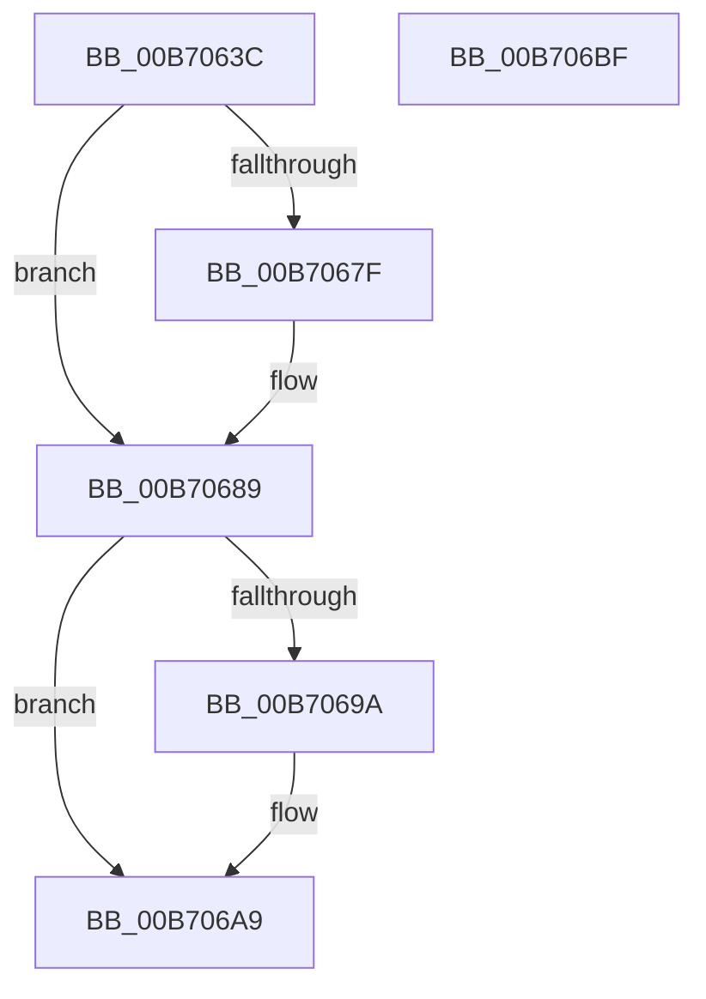

# ProducerConsumerCopyToContextBuffer

- RVA: `0x00B7063C`–`0x00B706C0` (길이 `132` bytes)
- VA: `0x0000000140B7063C`
- 실행 섹션: `PAGELK`
- PDB 이름 있음: `예`; PDB Function 태그: `아니요`
- unwind 정보 RVA: `0x0006F978`
- 디코드: `41`개 명령, `132/132` bytes 표시
- 미해석 바이트: `0` (있으면 어셈블리에 `.byte`로 보존)

> 이 문서는 커널 이미지의 기계어와 PDB 기호를 분석해 생성했습니다. 4번과 5번은 함수 원형과 자료형을 바이너리 사용 방식에서 추정한 C 해석이며 원본 소스 복구 결과는 아닙니다.

## 1. Dependencies

- 직접 호출 지점: **2**; 고유 호출 대상: **1**
- 직접 호출자로 확인된 함수: **1**
- RIP 상대 이미지 참조: **0**

### Outgoing calls
- `0x00B70691` → [memcpy](../../text/6C/memcpy_function_006C6840.md) (function, `0x006C6840`)
- `0x00B706A4` → [memcpy](../../text/6C/memcpy_function_006C6840.md) (function, `0x006C6840`)

### Direct callers
- [PopCountDataAsProduced](../B6/PopCountDataAsProduced_function_00B6CE5C.md) at `0x00B6CECE`
- [PopCountDataAsProduced](../B6/PopCountDataAsProduced_function_00B6CE5C.md) at `0x00B6CEDF`
- [PopCountDataAsProduced](../B6/PopCountDataAsProduced_function_00B6CE5C.md) at `0x00B6CF00`

### Static image references
- 디코드된 RIP-relative 메모리 참조가 없습니다.

## 2. Other-region calls and transfers

- 다른 실행 섹션으로 향하는 call: **2**
  - `0x00B70691` → [memcpy](../../text/6C/memcpy_function_006C6840.md) (`PAGELK` → `.text`)
  - `0x00B706A4` → [memcpy](../../text/6C/memcpy_function_006C6840.md) (`PAGELK` → `.text`)
- 별도 외부 분기/꼬리 이동을 확인하지 못했습니다.

## 3. Assembly (complete function range)

```asm
00B7063C  48 89 5C 24 08                  mov qword ptr [rsp + 8], rbx
00B70641  48 89 74 24 10                  mov qword ptr [rsp + 0x10], rsi
00B70646  48 89 7C 24 18                  mov qword ptr [rsp + 0x18], rdi
00B7064B  41 56                           push r14
00B7064D  48 83 EC 20                     sub rsp, 0x20
00B70651  4D 8B F0                        mov r14, r8
00B70654  48 8B F1                        mov rsi, rcx
00B70657  45 8B 40 08                     mov r8d, dword ptr [r8 + 8]
00B7065B  49 8B C9                        mov rcx, r9
00B7065E  49 2B C8                        sub rcx, r8
00B70661  4D 8B 16                        mov r10, qword ptr [r14]
00B70664  4D 03 D0                        add r10, r8
00B70667  4D 3B CA                        cmp r9, r10
00B7066A  49 0F 42 C9                     cmovb rcx, r9
00B7066E  33 DB                           xor ebx, ebx
00B70670  44 8B C9                        mov r9d, ecx
00B70673  45 2B 0E                        sub r9d, dword ptr [r14]
00B70676  41 8D 04 11                     lea eax, [r9 + rdx]
00B7067A  41 3B C0                        cmp eax, r8d
00B7067D  76 0A                           jbe 0x140b70689
00B7067F  41 8B D9                        mov ebx, r9d
00B70682  41 2B D8                        sub ebx, r8d
00B70685  03 DA                           add ebx, edx
00B70687  2B D3                           sub edx, ebx
00B70689  8B FA                           mov edi, edx
00B7068B  44 8B C2                        mov r8d, edx
00B7068E  48 8B D6                        mov rdx, rsi
00B70691  E8 AA 61 B5 FF                  call 0x1406c6840
00B70696  85 DB                           test ebx, ebx
00B70698  74 0F                           je 0x140b706a9
00B7069A  49 8B 0E                        mov rcx, qword ptr [r14]
00B7069D  48 8D 14 37                     lea rdx, [rdi + rsi]
00B706A1  44 8B C3                        mov r8d, ebx
00B706A4  E8 97 61 B5 FF                  call 0x1406c6840
00B706A9  48 8B 5C 24 30                  mov rbx, qword ptr [rsp + 0x30]
00B706AE  48 8B 74 24 38                  mov rsi, qword ptr [rsp + 0x38]
00B706B3  48 8B 7C 24 40                  mov rdi, qword ptr [rsp + 0x40]
00B706B8  48 83 C4 20                     add rsp, 0x20
00B706BC  41 5E                           pop r14
00B706BE  C3                              ret
00B706BF  CC                              int3
```

## 4. C-style interpretation (structured pseudocode)

```c
__int64 __fastcall ProducerConsumerCopyToContextBuffer(__int64 a1, __int64 a2, __int64 a3, __int64 a4)
{
    __int64 result;
    __int64 v_r10;
    __int64 v_rbx;
    __int64 v_rsp;
    unsigned __int64 v_stack_p10;
    unsigned __int64 v_stack_p18;
    unsigned __int64 v_stack_p8;

    v_stack_p8 = v_rbx;
    v_stack_p10 = v_rsi;
    v_stack_p18 = v_rdi;
    v_rsp = (v_rsp) - (32);
    a1 = (a4) - ((unsigned int)(*(unsigned int *)(a3 + 8)));
    v_r10 = (*(unsigned __int64 *)(a3)) + ((unsigned int)(*(unsigned int *)(a3 + 8)));
    if (a4 < v_r10) { a1 = a4; }
    v_rbx = 0;
    a4 = (unsigned int)(((unsigned int)((unsigned int)(a1))) - (*(unsigned int *)(a3)));
    if (((unsigned int)(a4 + a2 * 1)) >= = ((unsigned int)((unsigned int)(*(unsigned int *)(a3 + 8))))) {
        v_rbx = (unsigned int)(a4);
        v_rbx = (unsigned int)((v_rbx) - ((unsigned int)((unsigned int)(*(unsigned int *)(a3 + 8)))));
        v_rbx = (unsigned int)((v_rbx) + ((unsigned int)(a2)));
        a2 = (unsigned int)((a2) - ((unsigned int)(v_rbx)));
    }
    result = memcpy(a1, a1, (unsigned int)((unsigned int)(a2)), a4);
    if ((unsigned int)(v_rbx) != 0) {
        a1 = *(unsigned __int64 *)(a3);
        a2 = (unsigned int)((unsigned int)(a2)) + a1 * 1;
        a3 = (unsigned int)(v_rbx);
        result = memcpy(a1, a2, a3, a4);
    }
    v_rsp = (v_rsp) + (32);
    return result;
}
```

## 5. (Beta) C Style

```c
int64_t ProducerConsumerCopyToContextBuffer(int64_t Arg1, void *Arg2, void *Arg3, int64_t Arg4)
{
    uint8_t *arg2 = (uint8_t *)Arg2;
    uint8_t *arg3 = (uint8_t *)Arg3;

    int64_t result;
    int64_t local_r10;
    int64_t local_rbx;
    int64_t local_rsp;
    uint64_t v_stack_p10;
    uint64_t v_stack_p18;
    uint64_t v_stack_p8;

    v_stack_p8 = local_rbx;
    v_stack_p10 = local_rsi;
    v_stack_p18 = local_rdi;
    local_rsp = (local_rsp) - (32);
    Arg1 = (Arg4) - ((uint32_t)(*(uint32_t *)(arg3 + 0x8)));
    local_r10 = (*(uint64_t *)(arg3)) + ((uint32_t)(*(uint32_t *)(arg3 + 0x8)));
    if (Arg4 < local_r10) { Arg1 = Arg4; }
    local_rbx = 0;
    Arg4 = (uint32_t)(((uint32_t)((uint32_t)(Arg1))) - (*(uint32_t *)(arg3)));
    if (((uint32_t)(Arg4 + Arg2 * 1)) >= = ((uint32_t)((uint32_t)(*(uint32_t *)(arg3 + 0x8))))) {
        local_rbx = (uint32_t)(Arg4);
        local_rbx = (uint32_t)((local_rbx) - ((uint32_t)((uint32_t)(*(uint32_t *)(arg3 + 0x8)))));
        local_rbx = (uint32_t)((local_rbx) + ((uint32_t)(Arg2)));
        Arg2 = (uint32_t)((Arg2) - ((uint32_t)(local_rbx)));
    }
    result = memcpy(Arg1, Arg1, (uint32_t)((uint32_t)(Arg2)), Arg4);
    if ((uint32_t)(local_rbx) != 0) {
        Arg1 = *(uint64_t *)(arg3);
        Arg2 = (uint32_t)((uint32_t)(Arg2)) + Arg1 * 1;
        Arg3 = (uint32_t)(local_rbx);
        result = memcpy(Arg1, Arg2, Arg3, Arg4);
    }
    local_rsp = (local_rsp) + (32);
    return result;
}
```

### 관측된 메모리 오프셋

구조체 형식이 확인되지 않은 접근은 인자 기준의 오프셋으로만 기록했습니다.

| 기준 인자 | 오프셋 표현 | 폭 (bit) | 접근 |
|---|---:|---:|---|
| `Arg2` | `+ 0x0 + rsi*1` | `64` | `R` |
| `Arg3` | `+ 0x0` | `32` | `R` |
| `Arg3` | `+ 0x0` | `64` | `R` |
| `Arg3` | `+ 0x8` | `32` | `R` |

## 6. Execution-region graph

[열기: 2D/3D 그래프와 함수 탐색 컨트롤 패널](../../../control-panel.html?section=pagelk&rva=0x00B7063C&view=graph)

- 2D 그래프는 위에서 아래로 흐르고, 3D 그래프는 빈 공간을 드래그해 회전합니다. Shift+드래그는 이동, 휠은 확대·축소, 함수 노드 선택은 대상 보고서 이동입니다.

### Static fallback


