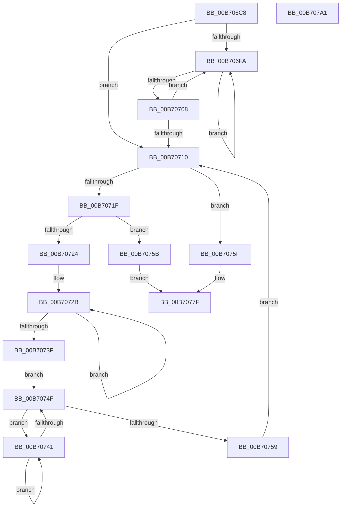

# ProducerGetBuffer

- RVA: `0x00B706C8`–`0x00B707A2` (길이 `218` bytes)
- VA: `0x0000000140B706C8`
- 실행 섹션: `PAGELK`
- PDB 이름 있음: `예`; PDB Function 태그: `아니요`
- unwind 정보 RVA: `0x0005E6B4`
- 디코드: `69`개 명령, `218/218` bytes 표시
- 미해석 바이트: `0` (있으면 어셈블리에 `.byte`로 보존)

> 이 문서는 커널 이미지의 기계어와 PDB 기호를 분석해 생성했습니다. 4번과 5번은 함수 원형과 자료형을 바이너리 사용 방식에서 추정한 C 해석이며 원본 소스 복구 결과는 아닙니다.

## 1. Dependencies

- 직접 호출 지점: **3**; 고유 호출 대상: **1**
- 직접 호출자로 확인된 함수: **2**
- RIP 상대 이미지 참조: **0**

### Outgoing calls
- `0x00B706FC` → [PopHiberCheckForDebugBreak](PopHiberCheckForDebugBreak_function_00B78258.md) (function, `0x00B78258`)
- `0x00B7072D` → [PopHiberCheckForDebugBreak](PopHiberCheckForDebugBreak_function_00B78258.md) (function, `0x00B78258`)
- `0x00B70743` → [PopHiberCheckForDebugBreak](PopHiberCheckForDebugBreak_function_00B78258.md) (function, `0x00B78258`)

### Direct callers
- [PopCountDataAsProduced](../B6/PopCountDataAsProduced_function_00B6CE5C.md) at `0x00B6CEB3`
- [PopRequestRead](../B6/PopRequestRead_function_00B6E6DC.md) at `0x00B6E8D8`

### Static image references
- 디코드된 RIP-relative 메모리 참조가 없습니다.

## 2. Other-region calls and transfers

- 다른 실행 섹션으로 향하는 call: **0**
- 별도 외부 분기/꼬리 이동을 확인하지 못했습니다.

## 3. Assembly (complete function range)

```asm
00B706C8  48 8B C4                        mov rax, rsp
00B706CB  48 89 58 08                     mov qword ptr [rax + 8], rbx
00B706CF  48 89 68 10                     mov qword ptr [rax + 0x10], rbp
00B706D3  48 89 70 18                     mov qword ptr [rax + 0x18], rsi
00B706D7  48 89 78 20                     mov qword ptr [rax + 0x20], rdi
00B706DB  41 56                           push r14
00B706DD  48 83 EC 20                     sub rsp, 0x20
00B706E1  33 C0                           xor eax, eax
00B706E3  41 8B E8                        mov ebp, r8d
00B706E6  41 8B D9                        mov ebx, r9d
00B706E9  8B F2                           mov esi, edx
00B706EB  48 8B F9                        mov rdi, rcx
00B706EE  44 8D 70 01                     lea r14d, [rax + 1]
00B706F2  F0 44 0F B1 71 18               lock cmpxchg dword ptr [rcx + 0x18], r14d
00B706F8  74 16                           je 0x140b70710
00B706FA  F3 90                           pause
00B706FC  E8 57 7B 00 00                  call 0x140b78258
00B70701  8B 47 18                        mov eax, dword ptr [rdi + 0x18]
00B70704  85 C0                           test eax, eax
00B70706  75 F2                           jne 0x140b706fa
00B70708  F0 44 0F B1 77 18               lock cmpxchg dword ptr [rdi + 0x18], r14d
00B7070E  75 EA                           jne 0x140b706fa
00B70710  8B 4F 38                        mov ecx, dword ptr [rdi + 0x38]
00B70713  2B 4F 20                        sub ecx, dword ptr [rdi + 0x20]
00B70716  8B 57 08                        mov edx, dword ptr [rdi + 8]
00B70719  03 CA                           add ecx, edx
00B7071B  3B F1                           cmp esi, ecx
00B7071D  76 40                           jbe 0x140b7075f
00B7071F  41 84 DE                        test r14b, bl
00B70722  75 37                           jne 0x140b7075b
00B70724  C7 47 18 00 00 00 00            mov dword ptr [rdi + 0x18], 0
00B7072B  F3 90                           pause
00B7072D  E8 26 7B 00 00                  call 0x140b78258
00B70732  8B 4F 38                        mov ecx, dword ptr [rdi + 0x38]
00B70735  2B 4F 20                        sub ecx, dword ptr [rdi + 0x20]
00B70738  03 4F 08                        add ecx, dword ptr [rdi + 8]
00B7073B  3B F1                           cmp esi, ecx
00B7073D  77 EC                           ja 0x140b7072b
00B7073F  EB 0E                           jmp 0x140b7074f
00B70741  F3 90                           pause
00B70743  E8 10 7B 00 00                  call 0x140b78258
00B70748  8B 47 18                        mov eax, dword ptr [rdi + 0x18]
00B7074B  85 C0                           test eax, eax
00B7074D  75 F2                           jne 0x140b70741
00B7074F  33 C0                           xor eax, eax
00B70751  F0 44 0F B1 77 18               lock cmpxchg dword ptr [rdi + 0x18], r14d
00B70757  75 E8                           jne 0x140b70741
00B70759  EB B5                           jmp 0x140b70710
00B7075B  33 C0                           xor eax, eax
00B7075D  EB 20                           jmp 0x140b7077f
00B7075F  4C 8B 47 20                     mov r8, qword ptr [rdi + 0x20]
00B70763  48 8B CA                        mov rcx, rdx
00B70766  33 D2                           xor edx, edx
00B70768  49 8B C0                        mov rax, r8
00B7076B  48 F7 F1                        div rcx
00B7076E  49 8D 0C 30                     lea rcx, [r8 + rsi]
00B70772  8B C2                           mov eax, edx
00B70774  48 03 07                        add rax, qword ptr [rdi]
00B70777  48 29 6F 10                     sub qword ptr [rdi + 0x10], rbp
00B7077B  48 89 4F 20                     mov qword ptr [rdi + 0x20], rcx
00B7077F  48 8B 5C 24 30                  mov rbx, qword ptr [rsp + 0x30]
00B70784  48 8B 6C 24 38                  mov rbp, qword ptr [rsp + 0x38]
00B70789  48 8B 74 24 40                  mov rsi, qword ptr [rsp + 0x40]
00B7078E  C7 47 18 00 00 00 00            mov dword ptr [rdi + 0x18], 0
00B70795  48 8B 7C 24 48                  mov rdi, qword ptr [rsp + 0x48]
00B7079A  48 83 C4 20                     add rsp, 0x20
00B7079E  41 5E                           pop r14
00B707A0  C3                              ret
00B707A1  CC                              int3
```

## 4. C-style interpretation (structured pseudocode)

```c
__int64 __fastcall ProducerGetBuffer(__int64 a1, int a2, int a3, int a4)
{
    __int64 result;
    __int64 v_rsp;
    unsigned __int64 v_stack_p10;
    unsigned __int64 v_stack_p18;
    unsigned __int64 v_stack_p20;
    unsigned __int64 v_stack_p8;

    *(unsigned __int64 *)(v_rsp + 8) = v_rbx;
    *(unsigned __int64 *)(v_rsp + 16) = v_rbp;
    *(unsigned __int64 *)(v_rsp + 24) = v_rsi;
    *(unsigned __int64 *)(v_rsp + 32) = v_rdi;
    v_rsp = (v_rsp) - (32);
    result = 0;
    if (condition_is_equal) goto loc_00B70710;
loc_00B706FA:
    result = PopHiberCheckForDebugBreak(a1, a2, a3, a4);
    if ((unsigned int)((unsigned int)(*(unsigned int *)(a1 + 24))) != 0) goto loc_00B706FA;
    if ((unsigned int)((unsigned int)(*(unsigned int *)(a1 + 24))) != 0) goto loc_00B706FA;
loc_00B70710:
    a1 = (unsigned int)(((unsigned int)(*(unsigned int *)(a1 + 56))) - (*(unsigned int *)(a1 + 32)));
    a1 = (unsigned int)((a1) + ((unsigned int)((unsigned int)(*(unsigned int *)(a1 + 8)))));
    if (((unsigned int)((unsigned int)(a2))) <= ((unsigned int)(a1))) goto loc_00B7075F;
    if ((((unsigned __int8)(result + 1)) & ((unsigned __int8)((unsigned int)(a4)))) != 0) goto loc_00B7075B;
    *(unsigned int *)(a1 + 24) = 0;
loc_00B7072B:
    result = PopHiberCheckForDebugBreak(a1, (unsigned int)(*(unsigned int *)(a1 + 8)), a3, a4);
    a1 = (unsigned int)(((unsigned int)(*(unsigned int *)(a1 + 56))) - (*(unsigned int *)(a1 + 32)));
    a1 = (unsigned int)((a1) + (*(unsigned int *)(a1 + 8)));
    if (((unsigned int)((unsigned int)(a2))) > ((unsigned int)(a1))) goto loc_00B7072B;
    goto loc_00B7074F;
loc_00B70741:
    result = PopHiberCheckForDebugBreak(a1, (unsigned int)(*(unsigned int *)(a1 + 8)), a3, a4);
    if ((unsigned int)((unsigned int)(*(unsigned int *)(a1 + 24))) != 0) goto loc_00B70741;
loc_00B7074F:
    result = 0;
    if (condition_is_not_equal) goto loc_00B70741;
    goto loc_00B70710;
loc_00B7075B:
    result = 0;
    goto loc_00B7077F;
loc_00B7075F:
    a2 = 0;
    result = (0) + (*(unsigned __int64 *)(a1));
    *(unsigned __int64 *)(a1 + 32) = *(unsigned __int64 *)(a1 + 32) + (unsigned int)(a2) * 1;
loc_00B7077F:
    *(unsigned int *)(a1 + 24) = 0;
    v_rsp = (v_rsp) + (32);
    return result;
}
```

## 5. (Beta) C Style

```c
int64_t ProducerGetBuffer(void *Arg1, int32_t Arg2, int32_t Arg3, int32_t Arg4)
{
    uint8_t *arg1 = (uint8_t *)Arg1;

    int64_t result;
    int64_t local_rsp;
    uint64_t v_stack_p10;
    uint64_t v_stack_p18;
    uint64_t v_stack_p20;
    uint64_t v_stack_p8;

    *(uint64_t *)(local_rsp + 0x8) = local_rbx;
    *(uint64_t *)(local_rsp + 0x10) = local_rbp;
    *(uint64_t *)(local_rsp + 0x18) = local_rsi;
    *(uint64_t *)(local_rsp + 0x20) = local_rdi;
    local_rsp = (local_rsp) - (32);
    result = 0;
    if (condition_is_equal) goto loc_00B70710;
loc_00B706FA:
    result = PopHiberCheckForDebugBreak(Arg1, Arg2, Arg3, Arg4);
    if ((uint32_t)((uint32_t)(*(uint32_t *)(arg1 + 0x18))) != 0) goto loc_00B706FA;
    if ((uint32_t)((uint32_t)(*(uint32_t *)(arg1 + 0x18))) != 0) goto loc_00B706FA;
loc_00B70710:
    Arg1 = (uint32_t)(((uint32_t)(*(uint32_t *)(arg1 + 0x38))) - (*(uint32_t *)(arg1 + 0x20)));
    Arg1 = (uint32_t)((Arg1) + ((uint32_t)((uint32_t)(*(uint32_t *)(arg1 + 0x8)))));
    if (((uint32_t)((uint32_t)(Arg2))) <= ((uint32_t)(Arg1))) goto loc_00B7075F;
    if ((((uint8_t)(result + 1)) & ((uint8_t)((uint32_t)(Arg4)))) != 0) goto loc_00B7075B;
    *(uint32_t *)(arg1 + 0x18) = 0;
loc_00B7072B:
    result = PopHiberCheckForDebugBreak(Arg1, (uint32_t)(*(uint32_t *)(arg1 + 0x8)), Arg3, Arg4);
    Arg1 = (uint32_t)(((uint32_t)(*(uint32_t *)(arg1 + 0x38))) - (*(uint32_t *)(arg1 + 0x20)));
    Arg1 = (uint32_t)((Arg1) + (*(uint32_t *)(arg1 + 0x8)));
    if (((uint32_t)((uint32_t)(Arg2))) > ((uint32_t)(Arg1))) goto loc_00B7072B;
    goto loc_00B7074F;
loc_00B70741:
    result = PopHiberCheckForDebugBreak(Arg1, (uint32_t)(*(uint32_t *)(arg1 + 0x8)), Arg3, Arg4);
    if ((uint32_t)((uint32_t)(*(uint32_t *)(arg1 + 0x18))) != 0) goto loc_00B70741;
loc_00B7074F:
    result = 0;
    if (condition_is_not_equal) goto loc_00B70741;
    goto loc_00B70710;
loc_00B7075B:
    result = 0;
    goto loc_00B7077F;
loc_00B7075F:
    Arg2 = 0;
    result = (0) + (*(uint64_t *)(arg1));
    *(uint64_t *)(arg1 + 0x20) = *(uint64_t *)(arg1 + 0x20) + (uint32_t)(Arg2) * 1;
loc_00B7077F:
    *(uint32_t *)(arg1 + 0x18) = 0;
    local_rsp = (local_rsp) + (32);
    return result;
}
```

### 관측된 메모리 오프셋

구조체 형식이 확인되지 않은 접근은 인자 기준의 오프셋으로만 기록했습니다.

| 기준 인자 | 오프셋 표현 | 폭 (bit) | 접근 |
|---|---:|---:|---|
| `Arg1` | `+ 0x0` | `64` | `R` |
| `Arg1` | `+ 0x8` | `32` | `R` |
| `Arg1` | `+ 0x10` | `64` | `R/W` |
| `Arg1` | `+ 0x18` | `32` | `R` |
| `Arg1` | `+ 0x18` | `32` | `W` |
| `Arg1` | `+ 0x20` | `32` | `R` |
| `Arg1` | `+ 0x20` | `64` | `R` |
| `Arg1` | `+ 0x20` | `64` | `W` |
| `Arg1` | `+ 0x38` | `32` | `R` |

## 6. Execution-region graph

[열기: 2D/3D 그래프와 함수 탐색 컨트롤 패널](../../../control-panel.html?section=pagelk&rva=0x00B706C8&view=graph)

- 2D 그래프는 위에서 아래로 흐르고, 3D 그래프는 빈 공간을 드래그해 회전합니다. Shift+드래그는 이동, 휠은 확대·축소, 함수 노드 선택은 대상 보고서 이동입니다.

### Static fallback


