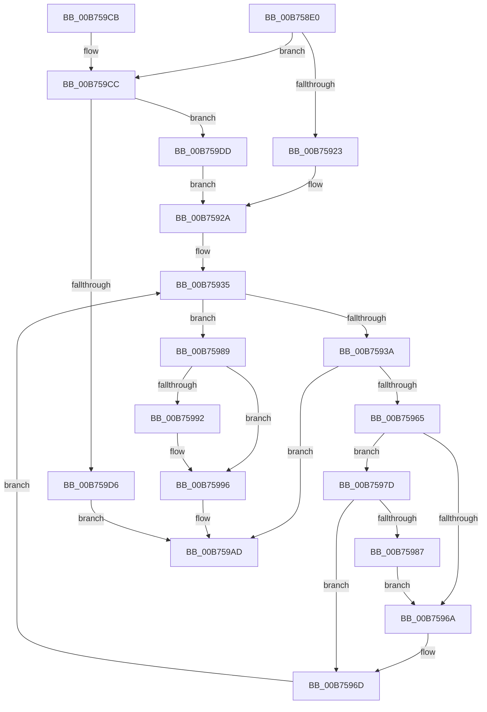

# RtlCompressBufferLZNT1

- RVA: `0x00B758E0`–`0x00B759E9` (길이 `265` bytes)
- VA: `0x0000000140B758E0`
- 실행 섹션: `PAGELK`
- PDB 이름 있음: `예`; PDB Function 태그: `아니요`
- unwind 정보 RVA: `0x00089FF8`
- 디코드: `78`개 명령, `265/265` bytes 표시
- 미해석 바이트: `0` (있으면 어셈블리에 `.byte`로 보존)

> 이 문서는 커널 이미지의 기계어와 PDB 기호를 분석해 생성했습니다. 4번과 5번은 함수 원형과 자료형을 바이너리 사용 방식에서 추정한 C 해석이며 원본 소스 복구 결과는 아닙니다.

## 1. Dependencies

- 직접 호출 지점: **1**; 고유 호출 대상: **1**
- 직접 호출자로 확인된 함수: **2**
- RIP 상대 이미지 참조: **2**

### Outgoing calls
- `0x00B7595A` → [LZNT1CompressChunk](LZNT1CompressChunk_function_00B759F0.md) (function, `0x00B759F0`)

### Direct callers
- [SmStoreCompressBuffer](../../text/26/SmStoreCompressBuffer_function_002683E0.md) at `0x002684F0`
- [RtlCompressBuffer](../../text/26/RtlCompressBuffer_function_0026A220.md) at `0x0026A2EC`

### Static image references
- `0x00B75923` → RVA `0x00B75CF0` (`LZNT1FindMatchStandard`; read)
- `0x00B759DD` → RVA `0x00A225D0` (`LZNT1FindMatchMaximum`; read)

## 2. Other-region calls and transfers

- 다른 실행 섹션으로 향하는 call: **0**
- 별도 외부 분기/꼬리 이동을 확인하지 못했습니다.

## 3. Assembly (complete function range)

```asm
00B758E0  48 8B C4                        mov rax, rsp
00B758E3  48 89 58 10                     mov qword ptr [rax + 0x10], rbx
00B758E7  48 89 68 18                     mov qword ptr [rax + 0x18], rbp
00B758EB  48 89 70 20                     mov qword ptr [rax + 0x20], rsi
00B758EF  57                              push rdi
00B758F0  41 54                           push r12
00B758F2  41 55                           push r13
00B758F4  41 56                           push r14
00B758F6  41 57                           push r15
00B758F8  48 83 EC 40                     sub rsp, 0x40
00B758FC  8B AC 24 90 00 00 00            mov ebp, dword ptr [rsp + 0x90]
00B75903  48 8B F2                        mov rsi, rdx
00B75906  33 D2                           xor edx, edx
00B75908  45 8B F8                        mov r15d, r8d
00B7590B  4C 03 FE                        add r15, rsi
00B7590E  89 50 08                        mov dword ptr [rax + 8], edx
00B75911  49 03 E9                        add rbp, r9
00B75914  4D 8B F1                        mov r14, r9
00B75917  40 B7 01                        mov dil, 1
00B7591A  66 85 C9                        test cx, cx
00B7591D  0F 85 A9 00 00 00               jne 0x140b759cc
00B75923  4C 8D 25 C6 03 00 00            lea r12, [rip + 0x3c6]
00B7592A  4C 8B AC 24 A8 00 00 00         mov r13, qword ptr [rsp + 0xa8]
00B75932  49 8B DE                        mov rbx, r14
00B75935  49 3B F7                        cmp rsi, r15
00B75938  73 4F                           jae 0x140b75989
00B7593A  48 8D 44 24 70                  lea rax, [rsp + 0x70]
00B7593F  4C 89 6C 24 30                  mov qword ptr [rsp + 0x30], r13
00B75944  48 89 44 24 28                  mov qword ptr [rsp + 0x28], rax
00B75949  4C 8B CB                        mov r9, rbx
00B7594C  4D 8B C7                        mov r8, r15
00B7594F  48 89 6C 24 20                  mov qword ptr [rsp + 0x20], rbp
00B75954  48 8B D6                        mov rdx, rsi
00B75957  49 8B CC                        mov rcx, r12
00B7595A  E8 91 00 00 00                  call 0x140b759f0
00B7595F  33 D2                           xor edx, edx
00B75961  85 C0                           test eax, eax
00B75963  78 48                           js 0x140b759ad
00B75965  40 84 FF                        test dil, dil
00B75968  75 13                           jne 0x140b7597d
00B7596A  40 8A FA                        mov dil, dl
00B7596D  8B 44 24 70                     mov eax, dword ptr [rsp + 0x70]
00B75971  48 81 C6 00 10 00 00            add rsi, 0x1000
00B75978  48 03 D8                        add rbx, rax
00B7597B  EB B8                           jmp 0x140b75935
00B7597D  40 B7 01                        mov dil, 1
00B75980  3D 17 01 00 00                  cmp eax, 0x117
00B75985  74 E6                           je 0x140b7596d
00B75987  EB E1                           jmp 0x140b7596a
00B75989  48 8D 45 FE                     lea rax, [rbp - 2]
00B7598D  48 3B D8                        cmp rbx, rax
00B75990  77 04                           ja 0x140b75996
00B75992  66 83 23 00                     and word ptr [rbx], 0
00B75996  48 8B 84 24 A0 00 00 00         mov rax, qword ptr [rsp + 0xa0]
00B7599E  41 2B DE                        sub ebx, r14d
00B759A1  40 F6 DF                        neg dil
00B759A4  89 18                           mov dword ptr [rax], ebx
00B759A6  1B C0                           sbb eax, eax
00B759A8  25 17 01 00 00                  and eax, 0x117
00B759AD  4C 8D 5C 24 40                  lea r11, [rsp + 0x40]
00B759B2  49 8B 5B 38                     mov rbx, qword ptr [r11 + 0x38]
00B759B6  49 8B 6B 40                     mov rbp, qword ptr [r11 + 0x40]
00B759BA  49 8B 73 48                     mov rsi, qword ptr [r11 + 0x48]
00B759BE  49 8B E3                        mov rsp, r11
00B759C1  41 5F                           pop r15
00B759C3  41 5E                           pop r14
00B759C5  41 5D                           pop r13
00B759C7  41 5C                           pop r12
00B759C9  5F                              pop rdi
00B759CA  C3                              ret
00B759CB  CC                              int3
00B759CC  B8 00 01 00 00                  mov eax, 0x100
00B759D1  66 3B C8                        cmp cx, ax
00B759D4  74 07                           je 0x140b759dd
00B759D6  B8 BB 00 00 C0                  mov eax, 0xc00000bb
00B759DB  EB D0                           jmp 0x140b759ad
00B759DD  4C 8D 25 EC CB EA FF            lea r12, [rip - 0x153414]
00B759E4  E9 41 FF FF FF                  jmp 0x140b7592a
```

## 4. C-style interpretation (structured pseudocode)

```c
__int64 __fastcall RtlCompressBufferLZNT1(unsigned __int16 a1, __int64 a2, int a3, __int64 a4, unsigned int a5, __int64 a6, __int64 a7, __int64 a8)
{
    __int64 result;
    __int64 v_r15;
    __int64 v_rbp;
    __int64 v_rbx;
    __int64 v_rdi;
    __int64 v_rsi;
    __int64 v_rsp;
    unsigned __int64 v_stack_m28;
    unsigned __int64 v_stack_m38;
    unsigned __int64 v_stack_m40;
    unsigned __int64 v_stack_m48;
    unsigned __int64 v_stack_p8;

    *(unsigned __int64 *)(v_rsp + 16) = v_rbx;
    *(unsigned __int64 *)(v_rsp + 24) = v_rbp;
    *(unsigned __int64 *)(v_rsp + 32) = v_rsi;
    v_rsp = (v_rsp) - (64);
    a2 = 0;
    v_r15 = ((unsigned int)(a3)) + (0);
    *(unsigned int *)(v_rsp + 8) = 0;
    v_rbp = ((unsigned int)(a5)) + (a4);
    if (a1 != 0) goto loc_00B759CC;
loc_00B7592A:
loc_00B75935:
    if (0 >= v_r15) goto loc_00B75989;
    v_stack_m38 = a8;
    v_stack_m40 = v_stack_p8;
    v_stack_m48 = v_rbp;
    result = LZNT1CompressChunk(v_rip + 966, 0, v_r15, a4);
    a2 = 0;
    if (sign_flag) goto loc_00B759AD;
    if (1 != 0) goto loc_00B7597D;
loc_00B7596A:
loc_00B7596D:
    v_rsi = (a2) + (0x1000ULL);
    v_rbx = (a4) + ((unsigned int)(v_stack_p8));
    goto loc_00B75935;
loc_00B7597D:
    if (((unsigned int)((unsigned int)(v_stack_p8))) == 279) goto loc_00B7596D;
    goto loc_00B7596A;
loc_00B75989:
    if (v_rbx <= (v_rbp - 2)) {
    }
    v_rbx = (unsigned int)((v_rbx) - ((unsigned int)(a4)));
    v_rdi = (unsigned __int8)(-(1));
    *(unsigned int *)(a7) = (unsigned int)(v_rbx);
    result = (unsigned int)((a7) & (279));
loc_00B759AD:
    return result;
loc_00B759CC:
    if (((unsigned __int16)(v_rip + 966)) == 256) goto loc_00B759DD;
    goto loc_00B759AD;
loc_00B759DD:
    goto loc_00B7592A;
}
```

## 5. (Beta) C Style

```c
int64_t RtlCompressBufferLZNT1(uint16_t Arg1, int64_t Arg2, int32_t Arg3, int64_t Arg4, void *Arg5, uint64_t Arg6, void *Arg7, int64_t Arg8)
{
    uint8_t *arg5 = (uint8_t *)Arg5;
    uint8_t *arg7 = (uint8_t *)Arg7;

    int64_t result;
    int64_t local_r15;
    int64_t local_rbp;
    int64_t local_rbx;
    int64_t local_rdi;
    int64_t local_rsi;
    int64_t local_rsp;
    uint64_t v_stack_m28;
    uint64_t v_stack_m38;
    uint64_t v_stack_m40;
    uint64_t v_stack_m48;
    uint64_t v_stack_p8;

    *(uint64_t *)(local_rsp + 0x10) = local_rbx;
    *(uint64_t *)(local_rsp + 0x18) = local_rbp;
    *(uint64_t *)(local_rsp + 0x20) = local_rsi;
    local_rsp = (local_rsp) - (64);
    Arg2 = 0;
    local_r15 = ((uint32_t)(Arg3)) + (0);
    *(uint32_t *)(local_rsp + 0x8) = 0;
    local_rbp = ((uint32_t)(Arg5)) + (Arg4);
    if (Arg1 != 0) goto loc_00B759CC;
loc_00B7592A:
loc_00B75935:
    if (0 >= local_r15) goto loc_00B75989;
    v_stack_m38 = Arg8;
    v_stack_m40 = v_stack_p8;
    v_stack_m48 = local_rbp;
    result = LZNT1CompressChunk(v_rip + 966, 0, local_r15, Arg4);
    Arg2 = 0;
    if (sign_flag) goto loc_00B759AD;
    if (1 != 0) goto loc_00B7597D;
loc_00B7596A:
loc_00B7596D:
    local_rsi = (Arg2) + (0x1000ULL);
    local_rbx = (Arg4) + ((uint32_t)(v_stack_p8));
    goto loc_00B75935;
loc_00B7597D:
    if (((uint32_t)((uint32_t)(v_stack_p8))) == 279) goto loc_00B7596D;
    goto loc_00B7596A;
loc_00B75989:
    if (local_rbx <= (local_rbp - 2)) {
    }
    local_rbx = (uint32_t)((local_rbx) - ((uint32_t)(Arg4)));
    local_rdi = (uint8_t)(-(1));
    *(uint32_t *)(arg7) = (uint32_t)(local_rbx);
    result = (uint32_t)((Arg7) & (279));
loc_00B759AD:
    return result;
loc_00B759CC:
    if (((uint16_t)(v_rip + 966)) == 256) goto loc_00B759DD;
    goto loc_00B759AD;
loc_00B759DD:
    goto loc_00B7592A;
}
```

### 관측된 메모리 오프셋

구조체 형식이 확인되지 않은 접근은 인자 기준의 오프셋으로만 기록했습니다.

| 기준 인자 | 오프셋 표현 | 폭 (bit) | 접근 |
|---|---:|---:|---|
| `Arg5` | `- 0x2` | `64` | `R` |
| `Arg7` | `+ 0x0` | `32` | `W` |

## 6. Execution-region graph

[열기: 2D/3D 그래프와 함수 탐색 컨트롤 패널](../../../control-panel.html?section=pagelk&rva=0x00B758E0&view=graph)

- 2D 그래프는 위에서 아래로 흐르고, 3D 그래프는 빈 공간을 드래그해 회전합니다. Shift+드래그는 이동, 휠은 확대·축소, 함수 노드 선택은 대상 보고서 이동입니다.

### Static fallback


