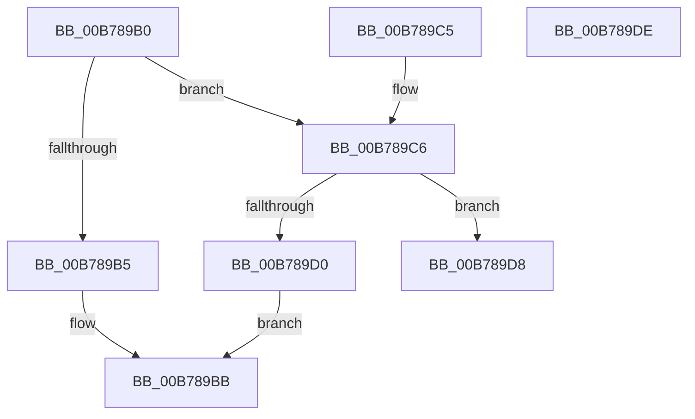

# RtlCompressWorkSpaceSizeLZNT1

- RVA: `0x00B789B0`–`0x00B789DF` (길이 `47` bytes)
- VA: `0x0000000140B789B0`
- 실행 섹션: `PAGELK`
- PDB 이름 있음: `예`; PDB Function 태그: `아니요`
- unwind 정보 RVA: `0x000DB714`
- 디코드: `15`개 명령, `47/47` bytes 표시
- 미해석 바이트: `0` (있으면 어셈블리에 `.byte`로 보존)

> 이 문서는 커널 이미지의 기계어와 PDB 기호를 분석해 생성했습니다. 4번과 5번은 함수 원형과 자료형을 바이너리 사용 방식에서 추정한 C 해석이며 원본 소스 복구 결과는 아닙니다.

## 1. Dependencies

- 직접 호출 지점: **0**; 고유 호출 대상: **0**
- 직접 호출자로 확인된 함수: **2**
- RIP 상대 이미지 참조: **0**

### Outgoing calls
- 직접 디코드된 call 명령이 없습니다.

### Direct callers
- [SmDecompressBuffer](../../text/3A/SmDecompressBuffer_function_003A4978.md) at `0x003A4A53`
- [RtlGetCompressionWorkSpaceSize](../../text/3B/RtlGetCompressionWorkSpaceSize_function_003B2560.md) at `0x003B25A1`

### Static image references
- 디코드된 RIP-relative 메모리 참조가 없습니다.

## 2. Other-region calls and transfers

- 다른 실행 섹션으로 향하는 call: **0**
- 별도 외부 분기/꼬리 이동을 확인하지 못했습니다.

## 3. Assembly (complete function range)

```asm
00B789B0  66 85 C9                        test cx, cx
00B789B3  75 11                           jne 0x140b789c6
00B789B5  C7 02 20 00 01 00               mov dword ptr [rdx], 0x10020
00B789BB  41 C7 00 00 10 00 00            mov dword ptr [r8], 0x1000
00B789C2  33 C0                           xor eax, eax
00B789C4  C3                              ret
00B789C5  CC                              int3
00B789C6  B8 00 01 00 00                  mov eax, 0x100
00B789CB  66 3B C8                        cmp cx, ax
00B789CE  75 08                           jne 0x140b789d8
00B789D0  C7 02 20 00 00 00               mov dword ptr [rdx], 0x20
00B789D6  EB E3                           jmp 0x140b789bb
00B789D8  B8 BB 00 00 C0                  mov eax, 0xc00000bb
00B789DD  C3                              ret
00B789DE  CC                              int3
```

## 4. C-style interpretation (structured pseudocode)

```c
__int64 __fastcall RtlCompressWorkSpaceSizeLZNT1(unsigned __int16 a1, __int64 a2, __int64 a3)
{
    __int64 result;

    if (a1 != 0) goto loc_00B789C6;
    *(unsigned int *)(a2) = 0x10020ULL;
loc_00B789BB:
    *(unsigned int *)(a3) = 0x1000ULL;
    result = 0;
    return result;
loc_00B789C6:
    if (a1 != 256) goto loc_00B789D8;
    *(unsigned int *)(a2) = 32;
    goto loc_00B789BB;
loc_00B789D8:
    return (unsigned int)(0xC00000BBULL);
}
```

## 5. (Beta) C Style

```c
int64_t RtlCompressWorkSpaceSizeLZNT1(uint16_t Arg1, void *Arg2, void *Arg3)
{
    uint8_t *arg2 = (uint8_t *)Arg2;
    uint8_t *arg3 = (uint8_t *)Arg3;

    int64_t result;

    if (Arg1 != 0) goto loc_00B789C6;
    *(uint32_t *)(arg2) = 0x10020ULL;
loc_00B789BB:
    *(uint32_t *)(arg3) = 0x1000ULL;
    result = 0;
    return result;
loc_00B789C6:
    if (Arg1 != 256) goto loc_00B789D8;
    *(uint32_t *)(arg2) = 32;
    goto loc_00B789BB;
loc_00B789D8:
    return (uint32_t)(0xC00000BBULL);
}
```

### 관측된 메모리 오프셋

구조체 형식이 확인되지 않은 접근은 인자 기준의 오프셋으로만 기록했습니다.

| 기준 인자 | 오프셋 표현 | 폭 (bit) | 접근 |
|---|---:|---:|---|
| `Arg2` | `+ 0x0` | `32` | `W` |
| `Arg3` | `+ 0x0` | `32` | `W` |

## 6. Execution-region graph

[열기: 2D/3D 그래프와 함수 탐색 컨트롤 패널](../../../control-panel.html?section=pagelk&rva=0x00B789B0&view=graph)

- 2D 그래프는 위에서 아래로 흐르고, 3D 그래프는 빈 공간을 드래그해 회전합니다. Shift+드래그는 이동, 휠은 확대·축소, 함수 노드 선택은 대상 보고서 이동입니다.

### Static fallback


