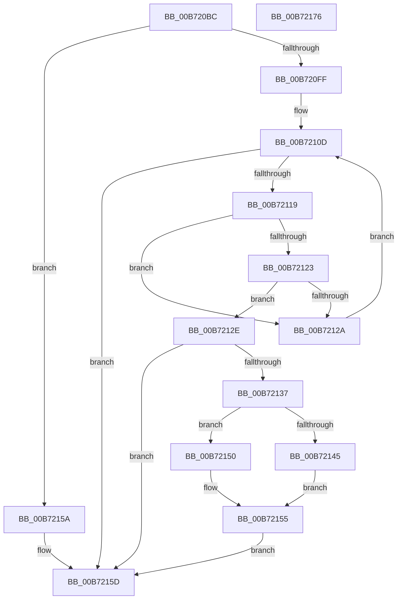

# RtlGetCpuMaxPhysicalBits

- RVA: `0x00B720BC`–`0x00B72177` (길이 `187` bytes)
- VA: `0x0000000140B720BC`
- 실행 섹션: `PAGELK`
- PDB 이름 있음: `예`; PDB Function 태그: `아니요`
- unwind 정보 RVA: `0x000C412C`
- 디코드: `56`개 명령, `187/187` bytes 표시
- 미해석 바이트: `0` (있으면 어셈블리에 `.byte`로 보존)

> 이 문서는 커널 이미지의 기계어와 PDB 기호를 분석해 생성했습니다. 4번과 5번은 함수 원형과 자료형을 바이너리 사용 방식에서 추정한 C 해석이며 원본 소스 복구 결과는 아닙니다.

## 1. Dependencies

- 직접 호출 지점: **3**; 고유 호출 대상: **3**
- 직접 호출자로 확인된 함수: **1**
- RIP 상대 이미지 참조: **2**

### Outgoing calls
- `0x00B720EB` → [RtlGetProcessorSignature](RtlGetProcessorSignature_function_00B7225C.md) (function, `0x00B7225C`)
- `0x00B720F6` → [HviGetImplementedPhysicalBits](../../text/66/HviGetImplementedPhysicalBits_function_00666750.md) (function, `0x00666750`)
- `0x00B72166` → [_security_check_cookie](../../text/6A/_security_check_cookie_function_006AC640.md) (function, `0x006AC640`)

### Direct callers
- [SpcDetectKvaLeakage](SpcDetectKvaLeakage_function_00B75098.md) at `0x00B751F6`

### Static image references
- `0x00B720C9` → RVA `0x00E0A740` (`.data`; read)
- `0x00B72104` → RVA `0x00034240` (`.rdata`; read)

## 2. Other-region calls and transfers

- 다른 실행 섹션으로 향하는 call: **2**
  - `0x00B720F6` → [HviGetImplementedPhysicalBits](../../text/66/HviGetImplementedPhysicalBits_function_00666750.md) (`PAGELK` → `.text`)
  - `0x00B72166` → [_security_check_cookie](../../text/6A/_security_check_cookie_function_006AC640.md) (`PAGELK` → `.text`)
- 별도 외부 분기/꼬리 이동을 확인하지 못했습니다.

## 3. Assembly (complete function range)

```asm
00B720BC  48 89 5C 24 08                  mov qword ptr [rsp + 8], rbx
00B720C1  55                              push rbp
00B720C2  48 8B EC                        mov rbp, rsp
00B720C5  48 83 EC 40                     sub rsp, 0x40
00B720C9  48 8B 05 70 86 29 00            mov rax, qword ptr [rip + 0x298670]
00B720D0  48 33 C4                        xor rax, rsp
00B720D3  48 89 45 F8                     mov qword ptr [rbp - 8], rax
00B720D7  83 65 E4 00                     and dword ptr [rbp - 0x1c], 0
00B720DB  48 8D 4D E0                     lea rcx, [rbp - 0x20]
00B720DF  45 33 C9                        xor r9d, r9d
00B720E2  C6 45 E0 00                     mov byte ptr [rbp - 0x20], 0
00B720E6  45 33 C0                        xor r8d, r8d
00B720E9  33 D2                           xor edx, edx
00B720EB  E8 6C 01 00 00                  call 0x140b7225c
00B720F0  48 8D 4D E4                     lea rcx, [rbp - 0x1c]
00B720F4  8B D8                           mov ebx, eax
00B720F6  E8 55 46 AF FF                  call 0x140666750
00B720FB  84 C0                           test al, al
00B720FD  75 5B                           jne 0x140b7215a
00B720FF  B9 2E 00 00 00                  mov ecx, 0x2e
00B72104  4C 8D 0D 35 21 4C FF            lea r9, [rip - 0xb3decb]
00B7210B  33 D2                           xor edx, edx
00B7210D  4C 8D 04 92                     lea r8, [rdx + rdx*4]
00B72111  43 83 7C 81 08 13               cmp dword ptr [r9 + r8*4 + 8], 0x13
00B72117  74 44                           je 0x140b7215d
00B72119  0F B6 45 E0                     movzx eax, byte ptr [rbp - 0x20]
00B7211D  43 39 04 81                     cmp dword ptr [r9 + r8*4], eax
00B72121  75 07                           jne 0x140b7212a
00B72123  43 39 5C 81 04                  cmp dword ptr [r9 + r8*4 + 4], ebx
00B72128  74 04                           je 0x140b7212e
00B7212A  FF C2                           inc edx
00B7212C  EB DF                           jmp 0x140b7210d
00B7212E  43 8B 4C 81 0C                  mov ecx, dword ptr [r9 + r8*4 + 0xc]
00B72133  85 C9                           test ecx, ecx
00B72135  75 26                           jne 0x140b7215d
00B72137  B8 00 00 00 80                  mov eax, 0x80000000
00B7213C  0F A2                           cpuid
00B7213E  3D 08 00 00 80                  cmp eax, 0x80000008
00B72143  72 0B                           jb 0x140b72150
00B72145  B8 08 00 00 80                  mov eax, 0x80000008
00B7214A  33 C9                           xor ecx, ecx
00B7214C  0F A2                           cpuid
00B7214E  EB 05                           jmp 0x140b72155
00B72150  B8 24 00 00 00                  mov eax, 0x24
00B72155  0F B6 C8                        movzx ecx, al
00B72158  EB 03                           jmp 0x140b7215d
00B7215A  8B 4D E4                        mov ecx, dword ptr [rbp - 0x1c]
00B7215D  8B C1                           mov eax, ecx
00B7215F  48 8B 4D F8                     mov rcx, qword ptr [rbp - 8]
00B72163  48 33 CC                        xor rcx, rsp
00B72166  E8 D5 A4 B3 FF                  call 0x1406ac640
00B7216B  48 8B 5C 24 50                  mov rbx, qword ptr [rsp + 0x50]
00B72170  48 83 C4 40                     add rsp, 0x40
00B72174  5D                              pop rbp
00B72175  C3                              ret
00B72176  CC                              int3
```

## 4. C-style interpretation (structured pseudocode)

```c
__int64 __fastcall RtlGetCpuMaxPhysicalBits(__int64 a1, int a2, int a3, int a4)
{
    __int64 result;
    __int64 v_rsp;
    unsigned __int64 v_stack_m10;
    unsigned int v_stack_m24;
    unsigned __int64 v_stack_m28;
    unsigned __int64 v_stack_p8;

    v_stack_p8 = v_rbx;
    v_rsp = (v_rsp) - (64);
    result = (*(unsigned __int64 *)(v_rip + 2721392)) ^ (v_rsp);
    v_stack_m10 = result;
    a4 = 0;
    v_stack_m28 = 0;
    a3 = 0;
    a2 = 0;
    result = RtlGetProcessorSignature(v_stack_m28, a2, a3, a4);
    result = HviGetImplementedPhysicalBits(v_stack_m24, a2, a3, a4);
    if ((unsigned __int8)(result) != 0) goto loc_00B7215A;
    a2 = 0;
loc_00B7210D:
    if ((*(unsigned int *)(v_rip - 11787979 + a2 + a2 * 4 * 4 + 8)) == 19) goto loc_00B7215D;
    if ((*(unsigned int *)(v_rip - 11787979 + a2 + a2 * 4 * 4)) != ((unsigned int)(v_stack_m28))) goto loc_00B7212A;
    if ((*(unsigned int *)(v_rip - 11787979 + a2 + a2 * 4 * 4 + 4)) == ((unsigned int)((unsigned int)((unsigned int)(result))))) goto loc_00B7212E;
loc_00B7212A:
    a2 = (unsigned int)((a2) + 1);
    goto loc_00B7210D;
loc_00B7212E:
    if ((unsigned int)((unsigned int)(*(unsigned int *)(v_rip - 11787979 + a2 + a2 * 4 * 4 + 12))) != 0) goto loc_00B7215D;
    if (((unsigned int)((unsigned int)(0x80000000ULL))) < 0x80000008ULL) goto loc_00B72150;
    a1 = 0;
    goto loc_00B72155;
loc_00B72150:
loc_00B72155:
    goto loc_00B7215D;
loc_00B7215A:
loc_00B7215D:
    a1 = (v_stack_m10) ^ (v_rsp);
    result = _security_check_cookie(a1, a2, a2 + a2 * 4, v_rip - 11787979);
    v_rsp = (v_rsp) + (64);
    return result;
}
```

## 5. (Beta) C Style

```c
int64_t RtlGetCpuMaxPhysicalBits(int64_t Arg1, int32_t Arg2, int32_t Arg3, int32_t Arg4)
{
    int64_t result;
    int64_t local_rsp;
    uint64_t v_stack_m10;
    uint32_t v_stack_m24;
    uint64_t v_stack_m28;
    uint64_t v_stack_p8;

    v_stack_p8 = local_rbx;
    local_rsp = (local_rsp) - (64);
    result = (*(uint64_t *)(v_rip + 0x298670)) ^ (local_rsp);
    v_stack_m10 = result;
    Arg4 = 0;
    v_stack_m28 = 0;
    Arg3 = 0;
    Arg2 = 0;
    result = RtlGetProcessorSignature(v_stack_m28, Arg2, Arg3, Arg4);
    result = HviGetImplementedPhysicalBits(v_stack_m24, Arg2, Arg3, Arg4);
    if ((uint8_t)(result) != 0) goto loc_00B7215A;
    Arg2 = 0;
loc_00B7210D:
    if ((*(uint32_t *)(v_rip - 0xB3DECB + Arg2 + Arg2 * 4 * 4 + 0x8)) == 19) goto loc_00B7215D;
    if ((*(uint32_t *)(v_rip - 0xB3DECB + Arg2 + Arg2 * 4 * 4)) != ((uint32_t)(v_stack_m28))) goto loc_00B7212A;
    if ((*(uint32_t *)(v_rip - 0xB3DECB + Arg2 + Arg2 * 4 * 4 + 0x4)) == ((uint32_t)((uint32_t)((uint32_t)(result))))) goto loc_00B7212E;
loc_00B7212A:
    Arg2 = (uint32_t)((Arg2) + 1);
    goto loc_00B7210D;
loc_00B7212E:
    if ((uint32_t)((uint32_t)(*(uint32_t *)(v_rip - 0xB3DECB + Arg2 + Arg2 * 4 * 4 + 0xC))) != 0) goto loc_00B7215D;
    if (((uint32_t)((uint32_t)(0x80000000ULL))) < 0x80000008ULL) goto loc_00B72150;
    Arg1 = 0;
    goto loc_00B72155;
loc_00B72150:
loc_00B72155:
    goto loc_00B7215D;
loc_00B7215A:
loc_00B7215D:
    Arg1 = (v_stack_m10) ^ (local_rsp);
    result = _security_check_cookie(Arg1, Arg2, Arg2 + Arg2 * 4, v_rip - 11787979);
    local_rsp = (local_rsp) + (64);
    return result;
}
```

## 6. Execution-region graph

[열기: 2D/3D 그래프와 함수 탐색 컨트롤 패널](../../../control-panel.html?section=pagelk&rva=0x00B720BC&view=graph)

- 2D 그래프는 위에서 아래로 흐르고, 3D 그래프는 빈 공간을 드래그해 회전합니다. Shift+드래그는 이동, 휠은 확대·축소, 함수 노드 선택은 대상 보고서 이동입니다.

### Static fallback


