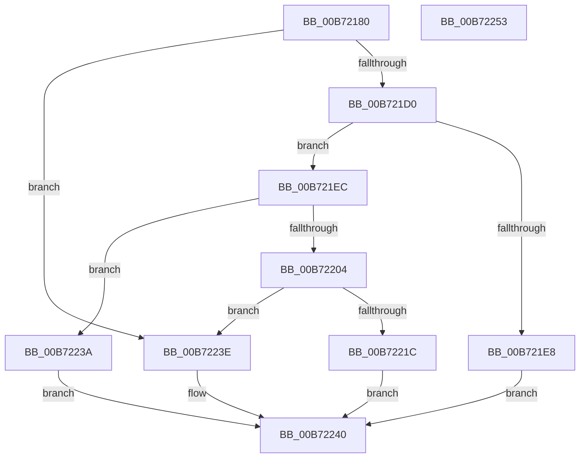

# RtlGetCpuVendor

- RVA: `0x00B72180`–`0x00B72254` (길이 `212` bytes)
- VA: `0x0000000140B72180`
- 실행 섹션: `PAGELK`
- PDB 이름 있음: `예`; PDB Function 태그: `아니요`
- unwind 정보 RVA: `0x000AB2E4`
- 디코드: `60`개 명령, `212/212` bytes 표시
- 미해석 바이트: `0` (있으면 어셈블리에 `.byte`로 보존)

> 이 문서는 커널 이미지의 기계어와 PDB 기호를 분석해 생성했습니다. 4번과 5번은 함수 원형과 자료형을 바이너리 사용 방식에서 추정한 C 해석이며 원본 소스 복구 결과는 아닙니다.

## 1. Dependencies

- 직접 호출 지점: **6**; 고유 호출 대상: **2**
- 직접 호출자로 확인된 함수: **2**
- RIP 상대 이미지 참조: **6**

### Outgoing calls
- `0x00B721C7` → [strncmp](../../text/6C/strncmp_function_006C6720.md) (function, `0x006C6720`)
- `0x00B721DF` → [strncmp](../../text/6C/strncmp_function_006C6720.md) (function, `0x006C6720`)
- `0x00B721FB` → [strncmp](../../text/6C/strncmp_function_006C6720.md) (function, `0x006C6720`)
- `0x00B72213` → [strncmp](../../text/6C/strncmp_function_006C6720.md) (function, `0x006C6720`)
- `0x00B7222B` → [strncmp](../../text/6C/strncmp_function_006C6720.md) (function, `0x006C6720`)
- `0x00B72248` → [_security_check_cookie](../../text/6A/_security_check_cookie_function_006AC640.md) (function, `0x006AC640`)

### Direct callers
- [SpcIsHyperVCr3RspErrataPresent](../../text/6A/SpcIsHyperVCr3RspErrataPresent_function_006A788C.md) at `0x006A78A9`
- [RtlGetProcessorSignature](RtlGetProcessorSignature_function_00B7225C.md) at `0x00B72283`

### Static image references
- `0x00B72186` → RVA `0x00E0A740` (`.data`; read)
- `0x00B721B7` → RVA `0x00B7FCE0` (` ?? ::OKHAJAOM::`string'`; read)
- `0x00B721D3` → RVA `0x00B7FCD0` (` ?? ::OKHAJAOM::`string'`; read)
- `0x00B721EF` → RVA `0x00B7FCB0` (` ?? ::OKHAJAOM::`string'`; read)
- `0x00B72207` → RVA `0x00B7FCA0` (` ?? ::OKHAJAOM::`string'`; read)
- `0x00B7221F` → RVA `0x00B7FCC0` (` ?? ::OKHAJAOM::`string'`; read)

## 2. Other-region calls and transfers

- 다른 실행 섹션으로 향하는 call: **6**
  - `0x00B721C7` → [strncmp](../../text/6C/strncmp_function_006C6720.md) (`PAGELK` → `.text`)
  - `0x00B721DF` → [strncmp](../../text/6C/strncmp_function_006C6720.md) (`PAGELK` → `.text`)
  - `0x00B721FB` → [strncmp](../../text/6C/strncmp_function_006C6720.md) (`PAGELK` → `.text`)
  - `0x00B72213` → [strncmp](../../text/6C/strncmp_function_006C6720.md) (`PAGELK` → `.text`)
  - `0x00B7222B` → [strncmp](../../text/6C/strncmp_function_006C6720.md) (`PAGELK` → `.text`)
  - `0x00B72248` → [_security_check_cookie](../../text/6A/_security_check_cookie_function_006AC640.md) (`PAGELK` → `.text`)
- 별도 외부 분기/꼬리 이동을 확인하지 못했습니다.

## 3. Assembly (complete function range)

```asm
00B72180  40 53                           push rbx
00B72182  48 83 EC 40                     sub rsp, 0x40
00B72186  48 8B 05 B3 85 29 00            mov rax, qword ptr [rip + 0x2985b3]
00B7218D  48 33 C4                        xor rax, rsp
00B72190  48 89 44 24 30                  mov qword ptr [rsp + 0x30], rax
00B72195  33 C9                           xor ecx, ecx
00B72197  33 C0                           xor eax, eax
00B72199  0F A2                           cpuid
00B7219B  0F 57 C0                        xorps xmm0, xmm0
00B7219E  0F 11 44 24 20                  movups xmmword ptr [rsp + 0x20], xmm0
00B721A3  89 5C 24 24                     mov dword ptr [rsp + 0x24], ebx
00B721A7  BB 0C 00 00 00                  mov ebx, 0xc
00B721AC  89 54 24 28                     mov dword ptr [rsp + 0x28], edx
00B721B0  44 8B C3                        mov r8d, ebx
00B721B3  89 4C 24 2C                     mov dword ptr [rsp + 0x2c], ecx
00B721B7  48 8D 15 22 DB 00 00            lea rdx, [rip + 0xdb22]
00B721BE  48 8D 4C 24 24                  lea rcx, [rsp + 0x24]
00B721C3  89 44 24 20                     mov dword ptr [rsp + 0x20], eax
00B721C7  E8 54 45 B5 FF                  call 0x1406c6720
00B721CC  85 C0                           test eax, eax
00B721CE  74 6E                           je 0x140b7223e
00B721D0  44 8B C3                        mov r8d, ebx
00B721D3  48 8D 15 F6 DA 00 00            lea rdx, [rip + 0xdaf6]
00B721DA  48 8D 4C 24 24                  lea rcx, [rsp + 0x24]
00B721DF  E8 3C 45 B5 FF                  call 0x1406c6720
00B721E4  85 C0                           test eax, eax
00B721E6  75 04                           jne 0x140b721ec
00B721E8  B0 02                           mov al, 2
00B721EA  EB 54                           jmp 0x140b72240
00B721EC  4C 8B C3                        mov r8, rbx
00B721EF  48 8D 15 BA DA 00 00            lea rdx, [rip + 0xdaba]
00B721F6  48 8D 4C 24 24                  lea rcx, [rsp + 0x24]
00B721FB  E8 20 45 B5 FF                  call 0x1406c6720
00B72200  85 C0                           test eax, eax
00B72202  74 36                           je 0x140b7223a
00B72204  4C 8B C3                        mov r8, rbx
00B72207  48 8D 15 92 DA 00 00            lea rdx, [rip + 0xda92]
00B7220E  48 8D 4C 24 24                  lea rcx, [rsp + 0x24]
00B72213  E8 08 45 B5 FF                  call 0x1406c6720
00B72218  85 C0                           test eax, eax
00B7221A  74 22                           je 0x140b7223e
00B7221C  4C 8B C3                        mov r8, rbx
00B7221F  48 8D 15 9A DA 00 00            lea rdx, [rip + 0xda9a]
00B72226  48 8D 4C 24 24                  lea rcx, [rsp + 0x24]
00B7222B  E8 F0 44 B5 FF                  call 0x1406c6720
00B72230  F7 D8                           neg eax
00B72232  1A C0                           sbb al, al
00B72234  F6 D0                           not al
00B72236  24 03                           and al, 3
00B72238  EB 06                           jmp 0x140b72240
00B7223A  B0 03                           mov al, 3
00B7223C  EB 02                           jmp 0x140b72240
00B7223E  B0 01                           mov al, 1
00B72240  48 8B 4C 24 30                  mov rcx, qword ptr [rsp + 0x30]
00B72245  48 33 CC                        xor rcx, rsp
00B72248  E8 F3 A3 B3 FF                  call 0x1406ac640
00B7224D  48 83 C4 40                     add rsp, 0x40
00B72251  5B                              pop rbx
00B72252  C3                              ret
00B72253  CC                              int3
```

## 4. C-style interpretation (structured pseudocode)

```c
__int64 __fastcall RtlGetCpuVendor(int a1, int a2)
{
    __int64 result;
    __int64 v_rsp;
    unsigned __int64 v_stack_m18;
    unsigned int v_stack_m1C;
    unsigned int v_stack_m20;
    unsigned int v_stack_m24;
    unsigned __int64 v_stack_m28;

    v_rsp = (v_rsp) - (64);
    result = (*(unsigned __int64 *)(v_rip + 2721203)) ^ (v_rsp);
    v_stack_m18 = result;
    a1 = 0;
    result = 0;
    v_stack_m28 = v_xmm0;
    v_stack_m24 = (unsigned int)(v_rbx);
    v_stack_m20 = a2;
    v_stack_m1C = 0;
    v_stack_m28 = 0;
    result = strncmp(v_stack_m24, v_rip + 56098, 12, a4);
    if ((unsigned int)(result) == 0) goto loc_00B7223E;
    result = strncmp(v_stack_m24, v_rip + 56054, 12, a4);
    if ((unsigned int)(result) != 0) goto loc_00B721EC;
    goto loc_00B72240;
loc_00B721EC:
    result = strncmp(v_stack_m24, v_rip + 55994, 12, a4);
    if ((unsigned int)(result) == 0) goto loc_00B7223A;
    result = strncmp(v_stack_m24, v_rip + 55954, 12, a4);
    if ((unsigned int)(result) == 0) goto loc_00B7223E;
    result = strncmp(v_stack_m24, v_rip + 55962, 12, a4);
    result = (unsigned int)(-(result));
    result = (unsigned __int8)(~(result));
    result = (unsigned __int8)((result) & (3));
    goto loc_00B72240;
loc_00B7223A:
    goto loc_00B72240;
loc_00B7223E:
loc_00B72240:
    a1 = (v_stack_m18) ^ (v_rsp);
    result = _security_check_cookie(a1, v_rip + 55962, 12, a4);
    v_rsp = (v_rsp) + (64);
    return result;
}
```

## 5. (Beta) C Style

```c
int64_t RtlGetCpuVendor(int32_t Arg1, int32_t Arg2)
{
    int64_t result;
    int64_t local_rsp;
    uint64_t v_stack_m18;
    uint32_t v_stack_m1C;
    uint32_t v_stack_m20;
    uint32_t v_stack_m24;
    uint64_t v_stack_m28;

    local_rsp = (local_rsp) - (64);
    result = (*(uint64_t *)(v_rip + 0x2985B3)) ^ (local_rsp);
    v_stack_m18 = result;
    Arg1 = 0;
    result = 0;
    v_stack_m28 = v_xmm0;
    v_stack_m24 = (uint32_t)(local_rbx);
    v_stack_m20 = Arg2;
    v_stack_m1C = 0;
    v_stack_m28 = 0;
    result = strncmp(v_stack_m24, v_rip + 56098, 12, a4);
    if ((uint32_t)(result) == 0) goto loc_00B7223E;
    result = strncmp(v_stack_m24, v_rip + 56054, 12, a4);
    if ((uint32_t)(result) != 0) goto loc_00B721EC;
    goto loc_00B72240;
loc_00B721EC:
    result = strncmp(v_stack_m24, v_rip + 55994, 12, a4);
    if ((uint32_t)(result) == 0) goto loc_00B7223A;
    result = strncmp(v_stack_m24, v_rip + 55954, 12, a4);
    if ((uint32_t)(result) == 0) goto loc_00B7223E;
    result = strncmp(v_stack_m24, v_rip + 55962, 12, a4);
    result = (uint32_t)(-(result));
    result = (uint8_t)(~(result));
    result = (uint8_t)((result) & (3));
    goto loc_00B72240;
loc_00B7223A:
    goto loc_00B72240;
loc_00B7223E:
loc_00B72240:
    Arg1 = (v_stack_m18) ^ (local_rsp);
    result = _security_check_cookie(Arg1, v_rip + 55962, 12, a4);
    local_rsp = (local_rsp) + (64);
    return result;
}
```

## 6. Execution-region graph

[열기: 2D/3D 그래프와 함수 탐색 컨트롤 패널](../../../control-panel.html?section=pagelk&rva=0x00B72180&view=graph)

- 2D 그래프는 위에서 아래로 흐르고, 3D 그래프는 빈 공간을 드래그해 회전합니다. Shift+드래그는 이동, 휠은 확대·축소, 함수 노드 선택은 대상 보고서 이동입니다.

### Static fallback


