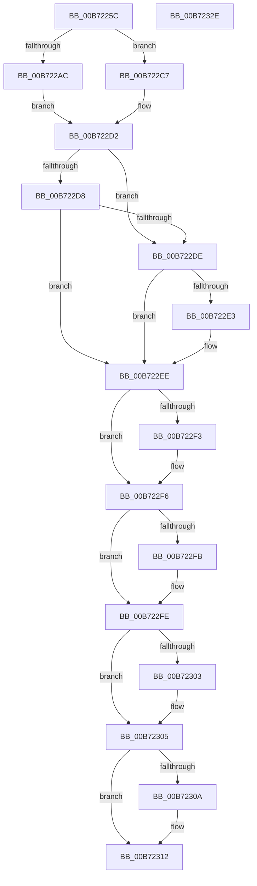

# RtlGetProcessorSignature

- RVA: `0x00B7225C`–`0x00B7232F` (길이 `211` bytes)
- VA: `0x0000000140B7225C`
- 실행 섹션: `PAGELK`
- PDB 이름 있음: `예`; PDB Function 태그: `아니요`
- unwind 정보 RVA: `0x000CFFB8`
- 디코드: `75`개 명령, `211/211` bytes 표시
- 미해석 바이트: `0` (있으면 어셈블리에 `.byte`로 보존)

> 이 문서는 커널 이미지의 기계어와 PDB 기호를 분석해 생성했습니다. 4번과 5번은 함수 원형과 자료형을 바이너리 사용 방식에서 추정한 C 해석이며 원본 소스 복구 결과는 아닙니다.

## 1. Dependencies

- 직접 호출 지점: **2**; 고유 호출 대상: **2**
- 직접 호출자로 확인된 함수: **5**
- RIP 상대 이미지 참조: **1**

### Outgoing calls
- `0x00B72283` → [RtlGetCpuVendor](RtlGetCpuVendor_function_00B72180.md) (function, `0x00B72180`)
- `0x00B7231D` → [_security_check_cookie](../../text/6A/_security_check_cookie_function_006AC640.md) (function, `0x006AC640`)

### Direct callers
- [KiGetProcessorSignature](../../text/5C/KiGetProcessorSignature_function_005C48A8.md) at `0x005C48AC`
- [RtlpInitFunctionOverrideCapabilities](../../page/79/RtlpInitFunctionOverrideCapabilities_function_0079AC60.md) at `0x0079ACA7`
- [RtlDetectProcessorFeatures](RtlDetectProcessorFeatures_function_00B719B0.md) at `0x00B71A48`
- [RtlGetCpuMaxPhysicalBits](RtlGetCpuMaxPhysicalBits_function_00B720BC.md) at `0x00B720EB`
- [SpcDetectKvaLeakage](SpcDetectKvaLeakage_function_00B75098.md) at `0x00B750D7`

### Static image references
- `0x00B72268` → RVA `0x00E0A740` (`.data`; read)

## 2. Other-region calls and transfers

- 다른 실행 섹션으로 향하는 call: **1**
  - `0x00B7231D` → [_security_check_cookie](../../text/6A/_security_check_cookie_function_006AC640.md) (`PAGELK` → `.text`)
- 별도 외부 분기/꼬리 이동을 확인하지 못했습니다.

## 3. Assembly (complete function range)

```asm
00B7225C  40 53                           push rbx
00B7225E  56                              push rsi
00B7225F  57                              push rdi
00B72260  41 56                           push r14
00B72262  41 57                           push r15
00B72264  48 83 EC 40                     sub rsp, 0x40
00B72268  48 8B 05 D1 84 29 00            mov rax, qword ptr [rip + 0x2984d1]
00B7226F  48 33 C4                        xor rax, rsp
00B72272  48 89 44 24 30                  mov qword ptr [rsp + 0x30], rax
00B72277  49 8B F9                        mov rdi, r9
00B7227A  49 8B F0                        mov rsi, r8
00B7227D  4C 8B F2                        mov r14, rdx
00B72280  4C 8B F9                        mov r15, rcx
00B72283  E8 F8 FE FF FF                  call 0x140b72180
00B72288  33 C9                           xor ecx, ecx
00B7228A  44 8A D0                        mov r10b, al
00B7228D  B8 01 00 00 00                  mov eax, 1
00B72292  41 B9 F0 00 00 00               mov r9d, 0xf0
00B72298  0F A2                           cpuid
00B7229A  8B C8                           mov ecx, eax
00B7229C  44 8B C0                        mov r8d, eax
00B7229F  C1 E9 08                        shr ecx, 8
00B722A2  8B D9                           mov ebx, ecx
00B722A4  83 E3 0F                        and ebx, 0xf
00B722A7  83 FB 0F                        cmp ebx, 0xf
00B722AA  75 1B                           jne 0x140b722c7
00B722AC  C1 E8 14                        shr eax, 0x14
00B722AF  81 E1 00 0F 00 00               and ecx, 0xf00
00B722B5  0F B6 D0                        movzx edx, al
00B722B8  41 8B C0                        mov eax, r8d
00B722BB  41 23 C1                        and eax, r9d
00B722BE  03 D3                           add edx, ebx
00B722C0  0B C8                           or ecx, eax
00B722C2  C1 E9 04                        shr ecx, 4
00B722C5  EB 0B                           jmp 0x140b722d2
00B722C7  41 8B C8                        mov ecx, r8d
00B722CA  8B D3                           mov edx, ebx
00B722CC  C1 E9 04                        shr ecx, 4
00B722CF  83 E1 0F                        and ecx, 0xf
00B722D2  41 80 FA 02                     cmp r10b, 2
00B722D6  74 06                           je 0x140b722de
00B722D8  41 80 FA 03                     cmp r10b, 3
00B722DC  75 10                           jne 0x140b722ee
00B722DE  83 FA 06                        cmp edx, 6
00B722E1  75 0B                           jne 0x140b722ee
00B722E3  41 8B C0                        mov eax, r8d
00B722E6  C1 E8 0C                        shr eax, 0xc
00B722E9  41 23 C1                        and eax, r9d
00B722EC  0B C8                           or ecx, eax
00B722EE  4D 85 FF                        test r15, r15
00B722F1  74 03                           je 0x140b722f6
00B722F3  45 88 17                        mov byte ptr [r15], r10b
00B722F6  4D 85 F6                        test r14, r14
00B722F9  74 03                           je 0x140b722fe
00B722FB  41 89 16                        mov dword ptr [r14], edx
00B722FE  48 85 F6                        test rsi, rsi
00B72301  74 02                           je 0x140b72305
00B72303  89 0E                           mov dword ptr [rsi], ecx
00B72305  48 85 FF                        test rdi, rdi
00B72308  74 08                           je 0x140b72312
00B7230A  41 8B C8                        mov ecx, r8d
00B7230D  83 E1 0F                        and ecx, 0xf
00B72310  89 0F                           mov dword ptr [rdi], ecx
00B72312  41 8B C0                        mov eax, r8d
00B72315  48 8B 4C 24 30                  mov rcx, qword ptr [rsp + 0x30]
00B7231A  48 33 CC                        xor rcx, rsp
00B7231D  E8 1E A3 B3 FF                  call 0x1406ac640
00B72322  48 83 C4 40                     add rsp, 0x40
00B72326  41 5F                           pop r15
00B72328  41 5E                           pop r14
00B7232A  5F                              pop rdi
00B7232B  5E                              pop rsi
00B7232C  5B                              pop rbx
00B7232D  C3                              ret
00B7232E  CC                              int3
```

## 4. C-style interpretation (structured pseudocode)

```c
__int64 __fastcall RtlGetProcessorSignature(__int64 a1, __int64 a2, __int64 a3, __int64 a4)
{
    __int64 result;
    __int64 v_rbx;
    __int64 v_rsp;
    unsigned __int64 v_stack_m38;

    v_rsp = (v_rsp) - (64);
    result = (*(unsigned __int64 *)(v_rip + 2720977)) ^ (v_rsp);
    v_stack_m38 = result;
    result = RtlGetCpuVendor(a1, a2, a3, a4);
    a1 = 0;
    a1 = (unsigned int)((1) >> (8));
    v_rbx = (unsigned int)(((unsigned int)((unsigned int)(a1))) & (15));
    if (((unsigned int)(v_rbx)) != 15) goto loc_00B722C7;
    result = (unsigned int)((1) >> (20));
    a1 = (unsigned int)((a1) & (0xF00ULL));
    result = (unsigned int)((1) & (240));
    a2 = (unsigned int)(((unsigned __int8)(result)) + ((unsigned int)(v_rbx)));
    a1 = (unsigned int)((a1) | ((unsigned int)(result)));
    a1 = (unsigned int)((a1) >> (4));
    goto loc_00B722D2;
loc_00B722C7:
    a1 = (unsigned int)((1) >> (4));
    a1 = (unsigned int)((a1) & (15));
loc_00B722D2:
    if (((unsigned __int8)((unsigned __int8)(result))) == 2) goto loc_00B722DE;
    if (((unsigned __int8)((unsigned __int8)(result))) != 3) goto loc_00B722EE;
loc_00B722DE:
    if (((unsigned int)((unsigned int)((unsigned int)(v_rbx)))) == 6) {
        result = 1;
        result = (unsigned int)((result) >> (12));
        result = (unsigned int)((result) & (240));
        a1 = (unsigned int)((a1) | ((unsigned int)(result)));
    }
    if (a1 != 0) {
        *(unsigned __int8 *)(a1) = (unsigned __int8)((unsigned __int8)(result));
    }
    if (a2 != 0) {
        *(unsigned int *)(a2) = (unsigned int)((unsigned int)((unsigned int)(v_rbx)));
    }
    if (a3 != 0) {
        *(unsigned int *)(a3) = (unsigned int)(a1);
    }
    if (a4 != 0) {
        a1 = 1;
        a1 = (unsigned int)((a1) & (15));
        *(unsigned int *)(a4) = (unsigned int)(a1);
    }
    a1 = (v_stack_m38) ^ (v_rsp);
    result = _security_check_cookie(a1, (unsigned int)((unsigned int)(v_rbx)), 1, 240);
    v_rsp = (v_rsp) + (64);
    return result;
}
```

## 5. (Beta) C Style

```c
int64_t RtlGetProcessorSignature(int64_t Arg1, int64_t Arg2, int64_t Arg3, int64_t Arg4)
{
    int64_t result;
    int64_t local_rbx;
    int64_t local_rsp;
    uint64_t v_stack_m38;

    local_rsp = (local_rsp) - (64);
    result = (*(uint64_t *)(v_rip + 0x2984D1)) ^ (local_rsp);
    v_stack_m38 = result;
    result = RtlGetCpuVendor(Arg1, Arg2, Arg3, Arg4);
    Arg1 = 0;
    Arg1 = (uint32_t)((1) >> (8));
    local_rbx = (uint32_t)(((uint32_t)((uint32_t)(Arg1))) & (15));
    if (((uint32_t)(local_rbx)) != 15) goto loc_00B722C7;
    result = (uint32_t)((1) >> (20));
    Arg1 = (uint32_t)((Arg1) & (0xF00ULL));
    result = (uint32_t)((1) & (240));
    Arg2 = (uint32_t)(((uint8_t)(result)) + ((uint32_t)(local_rbx)));
    Arg1 = (uint32_t)((Arg1) | ((uint32_t)(result)));
    Arg1 = (uint32_t)((Arg1) >> (4));
    goto loc_00B722D2;
loc_00B722C7:
    Arg1 = (uint32_t)((1) >> (4));
    Arg1 = (uint32_t)((Arg1) & (15));
loc_00B722D2:
    if (((uint8_t)((uint8_t)(result))) == 2) goto loc_00B722DE;
    if (((uint8_t)((uint8_t)(result))) != 3) goto loc_00B722EE;
loc_00B722DE:
    if (((uint32_t)((uint32_t)((uint32_t)(local_rbx)))) == 6) {
        result = 1;
        result = (uint32_t)((result) >> (12));
        result = (uint32_t)((result) & (240));
        Arg1 = (uint32_t)((Arg1) | ((uint32_t)(result)));
    }
    if (Arg1 != 0) {
        *(uint8_t *)(Arg1) = (uint8_t)((uint8_t)(result));
    }
    if (Arg2 != 0) {
        *(uint32_t *)(Arg2) = (uint32_t)((uint32_t)((uint32_t)(local_rbx)));
    }
    if (Arg3 != 0) {
        *(uint32_t *)(Arg3) = (uint32_t)(Arg1);
    }
    if (Arg4 != 0) {
        Arg1 = 1;
        Arg1 = (uint32_t)((Arg1) & (15));
        *(uint32_t *)(Arg4) = (uint32_t)(Arg1);
    }
    Arg1 = (v_stack_m38) ^ (local_rsp);
    result = _security_check_cookie(Arg1, (uint32_t)((uint32_t)(local_rbx)), 1, 240);
    local_rsp = (local_rsp) + (64);
    return result;
}
```

## 6. Execution-region graph

[열기: 2D/3D 그래프와 함수 탐색 컨트롤 패널](../../../control-panel.html?section=pagelk&rva=0x00B7225C&view=graph)

- 2D 그래프는 위에서 아래로 흐르고, 3D 그래프는 빈 공간을 드래그해 회전합니다. Shift+드래그는 이동, 휠은 확대·축소, 함수 노드 선택은 대상 보고서 이동입니다.

### Static fallback


