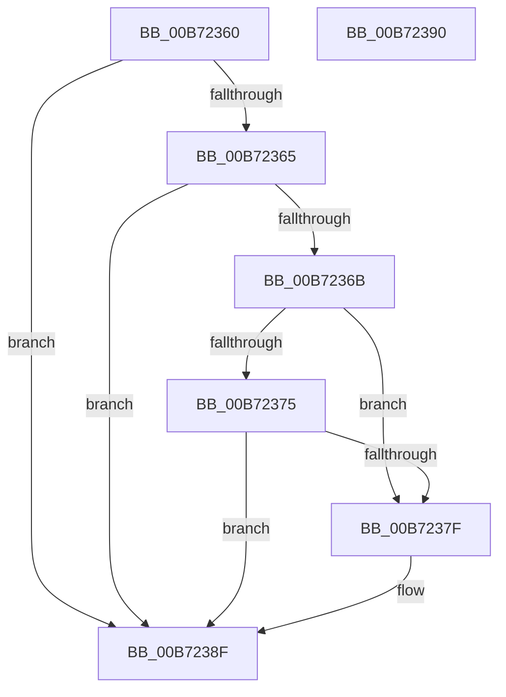

# RtlHandleGdsNoOverride

- RVA: `0x00B72360`–`0x00B72391` (길이 `49` bytes)
- VA: `0x0000000140B72360`
- 실행 섹션: `PAGELK`
- PDB 이름 있음: `예`; PDB Function 태그: `아니요`
- unwind 정보 RVA: `0x000DB714`
- 디코드: `16`개 명령, `49/49` bytes 표시
- 미해석 바이트: `0` (있으면 어셈블리에 `.byte`로 보존)

> 이 문서는 커널 이미지의 기계어와 PDB 기호를 분석해 생성했습니다. 4번과 5번은 함수 원형과 자료형을 바이너리 사용 방식에서 추정한 C 해석이며 원본 소스 복구 결과는 아닙니다.

## 1. Dependencies

- 직접 호출 지점: **0**; 고유 호출 대상: **0**
- 직접 호출자로 확인된 함수: **0**
- RIP 상대 이미지 참조: **1**

### Outgoing calls
- 직접 디코드된 call 명령이 없습니다.

### Direct callers
- 이 함수 시작 RVA로 연결되는 직접 call은 확인되지 않았습니다. 간접 호출은 완전히 역산할 수 없습니다.

### Static image references
- `0x00B7237F` → RVA `0x00F05BE0` (`.data`; read)

## 2. Other-region calls and transfers

- 다른 실행 섹션으로 향하는 call: **0**
- 별도 외부 분기/꼬리 이동을 확인하지 못했습니다.

## 3. Assembly (complete function range)

```asm
00B72360  83 39 00                        cmp dword ptr [rcx], 0
00B72363  74 2A                           je 0x140b7238f
00B72365  80 79 04 02                     cmp byte ptr [rcx + 4], 2
00B72369  75 24                           jne 0x140b7238f
00B7236B  8B 41 14                        mov eax, dword ptr [rcx + 0x14]
00B7236E  3D 71 06 0B 00                  cmp eax, 0xb0671
00B72373  74 0A                           je 0x140b7237f
00B72375  05 5E F9 F4 FF                  add eax, 0xfff4f95e
00B7237A  83 F8 01                        cmp eax, 1
00B7237D  77 10                           ja 0x140b7238f
00B7237F  48 8B 05 5A 38 39 00            mov rax, qword ptr [rip + 0x39385a]
00B72386  48 C1 E8 20                     shr rax, 0x20
00B7238A  83 E0 01                        and eax, 1
00B7238D  89 02                           mov dword ptr [rdx], eax
00B7238F  C3                              ret
00B72390  CC                              int3
```

## 4. C-style interpretation (structured pseudocode)

```c
__int64 __fastcall RtlHandleGdsNoOverride(__int64 a1, __int64 a2)
{
    __int64 result;

    if ((*(unsigned int *)(a1)) == 0) goto loc_00B7238F;
    if ((*(unsigned __int8 *)(a1 + 4)) != 2) goto loc_00B7238F;
    if (((unsigned int)((unsigned int)(*(unsigned int *)(a1 + 20)))) == 0xB0671ULL) goto loc_00B7237F;
    result = (unsigned int)(((unsigned int)(*(unsigned int *)(a1 + 20))) + (0xFFF4F95EULL));
    if (((unsigned int)(result)) <= 1) {
        result = *(unsigned __int64 *)(v_rip + 3749978);
        result = (result) >> (32);
        result = (unsigned int)((result) & (1));
        *(unsigned int *)(a2) = (unsigned int)(result);
    }
    return result;
}
```

## 5. (Beta) C Style

```c
int64_t RtlHandleGdsNoOverride(void *Arg1, void *Arg2)
{
    uint8_t *arg1 = (uint8_t *)Arg1;
    uint8_t *arg2 = (uint8_t *)Arg2;

    int64_t result;

    if ((*(uint32_t *)(arg1)) == 0) goto loc_00B7238F;
    if ((*(uint8_t *)(arg1 + 0x4)) != 2) goto loc_00B7238F;
    if (((uint32_t)((uint32_t)(*(uint32_t *)(arg1 + 0x14)))) == 0xB0671ULL) goto loc_00B7237F;
    result = (uint32_t)(((uint32_t)(*(uint32_t *)(arg1 + 0x14))) + (0xFFF4F95EULL));
    if (((uint32_t)(result)) <= 1) {
        result = *(uint64_t *)(v_rip + 0x39385A);
        result = (result) >> (32);
        result = (uint32_t)((result) & (1));
        *(uint32_t *)(arg2) = (uint32_t)(result);
    }
    return result;
}
```

### 관측된 메모리 오프셋

구조체 형식이 확인되지 않은 접근은 인자 기준의 오프셋으로만 기록했습니다.

| 기준 인자 | 오프셋 표현 | 폭 (bit) | 접근 |
|---|---:|---:|---|
| `Arg1` | `+ 0x0` | `32` | `R` |
| `Arg1` | `+ 0x4` | `8` | `R` |
| `Arg1` | `+ 0x14` | `32` | `R` |
| `Arg2` | `+ 0x0` | `32` | `W` |

## 6. Execution-region graph

[열기: 2D/3D 그래프와 함수 탐색 컨트롤 패널](../../../control-panel.html?section=pagelk&rva=0x00B72360&view=graph)

- 2D 그래프는 위에서 아래로 흐르고, 3D 그래프는 빈 공간을 드래그해 회전합니다. Shift+드래그는 이동, 휠은 확대·축소, 함수 노드 선택은 대상 보고서 이동입니다.

### Static fallback


