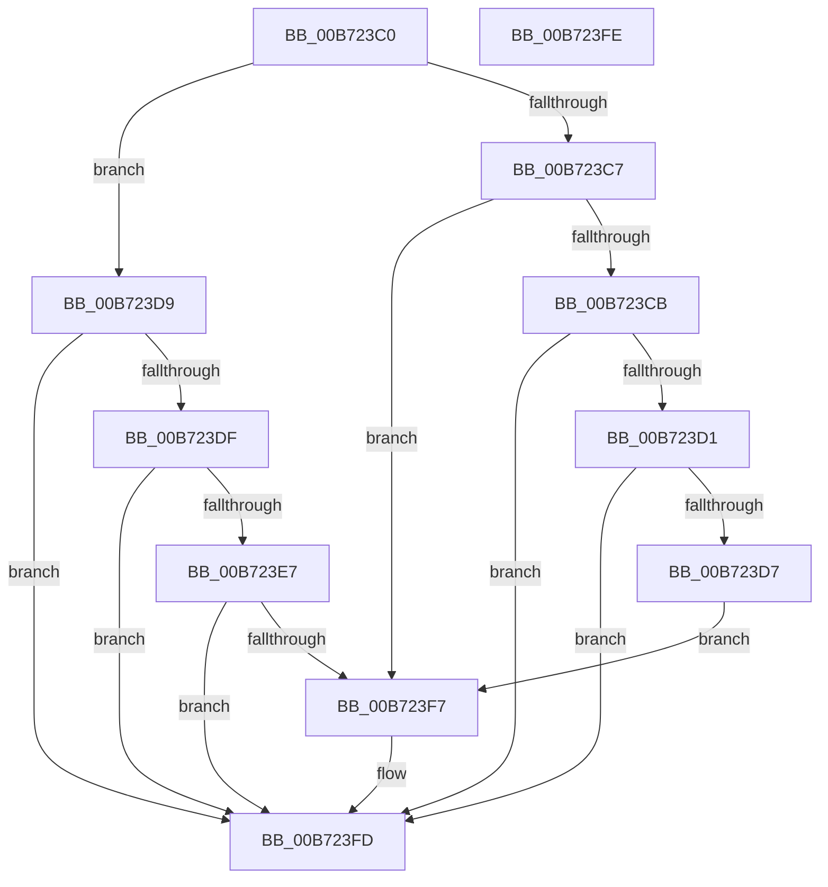

# RtlHandleRdclNoOverride

- RVA: `0x00B723C0`–`0x00B723FF` (길이 `63` bytes)
- VA: `0x0000000140B723C0`
- 실행 섹션: `PAGELK`
- PDB 이름 있음: `예`; PDB Function 태그: `아니요`
- unwind 정보 RVA: `0x000DB714`
- 디코드: `21`개 명령, `63/63` bytes 표시
- 미해석 바이트: `0` (있으면 어셈블리에 `.byte`로 보존)

> 이 문서는 커널 이미지의 기계어와 PDB 기호를 분석해 생성했습니다. 4번과 5번은 함수 원형과 자료형을 바이너리 사용 방식에서 추정한 C 해석이며 원본 소스 복구 결과는 아닙니다.

## 1. Dependencies

- 직접 호출 지점: **0**; 고유 호출 대상: **0**
- 직접 호출자로 확인된 함수: **0**
- RIP 상대 이미지 참조: **0**

### Outgoing calls
- 직접 디코드된 call 명령이 없습니다.

### Direct callers
- 이 함수 시작 RVA로 연결되는 직접 call은 확인되지 않았습니다. 간접 호출은 완전히 역산할 수 없습니다.

### Static image references
- 디코드된 RIP-relative 메모리 참조가 없습니다.

## 2. Other-region calls and transfers

- 다른 실행 섹션으로 향하는 call: **0**
- 별도 외부 분기/꼬리 이동을 확인하지 못했습니다.

## 3. Assembly (complete function range)

```asm
00B723C0  8A 41 04                        mov al, byte ptr [rcx + 4]
00B723C3  3C 02                           cmp al, 2
00B723C5  74 12                           je 0x140b723d9
00B723C7  3C 03                           cmp al, 3
00B723C9  75 2C                           jne 0x140b723f7
00B723CB  83 79 08 06                     cmp dword ptr [rcx + 8], 6
00B723CF  75 2C                           jne 0x140b723fd
00B723D1  83 79 0C 0D                     cmp dword ptr [rcx + 0xc], 0xd
00B723D5  75 26                           jne 0x140b723fd
00B723D7  EB 1E                           jmp 0x140b723f7
00B723D9  83 79 08 06                     cmp dword ptr [rcx + 8], 6
00B723DD  75 1E                           jne 0x140b723fd
00B723DF  8B 41 0C                        mov eax, dword ptr [rcx + 0xc]
00B723E2  83 F8 36                        cmp eax, 0x36
00B723E5  77 16                           ja 0x140b723fd
00B723E7  48 B9 00 00 00 10 C0 00 60 00   movabs rcx, 0x6000c010000000
00B723F1  48 0F A3 C1                     bt rcx, rax
00B723F5  73 06                           jae 0x140b723fd
00B723F7  C7 02 01 00 00 00               mov dword ptr [rdx], 1
00B723FD  C3                              ret
00B723FE  CC                              int3
```

## 4. C-style interpretation (structured pseudocode)

```c
__int64 __fastcall RtlHandleRdclNoOverride(__int64 a1, __int64 a2)
{
    if (((unsigned __int8)(*(unsigned __int8 *)(a1 + 4))) == 2) goto loc_00B723D9;
    if (((unsigned __int8)(*(unsigned __int8 *)(a1 + 4))) != 3) goto loc_00B723F7;
    if ((*(unsigned int *)(a1 + 8)) != 6) goto loc_00B723FD;
    if ((*(unsigned int *)(a1 + 12)) != 13) goto loc_00B723FD;
    goto loc_00B723F7;
loc_00B723D9:
    if ((*(unsigned int *)(a1 + 8)) != 6) goto loc_00B723FD;
    if (((unsigned int)((unsigned int)(*(unsigned int *)(a1 + 12)))) > 54) goto loc_00B723FD;
    if (((unsigned int)((unsigned int)(*(unsigned int *)(a1 + 12)))) < 54) {
        *(unsigned int *)(a2) = 1;
    }
    return (unsigned int)(*(unsigned int *)(a1 + 12));
}
```

## 5. (Beta) C Style

```c
int64_t RtlHandleRdclNoOverride(void *Arg1, void *Arg2)
{
    uint8_t *arg1 = (uint8_t *)Arg1;
    uint8_t *arg2 = (uint8_t *)Arg2;

    if (((uint8_t)(*(uint8_t *)(arg1 + 0x4))) == 2) goto loc_00B723D9;
    if (((uint8_t)(*(uint8_t *)(arg1 + 0x4))) != 3) goto loc_00B723F7;
    if ((*(uint32_t *)(arg1 + 0x8)) != 6) goto loc_00B723FD;
    if ((*(uint32_t *)(arg1 + 0xC)) != 13) goto loc_00B723FD;
    goto loc_00B723F7;
loc_00B723D9:
    if ((*(uint32_t *)(arg1 + 0x8)) != 6) goto loc_00B723FD;
    if (((uint32_t)((uint32_t)(*(uint32_t *)(arg1 + 0xC)))) > 54) goto loc_00B723FD;
    if (((uint32_t)((uint32_t)(*(uint32_t *)(arg1 + 0xC)))) < 54) {
        *(uint32_t *)(arg2) = 1;
    }
    return (uint32_t)(*(uint32_t *)(arg1 + 0xC));
}
```

### 관측된 메모리 오프셋

구조체 형식이 확인되지 않은 접근은 인자 기준의 오프셋으로만 기록했습니다.

| 기준 인자 | 오프셋 표현 | 폭 (bit) | 접근 |
|---|---:|---:|---|
| `Arg1` | `+ 0x4` | `8` | `R` |
| `Arg1` | `+ 0x8` | `32` | `R` |
| `Arg1` | `+ 0xC` | `32` | `R` |
| `Arg2` | `+ 0x0` | `32` | `W` |

## 6. Execution-region graph

[열기: 2D/3D 그래프와 함수 탐색 컨트롤 패널](../../../control-panel.html?section=pagelk&rva=0x00B723C0&view=graph)

- 2D 그래프는 위에서 아래로 흐르고, 3D 그래프는 빈 공간을 드래그해 회전합니다. Shift+드래그는 이동, 휠은 확대·축소, 함수 노드 선택은 대상 보고서 이동입니다.

### Static fallback


