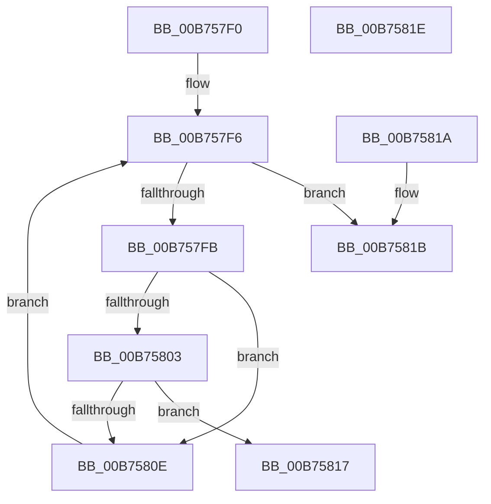

# RtlIsCodeInEcRanges

- RVA: `0x00B757F0`–`0x00B7581F` (길이 `47` bytes)
- VA: `0x0000000140B757F0`
- 실행 섹션: `PAGELK`
- PDB 이름 있음: `예`; PDB Function 태그: `아니요`
- unwind 정보 RVA: `0x000DB714`
- 디코드: `20`개 명령, `47/47` bytes 표시
- 미해석 바이트: `0` (있으면 어셈블리에 `.byte`로 보존)

> 이 문서는 커널 이미지의 기계어와 PDB 기호를 분석해 생성했습니다. 4번과 5번은 함수 원형과 자료형을 바이너리 사용 방식에서 추정한 C 해석이며 원본 소스 복구 결과는 아닙니다.

## 1. Dependencies

- 직접 호출 지점: **0**; 고유 호출 대상: **0**
- 직접 호출자로 확인된 함수: **2**
- RIP 상대 이미지 참조: **0**

### Outgoing calls
- 직접 디코드된 call 명령이 없습니다.

### Direct callers
- [MiPrepareToHotPatchImagePatchCallback](../../page/80/MiPrepareToHotPatchImagePatchCallback_function_00806DC0.md) at `0x00806E0C`
- [RtlApplyHotPatch](RtlApplyHotPatch_function_00B7528C.md) at `0x00B75496`

### Static image references
- 디코드된 RIP-relative 메모리 참조가 없습니다.

## 2. Other-region calls and transfers

- 다른 실행 섹션으로 향하는 call: **0**
- 별도 외부 분기/꼬리 이동을 확인하지 못했습니다.

## 3. Assembly (complete function range)

```asm
00B757F0  44 8B D9                        mov r11d, ecx
00B757F3  45 33 C9                        xor r9d, r9d
00B757F6  45 3B C8                        cmp r9d, r8d
00B757F9  73 20                           jae 0x140b7581b
00B757FB  44 8B 12                        mov r10d, dword ptr [rdx]
00B757FE  45 3B DA                        cmp r11d, r10d
00B75801  72 0B                           jb 0x140b7580e
00B75803  8B 4A 04                        mov ecx, dword ptr [rdx + 4]
00B75806  41 03 CA                        add ecx, r10d
00B75809  44 3B D9                        cmp r11d, ecx
00B7580C  72 09                           jb 0x140b75817
00B7580E  41 FF C1                        inc r9d
00B75811  48 83 C2 08                     add rdx, 8
00B75815  EB DF                           jmp 0x140b757f6
00B75817  B0 01                           mov al, 1
00B75819  C3                              ret
00B7581A  CC                              int3
00B7581B  32 C0                           xor al, al
00B7581D  C3                              ret
00B7581E  CC                              int3
```

## 4. C-style interpretation (structured pseudocode)

```c
__int64 __fastcall RtlIsCodeInEcRanges(int a1, __int64 a2, int a3, int a4)
{
    __int64 result;

    a4 = 0;
loc_00B757F6:
    if (0 >= a3) goto loc_00B7581B;
    if (((unsigned int)((unsigned int)(a1))) < ((unsigned int)((unsigned int)(*(unsigned int *)(a2))))) goto loc_00B7580E;
    a1 = (unsigned int)(((unsigned int)(*(unsigned int *)(a2 + 4))) + ((unsigned int)((unsigned int)(*(unsigned int *)(a2)))));
    if (((unsigned int)((unsigned int)(a1))) < a1) goto loc_00B75817;
loc_00B7580E:
    a4 = (unsigned int)((a4) + 1);
    a2 = (a2) + (8);
    goto loc_00B757F6;
loc_00B75817:
    return 1;
loc_00B7581B:
    result = 0;
    return result;
}
```

## 5. (Beta) C Style

```c
int64_t RtlIsCodeInEcRanges(int32_t Arg1, void *Arg2, int32_t Arg3, int32_t Arg4)
{
    uint8_t *arg2 = (uint8_t *)Arg2;

    int64_t result;

    Arg4 = 0;
loc_00B757F6:
    if (0 >= Arg3) goto loc_00B7581B;
    if (((uint32_t)((uint32_t)(Arg1))) < ((uint32_t)((uint32_t)(*(uint32_t *)(arg2))))) goto loc_00B7580E;
    Arg1 = (uint32_t)(((uint32_t)(*(uint32_t *)(arg2 + 0x4))) + ((uint32_t)((uint32_t)(*(uint32_t *)(arg2)))));
    if (((uint32_t)((uint32_t)(Arg1))) < Arg1) goto loc_00B75817;
loc_00B7580E:
    Arg4 = (uint32_t)((Arg4) + 1);
    Arg2 = (Arg2) + (8);
    goto loc_00B757F6;
loc_00B75817:
    return 1;
loc_00B7581B:
    result = 0;
    return result;
}
```

### 관측된 메모리 오프셋

구조체 형식이 확인되지 않은 접근은 인자 기준의 오프셋으로만 기록했습니다.

| 기준 인자 | 오프셋 표현 | 폭 (bit) | 접근 |
|---|---:|---:|---|
| `Arg2` | `+ 0x0` | `32` | `R` |
| `Arg2` | `+ 0x4` | `32` | `R` |

## 6. Execution-region graph

[열기: 2D/3D 그래프와 함수 탐색 컨트롤 패널](../../../control-panel.html?section=pagelk&rva=0x00B757F0&view=graph)

- 2D 그래프는 위에서 아래로 흐르고, 3D 그래프는 빈 공간을 드래그해 회전합니다. Shift+드래그는 이동, 휠은 확대·축소, 함수 노드 선택은 대상 보고서 이동입니다.

### Static fallback


