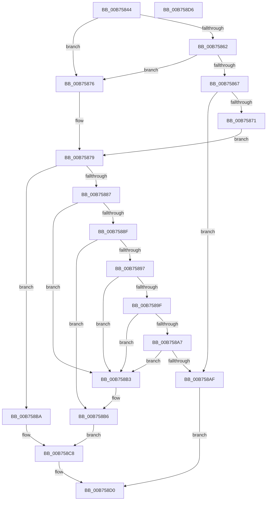

# RtlpDetermineHotPatchExtent

- RVA: `0x00B75844`–`0x00B758D7` (길이 `147` bytes)
- VA: `0x0000000140B75844`
- 실행 섹션: `PAGELK`
- PDB 이름 있음: `예`; PDB Function 태그: `아니요`
- unwind 정보 RVA: `0x00071750`
- 디코드: `44`개 명령, `147/147` bytes 표시
- 미해석 바이트: `0` (있으면 어셈블리에 `.byte`로 보존)

> 이 문서는 커널 이미지의 기계어와 PDB 기호를 분석해 생성했습니다. 4번과 5번은 함수 원형과 자료형을 바이너리 사용 방식에서 추정한 C 해석이며 원본 소스 복구 결과는 아닙니다.

## 1. Dependencies

- 직접 호출 지점: **0**; 고유 호출 대상: **0**
- 직접 호출자로 확인된 함수: **2**
- RIP 상대 이미지 참조: **0**

### Outgoing calls
- 직접 디코드된 call 명령이 없습니다.

### Direct callers
- [RtlDetermineHotPatchExtent](../../page/84/RtlDetermineHotPatchExtent_function_00840D24.md) at `0x00840D4E`
- [RtlApplyHotPatch](RtlApplyHotPatch_function_00B7528C.md) at `0x00B754CF`

### Static image references
- 디코드된 RIP-relative 메모리 참조가 없습니다.

## 2. Other-region calls and transfers

- 다른 실행 섹션으로 향하는 call: **0**
- 별도 외부 분기/꼬리 이동을 확인하지 못했습니다.

## 3. Assembly (complete function range)

```asm
00B75844  48 89 5C 24 08                  mov qword ptr [rsp + 8], rbx
00B75849  41 BB 08 00 00 00               mov r11d, 8
00B7584F  B8 64 86 00 00                  mov eax, 0x8664
00B75854  BB 64 AA 00 00                  mov ebx, 0xaa64
00B75859  45 8D 53 FC                     lea r10d, [r11 - 4]
00B7585D  66 3B D0                        cmp dx, ax
00B75860  74 14                           je 0x140b75876
00B75862  66 3B D3                        cmp dx, bx
00B75865  74 0F                           je 0x140b75876
00B75867  B8 4C 01 00 00                  mov eax, 0x14c
00B7586C  66 3B D0                        cmp dx, ax
00B7586F  75 3E                           jne 0x140b758af
00B75871  41 8B C2                        mov eax, r10d
00B75874  EB 03                           jmp 0x140b75879
00B75876  41 8B C3                        mov eax, r11d
00B75879  81 E1 00 C0 0F 00               and ecx, 0xfc000
00B7587F  81 F9 00 C0 01 00               cmp ecx, 0x1c000
00B75885  74 33                           je 0x140b758ba
00B75887  81 F9 00 C0 02 00               cmp ecx, 0x2c000
00B7588D  74 24                           je 0x140b758b3
00B7588F  81 F9 00 C0 03 00               cmp ecx, 0x3c000
00B75895  74 1F                           je 0x140b758b6
00B75897  81 F9 00 40 04 00               cmp ecx, 0x44000
00B7589D  74 14                           je 0x140b758b3
00B7589F  81 F9 00 C0 05 00               cmp ecx, 0x5c000
00B758A5  74 0C                           je 0x140b758b3
00B758A7  81 F9 00 80 07 00               cmp ecx, 0x78000
00B758AD  74 04                           je 0x140b758b3
00B758AF  32 C0                           xor al, al
00B758B1  EB 1D                           jmp 0x140b758d0
00B758B3  44 8B D0                        mov r10d, eax
00B758B6  33 C0                           xor eax, eax
00B758B8  EB 0E                           jmp 0x140b758c8
00B758BA  66 2B D3                        sub dx, bx
00B758BD  45 8B D3                        mov r10d, r11d
00B758C0  66 F7 DA                        neg dx
00B758C3  1B C0                           sbb eax, eax
00B758C5  83 E0 FA                        and eax, 0xfffffffa
00B758C8  41 89 00                        mov dword ptr [r8], eax
00B758CB  B0 01                           mov al, 1
00B758CD  45 89 11                        mov dword ptr [r9], r10d
00B758D0  48 8B 5C 24 08                  mov rbx, qword ptr [rsp + 8]
00B758D5  C3                              ret
00B758D6  CC                              int3
```

## 4. C-style interpretation (structured pseudocode)

```c
__int64 __fastcall RtlpDetermineHotPatchExtent(int a1, unsigned __int16 a2, __int64 a3, __int64 a4)
{
    __int64 result;
    unsigned __int64 v_stack_p8;

    v_stack_p8 = v_rbx;
    if (a2 == ((unsigned __int16)((unsigned int)(0x8664ULL)))) goto loc_00B75876;
    if (a2 == ((unsigned __int16)((unsigned int)(0xAA64ULL)))) goto loc_00B75876;
    if (a2 != 332) goto loc_00B758AF;
    goto loc_00B75879;
loc_00B75876:
loc_00B75879:
    a1 = (unsigned int)((a1) & (0xFC000ULL));
    if (a1 == 0x1C000ULL) goto loc_00B758BA;
    if (a1 == 0x2C000ULL) goto loc_00B758B3;
    if (a1 == 0x3C000ULL) goto loc_00B758B6;
    if (a1 == 0x44000ULL) goto loc_00B758B3;
    if (a1 == 0x5C000ULL) goto loc_00B758B3;
    if (a1 == 0x78000ULL) goto loc_00B758B3;
loc_00B758AF:
    result = 0;
    goto loc_00B758D0;
loc_00B758B3:
loc_00B758B6:
    result = 0;
    goto loc_00B758C8;
loc_00B758BA:
    a2 = (unsigned __int16)((a2) - ((unsigned __int16)((unsigned int)(0xAA64ULL))));
    a2 = (unsigned __int16)(-(a2));
    result = (unsigned int)((result) & (0xFFFFFFFAULL));
loc_00B758C8:
    *(unsigned int *)(a3) = (unsigned int)(result);
    *(unsigned int *)(a4) = 8;
loc_00B758D0:
    return 1;
}
```

## 5. (Beta) C Style

```c
int64_t RtlpDetermineHotPatchExtent(int32_t Arg1, uint16_t Arg2, void *Arg3, void *Arg4)
{
    uint8_t *arg3 = (uint8_t *)Arg3;
    uint8_t *arg4 = (uint8_t *)Arg4;

    int64_t result;
    uint64_t v_stack_p8;

    v_stack_p8 = local_rbx;
    if (Arg2 == ((uint16_t)((uint32_t)(0x8664ULL)))) goto loc_00B75876;
    if (Arg2 == ((uint16_t)((uint32_t)(0xAA64ULL)))) goto loc_00B75876;
    if (Arg2 != 332) goto loc_00B758AF;
    goto loc_00B75879;
loc_00B75876:
loc_00B75879:
    Arg1 = (uint32_t)((Arg1) & (0xFC000ULL));
    if (Arg1 == 0x1C000ULL) goto loc_00B758BA;
    if (Arg1 == 0x2C000ULL) goto loc_00B758B3;
    if (Arg1 == 0x3C000ULL) goto loc_00B758B6;
    if (Arg1 == 0x44000ULL) goto loc_00B758B3;
    if (Arg1 == 0x5C000ULL) goto loc_00B758B3;
    if (Arg1 == 0x78000ULL) goto loc_00B758B3;
loc_00B758AF:
    result = 0;
    goto loc_00B758D0;
loc_00B758B3:
loc_00B758B6:
    result = 0;
    goto loc_00B758C8;
loc_00B758BA:
    Arg2 = (uint16_t)((Arg2) - ((uint16_t)((uint32_t)(0xAA64ULL))));
    Arg2 = (uint16_t)(-(Arg2));
    result = (uint32_t)((result) & (0xFFFFFFFAULL));
loc_00B758C8:
    *(uint32_t *)(arg3) = (uint32_t)(result);
    *(uint32_t *)(arg4) = 8;
loc_00B758D0:
    return 1;
}
```

### 관측된 메모리 오프셋

구조체 형식이 확인되지 않은 접근은 인자 기준의 오프셋으로만 기록했습니다.

| 기준 인자 | 오프셋 표현 | 폭 (bit) | 접근 |
|---|---:|---:|---|
| `Arg3` | `+ 0x0` | `32` | `W` |
| `Arg4` | `+ 0x0` | `32` | `W` |

## 6. Execution-region graph

[열기: 2D/3D 그래프와 함수 탐색 컨트롤 패널](../../../control-panel.html?section=pagelk&rva=0x00B75844&view=graph)

- 2D 그래프는 위에서 아래로 흐르고, 3D 그래프는 빈 공간을 드래그해 회전합니다. Shift+드래그는 이동, 휠은 확대·축소, 함수 노드 선택은 대상 보고서 이동입니다.

### Static fallback


