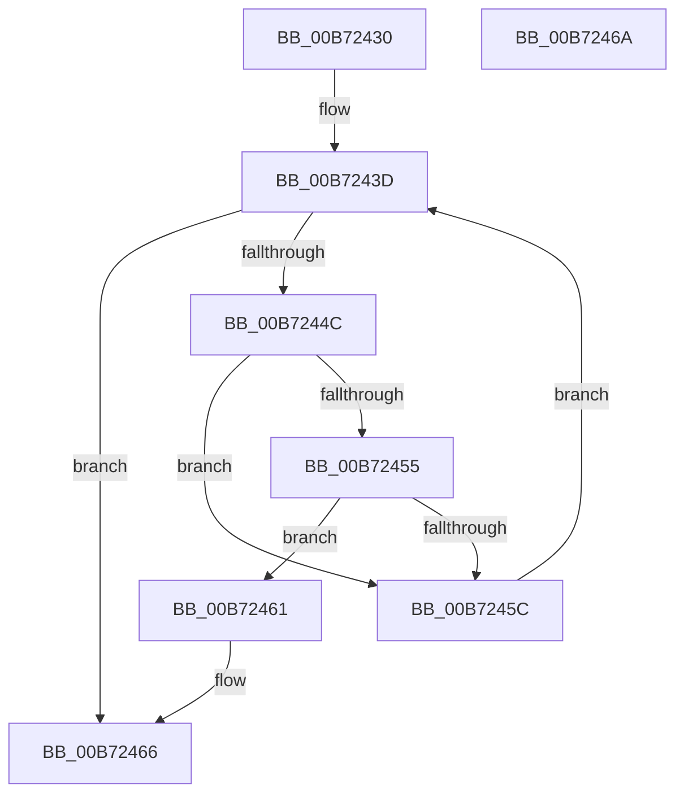

# RtlpGetSpecificProcessorFlags

- RVA: `0x00B72430`–`0x00B7246B` (길이 `59` bytes)
- VA: `0x0000000140B72430`
- 실행 섹션: `PAGELK`
- PDB 이름 있음: `예`; PDB Function 태그: `아니요`
- unwind 정보 RVA: `0x000DB714`
- 디코드: `18`개 명령, `59/59` bytes 표시
- 미해석 바이트: `0` (있으면 어셈블리에 `.byte`로 보존)

> 이 문서는 커널 이미지의 기계어와 PDB 기호를 분석해 생성했습니다. 4번과 5번은 함수 원형과 자료형을 바이너리 사용 방식에서 추정한 C 해석이며 원본 소스 복구 결과는 아닙니다.

## 1. Dependencies

- 직접 호출 지점: **0**; 고유 호출 대상: **0**
- 직접 호출자로 확인된 함수: **1**
- RIP 상대 이미지 참조: **1**

### Outgoing calls
- 직접 디코드된 call 명령이 없습니다.

### Direct callers
- [RtlDetectProcessorFeatures](RtlDetectProcessorFeatures_function_00B719B0.md) at `0x00B72074`

### Static image references
- `0x00B72433` → RVA `0x00034240` (`.rdata`; read)

## 2. Other-region calls and transfers

- 다른 실행 섹션으로 향하는 call: **0**
- 별도 외부 분기/꼬리 이동을 확인하지 못했습니다.

## 3. Assembly (complete function range)

```asm
00B72430  45 33 C0                        xor r8d, r8d
00B72433  4C 8D 1D 06 1E 4C FF            lea r11, [rip - 0xb3e1fa]
00B7243A  45 8B D0                        mov r10d, r8d
00B7243D  41 8B C2                        mov eax, r10d
00B72440  4C 8D 0C 80                     lea r9, [rax + rax*4]
00B72444  43 83 7C 8B 08 13               cmp dword ptr [r11 + r9*4 + 8], 0x13
00B7244A  74 1A                           je 0x140b72466
00B7244C  0F B6 C1                        movzx eax, cl
00B7244F  43 39 04 8B                     cmp dword ptr [r11 + r9*4], eax
00B72453  75 07                           jne 0x140b7245c
00B72455  43 39 54 8B 04                  cmp dword ptr [r11 + r9*4 + 4], edx
00B7245A  74 05                           je 0x140b72461
00B7245C  41 FF C2                        inc r10d
00B7245F  EB DC                           jmp 0x140b7243d
00B72461  47 8B 44 8B 10                  mov r8d, dword ptr [r11 + r9*4 + 0x10]
00B72466  41 8B C0                        mov eax, r8d
00B72469  C3                              ret
00B7246A  CC                              int3
```

## 4. C-style interpretation (structured pseudocode)

```c
__int64 __fastcall RtlpGetSpecificProcessorFlags(unsigned __int8 a1, int a2, int a3)
{
    __int64 v_r10;

    a3 = 0;
loc_00B7243D:
    if ((*(unsigned int *)(v_rip - 11788794 + 0 + 0 * 4 * 4 + 8)) == 19) goto loc_00B72466;
    if ((*(unsigned int *)(v_rip - 11788794 + 0 + 0 * 4 * 4)) != a1) goto loc_00B7245C;
    if ((*(unsigned int *)(v_rip - 11788794 + 0 + 0 * 4 * 4 + 4)) == a2) goto loc_00B72461;
loc_00B7245C:
    v_r10 = (unsigned int)((0) + 1);
    goto loc_00B7243D;
loc_00B72461:
loc_00B72466:
    return (unsigned int)((unsigned int)((unsigned int)(*(unsigned int *)(v_rip - 11788794 + 0 + 0 * 4 * 4 + 16))));
}
```

## 5. (Beta) C Style

```c
int64_t RtlpGetSpecificProcessorFlags(uint8_t Arg1, int32_t Arg2, int32_t Arg3)
{
    int64_t local_r10;

    Arg3 = 0;
loc_00B7243D:
    if ((*(uint32_t *)(v_rip - 0xB3E1FA + 0x0 + 0x0 * 4 * 4 + 0x8)) == 19) goto loc_00B72466;
    if ((*(uint32_t *)(v_rip - 0xB3E1FA + 0x0 + 0x0 * 4 * 4)) != Arg1) goto loc_00B7245C;
    if ((*(uint32_t *)(v_rip - 0xB3E1FA + 0x0 + 0x0 * 4 * 4 + 0x4)) == Arg2) goto loc_00B72461;
loc_00B7245C:
    local_r10 = (uint32_t)((0) + 1);
    goto loc_00B7243D;
loc_00B72461:
loc_00B72466:
    return (uint32_t)((uint32_t)((uint32_t)(*(uint32_t *)(v_rip - 0xB3E1FA + 0x0 + 0x0 * 4 * 4 + 0x10))));
}
```

## 6. Execution-region graph

[열기: 2D/3D 그래프와 함수 탐색 컨트롤 패널](../../../control-panel.html?section=pagelk&rva=0x00B72430&view=graph)

- 2D 그래프는 위에서 아래로 흐르고, 3D 그래프는 빈 공간을 드래그해 회전합니다. Shift+드래그는 이동, 휠은 확대·축소, 함수 노드 선택은 대상 보고서 이동입니다.

### Static fallback


