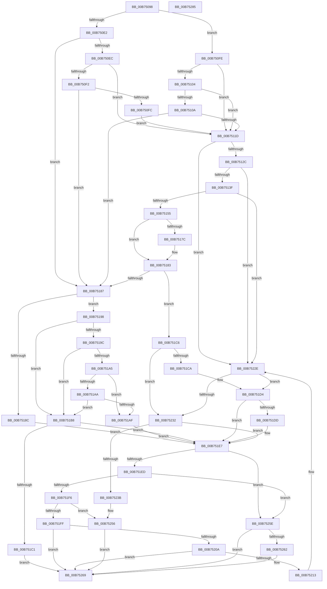

# SpcDetectKvaLeakage

- RVA: `0x00B75098`–`0x00B75286` (길이 `494` bytes)
- VA: `0x0000000140B75098`
- 실행 섹션: `PAGELK`
- PDB 이름 있음: `예`; PDB Function 태그: `아니요`
- unwind 정보 RVA: `0x000DB0CC`
- 디코드: `136`개 명령, `494/494` bytes 표시
- 미해석 바이트: `0` (있으면 어셈블리에 `.byte`로 보존)

> 이 문서는 커널 이미지의 기계어와 PDB 기호를 분석해 생성했습니다. 4번과 5번은 함수 원형과 자료형을 바이너리 사용 방식에서 추정한 C 해석이며 원본 소스 복구 결과는 아닙니다.

## 1. Dependencies

- 직접 호출 지점: **7**; 고유 호출 대상: **6**
- 직접 호출자로 확인된 함수: **1**
- RIP 상대 이미지 참조: **10**

### Outgoing calls
- `0x00B750D7` → [RtlGetProcessorSignature](RtlGetProcessorSignature_function_00B7225C.md) (function, `0x00B7225C`)
- `0x00B7517C` → [SpcIsFbClearSupported](../../text/6A/SpcIsFbClearSupported_function_006A7864.md) (function, `0x006A7864`)
- `0x00B7519C` → [SpcIsHyperVCr3RspErrataPresent](../../text/6A/SpcIsHyperVCr3RspErrataPresent_function_006A788C.md) (function, `0x006A788C`)
- `0x00B751F6` → [RtlGetCpuMaxPhysicalBits](RtlGetCpuMaxPhysicalBits_function_00B720BC.md) (function, `0x00B720BC`)
- `0x00B75228` → [KeBugCheckEx](../../text/4F/KeBugCheckEx_function_004FD660.md) (function, `0x004FD660`)
- `0x00B75250` → [KeBugCheckEx](../../text/4F/KeBugCheckEx_function_004FD660.md) (function, `0x004FD660`)
- `0x00B75270` → [_security_check_cookie](../../text/6A/_security_check_cookie_function_006AC640.md) (function, `0x006AC640`)

### Direct callers
- [KiDetectKvaLeakage](../../text/5C/KiDetectKvaLeakage_function_005C4CD0.md) at `0x005C4DA9`

### Static image references
- `0x00B750A7` → RVA `0x00E0A740` (`.data`; read)
- `0x00B75155` → RVA `0x00FC6B60` (`ALMOSTRO`; read)
- `0x00B7515E` → RVA `0x00FC6E78` (`ALMOSTRO`; write)
- `0x00B7518C` → RVA `0x00EF0000` (`.data`; write)
- `0x00B751AF` → RVA `0x00EF0004` (`.data`; write)
- `0x00B751B8` → RVA `0x00EF0004` (`.data`; read)
- `0x00B751D4` → RVA `0x00EF0000` (`.data`; read)
- `0x00B751FF` → RVA `0x00EF02D0` (`.data`; read)
- `0x00B75256` → RVA `0x00EF02D0` (`.data`; write)
- `0x00B75262` → RVA `0x00EF02D0` (`.data`; read/write)

## 2. Other-region calls and transfers

- 다른 실행 섹션으로 향하는 call: **5**
  - `0x00B7517C` → [SpcIsFbClearSupported](../../text/6A/SpcIsFbClearSupported_function_006A7864.md) (`PAGELK` → `.text`)
  - `0x00B7519C` → [SpcIsHyperVCr3RspErrataPresent](../../text/6A/SpcIsHyperVCr3RspErrataPresent_function_006A788C.md) (`PAGELK` → `.text`)
  - `0x00B75228` → [KeBugCheckEx](../../text/4F/KeBugCheckEx_function_004FD660.md) (`PAGELK` → `.text`)
  - `0x00B75250` → [KeBugCheckEx](../../text/4F/KeBugCheckEx_function_004FD660.md) (`PAGELK` → `.text`)
  - `0x00B75270` → [_security_check_cookie](../../text/6A/_security_check_cookie_function_006AC640.md) (`PAGELK` → `.text`)
- 별도 외부 분기/꼬리 이동을 확인하지 못했습니다.

## 3. Assembly (complete function range)

```asm
00B75098  48 89 5C 24 18                  mov qword ptr [rsp + 0x18], rbx
00B7509D  55                              push rbp
00B7509E  56                              push rsi
00B7509F  57                              push rdi
00B750A0  48 8B EC                        mov rbp, rsp
00B750A3  48 83 EC 60                     sub rsp, 0x60
00B750A7  48 8B 05 92 56 29 00            mov rax, qword ptr [rip + 0x295692]
00B750AE  48 33 C4                        xor rax, rsp
00B750B1  48 89 45 F8                     mov qword ptr [rbp - 8], rax
00B750B5  83 65 D8 00                     and dword ptr [rbp - 0x28], 0
00B750B9  4C 8D 45 D4                     lea r8, [rbp - 0x2c]
00B750BD  83 65 D4 00                     and dword ptr [rbp - 0x2c], 0
00B750C1  8B FA                           mov edi, edx
00B750C3  8B F1                           mov esi, ecx
00B750C5  45 33 C9                        xor r9d, r9d
00B750C8  89 55 E0                        mov dword ptr [rbp - 0x20], edx
00B750CB  48 8D 4D D0                     lea rcx, [rbp - 0x30]
00B750CF  48 8D 55 D8                     lea rdx, [rbp - 0x28]
00B750D3  C6 45 D0 00                     mov byte ptr [rbp - 0x30], 0
00B750D7  E8 80 D1 FF FF                  call 0x140b7225c
00B750DC  80 7D D0 02                     cmp byte ptr [rbp - 0x30], 2
00B750E0  74 1C                           je 0x140b750fe
00B750E2  80 7D D0 03                     cmp byte ptr [rbp - 0x30], 3
00B750E6  0F 85 9B 00 00 00               jne 0x140b75187
00B750EC  83 7D D8 06                     cmp dword ptr [rbp - 0x28], 6
00B750F0  75 2B                           jne 0x140b7511d
00B750F2  83 7D D4 0D                     cmp dword ptr [rbp - 0x2c], 0xd
00B750F6  0F 84 8B 00 00 00               je 0x140b75187
00B750FC  EB 1F                           jmp 0x140b7511d
00B750FE  83 7D D8 06                     cmp dword ptr [rbp - 0x28], 6
00B75102  75 19                           jne 0x140b7511d
00B75104  83 7D D4 36                     cmp dword ptr [rbp - 0x2c], 0x36
00B75108  77 13                           ja 0x140b7511d
00B7510A  8B 45 D4                        mov eax, dword ptr [rbp - 0x2c]
00B7510D  48 B9 00 00 00 10 C0 00 60 00   movabs rcx, 0x6000c010000000
00B75117  48 0F A3 C1                     bt rcx, rax
00B7511B  72 6A                           jb 0x140b75187
00B7511D  33 C0                           xor eax, eax
00B7511F  33 C9                           xor ecx, ecx
00B75121  0F A2                           cpuid
00B75123  83 F8 07                        cmp eax, 7
00B75126  0F 82 02 01 00 00               jb 0x140b7522e
00B7512C  33 C9                           xor ecx, ecx
00B7512E  B8 07 00 00 00                  mov eax, 7
00B75133  0F A2                           cpuid
00B75135  0F BA E2 1D                     bt edx, 0x1d
00B75139  0F 83 EF 00 00 00               jae 0x140b7522e
00B7513F  B9 0A 01 00 00                  mov ecx, 0x10a
00B75144  0F 32                           rdmsr
00B75146  48 C1 E2 20                     shl rdx, 0x20
00B7514A  48 0B C2                        or rax, rdx
00B7514D  A8 01                           test al, 1
00B7514F  0F 84 D9 00 00 00               je 0x140b7522e
00B75155  48 8B 0D 04 1A 45 00            mov rcx, qword ptr [rip + 0x451a04]
00B7515C  8A C1                           mov al, cl
00B7515E  C7 05 10 1D 45 00 01 00 00 00   mov dword ptr [rip + 0x451d10], 1
00B75168  24 28                           and al, 0x28
00B7516A  3C 08                           cmp al, 8
00B7516C  B8 00 00 38 00                  mov eax, 0x380000
00B75171  0F 94 C2                        sete dl
00B75174  48 23 C8                        and rcx, rax
00B75177  48 3B C8                        cmp rcx, rax
00B7517A  74 07                           je 0x140b75183
00B7517C  E8 E3 26 B3 FF                  call 0x1406a7864
00B75181  0A D0                           or dl, al
00B75183  84 D2                           test dl, dl
00B75185  75 3F                           jne 0x140b751c6
00B75187  40 84 FF                        test dil, dil
00B7518A  74 0C                           je 0x140b75198
00B7518C  C7 05 6A AE 37 00 01 00 00 00   mov dword ptr [rip + 0x37ae6a], 1
00B75196  EB 4F                           jmp 0x140b751e7
00B75198  85 F6                           test esi, esi
00B7519A  75 1C                           jne 0x140b751b8
00B7519C  E8 EB 26 B3 FF                  call 0x1406a788c
00B751A1  85 C0                           test eax, eax
00B751A3  75 13                           jne 0x140b751b8
00B751A5  38 45 E2                        cmp byte ptr [rbp - 0x1e], al
00B751A8  75 05                           jne 0x140b751af
00B751AA  38 45 E1                        cmp byte ptr [rbp - 0x1f], al
00B751AD  74 09                           je 0x140b751b8
00B751AF  C6 05 4E AE 37 00 01            mov byte ptr [rip + 0x37ae4e], 1
00B751B6  EB 2F                           jmp 0x140b751e7
00B751B8  80 3D 45 AE 37 00 00            cmp byte ptr [rip + 0x37ae45], 0
00B751BF  75 26                           jne 0x140b751e7
00B751C1  E9 A3 00 00 00                  jmp 0x140b75269
00B751C6  85 F6                           test esi, esi
00B751C8  75 68                           jne 0x140b75232
00B751CA  C7 05 2C AE 37 00 01 00 00 00   mov dword ptr [rip + 0x37ae2c], 1
00B751D4  83 3D 25 AE 37 00 00            cmp dword ptr [rip + 0x37ae25], 0
00B751DB  75 0A                           jne 0x140b751e7
00B751DD  C7 05 19 AE 37 00 02 00 00 00   mov dword ptr [rip + 0x37ae19], 2
00B751E7  80 7D D0 02                     cmp byte ptr [rbp - 0x30], 2
00B751EB  75 71                           jne 0x140b7525e
00B751ED  F6 05 6C 19 45 00 10            test byte ptr [rip + 0x45196c], 0x10
00B751F4  75 68                           jne 0x140b7525e
00B751F6  E8 C1 CE FF FF                  call 0x140b720bc
00B751FB  85 F6                           test esi, esi
00B751FD  74 57                           je 0x140b75256
00B751FF  48 63 0D CA B0 37 00            movsxd rcx, dword ptr [rip + 0x37b0ca]
00B75206  3B C1                           cmp eax, ecx
00B75208  74 5F                           je 0x140b75269
00B7520A  80 3D F3 AD 37 00 00            cmp byte ptr [rip + 0x37adf3], 0
00B75211  75 56                           jne 0x140b75269
00B75213  48 89 4C 24 20                  mov qword ptr [rsp + 0x20], rcx
00B75218  4C 8B C6                        mov r8, rsi
00B7521B  B9 5D 00 00 00                  mov ecx, 0x5d
00B75220  4C 63 C8                        movsxd r9, eax
00B75223  BA 46 54 31 4C                  mov edx, 0x4c315446
00B75228  E8 33 84 98 FF                  call 0x1404fd660
00B7522D  CC                              int3
00B7522E  85 F6                           test esi, esi
00B75230  74 A2                           je 0x140b751d4
00B75232  83 3D C7 AD 37 00 00            cmp dword ptr [rip + 0x37adc7], 0
00B75239  75 AC                           jne 0x140b751e7
00B7523B  48 83 64 24 20 00               and qword ptr [rsp + 0x20], 0
00B75241  45 33 C9                        xor r9d, r9d
00B75244  45 33 C0                        xor r8d, r8d
00B75247  BA 4C 41 56 4B                  mov edx, 0x4b56414c
00B7524C  41 8D 49 5D                     lea ecx, [r9 + 0x5d]
00B75250  E8 0B 84 98 FF                  call 0x1404fd660
00B75255  CC                              int3
00B75256  89 05 74 B0 37 00               mov dword ptr [rip + 0x37b074], eax
00B7525C  EB 0B                           jmp 0x140b75269
00B7525E  85 F6                           test esi, esi
00B75260  75 07                           jne 0x140b75269
00B75262  83 0D 67 B0 37 00 FF            or dword ptr [rip + 0x37b067], 0xffffffff
00B75269  48 8B 4D F8                     mov rcx, qword ptr [rbp - 8]
00B7526D  48 33 CC                        xor rcx, rsp
00B75270  E8 CB 73 B3 FF                  call 0x1406ac640
00B75275  48 8B 9C 24 90 00 00 00         mov rbx, qword ptr [rsp + 0x90]
00B7527D  48 83 C4 60                     add rsp, 0x60
00B75281  5F                              pop rdi
00B75282  5E                              pop rsi
00B75283  5D                              pop rbp
00B75284  C3                              ret
00B75285  CC                              int3
```

## 4. C-style interpretation (structured pseudocode)

```c
__int64 __fastcall SpcDetectKvaLeakage(int a1, int a2, __int64 a3, int a4)
{
    __int64 result;
    __int64 v_rsp;
    unsigned __int64 v_stack_m20;
    unsigned __int8 v_stack_m36;
    unsigned __int8 v_stack_m37;
    unsigned int v_stack_m38;
    unsigned int v_stack_m40;
    unsigned __int64 v_stack_m44;
    unsigned __int64 v_stack_m48;
    unsigned __int64 v_stack_m58;
    unsigned __int64 v_stack_p18;

    v_stack_p18 = v_rbx;
    v_rsp = (v_rsp) - (96);
    result = (*(unsigned __int64 *)(v_rip + 2709138)) ^ (v_rsp);
    v_stack_m20 = result;
    a4 = 0;
    v_stack_m38 = a2;
    v_stack_m48 = 0;
    result = RtlGetProcessorSignature(v_stack_m48, v_stack_m40, v_stack_m44, a4);
    if (v_stack_m48 == 2) goto loc_00B750FE;
    if (v_stack_m48 != 3) goto loc_00B75187;
    if (v_stack_m40 != 6) goto loc_00B7511D;
    if (v_stack_m44 == 13) goto loc_00B75187;
    goto loc_00B7511D;
loc_00B750FE:
    if (v_stack_m40 != 6) goto loc_00B7511D;
    if (v_stack_m44 > 54) goto loc_00B7511D;
    if (v_stack_m44 < 54) goto loc_00B75187;
loc_00B7511D:
    result = 0;
    a1 = 0;
    if (0 < 7) goto loc_00B7522E;
    a1 = 0;
    if (condition_is_above_or_equal) goto loc_00B7522E;
    a2 = (v_stack_m40) << (32);
    result = (7) | (a2);
    if ((((unsigned __int8)(result)) & (1)) == 0) goto loc_00B7522E;
    *(unsigned int *)(v_rip + 4529424) = 1;
    result = (unsigned __int8)(((unsigned __int8)(*(unsigned __int64 *)(v_rip + 4528644))) & (40));
    a2 = (((unsigned __int8)(result)) == 8) ? 1 : 0;
    a1 = (*(unsigned __int64 *)(v_rip + 4528644)) & ((unsigned int)(0x380000ULL));
    result = (unsigned int)(0x380000ULL);
    if (a1 != ((unsigned int)(0x380000ULL))) {
        result = SpcIsFbClearSupported(a1, a2, v_stack_m44, a4);
        a2 = (unsigned __int8)((a2) | ((unsigned __int8)(result)));
    }
    if ((unsigned __int8)(a2) != 0) goto loc_00B751C6;
loc_00B75187:
    if ((unsigned __int8)((unsigned int)(a2)) == 0) goto loc_00B75198;
    *(unsigned int *)(v_rip + 3649130) = 1;
    goto loc_00B751E7;
loc_00B75198:
    if ((unsigned int)((unsigned int)(a1)) != 0) goto loc_00B751B8;
    result = SpcIsHyperVCr3RspErrataPresent(a1, a2, v_stack_m44, a4);
    if ((unsigned int)(result) != 0) goto loc_00B751B8;
    if (v_stack_m36 != ((unsigned __int8)(result))) goto loc_00B751AF;
    if (v_stack_m37 == ((unsigned __int8)(result))) goto loc_00B751B8;
loc_00B751AF:
    *(unsigned __int8 *)(v_rip + 3649102) = 1;
    goto loc_00B751E7;
loc_00B751B8:
    if ((*(unsigned __int8 *)(v_rip + 3649093)) != 0) goto loc_00B751E7;
    goto loc_00B75269;
loc_00B751C6:
    if ((unsigned int)((unsigned int)(a1)) != 0) goto loc_00B75232;
    *(unsigned int *)(v_rip + 3649068) = 1;
loc_00B751D4:
    if ((*(unsigned int *)(v_rip + 3649061)) == 0) {
        *(unsigned int *)(v_rip + 3649049) = 2;
    }
    if (v_stack_m48 != 2) goto loc_00B7525E;
    if (((*(unsigned __int8 *)(v_rip + 4528492)) & (16)) != 0) goto loc_00B7525E;
    result = RtlGetCpuMaxPhysicalBits(a1, a2, v_stack_m44, a4);
    if ((unsigned int)((unsigned int)(a1)) == 0) goto loc_00B75256;
    if (((unsigned int)(result)) == ((unsigned int)((int)(*(unsigned int *)(v_rip + 3649738))))) goto loc_00B75269;
    if ((*(unsigned __int8 *)(v_rip + 3649011)) != 0) goto loc_00B75269;
    v_stack_m58 = (int)(*(unsigned int *)(v_rip + 3649738));
    result = KeBugCheckEx(93, (unsigned int)(0x4C315446ULL), (unsigned int)(a1), (int)((unsigned int)(result)));
loc_00B7522E:
    if ((unsigned int)((unsigned int)(a1)) == 0) goto loc_00B751D4;
loc_00B75232:
    if ((*(unsigned int *)(v_rip + 3648967)) != 0) goto loc_00B751E7;
    a4 = 0;
    a3 = 0;
    result = KeBugCheckEx(a4 + 93, (unsigned int)(0x4B56414CULL), a3, a4);
loc_00B75256:
    *(unsigned int *)(v_rip + 3649652) = (unsigned int)(result);
    goto loc_00B75269;
loc_00B7525E:
    if ((unsigned int)((unsigned int)(a1)) == 0) {
    }
    a1 = (v_stack_m20) ^ (v_rsp);
    result = _security_check_cookie(a1, (unsigned int)(0x4B56414CULL), a3, a4);
    v_rsp = (v_rsp) + (96);
    return result;
}
```

## 5. (Beta) C Style

```c
int64_t SpcDetectKvaLeakage(int32_t Arg1, int32_t Arg2, int64_t Arg3, int32_t Arg4)
{
    int64_t result;
    int64_t local_rsp;
    uint64_t v_stack_m20;
    uint8_t v_stack_m36;
    uint8_t v_stack_m37;
    uint32_t v_stack_m38;
    uint32_t v_stack_m40;
    uint64_t v_stack_m44;
    uint64_t v_stack_m48;
    uint64_t v_stack_m58;
    uint64_t v_stack_p18;

    v_stack_p18 = local_rbx;
    local_rsp = (local_rsp) - (96);
    result = (*(uint64_t *)(v_rip + 0x295692)) ^ (local_rsp);
    v_stack_m20 = result;
    Arg4 = 0;
    v_stack_m38 = Arg2;
    v_stack_m48 = 0;
    result = RtlGetProcessorSignature(v_stack_m48, v_stack_m40, v_stack_m44, Arg4);
    if (v_stack_m48 == 2) goto loc_00B750FE;
    if (v_stack_m48 != 3) goto loc_00B75187;
    if (v_stack_m40 != 6) goto loc_00B7511D;
    if (v_stack_m44 == 13) goto loc_00B75187;
    goto loc_00B7511D;
loc_00B750FE:
    if (v_stack_m40 != 6) goto loc_00B7511D;
    if (v_stack_m44 > 54) goto loc_00B7511D;
    if (v_stack_m44 < 54) goto loc_00B75187;
loc_00B7511D:
    result = 0;
    Arg1 = 0;
    if (0 < 7) goto loc_00B7522E;
    Arg1 = 0;
    if (condition_is_above_or_equal) goto loc_00B7522E;
    Arg2 = (v_stack_m40) << (32);
    result = (7) | (Arg2);
    if ((((uint8_t)(result)) & (1)) == 0) goto loc_00B7522E;
    *(uint32_t *)(v_rip + 0x451D10) = 1;
    result = (uint8_t)(((uint8_t)(*(uint64_t *)(v_rip + 0x451A04))) & (40));
    Arg2 = (((uint8_t)(result)) == 8) ? 1 : 0;
    Arg1 = (*(uint64_t *)(v_rip + 0x451A04)) & ((uint32_t)(0x380000ULL));
    result = (uint32_t)(0x380000ULL);
    if (Arg1 != ((uint32_t)(0x380000ULL))) {
        result = SpcIsFbClearSupported(Arg1, Arg2, v_stack_m44, Arg4);
        Arg2 = (uint8_t)((Arg2) | ((uint8_t)(result)));
    }
    if ((uint8_t)(Arg2) != 0) goto loc_00B751C6;
loc_00B75187:
    if ((uint8_t)((uint32_t)(Arg2)) == 0) goto loc_00B75198;
    *(uint32_t *)(v_rip + 0x37AE6A) = 1;
    goto loc_00B751E7;
loc_00B75198:
    if ((uint32_t)((uint32_t)(Arg1)) != 0) goto loc_00B751B8;
    result = SpcIsHyperVCr3RspErrataPresent(Arg1, Arg2, v_stack_m44, Arg4);
    if ((uint32_t)(result) != 0) goto loc_00B751B8;
    if (v_stack_m36 != ((uint8_t)(result))) goto loc_00B751AF;
    if (v_stack_m37 == ((uint8_t)(result))) goto loc_00B751B8;
loc_00B751AF:
    *(uint8_t *)(v_rip + 0x37AE4E) = 1;
    goto loc_00B751E7;
loc_00B751B8:
    if ((*(uint8_t *)(v_rip + 0x37AE45)) != 0) goto loc_00B751E7;
    goto loc_00B75269;
loc_00B751C6:
    if ((uint32_t)((uint32_t)(Arg1)) != 0) goto loc_00B75232;
    *(uint32_t *)(v_rip + 0x37AE2C) = 1;
loc_00B751D4:
    if ((*(uint32_t *)(v_rip + 0x37AE25)) == 0) {
        *(uint32_t *)(v_rip + 0x37AE19) = 2;
    }
    if (v_stack_m48 != 2) goto loc_00B7525E;
    if (((*(uint8_t *)(v_rip + 0x45196C)) & (16)) != 0) goto loc_00B7525E;
    result = RtlGetCpuMaxPhysicalBits(Arg1, Arg2, v_stack_m44, Arg4);
    if ((uint32_t)((uint32_t)(Arg1)) == 0) goto loc_00B75256;
    if (((uint32_t)(result)) == ((uint32_t)((int32_t)(*(uint32_t *)(v_rip + 0x37B0CA))))) goto loc_00B75269;
    if ((*(uint8_t *)(v_rip + 0x37ADF3)) != 0) goto loc_00B75269;
    v_stack_m58 = (int32_t)(*(uint32_t *)(v_rip + 0x37B0CA));
    result = KeBugCheckEx(93, (uint32_t)(0x4C315446ULL), (uint32_t)(Arg1), (int32_t)((uint32_t)(result)));
loc_00B7522E:
    if ((uint32_t)((uint32_t)(Arg1)) == 0) goto loc_00B751D4;
loc_00B75232:
    if ((*(uint32_t *)(v_rip + 0x37ADC7)) != 0) goto loc_00B751E7;
    Arg4 = 0;
    Arg3 = 0;
    result = KeBugCheckEx(Arg4 + 93, (uint32_t)(0x4B56414CULL), Arg3, Arg4);
loc_00B75256:
    *(uint32_t *)(v_rip + 0x37B074) = (uint32_t)(result);
    goto loc_00B75269;
loc_00B7525E:
    if ((uint32_t)((uint32_t)(Arg1)) == 0) {
    }
    Arg1 = (v_stack_m20) ^ (local_rsp);
    result = _security_check_cookie(Arg1, (uint32_t)(0x4B56414CULL), Arg3, Arg4);
    local_rsp = (local_rsp) + (96);
    return result;
}
```

## 6. Execution-region graph

[열기: 2D/3D 그래프와 함수 탐색 컨트롤 패널](../../../control-panel.html?section=pagelk&rva=0x00B75098&view=graph)

- 2D 그래프는 위에서 아래로 흐르고, 3D 그래프는 빈 공간을 드래그해 회전합니다. Shift+드래그는 이동, 휠은 확대·축소, 함수 노드 선택은 대상 보고서 이동입니다.

### Static fallback


