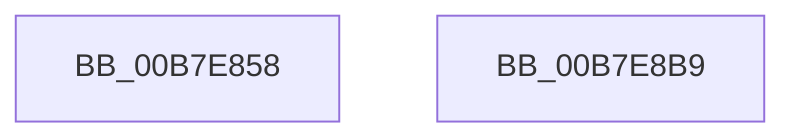

# VmInitializeProcessor

- RVA: `0x00B7E858`–`0x00B7E8BA` (길이 `98` bytes)
- VA: `0x0000000140B7E858`
- 실행 섹션: `PAGELK`
- PDB 이름 있음: `예`; PDB Function 태그: `아니요`
- unwind 정보 RVA: `0x000697A4`
- 디코드: `25`개 명령, `98/98` bytes 표시
- 미해석 바이트: `0` (있으면 어셈블리에 `.byte`로 보존)

> 이 문서는 커널 이미지의 기계어와 PDB 기호를 분석해 생성했습니다. 4번과 5번은 함수 원형과 자료형을 바이너리 사용 방식에서 추정한 C 해석이며 원본 소스 복구 결과는 아닙니다.

## 1. Dependencies

- 직접 호출 지점: **2**; 고유 호출 대상: **2**
- 직접 호출자로 확인된 함수: **3**
- RIP 상대 이미지 참조: **0**

### Outgoing calls
- `0x00B7E86E` → [KeGetProcessorNodeNumber](../../text/43/KeGetProcessorNodeNumber_function_0043F210.md) (function, `0x0043F210`)
- `0x00B7E89B` → [ExAllocatePool3](../../poolcode/B8/ExAllocatePool3_function_00B84270.md) (function, `0x00B84270`)

### Direct callers
- [KiStartDynamicProcessor](../../page/74/KiStartDynamicProcessor_function_007456C8.md) at `0x00745A01`
- [VmInitSystem](../../init/BE/VmInitSystem_function_00BEEEB8.md) at `0x00BEEED9`
- [KeStartAllProcessors](../../init/C3/KeStartAllProcessors_function_00C36F78.md) at `0x00C3732D`

### Static image references
- 디코드된 RIP-relative 메모리 참조가 없습니다.

## 2. Other-region calls and transfers

- 다른 실행 섹션으로 향하는 call: **2**
  - `0x00B7E86E` → [KeGetProcessorNodeNumber](../../text/43/KeGetProcessorNodeNumber_function_0043F210.md) (`PAGELK` → `.text`)
  - `0x00B7E89B` → [ExAllocatePool3](../../poolcode/B8/ExAllocatePool3_function_00B84270.md) (`PAGELK` → `POOLCODE`)
- 별도 외부 분기/꼬리 이동을 확인하지 못했습니다.

## 3. Assembly (complete function range)

```asm
00B7E858  40 53                           push rbx
00B7E85A  48 83 EC 40                     sub rsp, 0x40
00B7E85E  0F 57 C0                        xorps xmm0, xmm0
00B7E861  48 8B D9                        mov rbx, rcx
00B7E864  0F 11 44 24 30                  movups xmmword ptr [rsp + 0x30], xmm0
00B7E869  C6 44 24 30 03                  mov byte ptr [rsp + 0x30], 3
00B7E86E  E8 9D 09 8C FF                  call 0x14043f210
00B7E873  0F B7 D0                        movzx edx, ax
00B7E876  4C 8D 4C 24 30                  lea r9, [rsp + 0x30]
00B7E87B  0F BA EA 1F                     bts edx, 0x1f
00B7E87F  C7 44 24 20 01 00 00 00         mov dword ptr [rsp + 0x20], 1
00B7E887  89 54 24 38                     mov dword ptr [rsp + 0x38], edx
00B7E88B  B9 40 00 00 00                  mov ecx, 0x40
00B7E890  BA 00 32 00 00                  mov edx, 0x3200
00B7E895  41 B8 56 6D 70 62               mov r8d, 0x62706d56
00B7E89B  E8 D0 59 00 00                  call 0x140b84270
00B7E8A0  48 89 83 50 8B 00 00            mov qword ptr [rbx + 0x8b50], rax
00B7E8A7  48 F7 D8                        neg rax
00B7E8AA  1B C0                           sbb eax, eax
00B7E8AC  F7 D0                           not eax
00B7E8AE  25 9A 00 00 C0                  and eax, 0xc000009a
00B7E8B3  48 83 C4 40                     add rsp, 0x40
00B7E8B7  5B                              pop rbx
00B7E8B8  C3                              ret
00B7E8B9  CC                              int3
```

## 4. C-style interpretation (structured pseudocode)

```c
__int64 __fastcall VmInitializeProcessor(__int64 a1)
{
    __int64 result;
    __int64 v_rsp;
    unsigned int v_stack_m10;
    unsigned __int64 v_stack_m18;
    unsigned int v_stack_m28;

    v_rsp = (v_rsp) - (64);
    v_stack_m18 = v_xmm0;
    v_stack_m18 = 3;
    result = KeGetProcessorNodeNumber(a1, a2, a3, a4);
    v_stack_m28 = 1;
    v_stack_m10 = (unsigned int)((unsigned __int16)(result));
    result = ExAllocatePool3(64, (unsigned int)(0x3200ULL), (unsigned int)(0x62706D56ULL), v_stack_m18);
    *(unsigned __int64 *)(a1 + 35664) = result;
    result = -(result);
    result = (unsigned int)(~(result));
    result = (unsigned int)((result) & (0xC000009AULL));
    v_rsp = (v_rsp) + (64);
    return result;
}
```

## 5. (Beta) C Style

```c
int64_t VmInitializeProcessor(void *Arg1)
{
    uint8_t *arg1 = (uint8_t *)Arg1;

    int64_t result;
    int64_t local_rsp;
    uint32_t v_stack_m10;
    uint64_t v_stack_m18;
    uint32_t v_stack_m28;

    local_rsp = (local_rsp) - (64);
    v_stack_m18 = v_xmm0;
    v_stack_m18 = 3;
    result = KeGetProcessorNodeNumber(Arg1, a2, a3, a4);
    v_stack_m28 = 1;
    v_stack_m10 = (uint32_t)((uint16_t)(result));
    result = ExAllocatePool3(64, (uint32_t)(0x3200ULL), (uint32_t)(0x62706D56ULL), v_stack_m18);
    *(uint64_t *)(arg1 + 0x8B50) = result;
    result = -(result);
    result = (uint32_t)(~(result));
    result = (uint32_t)((result) & (0xC000009AULL));
    local_rsp = (local_rsp) + (64);
    return result;
}
```

### 관측된 메모리 오프셋

구조체 형식이 확인되지 않은 접근은 인자 기준의 오프셋으로만 기록했습니다.

| 기준 인자 | 오프셋 표현 | 폭 (bit) | 접근 |
|---|---:|---:|---|
| `Arg1` | `+ 0x8B50` | `64` | `W` |

## 6. Execution-region graph

[열기: 2D/3D 그래프와 함수 탐색 컨트롤 패널](../../../control-panel.html?section=pagelk&rva=0x00B7E858&view=graph)

- 2D 그래프는 위에서 아래로 흐르고, 3D 그래프는 빈 공간을 드래그해 회전합니다. Shift+드래그는 이동, 휠은 확대·축소, 함수 노드 선택은 대상 보고서 이동입니다.

### Static fallback


