# WheaConfigureErrorSource

- RVA: `0x00B733A0`–`0x00B73558` (길이 `440` bytes)
- VA: `0x0000000140B733A0`
- 실행 섹션: `PAGELK`
- PDB 이름 있음: `예`; PDB Function 태그: `아니요`
- unwind 정보 RVA: `0x000BCF54`
- 디코드: `124`개 명령, `440/440` bytes 표시
- 미해석 바이트: `0` (있으면 어셈블리에 `.byte`로 보존)

> 이 문서는 커널 이미지의 기계어와 PDB 기호를 분석해 생성했습니다. 4번과 5번은 함수 원형과 자료형을 바이너리 사용 방식에서 추정한 C 해석이며 원본 소스 복구 결과는 아닙니다.

## 1. Dependencies

- 직접 호출 지점: **10**; 고유 호출 대상: **8**
- 직접 호출자로 확인된 함수: **2**
- RIP 상대 이미지 참조: **4**

### Outgoing calls
- `0x00B73406` → [KeAbPreAcquire](../../text/21/KeAbPreAcquire_function_00210230.md) (function, `0x00210230`)
- `0x00B73429` → [ExfAcquirePushLockSharedEx](../../text/21/ExfAcquirePushLockSharedEx_function_0021044C.md) (function, `0x0021044C`)
- `0x00B73443` → [KeAbPreAcquire](../../text/21/KeAbPreAcquire_function_00210230.md) (function, `0x00210230`)
- `0x00B7345C` → [ExfAcquirePushLockExclusiveEx](../../text/20/ExfAcquirePushLockExclusiveEx_function_0020FC90.md) (function, `0x0020FC90`)
- `0x00B734E5` → [WheapInitializeDeferredErrorSources](../../text/65/WheapInitializeDeferredErrorSources_function_0065DDA0.md) (function, `0x0065DDA0`)
- `0x00B734FD` → [ExfTryToWakePushLock](../../text/26/ExfTryToWakePushLock_function_00265DD0.md) (function, `0x00265DD0`)
- `0x00B73505` → [KeAbPostRelease](../../text/2E/KeAbPostRelease_function_002E1600.md) (function, `0x002E1600`)
- `0x00B7351D` → [ExfReleasePushLockShared](../../text/26/ExfReleasePushLockShared_function_00263440.md) (function, `0x00263440`)
- `0x00B73525` → [KeAbPostRelease](../../text/2E/KeAbPostRelease_function_002E1600.md) (function, `0x002E1600`)
- `0x00B7352A` → [KeLeaveCriticalRegion](../../text/25/KeLeaveCriticalRegion_function_0025D8B0.md) (function, `0x0025D8B0`)

### Direct callers
- [WheaAddErrorSourceDeviceDriver](../../page/7D/WheaAddErrorSourceDeviceDriver_function_007D6E70.md) at `0x007D6EE4`
- [HalpWheaInitDiscard](../../init/C2/HalpWheaInitDiscard_function_00C202B4.md) at `0x00C2039F`
- [HalpWheaInitDiscard](../../init/C2/HalpWheaInitDiscard_function_00C202B4.md) at `0x00C203B0`
- [HalpWheaInitDiscard](../../init/C2/HalpWheaInitDiscard_function_00C202B4.md) at `0x00C203C1`
- [HalpWheaInitDiscard](../../init/C2/HalpWheaInitDiscard_function_00C202B4.md) at `0x00C203D2`
- [HalpWheaInitDiscard](../../init/C2/HalpWheaInitDiscard_function_00C202B4.md) at `0x00C203E3`

### Static image references
- `0x00B733CB` → RVA `0x00EEF090` (`.data`; read)
- `0x00B733D9` → RVA `0x00EF9FC8` (`.data`; read)
- `0x00B734B7` → RVA `0x00660080` (`WheapGenericErrSrcRecover`; read)
- `0x00B734D9` → RVA `0x00EEF000` (`.data`; read)

## 2. Other-region calls and transfers

- 다른 실행 섹션으로 향하는 call: **10**
  - `0x00B73406` → [KeAbPreAcquire](../../text/21/KeAbPreAcquire_function_00210230.md) (`PAGELK` → `.text`)
  - `0x00B73429` → [ExfAcquirePushLockSharedEx](../../text/21/ExfAcquirePushLockSharedEx_function_0021044C.md) (`PAGELK` → `.text`)
  - `0x00B73443` → [KeAbPreAcquire](../../text/21/KeAbPreAcquire_function_00210230.md) (`PAGELK` → `.text`)
  - `0x00B7345C` → [ExfAcquirePushLockExclusiveEx](../../text/20/ExfAcquirePushLockExclusiveEx_function_0020FC90.md) (`PAGELK` → `.text`)
  - `0x00B734E5` → [WheapInitializeDeferredErrorSources](../../text/65/WheapInitializeDeferredErrorSources_function_0065DDA0.md) (`PAGELK` → `.text`)
  - `0x00B734FD` → [ExfTryToWakePushLock](../../text/26/ExfTryToWakePushLock_function_00265DD0.md) (`PAGELK` → `.text`)
  - `0x00B73505` → [KeAbPostRelease](../../text/2E/KeAbPostRelease_function_002E1600.md) (`PAGELK` → `.text`)
  - `0x00B7351D` → [ExfReleasePushLockShared](../../text/26/ExfReleasePushLockShared_function_00263440.md) (`PAGELK` → `.text`)
  - `0x00B73525` → [KeAbPostRelease](../../text/2E/KeAbPostRelease_function_002E1600.md) (`PAGELK` → `.text`)
  - `0x00B7352A` → [KeLeaveCriticalRegion](../../text/25/KeLeaveCriticalRegion_function_0025D8B0.md) (`PAGELK` → `.text`)
- 별도 외부 분기/꼬리 이동을 확인하지 못했습니다.

## 3. Assembly (complete function range)

```asm
00B733A0  48 89 5C 24 08                  mov qword ptr [rsp + 8], rbx
00B733A5  48 89 6C 24 10                  mov qword ptr [rsp + 0x10], rbp
00B733AA  48 89 74 24 20                  mov qword ptr [rsp + 0x20], rsi
00B733AF  57                              push rdi
00B733B0  41 54                           push r12
00B733B2  41 55                           push r13
00B733B4  41 56                           push r14
00B733B6  41 57                           push r15
00B733B8  48 83 EC 20                     sub rsp, 0x20
00B733BC  48 63 E9                        movsxd rbp, ecx
00B733BF  48 8B F2                        mov rsi, rdx
00B733C2  83 FD 12                        cmp ebp, 0x12
00B733C5  0F 87 66 01 00 00               ja 0x140b73531
00B733CB  48 8D 05 BE BC 37 00            lea rax, [rip + 0x37bcbe]
00B733D2  48 8B FD                        mov rdi, rbp
00B733D5  48 C1 E7 06                     shl rdi, 6
00B733D9  4C 8D 2D E8 6B 38 00            lea r13, [rip + 0x386be8]
00B733E0  48 03 F8                        add rdi, rax
00B733E3  48 83 CB FF                     or rbx, 0xffffffffffffffff
00B733E7  65 48 8B 04 25 88 01 00 00      mov rax, qword ptr gs:[0x188]
00B733F0  45 33 C0                        xor r8d, r8d
00B733F3  33 D2                           xor edx, edx
00B733F5  49 8B CD                        mov rcx, r13
00B733F8  41 BF 01 00 00 C0               mov r15d, 0xc0000001
00B733FE  66 01 98 E4 01 00 00            add word ptr [rax + 0x1e4], bx
00B73405  90                              nop
00B73406  E8 25 CE 69 FF                  call 0x140210230
00B7340B  4C 8B F0                        mov r14, rax
00B7340E  8D 4B 12                        lea ecx, [rbx + 0x12]
00B73411  33 C0                           xor eax, eax
00B73413  F0 48 0F B1 0D AC 6B 38 00      lock cmpxchg qword ptr [rip + 0x386bac], rcx
00B7341C  74 10                           je 0x140b7342e
00B7341E  4D 8B CD                        mov r9, r13
00B73421  4D 8B C6                        mov r8, r14
00B73424  33 D2                           xor edx, edx
00B73426  49 8B CD                        mov rcx, r13
00B73429  E8 1E D0 69 FF                  call 0x14021044c
00B7342E  45 33 E4                        xor r12d, r12d
00B73431  4D 85 F6                        test r14, r14
00B73434  74 05                           je 0x140b7343b
00B73436  41 C6 46 0A 01                  mov byte ptr [r14 + 0xa], 1
00B7343B  45 33 C0                        xor r8d, r8d
00B7343E  33 D2                           xor edx, edx
00B73440  48 8B CF                        mov rcx, rdi
00B73443  E8 E8 CD 69 FF                  call 0x140210230
00B73448  F0 48 0F BA 2F 00               lock bts qword ptr [rdi], 0
00B7344E  4C 8B F0                        mov r14, rax
00B73451  73 0E                           jae 0x140b73461
00B73453  4C 8B C7                        mov r8, rdi
00B73456  48 8B D0                        mov rdx, rax
00B73459  48 8B CF                        mov rcx, rdi
00B7345C  E8 2F C8 69 FF                  call 0x14020fc90
00B73461  4D 85 F6                        test r14, r14
00B73464  74 05                           je 0x140b7346b
00B73466  41 C6 46 0A 01                  mov byte ptr [r14 + 0xa], 1
00B7346B  8A 47 08                        mov al, byte ptr [rdi + 8]
00B7346E  84 C0                           test al, al
00B73470  75 7B                           jne 0x140b734ed
00B73472  8B 06                           mov eax, dword ptr [rsi]
00B73474  89 47 0C                        mov dword ptr [rdi + 0xc], eax
00B73477  4C 39 66 08                     cmp qword ptr [rsi + 8], r12
00B7347B  74 08                           je 0x140b73485
00B7347D  48 8B 46 08                     mov rax, qword ptr [rsi + 8]
00B73481  48 89 47 10                     mov qword ptr [rdi + 0x10], rax
00B73485  4C 39 66 10                     cmp qword ptr [rsi + 0x10], r12
00B73489  74 08                           je 0x140b73493
00B7348B  48 8B 46 10                     mov rax, qword ptr [rsi + 0x10]
00B7348F  48 89 47 18                     mov qword ptr [rdi + 0x18], rax
00B73493  4C 39 66 18                     cmp qword ptr [rsi + 0x18], r12
00B73497  74 08                           je 0x140b734a1
00B73499  48 8B 46 18                     mov rax, qword ptr [rsi + 0x18]
00B7349D  48 89 47 20                     mov qword ptr [rdi + 0x20], rax
00B734A1  4C 39 66 20                     cmp qword ptr [rsi + 0x20], r12
00B734A5  74 06                           je 0x140b734ad
00B734A7  48 8B 46 20                     mov rax, qword ptr [rsi + 0x20]
00B734AB  EB 11                           jmp 0x140b734be
00B734AD  83 FD 0B                        cmp ebp, 0xb
00B734B0  7E 10                           jle 0x140b734c2
00B734B2  83 FD 0E                        cmp ebp, 0xe
00B734B5  74 0B                           je 0x140b734c2
00B734B7  48 8D 05 C2 CB AE FF            lea rax, [rip - 0x51343e]
00B734BE  48 89 47 28                     mov qword ptr [rdi + 0x28], rax
00B734C2  4C 39 66 28                     cmp qword ptr [rsi + 0x28], r12
00B734C6  74 08                           je 0x140b734d0
00B734C8  48 8B 46 28                     mov rax, qword ptr [rsi + 0x28]
00B734CC  48 89 47 30                     mov qword ptr [rdi + 0x30], rax
00B734D0  F0 44 09 24 24                  lock or dword ptr [rsp], r12d
00B734D5  C6 47 08 01                     mov byte ptr [rdi + 8], 1
00B734D9  8A 05 21 BB 37 00               mov al, byte ptr [rip + 0x37bb21]
00B734DF  84 C0                           test al, al
00B734E1  74 0A                           je 0x140b734ed
00B734E3  8B CD                           mov ecx, ebp
00B734E5  E8 B6 A8 AE FF                  call 0x14065dda0
00B734EA  44 8B F8                        mov r15d, eax
00B734ED  F0 48 0F C1 1F                  lock xadd qword ptr [rdi], rbx
00B734F2  80 E3 06                        and bl, 6
00B734F5  80 FB 02                        cmp bl, 2
00B734F8  75 08                           jne 0x140b73502
00B734FA  48 8B CF                        mov rcx, rdi
00B734FD  E8 CE 28 6F FF                  call 0x140265dd0
00B73502  48 8B CF                        mov rcx, rdi
00B73505  E8 F6 E0 76 FF                  call 0x1402e1600
00B7350A  B8 11 00 00 00                  mov eax, 0x11
00B7350F  F0 4C 0F B1 25 B0 6A 38 00      lock cmpxchg qword ptr [rip + 0x386ab0], r12
00B73518  74 08                           je 0x140b73522
00B7351A  49 8B CD                        mov rcx, r13
00B7351D  E8 1E FF 6E FF                  call 0x140263440
00B73522  49 8B CD                        mov rcx, r13
00B73525  E8 D6 E0 76 FF                  call 0x1402e1600
00B7352A  E8 81 A3 6E FF                  call 0x14025d8b0
00B7352F  EB 06                           jmp 0x140b73537
00B73531  41 BF 0D 00 00 C0               mov r15d, 0xc000000d
00B73537  48 8B 5C 24 50                  mov rbx, qword ptr [rsp + 0x50]
00B7353C  41 8B C7                        mov eax, r15d
00B7353F  48 8B 6C 24 58                  mov rbp, qword ptr [rsp + 0x58]
00B73544  48 8B 74 24 68                  mov rsi, qword ptr [rsp + 0x68]
00B73549  48 83 C4 20                     add rsp, 0x20
00B7354D  41 5F                           pop r15
00B7354F  41 5E                           pop r14
00B73551  41 5D                           pop r13
00B73553  41 5C                           pop r12
00B73555  5F                              pop rdi
00B73556  C3                              ret
00B73557  CC                              int3
```

## 4. C-style interpretation (structured pseudocode)

```c
__int64 __fastcall WheaConfigureErrorSource(int a1, __int64 a2, int a3)
{
    __int64 result;
    __int64 v_r12;
    __int64 v_r15;
    __int64 v_rbx;
    __int64 v_rdi;
    __int64 v_rsp;
    unsigned int v_stack_m48;
    unsigned __int64 v_stack_p10;
    unsigned __int64 v_stack_p20;
    unsigned __int64 v_stack_p8;

    v_stack_p8 = v_rbx;
    v_stack_p10 = v_rbp;
    v_stack_p20 = v_rsi;
    v_rsp = (v_rsp) - (32);
    if (((unsigned int)((int)(a1))) > 18) goto loc_00B73531;
    v_rdi = ((int)(a1)) << (6);
    v_rdi = (v_rdi) + (v_rip + 3652798);
    v_rbx = (v_rbx) | (-1);
    a3 = 0;
    a2 = 0;
    result = KeAbPreAcquire(v_rip + 3697640, a2, a3, a4);
    result = 0;
    if (!(condition_is_equal)) {
        a4 = v_rip + 3697640;
        a3 = 0;
        a2 = 0;
        a1 = v_rip + 3697640;
        result = ExfAcquirePushLockSharedEx(a1, a2, a3, a4);
    }
    v_r12 = 0;
    if (result != 0) {
        *(unsigned __int8 *)(result + 10) = 1;
    }
    a3 = 0;
    a2 = 0;
    result = KeAbPreAcquire(v_rdi, a2, a3, a4);
    if (!(condition_is_above_or_equal)) {
        a3 = v_rdi;
        a2 = result;
        a1 = v_rdi;
        result = ExfAcquirePushLockExclusiveEx(a1, a2, a3, a4);
    }
    if (result != 0) {
        *(unsigned __int8 *)(result + 10) = 1;
    }
    if ((unsigned __int8)(*(unsigned __int8 *)(v_rdi + 8)) != 0) goto loc_00B734ED;
    *(unsigned int *)(v_rdi + 12) = (unsigned int)((unsigned int)(*(unsigned int *)(a2)));
    result = (unsigned int)(*(unsigned int *)(a2));
    if ((*(unsigned __int64 *)(a2 + 8)) != 0) {
        result = *(unsigned __int64 *)(a2 + 8);
        *(unsigned __int64 *)(v_rdi + 16) = result;
    }
    if ((*(unsigned __int64 *)(a2 + 16)) != 0) {
        result = *(unsigned __int64 *)(a2 + 16);
        *(unsigned __int64 *)(v_rdi + 24) = result;
    }
    if ((*(unsigned __int64 *)(a2 + 24)) != 0) {
        result = *(unsigned __int64 *)(a2 + 24);
        *(unsigned __int64 *)(v_rdi + 32) = result;
    }
    if ((*(unsigned __int64 *)(a2 + 32)) == 0) goto loc_00B734AD;
    goto loc_00B734BE;
loc_00B734AD:
    if (((unsigned int)((int)(a1))) <= 11) goto loc_00B734C2;
    if (((unsigned int)((int)(a1))) == 14) goto loc_00B734C2;
loc_00B734BE:
    *(unsigned __int64 *)(v_rdi + 40) = v_rip - 5321790;
loc_00B734C2:
    result = v_rip - 5321790;
    if ((*(unsigned __int64 *)(a2 + 40)) != 0) {
        result = *(unsigned __int64 *)(a2 + 40);
        *(unsigned __int64 *)(v_rdi + 48) = result;
    }
    *(unsigned __int8 *)(v_rdi + 8) = 1;
    result = *(unsigned __int8 *)(v_rip + 3652385);
    v_r15 = (unsigned int)(0xC0000001ULL);
    if ((unsigned __int8)(*(unsigned __int8 *)(v_rip + 3652385)) != 0) {
        a1 = (unsigned int)((int)(a1));
        result = WheapInitializeDeferredErrorSources(a1, a2, a3, a4);
        v_r15 = (unsigned int)(result);
    }
    v_rbx = (unsigned __int8)((v_rbx) & (6));
    if (((unsigned __int8)(v_rbx)) == 2) {
        a1 = v_rdi;
        result = ExfTryToWakePushLock(a1, a2, a3, a4);
    }
    result = KeAbPostRelease(v_rdi, a2, a3, a4);
    result = 17;
    if (((unsigned __int8)(v_rbx)) != 2) {
        a1 = v_rip + 3697640;
        result = ExfReleasePushLockShared(a1, a2, a3, a4);
    }
    result = KeAbPostRelease(v_rip + 3697640, a2, a3, a4);
    result = KeLeaveCriticalRegion(v_rip + 3697640, a2, a3, a4);
    goto loc_00B73537;
loc_00B73531:
loc_00B73537:
    v_rsp = (v_rsp) + (32);
    return (unsigned int)((unsigned int)((unsigned int)(0xC000000DULL)));
}
```

## 5. (Beta) C Style

```c
int64_t WheaConfigureErrorSource(int32_t Arg1, void *Arg2, int32_t Arg3)
{
    uint8_t *arg2 = (uint8_t *)Arg2;

    int64_t result;
    int64_t local_r12;
    int64_t local_r15;
    int64_t local_rbx;
    int64_t local_rdi;
    int64_t local_rsp;
    uint32_t v_stack_m48;
    uint64_t v_stack_p10;
    uint64_t v_stack_p20;
    uint64_t v_stack_p8;

    v_stack_p8 = local_rbx;
    v_stack_p10 = local_rbp;
    v_stack_p20 = local_rsi;
    local_rsp = (local_rsp) - (32);
    if (((uint32_t)((int32_t)(Arg1))) > 18) goto loc_00B73531;
    local_rdi = ((int32_t)(Arg1)) << (6);
    local_rdi = (local_rdi) + (v_rip + 3652798);
    local_rbx = (local_rbx) | (-1);
    Arg3 = 0;
    Arg2 = 0;
    result = KeAbPreAcquire(v_rip + 3697640, Arg2, Arg3, a4);
    result = 0;
    if (!(condition_is_equal)) {
        a4 = v_rip + 3697640;
        Arg3 = 0;
        Arg2 = 0;
        Arg1 = v_rip + 3697640;
        result = ExfAcquirePushLockSharedEx(Arg1, Arg2, Arg3, a4);
    }
    local_r12 = 0;
    if (result != 0) {
        *(uint8_t *)(result + 0xA) = 1;
    }
    Arg3 = 0;
    Arg2 = 0;
    result = KeAbPreAcquire(local_rdi, Arg2, Arg3, a4);
    if (!(condition_is_above_or_equal)) {
        Arg3 = local_rdi;
        Arg2 = result;
        Arg1 = local_rdi;
        result = ExfAcquirePushLockExclusiveEx(Arg1, Arg2, Arg3, a4);
    }
    if (result != 0) {
        *(uint8_t *)(result + 0xA) = 1;
    }
    if ((uint8_t)(*(uint8_t *)(local_rdi + 0x8)) != 0) goto loc_00B734ED;
    *(uint32_t *)(local_rdi + 0xC) = (uint32_t)((uint32_t)(*(uint32_t *)(arg2)));
    result = (uint32_t)(*(uint32_t *)(arg2));
    if ((*(uint64_t *)(arg2 + 0x8)) != 0) {
        result = *(uint64_t *)(arg2 + 0x8);
        *(uint64_t *)(local_rdi + 0x10) = result;
    }
    if ((*(uint64_t *)(arg2 + 0x10)) != 0) {
        result = *(uint64_t *)(arg2 + 0x10);
        *(uint64_t *)(local_rdi + 0x18) = result;
    }
    if ((*(uint64_t *)(arg2 + 0x18)) != 0) {
        result = *(uint64_t *)(arg2 + 0x18);
        *(uint64_t *)(local_rdi + 0x20) = result;
    }
    if ((*(uint64_t *)(arg2 + 0x20)) == 0) goto loc_00B734AD;
    goto loc_00B734BE;
loc_00B734AD:
    if (((uint32_t)((int32_t)(Arg1))) <= 11) goto loc_00B734C2;
    if (((uint32_t)((int32_t)(Arg1))) == 14) goto loc_00B734C2;
loc_00B734BE:
    *(uint64_t *)(local_rdi + 0x28) = v_rip - 5321790;
loc_00B734C2:
    result = v_rip - 5321790;
    if ((*(uint64_t *)(arg2 + 0x28)) != 0) {
        result = *(uint64_t *)(arg2 + 0x28);
        *(uint64_t *)(local_rdi + 0x30) = result;
    }
    *(uint8_t *)(local_rdi + 0x8) = 1;
    result = *(uint8_t *)(v_rip + 0x37BB21);
    local_r15 = (uint32_t)(0xC0000001ULL);
    if ((uint8_t)(*(uint8_t *)(v_rip + 0x37BB21)) != 0) {
        Arg1 = (uint32_t)((int32_t)(Arg1));
        result = WheapInitializeDeferredErrorSources(Arg1, Arg2, Arg3, a4);
        local_r15 = (uint32_t)(result);
    }
    local_rbx = (uint8_t)((local_rbx) & (6));
    if (((uint8_t)(local_rbx)) == 2) {
        Arg1 = local_rdi;
        result = ExfTryToWakePushLock(Arg1, Arg2, Arg3, a4);
    }
    result = KeAbPostRelease(local_rdi, Arg2, Arg3, a4);
    result = 17;
    if (((uint8_t)(local_rbx)) != 2) {
        Arg1 = v_rip + 3697640;
        result = ExfReleasePushLockShared(Arg1, Arg2, Arg3, a4);
    }
    result = KeAbPostRelease(v_rip + 3697640, Arg2, Arg3, a4);
    result = KeLeaveCriticalRegion(v_rip + 3697640, Arg2, Arg3, a4);
    goto loc_00B73537;
loc_00B73531:
loc_00B73537:
    local_rsp = (local_rsp) + (32);
    return (uint32_t)((uint32_t)((uint32_t)(0xC000000DULL)));
}
```

### 관측된 메모리 오프셋

구조체 형식이 확인되지 않은 접근은 인자 기준의 오프셋으로만 기록했습니다.

| 기준 인자 | 오프셋 표현 | 폭 (bit) | 접근 |
|---|---:|---:|---|
| `Arg2` | `+ 0x0` | `32` | `R` |
| `Arg2` | `+ 0x8` | `64` | `R` |
| `Arg2` | `+ 0x10` | `64` | `R` |
| `Arg2` | `+ 0x18` | `64` | `R` |
| `Arg2` | `+ 0x20` | `64` | `R` |
| `Arg2` | `+ 0x28` | `64` | `R` |

## 6. Execution-region graph

[열기: 2D/3D 그래프와 함수 탐색 컨트롤 패널](../../../control-panel.html?section=pagelk&rva=0x00B733A0&view=graph)

- 2D 그래프는 위에서 아래로 흐르고, 3D 그래프는 빈 공간을 드래그해 회전합니다. Shift+드래그는 이동, 휠은 확대·축소, 함수 노드 선택은 대상 보고서 이동입니다.

### Static fallback

```mermaid
flowchart TD
  bb_00B733A0[BB_00B733A0]
  bb_00B733CB[BB_00B733CB]
  bb_00B7341E[BB_00B7341E]
  bb_00B7342E[BB_00B7342E]
  bb_00B73436[BB_00B73436]
  bb_00B7343B[BB_00B7343B]
  bb_00B73453[BB_00B73453]
  bb_00B73461[BB_00B73461]
  bb_00B73466[BB_00B73466]
  bb_00B7346B[BB_00B7346B]
  bb_00B73472[BB_00B73472]
  bb_00B7347D[BB_00B7347D]
  bb_00B73485[BB_00B73485]
  bb_00B7348B[BB_00B7348B]
  bb_00B73493[BB_00B73493]
  bb_00B73499[BB_00B73499]
  bb_00B734A1[BB_00B734A1]
  bb_00B734A7[BB_00B734A7]
  bb_00B734AD[BB_00B734AD]
  bb_00B734B2[BB_00B734B2]
  bb_00B734B7[BB_00B734B7]
  bb_00B734BE[BB_00B734BE]
  bb_00B734C2[BB_00B734C2]
  bb_00B734C8[BB_00B734C8]
  bb_00B734D0[BB_00B734D0]
  bb_00B734E3[BB_00B734E3]
  bb_00B734ED[BB_00B734ED]
  bb_00B734FA[BB_00B734FA]
  bb_00B73502[BB_00B73502]
  bb_00B7351A[BB_00B7351A]
  bb_00B73522[BB_00B73522]
  bb_00B73531[BB_00B73531]
  bb_00B73537[BB_00B73537]
  bb_00B73557[BB_00B73557]
  bb_00B733A0 -->|branch| bb_00B73531
  bb_00B733A0 -->|fallthrough| bb_00B733CB
  bb_00B733CB -->|branch| bb_00B7342E
  bb_00B733CB -->|fallthrough| bb_00B7341E
  bb_00B7341E -->|flow| bb_00B7342E
  bb_00B7342E -->|branch| bb_00B7343B
  bb_00B7342E -->|fallthrough| bb_00B73436
  bb_00B73436 -->|flow| bb_00B7343B
  bb_00B7343B -->|branch| bb_00B73461
  bb_00B7343B -->|fallthrough| bb_00B73453
  bb_00B73453 -->|flow| bb_00B73461
  bb_00B73461 -->|branch| bb_00B7346B
  bb_00B73461 -->|fallthrough| bb_00B73466
  bb_00B73466 -->|flow| bb_00B7346B
  bb_00B7346B -->|branch| bb_00B734ED
  bb_00B7346B -->|fallthrough| bb_00B73472
  bb_00B73472 -->|branch| bb_00B73485
  bb_00B73472 -->|fallthrough| bb_00B7347D
  bb_00B7347D -->|flow| bb_00B73485
  bb_00B73485 -->|branch| bb_00B73493
  bb_00B73485 -->|fallthrough| bb_00B7348B
  bb_00B7348B -->|flow| bb_00B73493
  bb_00B73493 -->|branch| bb_00B734A1
  bb_00B73493 -->|fallthrough| bb_00B73499
  bb_00B73499 -->|flow| bb_00B734A1
  bb_00B734A1 -->|branch| bb_00B734AD
  bb_00B734A1 -->|fallthrough| bb_00B734A7
  bb_00B734A7 -->|branch| bb_00B734BE
  bb_00B734AD -->|branch| bb_00B734C2
  bb_00B734AD -->|fallthrough| bb_00B734B2
  bb_00B734B2 -->|branch| bb_00B734C2
  bb_00B734B2 -->|fallthrough| bb_00B734B7
  bb_00B734B7 -->|flow| bb_00B734BE
  bb_00B734BE -->|flow| bb_00B734C2
  bb_00B734C2 -->|branch| bb_00B734D0
  bb_00B734C2 -->|fallthrough| bb_00B734C8
  bb_00B734C8 -->|flow| bb_00B734D0
  bb_00B734D0 -->|branch| bb_00B734ED
  bb_00B734D0 -->|fallthrough| bb_00B734E3
  bb_00B734E3 -->|flow| bb_00B734ED
  bb_00B734ED -->|branch| bb_00B73502
  bb_00B734ED -->|fallthrough| bb_00B734FA
  bb_00B734FA -->|flow| bb_00B73502
  bb_00B73502 -->|branch| bb_00B73522
  bb_00B73502 -->|fallthrough| bb_00B7351A
  bb_00B7351A -->|flow| bb_00B73522
  bb_00B73522 -->|branch| bb_00B73537
  bb_00B73531 -->|flow| bb_00B73537
```


