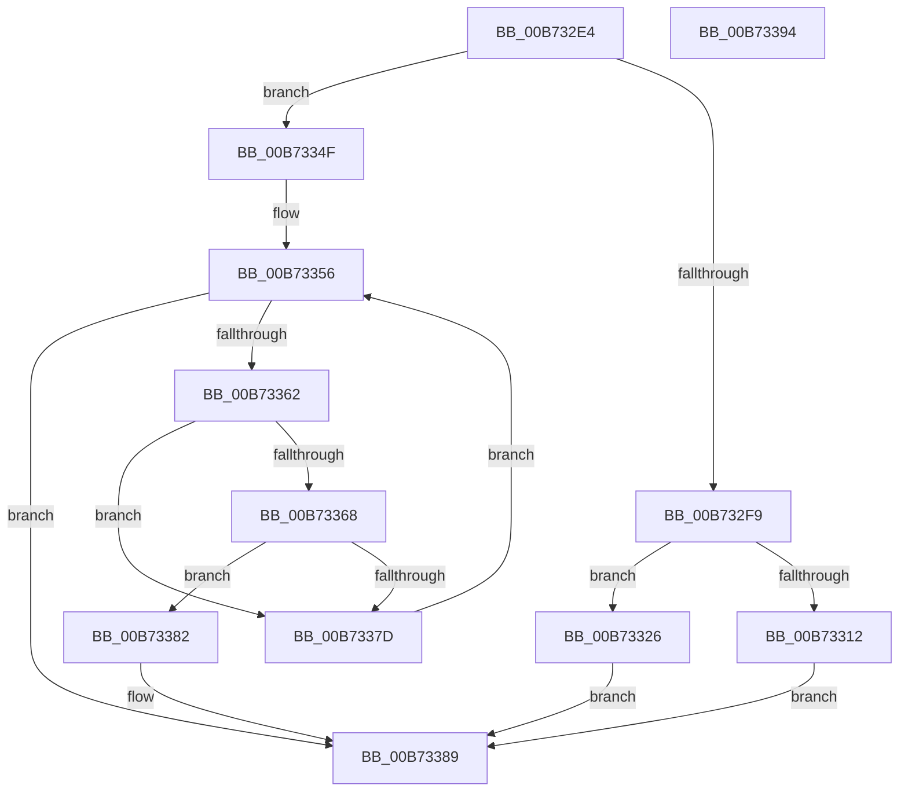

# WheaInitializeProcessor

- RVA: `0x00B732E4`–`0x00B73395` (길이 `177` bytes)
- VA: `0x0000000140B732E4`
- 실행 섹션: `PAGELK`
- PDB 이름 있음: `예`; PDB Function 태그: `아니요`
- unwind 정보 RVA: `0x0005CAAC`
- 디코드: `48`개 명령, `177/177` bytes 표시
- 미해석 바이트: `0` (있으면 어셈블리에 `.byte`로 보존)

> 이 문서는 커널 이미지의 기계어와 PDB 기호를 분석해 생성했습니다. 4번과 5번은 함수 원형과 자료형을 바이너리 사용 방식에서 추정한 C 해석이며 원본 소스 복구 결과는 아닙니다.

## 1. Dependencies

- 직접 호출 지점: **2**; 고유 호출 대상: **2**
- 직접 호출자로 확인된 함수: **1**
- RIP 상대 이미지 참조: **6**

### Outgoing calls
- `0x00B73305` → [ExAllocatePool2](../../poolcode/B8/ExAllocatePool2_function_00B820F0.md) (function, `0x00B820F0`)
- `0x00B73374` → [WheapCallErrorSourceInitialize](../../text/65/WheapCallErrorSourceInitialize_function_0065FC14.md) (function, `0x0065FC14`)

### Direct callers
- [KiStartDynamicProcessor](../../page/74/KiStartDynamicProcessor_function_007456C8.md) at `0x00745957`
- [KiStartDynamicProcessor](../../page/74/KiStartDynamicProcessor_function_007456C8.md) at `0x00745B51`

### Static image references
- `0x00B73312` → RVA `0x00EFA070` (`.data`; read/write)
- `0x00B7331D` → RVA `0x00EFA074` (`.data`; read/write)
- `0x00B73326` → RVA `0x00EEF018` (`.data`; read)
- `0x00B73331` → RVA `0x00EEF01C` (`.data`; read)
- `0x00B73339` → RVA `0x00EF9FE0` (`.data`; read)
- `0x00B7334F` → RVA `0x00EEF028` (`.data`; read)

## 2. Other-region calls and transfers

- 다른 실행 섹션으로 향하는 call: **2**
  - `0x00B73305` → [ExAllocatePool2](../../poolcode/B8/ExAllocatePool2_function_00B820F0.md) (`PAGELK` → `POOLCODE`)
  - `0x00B73374` → [WheapCallErrorSourceInitialize](../../text/65/WheapCallErrorSourceInitialize_function_0065FC14.md) (`PAGELK` → `.text`)
- 별도 외부 분기/꼬리 이동을 확인하지 못했습니다.

## 3. Assembly (complete function range)

```asm
00B732E4  48 89 5C 24 08                  mov qword ptr [rsp + 8], rbx
00B732E9  57                              push rdi
00B732EA  48 83 EC 20                     sub rsp, 0x20
00B732EE  33 C0                           xor eax, eax
00B732F0  8B FA                           mov edi, edx
00B732F2  48 8B D9                        mov rbx, rcx
00B732F5  85 D2                           test edx, edx
00B732F7  75 56                           jne 0x140b7334f
00B732F9  8D 57 18                        lea edx, [rdi + 0x18]
00B732FC  41 B8 57 68 65 61               mov r8d, 0x61656857
00B73302  8D 4F 42                        lea ecx, [rdi + 0x42]
00B73305  E8 E6 ED 00 00                  call 0x140b820f0
00B7330A  48 8B D0                        mov rdx, rax
00B7330D  48 85 C0                        test rax, rax
00B73310  75 14                           jne 0x140b73326
00B73312  FF 05 58 6D 38 00               inc dword ptr [rip + 0x386d58]
00B73318  B8 9A 00 00 C0                  mov eax, 0xc000009a
00B7331D  83 0D 50 6D 38 00 10            or dword ptr [rip + 0x386d50], 0x10
00B73324  EB 63                           jmp 0x140b73389
00B73326  48 8D 05 EB BC 37 00            lea rax, [rip + 0x37bceb]
00B7332D  48 89 42 08                     mov qword ptr [rdx + 8], rax
00B73331  8B 05 E5 BC 37 00               mov eax, dword ptr [rip + 0x37bce5]
00B73337  89 02                           mov dword ptr [rdx], eax
00B73339  48 8D 05 A0 6C 38 00            lea rax, [rip + 0x386ca0]
00B73340  48 89 42 10                     mov qword ptr [rdx + 0x10], rax
00B73344  33 C0                           xor eax, eax
00B73346  48 89 93 A0 8B 00 00            mov qword ptr [rbx + 0x8ba0], rdx
00B7334D  EB 3A                           jmp 0x140b73389
00B7334F  48 8B 1D D2 BC 37 00            mov rbx, qword ptr [rip + 0x37bcd2]
00B73356  48 8D 0D CB BC 37 00            lea rcx, [rip + 0x37bccb]
00B7335D  48 3B D9                        cmp rbx, rcx
00B73360  74 27                           je 0x140b73389
00B73362  83 7B 6C 01                     cmp dword ptr [rbx + 0x6c], 1
00B73366  75 15                           jne 0x140b7337d
00B73368  8B D7                           mov edx, edi
00B7336A  C7 43 6C 02 00 00 00            mov dword ptr [rbx + 0x6c], 2
00B73371  48 8B CB                        mov rcx, rbx
00B73374  E8 9B C8 AE FF                  call 0x14065fc14
00B73379  85 C0                           test eax, eax
00B7337B  78 05                           js 0x140b73382
00B7337D  48 8B 1B                        mov rbx, qword ptr [rbx]
00B73380  EB D4                           jmp 0x140b73356
00B73382  C7 43 6C 01 00 00 00            mov dword ptr [rbx + 0x6c], 1
00B73389  48 8B 5C 24 30                  mov rbx, qword ptr [rsp + 0x30]
00B7338E  48 83 C4 20                     add rsp, 0x20
00B73392  5F                              pop rdi
00B73393  C3                              ret
00B73394  CC                              int3
```

## 4. C-style interpretation (structured pseudocode)

```c
__int64 __fastcall WheaInitializeProcessor(__int64 a1, int a2)
{
    __int64 result;
    __int64 v_rsp;
    unsigned __int64 v_stack_p8;

    v_stack_p8 = v_rbx;
    v_rsp = (v_rsp) - (32);
    result = 0;
    if (a2 != 0) goto loc_00B7334F;
    result = ExAllocatePool2((unsigned int)(a2) + 66, (unsigned int)(a2) + 24, (unsigned int)(0x61656857ULL), a4);
    if (result != 0) goto loc_00B73326;
    goto loc_00B73389;
loc_00B73326:
    *(unsigned __int64 *)(result + 8) = v_rip + 3652843;
    *(unsigned int *)(result) = (unsigned int)((unsigned int)(*(unsigned int *)(v_rip + 3652837)));
    *(unsigned __int64 *)(result + 16) = v_rip + 3697824;
    result = 0;
    *(unsigned __int64 *)(a1 + 35744) = 0;
    goto loc_00B73389;
loc_00B7334F:
loc_00B73356:
    if ((*(unsigned __int64 *)(v_rip + 3652818)) == (v_rip + 3652811)) goto loc_00B73389;
    if ((*(unsigned int *)(*(unsigned __int64 *)(v_rip + 3652818) + 108)) != 1) goto loc_00B7337D;
    *(unsigned int *)(*(unsigned __int64 *)(v_rip + 3652818) + 108) = 2;
    result = WheapCallErrorSourceInitialize(*(unsigned __int64 *)(v_rip + 3652818), (unsigned int)((unsigned int)((unsigned int)(a2))), (unsigned int)(0x61656857ULL), a4);
    if (sign_flag) goto loc_00B73382;
loc_00B7337D:
    goto loc_00B73356;
loc_00B73382:
    *(unsigned int *)(*(unsigned __int64 *)(*(unsigned __int64 *)(v_rip + 3652818)) + 108) = 1;
loc_00B73389:
    v_rsp = (v_rsp) + (32);
    return result;
}
```

## 5. (Beta) C Style

```c
int64_t WheaInitializeProcessor(void *Arg1, void *Arg2)
{
    uint8_t *arg1 = (uint8_t *)Arg1;
    uint8_t *arg2 = (uint8_t *)Arg2;

    int64_t result;
    int64_t local_rsp;
    uint64_t v_stack_p8;

    v_stack_p8 = local_rbx;
    local_rsp = (local_rsp) - (32);
    result = 0;
    if (Arg2 != NULL) goto loc_00B7334F;
    result = ExAllocatePool2((uint32_t)(Arg2) + 66, (uint32_t)(Arg2) + 24, (uint32_t)(0x61656857ULL), a4);
    if (result != 0) goto loc_00B73326;
    goto loc_00B73389;
loc_00B73326:
    *(uint64_t *)(result + 0x8) = v_rip + 3652843;
    *(uint32_t *)(result) = (uint32_t)((uint32_t)(*(uint32_t *)(v_rip + 0x37BCE5)));
    *(uint64_t *)(result + 0x10) = v_rip + 3697824;
    result = 0;
    *(uint64_t *)(arg1 + 0x8BA0) = 0;
    goto loc_00B73389;
loc_00B7334F:
loc_00B73356:
    if ((*(uint64_t *)(v_rip + 0x37BCD2)) == (v_rip + 3652811)) goto loc_00B73389;
    if ((*(uint32_t *)(*(uint64_t *)(v_rip + 0x37BCD2) + 0x6C)) != 1) goto loc_00B7337D;
    *(uint32_t *)(*(uint64_t *)(v_rip + 0x37BCD2) + 0x6C) = 2;
    result = WheapCallErrorSourceInitialize(*(uint64_t *)(v_rip + 0x37BCD2), (uint32_t)((uint32_t)((uint32_t)(Arg2))), (uint32_t)(0x61656857ULL), a4);
    if (sign_flag) goto loc_00B73382;
loc_00B7337D:
    goto loc_00B73356;
loc_00B73382:
    *(uint32_t *)(*(uint64_t *)(*(uint64_t *)(v_rip + 0x37BCD2)) + 0x6C) = 1;
loc_00B73389:
    local_rsp = (local_rsp) + (32);
    return result;
}
```

### 관측된 메모리 오프셋

구조체 형식이 확인되지 않은 접근은 인자 기준의 오프셋으로만 기록했습니다.

| 기준 인자 | 오프셋 표현 | 폭 (bit) | 접근 |
|---|---:|---:|---|
| `Arg1` | `+ 0x8BA0` | `64` | `W` |
| `Arg2` | `+ 0x18` | `32` | `R` |
| `Arg2` | `+ 0x42` | `32` | `R` |

## 6. Execution-region graph

[열기: 2D/3D 그래프와 함수 탐색 컨트롤 패널](../../../control-panel.html?section=pagelk&rva=0x00B732E4&view=graph)

- 2D 그래프는 위에서 아래로 흐르고, 3D 그래프는 빈 공간을 드래그해 회전합니다. Shift+드래그는 이동, 휠은 확대·축소, 함수 노드 선택은 대상 보고서 이동입니다.

### Static fallback


