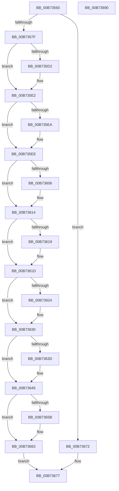

# WheaUnconfigureErrorSource

- RVA: `0x00B73560`–`0x00B73691` (길이 `305` bytes)
- VA: `0x0000000140B73560`
- 실행 섹션: `PAGELK`
- PDB 이름 있음: `예`; PDB Function 태그: `아니요`
- unwind 정보 RVA: `0x0009C52C`
- 디코드: `87`개 명령, `305/305` bytes 표시
- 미해석 바이트: `0` (있으면 어셈블리에 `.byte`로 보존)

> 이 문서는 커널 이미지의 기계어와 PDB 기호를 분석해 생성했습니다. 4번과 5번은 함수 원형과 자료형을 바이너리 사용 방식에서 추정한 C 해석이며 원본 소스 복구 결과는 아닙니다.

## 1. Dependencies

- 직접 호출 지점: **10**; 고유 호출 대상: **8**
- 직접 호출자로 확인된 함수: **0**
- RIP 상대 이미지 참조: **2**

### Outgoing calls
- `0x00B735B9` → [KeAbPreAcquire](../../text/21/KeAbPreAcquire_function_00210230.md) (function, `0x00210230`)
- `0x00B735DD` → [ExfAcquirePushLockSharedEx](../../text/21/ExfAcquirePushLockSharedEx_function_0021044C.md) (function, `0x0021044C`)
- `0x00B735F6` → [KeAbPreAcquire](../../text/21/KeAbPreAcquire_function_00210230.md) (function, `0x00210230`)
- `0x00B7360F` → [ExfAcquirePushLockExclusiveEx](../../text/20/ExfAcquirePushLockExclusiveEx_function_0020FC90.md) (function, `0x0020FC90`)
- `0x00B7362B` → [WheapSetDefaultErrorConfigurationCalls](../../text/66/WheapSetDefaultErrorConfigurationCalls_function_0066009C.md) (function, `0x0066009C`)
- `0x00B73640` → [ExfTryToWakePushLock](../../text/26/ExfTryToWakePushLock_function_00265DD0.md) (function, `0x00265DD0`)
- `0x00B73648` → [KeAbPostRelease](../../text/2E/KeAbPostRelease_function_002E1600.md) (function, `0x002E1600`)
- `0x00B7365E` → [ExfReleasePushLockShared](../../text/26/ExfReleasePushLockShared_function_00263440.md) (function, `0x00263440`)
- `0x00B73666` → [KeAbPostRelease](../../text/2E/KeAbPostRelease_function_002E1600.md) (function, `0x002E1600`)
- `0x00B7366B` → [KeLeaveCriticalRegion](../../text/25/KeLeaveCriticalRegion_function_0025D8B0.md) (function, `0x0025D8B0`)

### Direct callers
- 이 함수 시작 RVA로 연결되는 직접 call은 확인되지 않았습니다. 간접 호출은 완전히 역산할 수 없습니다.

### Static image references
- `0x00B73582` → RVA `0x00EEF090` (`.data`; read)
- `0x00B7358D` → RVA `0x00EF9FC8` (`.data`; read)

## 2. Other-region calls and transfers

- 다른 실행 섹션으로 향하는 call: **10**
  - `0x00B735B9` → [KeAbPreAcquire](../../text/21/KeAbPreAcquire_function_00210230.md) (`PAGELK` → `.text`)
  - `0x00B735DD` → [ExfAcquirePushLockSharedEx](../../text/21/ExfAcquirePushLockSharedEx_function_0021044C.md) (`PAGELK` → `.text`)
  - `0x00B735F6` → [KeAbPreAcquire](../../text/21/KeAbPreAcquire_function_00210230.md) (`PAGELK` → `.text`)
  - `0x00B7360F` → [ExfAcquirePushLockExclusiveEx](../../text/20/ExfAcquirePushLockExclusiveEx_function_0020FC90.md) (`PAGELK` → `.text`)
  - `0x00B7362B` → [WheapSetDefaultErrorConfigurationCalls](../../text/66/WheapSetDefaultErrorConfigurationCalls_function_0066009C.md) (`PAGELK` → `.text`)
  - `0x00B73640` → [ExfTryToWakePushLock](../../text/26/ExfTryToWakePushLock_function_00265DD0.md) (`PAGELK` → `.text`)
  - `0x00B73648` → [KeAbPostRelease](../../text/2E/KeAbPostRelease_function_002E1600.md) (`PAGELK` → `.text`)
  - `0x00B7365E` → [ExfReleasePushLockShared](../../text/26/ExfReleasePushLockShared_function_00263440.md) (`PAGELK` → `.text`)
  - `0x00B73666` → [KeAbPostRelease](../../text/2E/KeAbPostRelease_function_002E1600.md) (`PAGELK` → `.text`)
  - `0x00B7366B` → [KeLeaveCriticalRegion](../../text/25/KeLeaveCriticalRegion_function_0025D8B0.md) (`PAGELK` → `.text`)
- 별도 외부 분기/꼬리 이동을 확인하지 못했습니다.

## 3. Assembly (complete function range)

```asm
00B73560  48 89 5C 24 08                  mov qword ptr [rsp + 8], rbx
00B73565  48 89 6C 24 18                  mov qword ptr [rsp + 0x18], rbp
00B7356A  56                              push rsi
00B7356B  57                              push rdi
00B7356C  41 54                           push r12
00B7356E  41 56                           push r14
00B73570  41 57                           push r15
00B73572  48 83 EC 20                     sub rsp, 0x20
00B73576  83 F9 12                        cmp ecx, 0x12
00B73579  0F 87 F3 00 00 00               ja 0x140b73672
00B7357F  48 63 F9                        movsxd rdi, ecx
00B73582  48 8D 05 07 BB 37 00            lea rax, [rip + 0x37bb07]
00B73589  48 C1 E7 06                     shl rdi, 6
00B7358D  4C 8D 3D 34 6A 38 00            lea r15, [rip + 0x386a34]
00B73594  48 03 F8                        add rdi, rax
00B73597  48 83 CB FF                     or rbx, 0xffffffffffffffff
00B7359B  65 48 8B 04 25 88 01 00 00      mov rax, qword ptr gs:[0x188]
00B735A4  45 33 C0                        xor r8d, r8d
00B735A7  33 D2                           xor edx, edx
00B735A9  49 8B CF                        mov rcx, r15
00B735AC  BD 01 00 00 C0                  mov ebp, 0xc0000001
00B735B1  66 01 98 E4 01 00 00            add word ptr [rax + 0x1e4], bx
00B735B8  90                              nop
00B735B9  E8 72 CC 69 FF                  call 0x140210230
00B735BE  48 8B F0                        mov rsi, rax
00B735C1  44 8D 63 12                     lea r12d, [rbx + 0x12]
00B735C5  33 C0                           xor eax, eax
00B735C7  F0 4C 0F B1 25 F8 69 38 00      lock cmpxchg qword ptr [rip + 0x3869f8], r12
00B735D0  74 10                           je 0x140b735e2
00B735D2  4D 8B CF                        mov r9, r15
00B735D5  4C 8B C6                        mov r8, rsi
00B735D8  33 D2                           xor edx, edx
00B735DA  49 8B CF                        mov rcx, r15
00B735DD  E8 6A CE 69 FF                  call 0x14021044c
00B735E2  45 33 F6                        xor r14d, r14d
00B735E5  48 85 F6                        test rsi, rsi
00B735E8  74 04                           je 0x140b735ee
00B735EA  C6 46 0A 01                     mov byte ptr [rsi + 0xa], 1
00B735EE  45 33 C0                        xor r8d, r8d
00B735F1  33 D2                           xor edx, edx
00B735F3  48 8B CF                        mov rcx, rdi
00B735F6  E8 35 CC 69 FF                  call 0x140210230
00B735FB  F0 48 0F BA 2F 00               lock bts qword ptr [rdi], 0
00B73601  48 8B F0                        mov rsi, rax
00B73604  73 0E                           jae 0x140b73614
00B73606  4C 8B C7                        mov r8, rdi
00B73609  48 8B D0                        mov rdx, rax
00B7360C  48 8B CF                        mov rcx, rdi
00B7360F  E8 7C C6 69 FF                  call 0x14020fc90
00B73614  48 85 F6                        test rsi, rsi
00B73617  74 04                           je 0x140b7361d
00B73619  C6 46 0A 01                     mov byte ptr [rsi + 0xa], 1
00B7361D  8A 47 08                        mov al, byte ptr [rdi + 8]
00B73620  84 C0                           test al, al
00B73622  74 0C                           je 0x140b73630
00B73624  48 8B CF                        mov rcx, rdi
00B73627  44 88 77 08                     mov byte ptr [rdi + 8], r14b
00B7362B  E8 6C CA AE FF                  call 0x14066009c
00B73630  F0 48 0F C1 1F                  lock xadd qword ptr [rdi], rbx
00B73635  80 E3 06                        and bl, 6
00B73638  80 FB 02                        cmp bl, 2
00B7363B  75 08                           jne 0x140b73645
00B7363D  48 8B CF                        mov rcx, rdi
00B73640  E8 8B 27 6F FF                  call 0x140265dd0
00B73645  48 8B CF                        mov rcx, rdi
00B73648  E8 B3 DF 76 FF                  call 0x1402e1600
00B7364D  49 8B C4                        mov rax, r12
00B73650  F0 4C 0F B1 35 6F 69 38 00      lock cmpxchg qword ptr [rip + 0x38696f], r14
00B73659  74 08                           je 0x140b73663
00B7365B  49 8B CF                        mov rcx, r15
00B7365E  E8 DD FD 6E FF                  call 0x140263440
00B73663  49 8B CF                        mov rcx, r15
00B73666  E8 95 DF 76 FF                  call 0x1402e1600
00B7366B  E8 40 A2 6E FF                  call 0x14025d8b0
00B73670  EB 05                           jmp 0x140b73677
00B73672  BD 0D 00 00 C0                  mov ebp, 0xc000000d
00B73677  48 8B 5C 24 50                  mov rbx, qword ptr [rsp + 0x50]
00B7367C  8B C5                           mov eax, ebp
00B7367E  48 8B 6C 24 60                  mov rbp, qword ptr [rsp + 0x60]
00B73683  48 83 C4 20                     add rsp, 0x20
00B73687  41 5F                           pop r15
00B73689  41 5E                           pop r14
00B7368B  41 5C                           pop r12
00B7368D  5F                              pop rdi
00B7368E  5E                              pop rsi
00B7368F  C3                              ret
00B73690  CC                              int3
```

## 4. C-style interpretation (structured pseudocode)

```c
__int64 __fastcall WheaUnconfigureErrorSource(int a1, int a2, int a3)
{
    __int64 result;
    __int64 v_r14;
    __int64 v_rbx;
    __int64 v_rdi;
    __int64 v_rsp;
    unsigned __int64 v_stack_p18;
    unsigned __int64 v_stack_p8;

    v_stack_p8 = v_rbx;
    v_stack_p18 = v_rbp;
    v_rsp = (v_rsp) - (32);
    if (a1 > 18) goto loc_00B73672;
    v_rdi = ((int)(a1)) << (6);
    v_rdi = (v_rdi) + (v_rip + 3652359);
    v_rbx = (v_rbx) | (-1);
    a3 = 0;
    a2 = 0;
    result = KeAbPreAcquire(v_rip + 3697204, a2, a3, a4);
    result = 0;
    if (!(condition_is_equal)) {
        a4 = v_rip + 3697204;
        a3 = 0;
        a2 = 0;
        a1 = v_rip + 3697204;
        result = ExfAcquirePushLockSharedEx(a1, a2, a3, a4);
    }
    v_r14 = 0;
    if (result != 0) {
        *(unsigned __int8 *)(result + 10) = 1;
    }
    a3 = 0;
    a2 = 0;
    result = KeAbPreAcquire(v_rdi, a2, a3, a4);
    if (!(condition_is_above_or_equal)) {
        a3 = v_rdi;
        a2 = result;
        a1 = v_rdi;
        result = ExfAcquirePushLockExclusiveEx(a1, a2, a3, a4);
    }
    if (result != 0) {
        *(unsigned __int8 *)(result + 10) = 1;
    }
    result = *(unsigned __int8 *)(v_rdi + 8);
    if ((unsigned __int8)(*(unsigned __int8 *)(v_rdi + 8)) != 0) {
        a1 = v_rdi;
        *(unsigned __int8 *)(v_rdi + 8) = 0;
        result = WheapSetDefaultErrorConfigurationCalls(a1, a2, a3, a4);
    }
    v_rbx = (unsigned __int8)((v_rbx) & (6));
    if (((unsigned __int8)(v_rbx)) == 2) {
        a1 = v_rdi;
        result = ExfTryToWakePushLock(a1, a2, a3, a4);
    }
    result = KeAbPostRelease(v_rdi, a2, a3, a4);
    result = v_rbx + 18;
    if (((unsigned __int8)(v_rbx)) != 2) {
        a1 = v_rip + 3697204;
        result = ExfReleasePushLockShared(a1, a2, a3, a4);
    }
    result = KeAbPostRelease(v_rip + 3697204, a2, a3, a4);
    result = KeLeaveCriticalRegion(v_rip + 3697204, a2, a3, a4);
    goto loc_00B73677;
loc_00B73672:
loc_00B73677:
    v_rsp = (v_rsp) + (32);
    return (unsigned int)((unsigned int)((unsigned int)(0xC000000DULL)));
}
```

## 5. (Beta) C Style

```c
int64_t WheaUnconfigureErrorSource(int32_t Arg1, int32_t Arg2, int32_t Arg3)
{
    int64_t result;
    int64_t local_r14;
    int64_t local_rbx;
    int64_t local_rdi;
    int64_t local_rsp;
    uint64_t v_stack_p18;
    uint64_t v_stack_p8;

    v_stack_p8 = local_rbx;
    v_stack_p18 = local_rbp;
    local_rsp = (local_rsp) - (32);
    if (Arg1 > 18) goto loc_00B73672;
    local_rdi = ((int32_t)(Arg1)) << (6);
    local_rdi = (local_rdi) + (v_rip + 3652359);
    local_rbx = (local_rbx) | (-1);
    Arg3 = 0;
    Arg2 = 0;
    result = KeAbPreAcquire(v_rip + 3697204, Arg2, Arg3, a4);
    result = 0;
    if (!(condition_is_equal)) {
        a4 = v_rip + 3697204;
        Arg3 = 0;
        Arg2 = 0;
        Arg1 = v_rip + 3697204;
        result = ExfAcquirePushLockSharedEx(Arg1, Arg2, Arg3, a4);
    }
    local_r14 = 0;
    if (result != 0) {
        *(uint8_t *)(result + 0xA) = 1;
    }
    Arg3 = 0;
    Arg2 = 0;
    result = KeAbPreAcquire(local_rdi, Arg2, Arg3, a4);
    if (!(condition_is_above_or_equal)) {
        Arg3 = local_rdi;
        Arg2 = result;
        Arg1 = local_rdi;
        result = ExfAcquirePushLockExclusiveEx(Arg1, Arg2, Arg3, a4);
    }
    if (result != 0) {
        *(uint8_t *)(result + 0xA) = 1;
    }
    result = *(uint8_t *)(local_rdi + 0x8);
    if ((uint8_t)(*(uint8_t *)(local_rdi + 0x8)) != 0) {
        Arg1 = local_rdi;
        *(uint8_t *)(local_rdi + 0x8) = 0;
        result = WheapSetDefaultErrorConfigurationCalls(Arg1, Arg2, Arg3, a4);
    }
    local_rbx = (uint8_t)((local_rbx) & (6));
    if (((uint8_t)(local_rbx)) == 2) {
        Arg1 = local_rdi;
        result = ExfTryToWakePushLock(Arg1, Arg2, Arg3, a4);
    }
    result = KeAbPostRelease(local_rdi, Arg2, Arg3, a4);
    result = local_rbx + 18;
    if (((uint8_t)(local_rbx)) != 2) {
        Arg1 = v_rip + 3697204;
        result = ExfReleasePushLockShared(Arg1, Arg2, Arg3, a4);
    }
    result = KeAbPostRelease(v_rip + 3697204, Arg2, Arg3, a4);
    result = KeLeaveCriticalRegion(v_rip + 3697204, Arg2, Arg3, a4);
    goto loc_00B73677;
loc_00B73672:
loc_00B73677:
    local_rsp = (local_rsp) + (32);
    return (uint32_t)((uint32_t)((uint32_t)(0xC000000DULL)));
}
```

## 6. Execution-region graph

[열기: 2D/3D 그래프와 함수 탐색 컨트롤 패널](../../../control-panel.html?section=pagelk&rva=0x00B73560&view=graph)

- 2D 그래프는 위에서 아래로 흐르고, 3D 그래프는 빈 공간을 드래그해 회전합니다. Shift+드래그는 이동, 휠은 확대·축소, 함수 노드 선택은 대상 보고서 이동입니다.

### Static fallback


