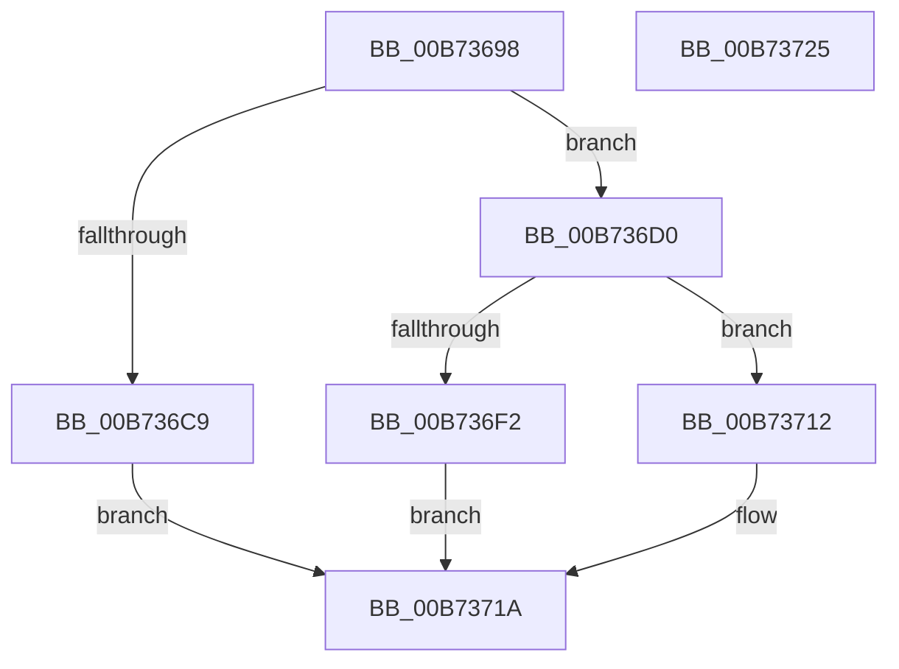

# WheapCreateLiveDumpFromPreviousSession

- RVA: `0x00B73698`–`0x00B73726` (길이 `142` bytes)
- VA: `0x0000000140B73698`
- 실행 섹션: `PAGELK`
- PDB 이름 있음: `예`; PDB Function 태그: `아니요`
- unwind 정보 RVA: `0x000718C0`
- 디코드: `37`개 명령, `142/142` bytes 표시
- 미해석 바이트: `0` (있으면 어셈블리에 `.byte`로 보존)

> 이 문서는 커널 이미지의 기계어와 PDB 기호를 분석해 생성했습니다. 4번과 5번은 함수 원형과 자료형을 바이너리 사용 방식에서 추정한 C 해석이며 원본 소스 복구 결과는 아닙니다.

## 1. Dependencies

- 직접 호출 지점: **4**; 고유 호출 대상: **4**
- 직접 호출자로 확인된 함수: **1**
- RIP 상대 이미지 참조: **3**

### Outgoing calls
- `0x00B736D7` → [ExAcquireFastMutex](../../text/20/ExAcquireFastMutex_function_0020E5A0.md) (function, `0x0020E5A0`)
- `0x00B736E9` → [ExReleaseFastMutex](../../text/25/ExReleaseFastMutex_function_002519C0.md) (function, `0x002519C0`)
- `0x00B7370B` → [WheapReportLiveDump](../../page/7D/WheapReportLiveDump_function_007D88E8.md) (function, `0x007D88E8`)
- `0x00B73715` → [WheapSaveRecordForLiveDump](WheapSaveRecordForLiveDump_function_00B7372C.md) (function, `0x00B7372C`)

### Direct callers
- [WheapProcessWorkQueueItem](../../text/48/WheapProcessWorkQueueItem_function_00484820.md) at `0x0048490B`

### Static image references
- `0x00B736BA` → RVA `0x00EEFAE8` (`.data`; read/write)
- `0x00B736D0` → RVA `0x00EF7DA0` (`.data`; read)
- `0x00B736DC` → RVA `0x00EEFAEC` (`.data`; read)

## 2. Other-region calls and transfers

- 다른 실행 섹션으로 향하는 call: **3**
  - `0x00B736D7` → [ExAcquireFastMutex](../../text/20/ExAcquireFastMutex_function_0020E5A0.md) (`PAGELK` → `.text`)
  - `0x00B736E9` → [ExReleaseFastMutex](../../text/25/ExReleaseFastMutex_function_002519C0.md) (`PAGELK` → `.text`)
  - `0x00B7370B` → [WheapReportLiveDump](../../page/7D/WheapReportLiveDump_function_007D88E8.md) (`PAGELK` → `PAGE`)
- 별도 외부 분기/꼬리 이동을 확인하지 못했습니다.

## 3. Assembly (complete function range)

```asm
00B73698  48 8B C4                        mov rax, rsp
00B7369B  48 89 58 08                     mov qword ptr [rax + 8], rbx
00B7369F  57                              push rdi
00B736A0  48 83 EC 40                     sub rsp, 0x40
00B736A4  48 83 60 D8 00                  and qword ptr [rax - 0x28], 0
00B736A9  48 8B F9                        mov rdi, rcx
00B736AC  48 83 60 E0 00                  and qword ptr [rax - 0x20], 0
00B736B1  83 60 EC 00                     and dword ptr [rax - 0x14], 0
00B736B5  B8 01 00 00 00                  mov eax, 1
00B736BA  F0 0F C1 05 26 C4 37 00         lock xadd dword ptr [rip + 0x37c426], eax
00B736C2  FF C0                           inc eax
00B736C4  83 F8 08                        cmp eax, 8
00B736C7  7E 07                           jle 0x140b736d0
00B736C9  B8 01 00 00 C0                  mov eax, 0xc0000001
00B736CE  EB 4A                           jmp 0x140b7371a
00B736D0  48 8D 0D C9 46 38 00            lea rcx, [rip + 0x3846c9]
00B736D7  E8 C4 AE 69 FF                  call 0x14020e5a0
00B736DC  8A 1D 0A C4 37 00               mov bl, byte ptr [rip + 0x37c40a]
00B736E2  48 8D 0D B7 46 38 00            lea rcx, [rip + 0x3846b7]
00B736E9  E8 D2 E2 6D FF                  call 0x1402519c0
00B736EE  84 DB                           test bl, bl
00B736F0  74 20                           je 0x140b73712
00B736F2  48 8D 47 28                     lea rax, [rdi + 0x28]
00B736F6  48 89 44 24 38                  mov qword ptr [rsp + 0x38], rax
00B736FB  48 8B 47 20                     mov rax, qword ptr [rdi + 0x20]
00B736FF  8B 48 28                        mov ecx, dword ptr [rax + 0x28]
00B73702  89 4C 24 30                     mov dword ptr [rsp + 0x30], ecx
00B73706  48 8D 4C 24 20                  lea rcx, [rsp + 0x20]
00B7370B  E8 D8 51 C6 FF                  call 0x1407d88e8
00B73710  EB 08                           jmp 0x140b7371a
00B73712  48 8B CF                        mov rcx, rdi
00B73715  E8 12 00 00 00                  call 0x140b7372c
00B7371A  48 8B 5C 24 50                  mov rbx, qword ptr [rsp + 0x50]
00B7371F  48 83 C4 40                     add rsp, 0x40
00B73723  5F                              pop rdi
00B73724  C3                              ret
00B73725  CC                              int3
```

## 4. C-style interpretation (structured pseudocode)

```c
__int64 __fastcall WheapCreateLiveDumpFromPreviousSession(__int64 a1)
{
    __int64 result;
    __int64 v_rsp;
    unsigned __int64 v_stack_m10;
    unsigned int v_stack_m18;
    unsigned __int64 v_stack_m28;
    unsigned __int64 v_stack_p8;

    *(unsigned __int64 *)(v_rsp + 8) = v_rbx;
    v_rsp = (v_rsp) - (64);
    result = (unsigned int)((1) + 1);
    if (((unsigned int)(result)) <= 8) goto loc_00B736D0;
    goto loc_00B7371A;
loc_00B736D0:
    result = ExAcquireFastMutex(v_rip + 3688137, a2, a3, a4);
    result = ExReleaseFastMutex(v_rip + 3688119, a2, a3, a4);
    if ((unsigned __int8)(*(unsigned __int8 *)(v_rip + 3654666)) == 0) goto loc_00B73712;
    v_stack_m10 = a1 + 40;
    v_stack_m18 = (unsigned int)((unsigned int)(*(unsigned int *)(*(unsigned __int64 *)(a1 + 32) + 40)));
    result = WheapReportLiveDump(v_stack_m28, a2, a3, a4);
    goto loc_00B7371A;
loc_00B73712:
    result = WheapSaveRecordForLiveDump(a1, a2, a3, a4);
loc_00B7371A:
    v_rsp = (v_rsp) + (64);
    return result;
}
```

## 5. (Beta) C Style

```c
int64_t WheapCreateLiveDumpFromPreviousSession(void *Arg1)
{
    uint8_t *arg1 = (uint8_t *)Arg1;

    int64_t result;
    int64_t local_rsp;
    uint64_t v_stack_m10;
    uint32_t v_stack_m18;
    uint64_t v_stack_m28;
    uint64_t v_stack_p8;

    *(uint64_t *)(local_rsp + 0x8) = local_rbx;
    local_rsp = (local_rsp) - (64);
    result = (uint32_t)((1) + 1);
    if (((uint32_t)(result)) <= 8) goto loc_00B736D0;
    goto loc_00B7371A;
loc_00B736D0:
    result = ExAcquireFastMutex(v_rip + 3688137, a2, a3, a4);
    result = ExReleaseFastMutex(v_rip + 3688119, a2, a3, a4);
    if ((uint8_t)(*(uint8_t *)(v_rip + 0x37C40A)) == 0) goto loc_00B73712;
    v_stack_m10 = Arg1 + 40;
    v_stack_m18 = (uint32_t)((uint32_t)(*(uint32_t *)(*(uint64_t *)(arg1 + 0x20) + 0x28)));
    result = WheapReportLiveDump(v_stack_m28, a2, a3, a4);
    goto loc_00B7371A;
loc_00B73712:
    result = WheapSaveRecordForLiveDump(Arg1, a2, a3, a4);
loc_00B7371A:
    local_rsp = (local_rsp) + (64);
    return result;
}
```

### 관측된 메모리 오프셋

구조체 형식이 확인되지 않은 접근은 인자 기준의 오프셋으로만 기록했습니다.

| 기준 인자 | 오프셋 표현 | 폭 (bit) | 접근 |
|---|---:|---:|---|
| `Arg1` | `+ 0x20` | `64` | `R` |
| `Arg1` | `+ 0x28` | `64` | `R` |

## 6. Execution-region graph

[열기: 2D/3D 그래프와 함수 탐색 컨트롤 패널](../../../control-panel.html?section=pagelk&rva=0x00B73698&view=graph)

- 2D 그래프는 위에서 아래로 흐르고, 3D 그래프는 빈 공간을 드래그해 회전합니다. Shift+드래그는 이동, 휠은 확대·축소, 함수 노드 선택은 대상 보고서 이동입니다.

### Static fallback


