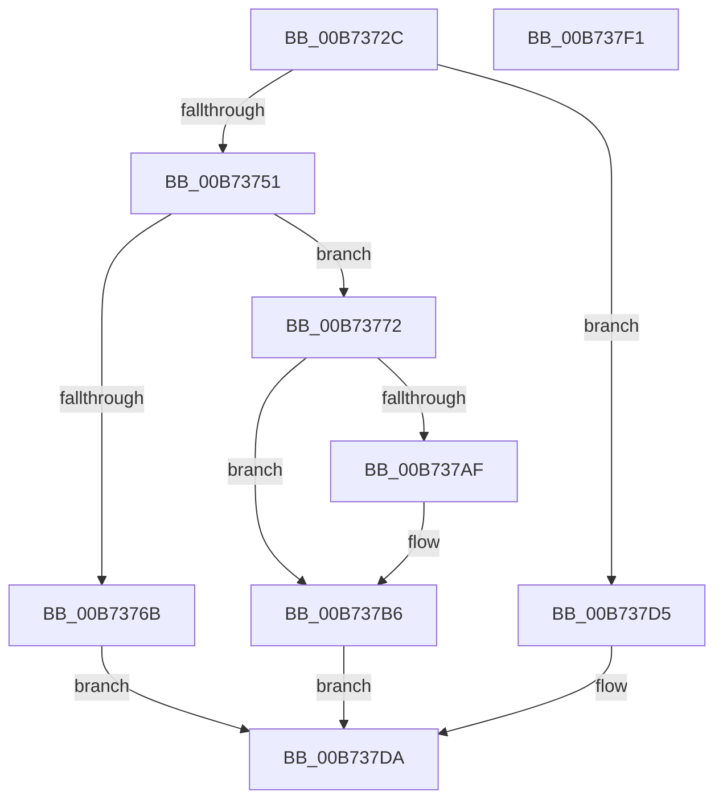

# WheapSaveRecordForLiveDump

- RVA: `0x00B7372C`–`0x00B737F2` (길이 `198` bytes)
- VA: `0x0000000140B7372C`
- 실행 섹션: `PAGELK`
- PDB 이름 있음: `예`; PDB Function 태그: `아니요`
- unwind 정보 RVA: `0x0005C954`
- 디코드: `52`개 명령, `198/198` bytes 표시
- 미해석 바이트: `0` (있으면 어셈블리에 `.byte`로 보존)

> 이 문서는 커널 이미지의 기계어와 PDB 기호를 분석해 생성했습니다. 4번과 5번은 함수 원형과 자료형을 바이너리 사용 방식에서 추정한 C 해석이며 원본 소스 복구 결과는 아닙니다.

## 1. Dependencies

- 직접 호출 지점: **4**; 고유 호출 대상: **4**
- 직접 호출자로 확인된 함수: **1**
- RIP 상대 이미지 참조: **4**

### Outgoing calls
- `0x00B7375E` → [ExAllocatePool2](../../poolcode/B8/ExAllocatePool2_function_00B820F0.md) (function, `0x00B820F0`)
- `0x00B7378B` → [memcpy](../../text/6C/memcpy_function_006C6840.md) (function, `0x006C6840`)
- `0x00B73797` → [ExAcquireFastMutex](../../text/20/ExAcquireFastMutex_function_0020E5A0.md) (function, `0x0020E5A0`)
- `0x00B737CE` → [ExReleaseFastMutex](../../text/25/ExReleaseFastMutex_function_002519C0.md) (function, `0x002519C0`)

### Direct callers
- [WheapCreateLiveDumpFromPreviousSession](WheapCreateLiveDumpFromPreviousSession_function_00B73698.md) at `0x00B73715`

### Static image references
- `0x00B73790` → RVA `0x00EF7DA0` (`.data`; read)
- `0x00B7379C` → RVA `0x00EF7DE8` (`.data`; read)
- `0x00B737A3` → RVA `0x00EF7DE0` (`.data`; read)
- `0x00B737C7` → RVA `0x00EF7DE8` (`.data`; write)

## 2. Other-region calls and transfers

- 다른 실행 섹션으로 향하는 call: **4**
  - `0x00B7375E` → [ExAllocatePool2](../../poolcode/B8/ExAllocatePool2_function_00B820F0.md) (`PAGELK` → `POOLCODE`)
  - `0x00B7378B` → [memcpy](../../text/6C/memcpy_function_006C6840.md) (`PAGELK` → `.text`)
  - `0x00B73797` → [ExAcquireFastMutex](../../text/20/ExAcquireFastMutex_function_0020E5A0.md) (`PAGELK` → `.text`)
  - `0x00B737CE` → [ExReleaseFastMutex](../../text/25/ExReleaseFastMutex_function_002519C0.md) (`PAGELK` → `.text`)
- 별도 외부 분기/꼬리 이동을 확인하지 못했습니다.

## 3. Assembly (complete function range)

```asm
00B7372C  48 89 5C 24 08                  mov qword ptr [rsp + 8], rbx
00B73731  48 89 6C 24 10                  mov qword ptr [rsp + 0x10], rbp
00B73736  48 89 74 24 18                  mov qword ptr [rsp + 0x18], rsi
00B7373B  57                              push rdi
00B7373C  48 83 EC 20                     sub rsp, 0x20
00B73740  8B 71 3C                        mov esi, dword ptr [rcx + 0x3c]
00B73743  48 8B E9                        mov rbp, rcx
00B73746  8D 46 20                        lea eax, [rsi + 0x20]
00B73749  3B C6                           cmp eax, esi
00B7374B  0F 82 84 00 00 00               jb 0x140b737d5
00B73751  33 FF                           xor edi, edi
00B73753  8B D0                           mov edx, eax
00B73755  41 B8 57 68 65 61               mov r8d, 0x61656857
00B7375B  8D 4F 42                        lea ecx, [rdi + 0x42]
00B7375E  E8 8D E9 00 00                  call 0x140b820f0
00B73763  48 8B D8                        mov rbx, rax
00B73766  48 85 C0                        test rax, rax
00B73769  75 07                           jne 0x140b73772
00B7376B  BF 9A 00 00 C0                  mov edi, 0xc000009a
00B73770  EB 68                           jmp 0x140b737da
00B73772  48 8B 45 20                     mov rax, qword ptr [rbp + 0x20]
00B73776  48 8D 55 28                     lea rdx, [rbp + 0x28]
00B7377A  4C 8B C6                        mov r8, rsi
00B7377D  8B 48 28                        mov ecx, dword ptr [rax + 0x28]
00B73780  89 4B 10                        mov dword ptr [rbx + 0x10], ecx
00B73783  48 8D 4B 20                     lea rcx, [rbx + 0x20]
00B73787  48 89 4B 18                     mov qword ptr [rbx + 0x18], rcx
00B7378B  E8 B0 30 B5 FF                  call 0x1406c6840
00B73790  48 8D 0D 09 46 38 00            lea rcx, [rip + 0x384609]
00B73797  E8 04 AE 69 FF                  call 0x14020e5a0
00B7379C  48 8B 05 45 46 38 00            mov rax, qword ptr [rip + 0x384645]
00B737A3  48 8D 0D 36 46 38 00            lea rcx, [rip + 0x384636]
00B737AA  48 39 08                        cmp qword ptr [rax], rcx
00B737AD  74 07                           je 0x140b737b6
00B737AF  B9 03 00 00 00                  mov ecx, 3
00B737B4  CD 29                           int 0x29
00B737B6  48 89 0B                        mov qword ptr [rbx], rcx
00B737B9  48 8D 0D E0 45 38 00            lea rcx, [rip + 0x3845e0]
00B737C0  48 89 43 08                     mov qword ptr [rbx + 8], rax
00B737C4  48 89 18                        mov qword ptr [rax], rbx
00B737C7  48 89 1D 1A 46 38 00            mov qword ptr [rip + 0x38461a], rbx
00B737CE  E8 ED E1 6D FF                  call 0x1402519c0
00B737D3  EB 05                           jmp 0x140b737da
00B737D5  BF 95 00 00 C0                  mov edi, 0xc0000095
00B737DA  48 8B 5C 24 30                  mov rbx, qword ptr [rsp + 0x30]
00B737DF  8B C7                           mov eax, edi
00B737E1  48 8B 6C 24 38                  mov rbp, qword ptr [rsp + 0x38]
00B737E6  48 8B 74 24 40                  mov rsi, qword ptr [rsp + 0x40]
00B737EB  48 83 C4 20                     add rsp, 0x20
00B737EF  5F                              pop rdi
00B737F0  C3                              ret
00B737F1  CC                              int3
```

## 4. C-style interpretation (structured pseudocode)

```c
__int64 __fastcall WheapSaveRecordForLiveDump(__int64 a1)
{
    __int64 result;
    __int64 v_rdi;
    __int64 v_rsp;
    unsigned __int64 v_stack_p10;
    unsigned __int64 v_stack_p18;
    unsigned __int64 v_stack_p8;

    v_stack_p8 = v_rbx;
    v_stack_p10 = v_rbp;
    v_stack_p18 = v_rsi;
    v_rsp = (v_rsp) - (32);
    if (((unsigned int)((unsigned int)(*(unsigned int *)(a1 + 60)) + 32)) < ((unsigned int)((unsigned int)(*(unsigned int *)(a1 + 60))))) goto loc_00B737D5;
    v_rdi = 0;
    result = ExAllocatePool2(v_rdi + 66, (unsigned int)((unsigned int)((unsigned int)(*(unsigned int *)(a1 + 60)) + 32)), (unsigned int)(0x61656857ULL), a4);
    if (result != 0) goto loc_00B73772;
    goto loc_00B737DA;
loc_00B73772:
    *(unsigned int *)(result + 16) = (unsigned int)((unsigned int)(*(unsigned int *)(*(unsigned __int64 *)(a1 + 32) + 40)));
    *(unsigned __int64 *)(result + 24) = result + 32;
    result = memcpy(result + 32, a1 + 40, (unsigned int)(*(unsigned int *)(a1 + 60)), a4);
    result = ExAcquireFastMutex(v_rip + 3687945, a1 + 40, (unsigned int)(*(unsigned int *)(a1 + 60)), a4);
    if ((*(unsigned __int64 *)(*(unsigned __int64 *)(v_rip + 3688005))) != (v_rip + 3687990)) {
        a1 = 3;
    }
    *(unsigned __int64 *)(result) = a1;
    *(unsigned __int64 *)(result + 8) = *(unsigned __int64 *)(v_rip + 3688005);
    *(unsigned __int64 *)(*(unsigned __int64 *)(v_rip + 3688005)) = result;
    *(unsigned __int64 *)(v_rip + 3687962) = result;
    result = ExReleaseFastMutex(v_rip + 3687904, a1 + 40, (unsigned int)(*(unsigned int *)(a1 + 60)), a4);
    goto loc_00B737DA;
loc_00B737D5:
loc_00B737DA:
    v_rsp = (v_rsp) + (32);
    return (unsigned int)((unsigned int)((unsigned int)(0xC0000095ULL)));
}
```

## 5. (Beta) C Style

```c
int64_t WheapSaveRecordForLiveDump(void *Arg1)
{
    uint8_t *arg1 = (uint8_t *)Arg1;

    int64_t result;
    int64_t local_rdi;
    int64_t local_rsp;
    uint64_t v_stack_p10;
    uint64_t v_stack_p18;
    uint64_t v_stack_p8;

    v_stack_p8 = local_rbx;
    v_stack_p10 = local_rbp;
    v_stack_p18 = local_rsi;
    local_rsp = (local_rsp) - (32);
    if (((uint32_t)((uint32_t)(*(uint32_t *)(arg1 + 0x3C)) + 32)) < ((uint32_t)((uint32_t)(*(uint32_t *)(arg1 + 0x3C))))) goto loc_00B737D5;
    local_rdi = 0;
    result = ExAllocatePool2(local_rdi + 66, (uint32_t)((uint32_t)((uint32_t)(*(uint32_t *)(arg1 + 0x3C)) + 32)), (uint32_t)(0x61656857ULL), a4);
    if (result != 0) goto loc_00B73772;
    goto loc_00B737DA;
loc_00B73772:
    *(uint32_t *)(result + 0x10) = (uint32_t)((uint32_t)(*(uint32_t *)(*(uint64_t *)(arg1 + 0x20) + 0x28)));
    *(uint64_t *)(result + 0x18) = result + 32;
    result = memcpy(result + 32, Arg1 + 40, (uint32_t)(*(uint32_t *)(arg1 + 0x3C)), a4);
    result = ExAcquireFastMutex(v_rip + 3687945, Arg1 + 40, (uint32_t)(*(uint32_t *)(arg1 + 0x3C)), a4);
    if ((*(uint64_t *)(*(uint64_t *)(v_rip + 0x384645))) != (v_rip + 3687990)) {
        Arg1 = 3;
    }
    *(void **)(result) = Arg1;
    *(uint64_t *)(result + 0x8) = *(uint64_t *)(v_rip + 0x384645);
    *(uint64_t *)(*(uint64_t *)(v_rip + 0x384645)) = result;
    *(uint64_t *)(v_rip + 0x38461A) = result;
    result = ExReleaseFastMutex(v_rip + 3687904, Arg1 + 40, (uint32_t)(*(uint32_t *)(arg1 + 0x3C)), a4);
    goto loc_00B737DA;
loc_00B737D5:
loc_00B737DA:
    local_rsp = (local_rsp) + (32);
    return (uint32_t)((uint32_t)((uint32_t)(0xC0000095ULL)));
}
```

### 관측된 메모리 오프셋

구조체 형식이 확인되지 않은 접근은 인자 기준의 오프셋으로만 기록했습니다.

| 기준 인자 | 오프셋 표현 | 폭 (bit) | 접근 |
|---|---:|---:|---|
| `Arg1` | `+ 0x20` | `64` | `R` |
| `Arg1` | `+ 0x28` | `64` | `R` |
| `Arg1` | `+ 0x3C` | `32` | `R` |

## 6. Execution-region graph

[열기: 2D/3D 그래프와 함수 탐색 컨트롤 패널](../../../control-panel.html?section=pagelk&rva=0x00B7372C&view=graph)

- 2D 그래프는 위에서 아래로 흐르고, 3D 그래프는 빈 공간을 드래그해 회전합니다. Shift+드래그는 이동, 휠은 확대·축소, 함수 노드 선택은 대상 보고서 이동입니다.

### Static fallback


