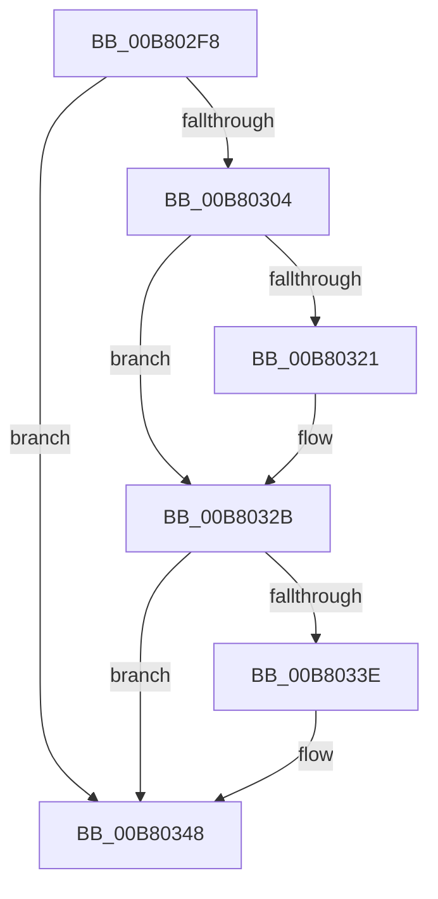

# sub_00B802F8

- RVA: `0x00B802F8`–`0x00B80363` (길이 `107` bytes)
- VA: `0x0000000140B802F8`
- 실행 섹션: `PAGELK`
- PDB 이름 있음: `아니요`; PDB Function 태그: `아니요`
- unwind 정보 RVA: `0x000A10A8`
- 디코드: `24`개 명령, `107/107` bytes 표시
- 미해석 바이트: `0` (있으면 어셈블리에 `.byte`로 보존)

> 이 문서는 커널 이미지의 기계어와 PDB 기호를 분석해 생성했습니다. 4번과 5번은 함수 원형과 자료형을 바이너리 사용 방식에서 추정한 C 해석이며 원본 소스 복구 결과는 아닙니다.

## 1. Dependencies

- 직접 호출 지점: **4**; 고유 호출 대상: **2**
- 직접 호출자로 확인된 함수: **0**
- RIP 상대 이미지 참조: **1**

### Outgoing calls
- `0x00B80309` → [IoAddTriageDumpDataBlock](../../text/42/IoAddTriageDumpDataBlock_function_00428374.md) (function, `0x00428374`)
- `0x00B80326` → [IoAddTriageDumpDataBlock](../../text/42/IoAddTriageDumpDataBlock_function_00428374.md) (function, `0x00428374`)
- `0x00B80343` → [IoAddTriageDumpDataBlock](../../text/42/IoAddTriageDumpDataBlock_function_00428374.md) (function, `0x00428374`)
- `0x00B8035D` → [KeBugCheckEx](../../text/4F/KeBugCheckEx_function_004FD660.md) (function, `0x004FD660`)

### Direct callers
- 이 함수 시작 RVA로 연결되는 직접 call은 확인되지 않았습니다. 간접 호출은 완전히 역산할 수 없습니다.

### Static image references
- `0x00B802F8` → RVA `0x00F0BD90` (`.data`; read)

## 2. Other-region calls and transfers

- 다른 실행 섹션으로 향하는 call: **4**
  - `0x00B80309` → [IoAddTriageDumpDataBlock](../../text/42/IoAddTriageDumpDataBlock_function_00428374.md) (`PAGELK` → `.text`)
  - `0x00B80326` → [IoAddTriageDumpDataBlock](../../text/42/IoAddTriageDumpDataBlock_function_00428374.md) (`PAGELK` → `.text`)
  - `0x00B80343` → [IoAddTriageDumpDataBlock](../../text/42/IoAddTriageDumpDataBlock_function_00428374.md) (`PAGELK` → `.text`)
  - `0x00B8035D` → [KeBugCheckEx](../../text/4F/KeBugCheckEx_function_004FD660.md) (`PAGELK` → `.text`)
- 별도 외부 분기/꼬리 이동을 확인하지 못했습니다.

## 3. Assembly (complete function range)

```asm
00B802F8  48 8B 0D 91 BA 38 00            mov rcx, qword ptr [rip + 0x38ba91]
00B802FF  48 85 C9                        test rcx, rcx
00B80302  74 44                           je 0x140b80348
00B80304  BA F0 01 00 00                  mov edx, 0x1f0
00B80309  E8 66 80 8A FF                  call 0x140428374
00B8030E  48 8B 05 7B BA 38 00            mov rax, qword ptr [rip + 0x38ba7b]
00B80315  48 8B 88 B8 00 00 00            mov rcx, qword ptr [rax + 0xb8]
00B8031C  48 85 C9                        test rcx, rcx
00B8031F  74 0A                           je 0x140b8032b
00B80321  BA 78 01 00 00                  mov edx, 0x178
00B80326  E8 49 80 8A FF                  call 0x140428374
00B8032B  48 8B 05 5E BA 38 00            mov rax, qword ptr [rip + 0x38ba5e]
00B80332  48 8B 88 D8 00 00 00            mov rcx, qword ptr [rax + 0xd8]
00B80339  48 85 C9                        test rcx, rcx
00B8033C  74 0A                           je 0x140b80348
00B8033E  BA F0 04 00 00                  mov edx, 0x4f0
00B80343  E8 2C 80 8A FF                  call 0x140428374
00B80348  4C 8B CE                        mov r9, rsi
00B8034B  4C 63 C3                        movsxd r8, ebx
00B8034E  BA 09 00 00 00                  mov edx, 9
00B80353  4C 89 74 24 20                  mov qword ptr [rsp + 0x20], r14
00B80358  B9 A0 00 00 00                  mov ecx, 0xa0
00B8035D  E8 FE D2 97 FF                  call 0x1404fd660
00B80362  CC                              int3
```

## 4. C-style interpretation (structured pseudocode)

```c
__int64 __fastcall sub_00B802F8(void)
{
    __int64 result;
    unsigned __int64 v_stack_p20;

    if (*(unsigned __int64 *)(v_rip + 3717777) == 0) goto loc_00B80348;
    result = IoAddTriageDumpDataBlock(*(unsigned __int64 *)(v_rip + 3717777), 496, a3, a4);
    result = *(unsigned __int64 *)(v_rip + 3717755);
    if (*(unsigned __int64 *)(*(unsigned __int64 *)(v_rip + 3717755) + 184) != 0) {
        a2 = 376;
        result = IoAddTriageDumpDataBlock(*(unsigned __int64 *)(*(unsigned __int64 *)(v_rip + 3717755) + 184), a2, a3, a4);
    }
    result = *(unsigned __int64 *)(v_rip + 3717726);
    if (*(unsigned __int64 *)(*(unsigned __int64 *)(v_rip + 3717726) + 216) != 0) {
        a2 = 0x4F0ULL;
        result = IoAddTriageDumpDataBlock(*(unsigned __int64 *)(*(unsigned __int64 *)(v_rip + 3717726) + 216), a2, a3, a4);
    }
    v_stack_p20 = v_r14;
    result = KeBugCheckEx(160, 9, (int)((unsigned int)(v_rbx)), v_rsi);
    return result;
}
```

## 5. (Beta) C Style

```c
void sub_00B802F8(void)
{
    int64_t result;
    uint64_t v_stack_p20;

    if (*(uint64_t *)(v_rip + 0x38BA91) == 0) goto loc_00B80348;
    result = IoAddTriageDumpDataBlock(*(uint64_t *)(v_rip + 0x38BA91), 496, a3, a4);
    result = *(uint64_t *)(v_rip + 0x38BA7B);
    if (*(uint64_t *)(*(uint64_t *)(v_rip + 0x38BA7B) + 0xB8) != 0) {
        a2 = 376;
        result = IoAddTriageDumpDataBlock(*(uint64_t *)(*(uint64_t *)(v_rip + 0x38BA7B) + 0xB8), a2, a3, a4);
    }
    result = *(uint64_t *)(v_rip + 0x38BA5E);
    if (*(uint64_t *)(*(uint64_t *)(v_rip + 0x38BA5E) + 0xD8) != 0) {
        a2 = 0x4F0ULL;
        result = IoAddTriageDumpDataBlock(*(uint64_t *)(*(uint64_t *)(v_rip + 0x38BA5E) + 0xD8), a2, a3, a4);
    }
    v_stack_p20 = local_r14;
    result = KeBugCheckEx(160, 9, (int32_t)((uint32_t)(local_rbx)), local_rsi);
    return result;
}
```

## 6. Execution-region graph

[열기: 2D/3D 그래프와 함수 탐색 컨트롤 패널](../../../control-panel.html?section=pagelk&rva=0x00B802F8&view=graph)

- 2D 그래프는 위에서 아래로 흐르고, 3D 그래프는 빈 공간을 드래그해 회전합니다. Shift+드래그는 이동, 휠은 확대·축소, 함수 노드 선택은 대상 보고서 이동입니다.

### Static fallback


