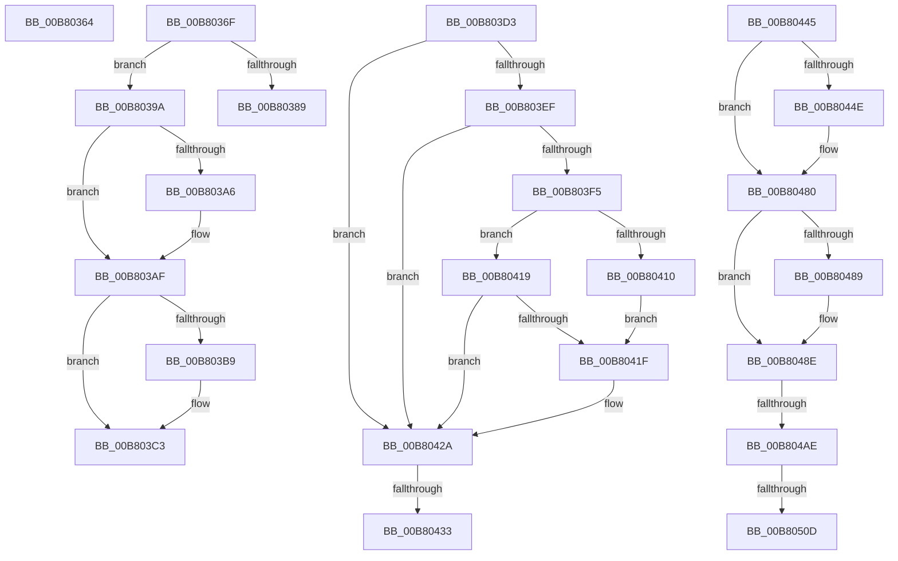

# sub_00B80364

- RVA: `0x00B80364`–`0x00B8053D` (길이 `473` bytes)
- VA: `0x0000000140B80364`
- 실행 섹션: `PAGELK`
- PDB 이름 있음: `아니요`; PDB Function 태그: `아니요`
- unwind 정보 RVA: `0x000A10E0`
- 디코드: `112`개 명령, `473/473` bytes 표시
- 미해석 바이트: `0` (있으면 어셈블리에 `.byte`로 보존)

> 이 문서는 커널 이미지의 기계어와 PDB 기호를 분석해 생성했습니다. 4번과 5번은 함수 원형과 자료형을 바이너리 사용 방식에서 추정한 C 해석이며 원본 소스 복구 결과는 아닙니다.

## 1. Dependencies

- 직접 호출 지점: **21**; 고유 호출 대상: **18**
- 직접 호출자로 확인된 함수: **0**
- RIP 상대 이미지 참조: **8**

### Outgoing calls
- `0x00B80371` → [EmPowerPagingEnabled](../../page/AC/EmPowerPagingEnabled_function_00ACE36C.md) (function, `0x00ACE36C`)
- `0x00B80376` → [PopVerifierFlushMemoryBeforeSleep](../B7/PopVerifierFlushMemoryBeforeSleep_function_00B70ED4.md) (function, `0x00B70ED4`)
- `0x00B80389` → [ExAcquireTimeRefreshLockExclusive](../../page/9C/ExAcquireTimeRefreshLockExclusive_function_009C5810.md) (function, `0x009C5810`)
- `0x00B803AA` → [IoConfigureCrashDump](../../text/59/IoConfigureCrashDump_function_00591CB4.md) (function, `0x00591CB4`)
- `0x00B803BE` → [ObShutdownSystem](../../page/74/ObShutdownSystem_function_0074DBB0.md) (function, `0x0074DBB0`)
- `0x00B803C8` → [MmShutdownSystem](../B7/MmShutdownSystem_function_00B73D80.md) (function, `0x00B73D80`)
- `0x00B80404` → [PopMapInternalActionToIrpAction](../../text/49/PopMapInternalActionToIrpAction_function_0049FE48.md) (function, `0x0049FE48`)
- `0x00B80425` → [IoNotifyPowerOperationVetoed](../../page/72/IoNotifyPowerOperationVetoed_function_00729A38.md) (function, `0x00729A38`)
- `0x00B8043A` → [PopDirectedDripsNotifyTransitionFailed](../../page/75/PopDirectedDripsNotifyTransitionFailed_function_00757A34.md) (function, `0x00757A34`)
- `0x00B8044E` → [PopBootLoaderSiDataProcess](../B7/PopBootLoaderSiDataProcess_function_00B7DFA0.md) (function, `0x00B7DFA0`)
- `0x00B8047B` → [PopUpdateSmbiosData](../../page/76/PopUpdateSmbiosData_function_007602BC.md) (function, `0x007602BC`)
- `0x00B80489` → [WmiReleaseSmbiosLockExclusive](../../page/A9/WmiReleaseSmbiosLockExclusive_function_00A946F8.md) (function, `0x00A946F8`)
- `0x00B80491` → [EmPowerPagingEnabled](../../page/AC/EmPowerPagingEnabled_function_00ACE36C.md) (function, `0x00ACE36C`)
- `0x00B804BE` → [KeDelayExecutionThread](../../text/20/KeDelayExecutionThread_function_00209550.md) (function, `0x00209550`)
- `0x00B804D7` → [KeBugCheckEx](../../text/4F/KeBugCheckEx_function_004FD660.md) (function, `0x004FD660`)
- `0x00B804DD` → [PopFxIdleDevicesFromSx](../../text/4B/PopFxIdleDevicesFromSx_function_004B2FB4.md) (function, `0x004B2FB4`)
- `0x00B804E4` → [KeQueryPerformanceCounter](../../text/37/KeQueryPerformanceCounter_function_0037E7E0.md) (function, `0x0037E7E0`)
- `0x00B804F0` → [PopDiagTraceDevicesWakeEnd](../../page/76/PopDiagTraceDevicesWakeEnd_function_007610B4.md) (function, `0x007610B4`)
- `0x00B804FA` → [PopCheckpointSystemSleep](../B7/PopCheckpointSystemSleep_function_00B77C90.md) (function, `0x00B77C90`)
- `0x00B8051D` → [KeDelayExecutionThread](../../text/20/KeDelayExecutionThread_function_00209550.md) (function, `0x00209550`)
- `0x00B80537` → [KeBugCheckEx](../../text/4F/KeBugCheckEx_function_004FD660.md) (function, `0x004FD660`)

### Direct callers
- 이 함수 시작 RVA로 연결되는 직접 call은 확인되지 않았습니다. 간접 호출은 완전히 역산할 수 없습니다.

### Static image references
- `0x00B8037D` → RVA `0x00E0B560` (`.data`; read/write)
- `0x00B8039A` → RVA `0x00F0BCC4` (`.data`; read)
- `0x00B803AF` → RVA `0x00F0C8B0` (`.data`; read)
- `0x00B80445` → RVA `0x00F0C680` (`.data`; read)
- `0x00B80453` → RVA `0x00F0BD90` (`.data`; read)
- `0x00B80480` → RVA `0x00F0BD74` (`.data`; read)
- `0x00B8049F` → RVA `0x00E67880` (`.data`; read)
- `0x00B804E9` → RVA `0x00F0C340` (`.data`; write)

## 2. Other-region calls and transfers

- 다른 실행 섹션으로 향하는 call: **17**
  - `0x00B80371` → [EmPowerPagingEnabled](../../page/AC/EmPowerPagingEnabled_function_00ACE36C.md) (`PAGELK` → `PAGE`)
  - `0x00B80389` → [ExAcquireTimeRefreshLockExclusive](../../page/9C/ExAcquireTimeRefreshLockExclusive_function_009C5810.md) (`PAGELK` → `PAGE`)
  - `0x00B803AA` → [IoConfigureCrashDump](../../text/59/IoConfigureCrashDump_function_00591CB4.md) (`PAGELK` → `.text`)
  - `0x00B803BE` → [ObShutdownSystem](../../page/74/ObShutdownSystem_function_0074DBB0.md) (`PAGELK` → `PAGE`)
  - `0x00B80404` → [PopMapInternalActionToIrpAction](../../text/49/PopMapInternalActionToIrpAction_function_0049FE48.md) (`PAGELK` → `.text`)
  - `0x00B80425` → [IoNotifyPowerOperationVetoed](../../page/72/IoNotifyPowerOperationVetoed_function_00729A38.md) (`PAGELK` → `PAGE`)
  - `0x00B8043A` → [PopDirectedDripsNotifyTransitionFailed](../../page/75/PopDirectedDripsNotifyTransitionFailed_function_00757A34.md) (`PAGELK` → `PAGE`)
  - `0x00B8047B` → [PopUpdateSmbiosData](../../page/76/PopUpdateSmbiosData_function_007602BC.md) (`PAGELK` → `PAGE`)
  - `0x00B80489` → [WmiReleaseSmbiosLockExclusive](../../page/A9/WmiReleaseSmbiosLockExclusive_function_00A946F8.md) (`PAGELK` → `PAGE`)
  - `0x00B80491` → [EmPowerPagingEnabled](../../page/AC/EmPowerPagingEnabled_function_00ACE36C.md) (`PAGELK` → `PAGE`)
  - `0x00B804BE` → [KeDelayExecutionThread](../../text/20/KeDelayExecutionThread_function_00209550.md) (`PAGELK` → `.text`)
  - `0x00B804D7` → [KeBugCheckEx](../../text/4F/KeBugCheckEx_function_004FD660.md) (`PAGELK` → `.text`)
  - `0x00B804DD` → [PopFxIdleDevicesFromSx](../../text/4B/PopFxIdleDevicesFromSx_function_004B2FB4.md) (`PAGELK` → `.text`)
  - `0x00B804E4` → [KeQueryPerformanceCounter](../../text/37/KeQueryPerformanceCounter_function_0037E7E0.md) (`PAGELK` → `.text`)
  - `0x00B804F0` → [PopDiagTraceDevicesWakeEnd](../../page/76/PopDiagTraceDevicesWakeEnd_function_007610B4.md) (`PAGELK` → `PAGE`)
  - `0x00B8051D` → [KeDelayExecutionThread](../../text/20/KeDelayExecutionThread_function_00209550.md) (`PAGELK` → `.text`)
  - `0x00B80537` → [KeBugCheckEx](../../text/4F/KeBugCheckEx_function_004FD660.md) (`PAGELK` → `.text`)
- call이 아닌 외부 분기/꼬리 이동: **7**
  - `0x00B8036A` → [PoBroadcastSystemState + 0x33B](../B7/PoBroadcastSystemState_function_00B761B0.md) (`tail-transfer`)
  - `0x00B80395` → [PoBroadcastSystemState + 0x358](../B7/PoBroadcastSystemState_function_00B761B0.md) (`tail-transfer`)
  - `0x00B803CE` → [PoBroadcastSystemState + 0x358](../B7/PoBroadcastSystemState_function_00B761B0.md) (`tail-transfer`)
  - `0x00B8042D` → [PoBroadcastSystemState + 0x3C6](../B7/PoBroadcastSystemState_function_00B761B0.md) (`tail-transfer`)
  - `0x00B80440` → [PoBroadcastSystemState + 0x3C6](../B7/PoBroadcastSystemState_function_00B761B0.md) (`tail-transfer`)
  - `0x00B804A8` → [PoBroadcastSystemState + 0x1AD](../B7/PoBroadcastSystemState_function_00B761B0.md) (`tail-transfer`)
  - `0x00B80507` → [PoBroadcastSystemState + 0x1C0](../B7/PoBroadcastSystemState_function_00B761B0.md) (`tail-transfer`)

## 3. Assembly (complete function range)

```asm
00B80364  41 BE 04 00 00 00               mov r14d, 4
00B8036A  E9 7C 61 FF FF                  jmp 0x140b764eb
00B8036F  33 C9                           xor ecx, ecx
00B80371  E8 F6 DF F4 FF                  call 0x140ace36c
00B80376  E8 59 0B FF FF                  call 0x140b70ed4
00B8037B  33 C0                           xor eax, eax
00B8037D  87 05 DD B1 28 00               xchg dword ptr [rip + 0x28b1dd], eax
00B80383  80 7F 18 00                     cmp byte ptr [rdi + 0x18], 0
00B80387  75 11                           jne 0x140b8039a
00B80389  E8 82 54 E4 FF                  call 0x1409c5810
00B8038E  C6 83 D4 01 00 00 01            mov byte ptr [rbx + 0x1d4], 1
00B80395  E9 6E 61 FF FF                  jmp 0x140b76508
00B8039A  F7 05 20 B9 38 00 00 00 40 00   test dword ptr [rip + 0x38b920], 0x400000
00B803A4  75 09                           jne 0x140b803af
00B803A6  B2 01                           mov dl, 1
00B803A8  33 C9                           xor ecx, ecx
00B803AA  E8 05 19 A1 FF                  call 0x140591cb4
00B803AF  8B 05 FB C4 38 00               mov eax, dword ptr [rip + 0x38c4fb]
00B803B5  A8 10                           test al, 0x10
00B803B7  74 0A                           je 0x140b803c3
00B803B9  B9 01 00 00 00                  mov ecx, 1
00B803BE  E8 ED D7 BC FF                  call 0x14074dbb0
00B803C3  B9 01 00 00 00                  mov ecx, 1
00B803C8  E8 B3 39 FF FF                  call 0x140b73d80
00B803CD  90                              nop
00B803CE  E9 35 61 FF FF                  jmp 0x140b76508
00B803D3  4C 8B 93 C8 01 00 00            mov r10, qword ptr [rbx + 0x1c8]
00B803DA  41 BC 01 00 00 00               mov r12d, 1
00B803E0  45 33 FF                        xor r15d, r15d
00B803E3  44 88 65 D0                     mov byte ptr [rbp - 0x30], r12b
00B803E7  45 8A F4                        mov r14b, r12b
00B803EA  4D 85 D2                        test r10, r10
00B803ED  74 3B                           je 0x140b8042a
00B803EF  44 39 67 0C                     cmp dword ptr [rdi + 0xc], r12d
00B803F3  75 35                           jne 0x140b8042a
00B803F5  48 8B 4D E0                     mov rcx, qword ptr [rbp - 0x20]
00B803F9  45 33 C0                        xor r8d, r8d
00B803FC  8B 53 04                        mov edx, dword ptr [rbx + 4]
00B803FF  45 8B CF                        mov r9d, r15d
00B80402  8B 09                           mov ecx, dword ptr [rcx]
00B80404  E8 3F FA 91 FF                  call 0x14049fe48
00B80409  8B C8                           mov ecx, eax
00B8040B  83 F8 07                        cmp eax, 7
00B8040E  75 09                           jne 0x140b80419
00B80410  48 8B 43 38                     mov rax, qword ptr [rbx + 0x38]
00B80414  4C 8B 08                        mov r9, qword ptr [rax]
00B80417  EB 06                           jmp 0x140b8041f
00B80419  44 39 7F 14                     cmp dword ptr [rdi + 0x14], r15d
00B8041D  7C 0B                           jl 0x140b8042a
00B8041F  4D 8B C2                        mov r8, r10
00B80422  49 8B D1                        mov rdx, r9
00B80425  E8 0E 96 BA FF                  call 0x140729a38
00B8042A  45 85 ED                        test r13d, r13d
00B8042D  0F 84 43 61 FF FF               je 0x140b76576
00B80433  48 8B 8B C8 01 00 00            mov rcx, qword ptr [rbx + 0x1c8]
00B8043A  E8 F5 75 BD FF                  call 0x140757a34
00B8043F  90                              nop
00B80440  E9 31 61 FF FF                  jmp 0x140b76576
00B80445  44 38 3D 34 C2 38 00            cmp byte ptr [rip + 0x38c234], r15b
00B8044C  74 32                           je 0x140b80480
00B8044E  E8 4D DB FF FF                  call 0x140b7dfa0
00B80453  48 8B 05 36 B9 38 00            mov rax, qword ptr [rip + 0x38b936]
00B8045A  48 8B 88 D8 00 00 00            mov rcx, qword ptr [rax + 0xd8]
00B80461  4C 8B 89 E0 04 00 00            mov r9, qword ptr [rcx + 0x4e0]
00B80468  44 8B 81 E8 04 00 00            mov r8d, dword ptr [rcx + 0x4e8]
00B8046F  8A 91 ED 04 00 00               mov dl, byte ptr [rcx + 0x4ed]
00B80475  8A 89 EC 04 00 00               mov cl, byte ptr [rcx + 0x4ec]
00B8047B  E8 3C FE BD FF                  call 0x1407602bc
00B80480  83 3D ED B8 38 00 05            cmp dword ptr [rip + 0x38b8ed], 5
00B80487  75 05                           jne 0x140b8048e
00B80489  E8 6A 42 F1 FF                  call 0x140a946f8
00B8048E  41 8A CC                        mov cl, r12b
00B80491  E8 D6 DE F4 FF                  call 0x140ace36c
00B80496  41 8B C4                        mov eax, r12d
00B80499  87 05 C1 B0 28 00               xchg dword ptr [rip + 0x28b0c1], eax
00B8049F  8B 0D DB 73 2E 00               mov ecx, dword ptr [rip + 0x2e73db]
00B804A5  F6 C1 04                        test cl, 4
00B804A8  0F 84 AF 5E FF FF               je 0x140b7635d
00B804AE  4C 8D 45 D8                     lea r8, [rbp - 0x28]
00B804B2  48 C7 45 D8 80 0F 05 FD         mov qword ptr [rbp - 0x28], 0xfffffffffd050f80
00B804BA  33 D2                           xor edx, edx
00B804BC  33 C9                           xor ecx, ecx
00B804BE  E8 8D 90 68 FF                  call 0x140209550
00B804C3  45 33 C9                        xor r9d, r9d
00B804C6  4C 89 7C 24 20                  mov qword ptr [rsp + 0x20], r15
00B804CB  4D 8B C4                        mov r8, r12
00B804CE  B9 A0 00 00 00                  mov ecx, 0xa0
00B804D3  41 8D 51 0A                     lea edx, [r9 + 0xa]
00B804D7  E8 84 D1 97 FF                  call 0x1404fd660
00B804DC  CC                              int3
00B804DD  E8 D2 2A 93 FF                  call 0x1404b2fb4
00B804E2  33 C9                           xor ecx, ecx
00B804E4  E8 F7 E2 7F FF                  call 0x14037e7e0
00B804E9  48 89 05 50 BE 38 00            mov qword ptr [rip + 0x38be50], rax
00B804F0  E8 BF 0B BE FF                  call 0x1407610b4
00B804F5  B9 24 00 00 00                  mov ecx, 0x24
00B804FA  E8 91 77 FF FF                  call 0x140b77c90
00B804FF  8B 05 7B 73 2E 00               mov eax, dword ptr [rip + 0x2e737b]
00B80505  A8 08                           test al, 8
00B80507  0F 84 63 5E FF FF               je 0x140b76370
00B8050D  4C 8D 45 D8                     lea r8, [rbp - 0x28]
00B80511  48 C7 45 D8 80 0F 05 FD         mov qword ptr [rbp - 0x28], 0xfffffffffd050f80
00B80519  33 D2                           xor edx, edx
00B8051B  33 C9                           xor ecx, ecx
00B8051D  E8 2E 90 68 FF                  call 0x140209550
00B80522  45 33 C9                        xor r9d, r9d
00B80525  4C 89 7C 24 20                  mov qword ptr [rsp + 0x20], r15
00B8052A  B9 A0 00 00 00                  mov ecx, 0xa0
00B8052F  41 8D 51 0A                     lea edx, [r9 + 0xa]
00B80533  45 8D 41 02                     lea r8d, [r9 + 2]
00B80537  E8 24 D1 97 FF                  call 0x1404fd660
00B8053C  CC                              int3
```

## 4. C-style interpretation (structured pseudocode)

```c
__int64 __fastcall sub_00B80364(int a1, __int64 a2, int a3)
{
    unsigned __int64 v_stack_p20;
}
```

## 5. (Beta) C Style

```c
int64_t sub_00B80364(int32_t Arg1, int64_t Arg2, int32_t Arg3)
{
    uint64_t v_stack_p20;
}
```

## 6. Execution-region graph

[열기: 2D/3D 그래프와 함수 탐색 컨트롤 패널](../../../control-panel.html?section=pagelk&rva=0x00B80364&view=graph)

- 2D 그래프는 위에서 아래로 흐르고, 3D 그래프는 빈 공간을 드래그해 회전합니다. Shift+드래그는 이동, 휠은 확대·축소, 함수 노드 선택은 대상 보고서 이동입니다.

### Static fallback


