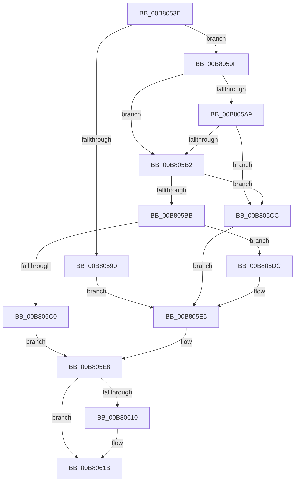

# sub_00B8053E

- RVA: `0x00B8053E`–`0x00B80654` (길이 `278` bytes)
- VA: `0x0000000140B8053E`
- 실행 섹션: `PAGELK`
- PDB 이름 있음: `아니요`; PDB Function 태그: `아니요`
- unwind 정보 RVA: `0x000A1120`
- 디코드: `65`개 명령, `278/278` bytes 표시
- 미해석 바이트: `0` (있으면 어셈블리에 `.byte`로 보존)

> 이 문서는 커널 이미지의 기계어와 PDB 기호를 분석해 생성했습니다. 4번과 5번은 함수 원형과 자료형을 바이너리 사용 방식에서 추정한 C 해석이며 원본 소스 복구 결과는 아닙니다.

## 1. Dependencies

- 직접 호출 지점: **8**; 고유 호출 대상: **6**
- 직접 호출자로 확인된 함수: **0**
- RIP 상대 이미지 참조: **14**

### Outgoing calls
- `0x00B80542` → [PopEnlargeHiberFile](../../page/75/PopEnlargeHiberFile_function_0075D564.md) (function, `0x0075D564`)
- `0x00B80590` → [MmEmptyAllWorkingSets](../../text/67/MmEmptyAllWorkingSets_function_0067EF2C.md) (function, `0x0067EF2C`)
- `0x00B805C0` → [MmTrimFilePagesFromWorkingSets](../../text/67/MmTrimFilePagesFromWorkingSets_function_0067EFB8.md) (function, `0x0067EFB8`)
- `0x00B805CC` → [MmEmptyAllWorkingSets](../../text/67/MmEmptyAllWorkingSets_function_0067EF2C.md) (function, `0x0067EF2C`)
- `0x00B80606` → [PopDiagTraceEventNoPayload](../../text/49/PopDiagTraceEventNoPayload_function_004982F8.md) (function, `0x004982F8`)
- `0x00B80616` → [MmFlushAllPagesEx](../../text/68/MmFlushAllPagesEx_function_006804E4.md) (function, `0x006804E4`)
- `0x00B80622` → [PopDiagTraceEventNoPayload](../../text/49/PopDiagTraceEventNoPayload_function_004982F8.md) (function, `0x004982F8`)
- `0x00B80638` → [MmDuplicateMemory](../B7/MmDuplicateMemory_function_00B74158.md) (function, `0x00B74158`)

### Direct callers
- 이 함수 시작 RVA로 연결되는 직접 call은 확인되지 않았습니다. 간접 호출은 완전히 역산할 수 없습니다.

### Static image references
- `0x00B8054D` → RVA `0x00B5D700` (`HalpQosInitSystem`; read)
- `0x00B80567` → RVA `0x00B75E50` (`PopEndMirroring`; read)
- `0x00B8057D` → RVA `0x00B77D10` (`PopMirrorPhysicalMemory`; read)
- `0x00B8059F` → RVA `0x00F0BD4C` (`.data`; read)
- `0x00B805A9` → RVA `0x00F0DDA0` (`.data`; read)
- `0x00B805B2` → RVA `0x00F0DD98` (`.data`; read)
- `0x00B805E8` → RVA `0x00020E28` (`.rdata`; read)
- `0x00B805F2` → RVA `0x00F0DE3C` (`.data`; write)
- `0x00B805F9` → RVA `0x00F0DE3D` (`.data`; write)
- `0x00B80600` → RVA `0x00F0DE38` (`.data`; write)
- `0x00B8061B` → RVA `0x000233F0` (`.rdata`; read)
- `0x00B8062B` → RVA `0x00E0B54C` (`.data`; write)
- `0x00B80631` → RVA `0x00E676F0` (`.data`; write)
- `0x00B8063D` → RVA `0x00E676F0` (`.data`; read/write)

## 2. Other-region calls and transfers

- 다른 실행 섹션으로 향하는 call: **7**
  - `0x00B80542` → [PopEnlargeHiberFile](../../page/75/PopEnlargeHiberFile_function_0075D564.md) (`PAGELK` → `PAGE`)
  - `0x00B80590` → [MmEmptyAllWorkingSets](../../text/67/MmEmptyAllWorkingSets_function_0067EF2C.md) (`PAGELK` → `.text`)
  - `0x00B805C0` → [MmTrimFilePagesFromWorkingSets](../../text/67/MmTrimFilePagesFromWorkingSets_function_0067EFB8.md) (`PAGELK` → `.text`)
  - `0x00B805CC` → [MmEmptyAllWorkingSets](../../text/67/MmEmptyAllWorkingSets_function_0067EF2C.md) (`PAGELK` → `.text`)
  - `0x00B80606` → [PopDiagTraceEventNoPayload](../../text/49/PopDiagTraceEventNoPayload_function_004982F8.md) (`PAGELK` → `.text`)
  - `0x00B80616` → [MmFlushAllPagesEx](../../text/68/MmFlushAllPagesEx_function_006804E4.md) (`PAGELK` → `.text`)
  - `0x00B80622` → [PopDiagTraceEventNoPayload](../../text/49/PopDiagTraceEventNoPayload_function_004982F8.md) (`PAGELK` → `.text`)
- call이 아닌 외부 분기/꼬리 이동: **1**
  - `0x00B8064F` → [PopTransitionToSleep + 0x7D](../B7/PopTransitionToSleep_function_00B76970.md) (`tail-transfer`)

## 3. Assembly (complete function range)

```asm
00B8053E  48 8D 4D 30                     lea rcx, [rbp + 0x30]
00B80542  E8 1D D0 BD FF                  call 0x14075d564
00B80547  0F B6 4D 30                     movzx ecx, byte ptr [rbp + 0x30]
00B8054B  85 C0                           test eax, eax
00B8054D  48 8D 05 AC D1 FD FF            lea rax, [rip - 0x22e54]
00B80554  C7 45 F0 10 00 00 00            mov dword ptr [rbp - 0x10], 0x10
00B8055B  48 89 45 D0                     mov qword ptr [rbp - 0x30], rax
00B8055F  BB 01 00 00 00                  mov ebx, 1
00B80564  0F 48 CB                        cmovs ecx, ebx
00B80567  48 8D 05 E2 58 FF FF            lea rax, [rip - 0xa71e]
00B8056E  48 83 65 E8 00                  and qword ptr [rbp - 0x18], 0
00B80573  45 32 F6                        xor r14b, r14b
00B80576  48 89 45 D8                     mov qword ptr [rbp - 0x28], rax
00B8057A  45 32 FF                        xor r15b, r15b
00B8057D  48 8D 05 8C 77 FF FF            lea rax, [rip - 0x8874]
00B80584  48 89 45 E0                     mov qword ptr [rbp - 0x20], rax
00B80588  44 8D 63 3B                     lea r12d, [rbx + 0x3b]
00B8058C  84 C9                           test cl, cl
00B8058E  74 0F                           je 0x140b8059f
00B80590  E8 97 E9 AF FF                  call 0x14067ef2c
00B80595  8B 45 F0                        mov eax, dword ptr [rbp - 0x10]
00B80598  44 8A FB                        mov r15b, bl
00B8059B  0B C3                           or eax, ebx
00B8059D  EB 46                           jmp 0x140b805e5
00B8059F  8B 05 A7 B7 38 00               mov eax, dword ptr [rip + 0x38b7a7]
00B805A5  A8 20                           test al, 0x20
00B805A7  74 09                           je 0x140b805b2
00B805A9  83 3D F0 D7 38 00 00            cmp dword ptr [rip + 0x38d7f0], 0
00B805B0  75 1A                           jne 0x140b805cc
00B805B2  83 3D DF D7 38 00 00            cmp dword ptr [rip + 0x38d7df], 0
00B805B9  75 11                           jne 0x140b805cc
00B805BB  83 FE 06                        cmp esi, 6
00B805BE  75 1C                           jne 0x140b805dc
00B805C0  E8 F3 E9 AF FF                  call 0x14067efb8
00B805C5  8B 45 F0                        mov eax, dword ptr [rbp - 0x10]
00B805C8  0B C3                           or eax, ebx
00B805CA  EB 1C                           jmp 0x140b805e8
00B805CC  E8 5B E9 AF FF                  call 0x14067ef2c
00B805D1  8B 45 F0                        mov eax, dword ptr [rbp - 0x10]
00B805D4  44 8A FB                        mov r15b, bl
00B805D7  83 C8 04                        or eax, 4
00B805DA  EB 09                           jmp 0x140b805e5
00B805DC  B8 14 00 00 00                  mov eax, 0x14
00B805E1  44 8D 60 F4                     lea r12d, [rax - 0xc]
00B805E5  44 8A F3                        mov r14b, bl
00B805E8  48 8D 0D 39 08 4A FF            lea rcx, [rip - 0xb5f7c7]
00B805EF  89 45 F0                        mov dword ptr [rbp - 0x10], eax
00B805F2  44 88 35 43 D8 38 00            mov byte ptr [rip + 0x38d843], r14b
00B805F9  44 88 3D 3D D8 38 00            mov byte ptr [rip + 0x38d83d], r15b
00B80600  89 05 32 D8 38 00               mov dword ptr [rip + 0x38d832], eax
00B80606  E8 ED 7C 91 FF                  call 0x1404982f8
00B8060B  45 84 F6                        test r14b, r14b
00B8060E  74 0B                           je 0x140b8061b
00B80610  41 8B D4                        mov edx, r12d
00B80613  41 8A CF                        mov cl, r15b
00B80616  E8 C9 FE AF FF                  call 0x1406804e4
00B8061B  48 8D 0D CE 2D 4A FF            lea rcx, [rip - 0xb5d232]
00B80622  E8 D1 7C 91 FF                  call 0x1404982f8
00B80627  48 8D 4D D0                     lea rcx, [rbp - 0x30]
00B8062B  89 35 1B AF 28 00               mov dword ptr [rip + 0x28af1b], esi
00B80631  48 89 3D B8 70 2E 00            mov qword ptr [rip + 0x2e70b8], rdi
00B80638  E8 1B 3B FF FF                  call 0x140b74158
00B8063D  48 83 25 AB 70 2E 00 00         and qword ptr [rip + 0x2e70ab], 0
00B80645  C7 05 FD AE 28 00 07 00 00 00   mov dword ptr [rip + 0x28aefd], 7
00B8064F  E9 99 63 FF FF                  jmp 0x140b769ed
```

## 4. C-style interpretation (structured pseudocode)

```c
__int64 __fastcall sub_00B8053E(void)
{
    __int64 result;
    __int64 v_r14;
    __int64 v_r15;

    result = PopEnlargeHiberFile(v_rbp + 48, a2, a3, a4);
    *(unsigned int *)(v_rbp - 16) = 16;
    *(unsigned __int64 *)(v_rbp - 48) = v_rip - 142932;
    a1 = *(unsigned __int8 *)(v_rbp + 48);
    if (sign_flag) { a1 = 1; }
    v_r14 = 0;
    *(unsigned __int64 *)(v_rbp - 40) = v_rip - 42782;
    v_r15 = 0;
    *(unsigned __int64 *)(v_rbp - 32) = v_rip - 34932;
    if ((unsigned __int8)(a1) == 0) goto loc_00B8059F;
    result = MmEmptyAllWorkingSets(a1, a2, a3, a4);
    result = (unsigned int)(((unsigned int)(*(unsigned int *)(v_rbp - 16))) | (1));
    goto loc_00B805E5;
loc_00B8059F:
    if ((((unsigned __int8)((unsigned int)(*(unsigned int *)(v_rip + 3717031)))) & (32)) == 0) goto loc_00B805B2;
    if ((*(unsigned int *)(v_rip + 3725296)) != 0) goto loc_00B805CC;
loc_00B805B2:
    if ((*(unsigned int *)(v_rip + 3725279)) != 0) goto loc_00B805CC;
    if (((unsigned int)(v_rsi)) != 6) goto loc_00B805DC;
    result = MmTrimFilePagesFromWorkingSets(a1, a2, a3, a4);
    result = (unsigned int)(((unsigned int)(*(unsigned int *)(v_rbp - 16))) | (1));
    goto loc_00B805E8;
loc_00B805CC:
    result = MmEmptyAllWorkingSets(a1, a2, a3, a4);
    result = (unsigned int)(((unsigned int)(*(unsigned int *)(v_rbp - 16))) | (4));
    goto loc_00B805E5;
loc_00B805DC:
loc_00B805E5:
loc_00B805E8:
    *(unsigned int *)(v_rbp - 16) = 20;
    *(unsigned __int8 *)(v_rip + 3725379) = 1;
    *(unsigned __int8 *)(v_rip + 3725373) = 1;
    *(unsigned int *)(v_rip + 3725362) = 20;
    result = PopDiagTraceEventNoPayload(v_rip - 11925447, a2, a3, a4);
    if (1 != 0) {
        a2 = (unsigned int)(20 - 12);
        a1 = 1;
        result = MmFlushAllPagesEx(a1, a2, a3, a4);
    }
    result = PopDiagTraceEventNoPayload(v_rip - 11915826, a2, a3, a4);
    *(unsigned int *)(v_rip + 2666267) = (unsigned int)(v_rsi);
    *(unsigned __int64 *)(v_rip + 3043512) = v_rdi;
    result = MmDuplicateMemory(v_rbp - 48, a2, a3, a4);
    *(unsigned int *)(v_rip + 2666237) = 7;
}
```

## 5. (Beta) C Style

```c
void sub_00B8053E(void)
{
    int64_t result;
    int64_t local_r14;
    int64_t local_r15;

    result = PopEnlargeHiberFile(local_rbp + 48, a2, a3, a4);
    *(uint32_t *)(local_rbp - 0x10) = 16;
    *(uint64_t *)(local_rbp - 0x30) = v_rip - 142932;
    a1 = *(uint8_t *)(local_rbp + 0x30);
    if (sign_flag) { a1 = 1; }
    local_r14 = 0;
    *(uint64_t *)(local_rbp - 0x28) = v_rip - 42782;
    local_r15 = 0;
    *(uint64_t *)(local_rbp - 0x20) = v_rip - 34932;
    if ((uint8_t)(a1) == 0) goto loc_00B8059F;
    result = MmEmptyAllWorkingSets(a1, a2, a3, a4);
    result = (uint32_t)(((uint32_t)(*(uint32_t *)(local_rbp - 0x10))) | (1));
    goto loc_00B805E5;
loc_00B8059F:
    if ((((uint8_t)((uint32_t)(*(uint32_t *)(v_rip + 0x38B7A7)))) & (32)) == 0) goto loc_00B805B2;
    if ((*(uint32_t *)(v_rip + 0x38D7F0)) != 0) goto loc_00B805CC;
loc_00B805B2:
    if ((*(uint32_t *)(v_rip + 0x38D7DF)) != 0) goto loc_00B805CC;
    if (((uint32_t)(local_rsi)) != 6) goto loc_00B805DC;
    result = MmTrimFilePagesFromWorkingSets(a1, a2, a3, a4);
    result = (uint32_t)(((uint32_t)(*(uint32_t *)(local_rbp - 0x10))) | (1));
    goto loc_00B805E8;
loc_00B805CC:
    result = MmEmptyAllWorkingSets(a1, a2, a3, a4);
    result = (uint32_t)(((uint32_t)(*(uint32_t *)(local_rbp - 0x10))) | (4));
    goto loc_00B805E5;
loc_00B805DC:
loc_00B805E5:
loc_00B805E8:
    *(uint32_t *)(local_rbp - 0x10) = 20;
    *(uint8_t *)(v_rip + 0x38D843) = 1;
    *(uint8_t *)(v_rip + 0x38D83D) = 1;
    *(uint32_t *)(v_rip + 0x38D832) = 20;
    result = PopDiagTraceEventNoPayload(v_rip - 11925447, a2, a3, a4);
    if (1 != 0) {
        a2 = (uint32_t)(20 - 12);
        a1 = 1;
        result = MmFlushAllPagesEx(a1, a2, a3, a4);
    }
    result = PopDiagTraceEventNoPayload(v_rip - 11915826, a2, a3, a4);
    *(uint32_t *)(v_rip + 0x28AF1B) = (uint32_t)(local_rsi);
    *(uint64_t *)(v_rip + 0x2E70B8) = local_rdi;
    result = MmDuplicateMemory(local_rbp - 48, a2, a3, a4);
    *(uint32_t *)(v_rip + 0x28AEFD) = 7;
}
```

## 6. Execution-region graph

[열기: 2D/3D 그래프와 함수 탐색 컨트롤 패널](../../../control-panel.html?section=pagelk&rva=0x00B8053E&view=graph)

- 2D 그래프는 위에서 아래로 흐르고, 3D 그래프는 빈 공간을 드래그해 회전합니다. Shift+드래그는 이동, 휠은 확대·축소, 함수 노드 선택은 대상 보고서 이동입니다.

### Static fallback


