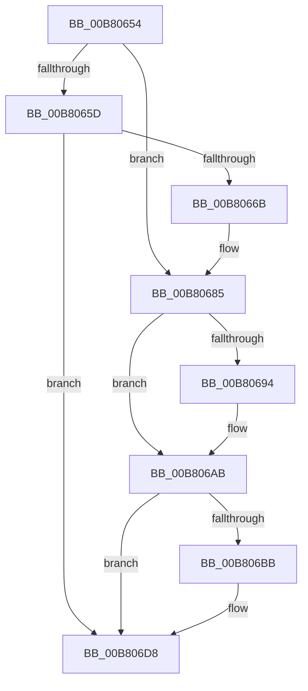

# sub_00B80654

- RVA: `0x00B80654`–`0x00B806E5` (길이 `145` bytes)
- VA: `0x0000000140B80654`
- 실행 섹션: `PAGELK`
- PDB 이름 있음: `아니요`; PDB Function 태그: `아니요`
- unwind 정보 RVA: `0x000A11C0`
- 디코드: `37`개 명령, `145/145` bytes 표시
- 미해석 바이트: `0` (있으면 어셈블리에 `.byte`로 보존)

> 이 문서는 커널 이미지의 기계어와 PDB 기호를 분석해 생성했습니다. 4번과 5번은 함수 원형과 자료형을 바이너리 사용 방식에서 추정한 C 해석이며 원본 소스 복구 결과는 아닙니다.

## 1. Dependencies

- 직접 호출 지점: **5**; 고유 호출 대상: **3**
- 직접 호출자로 확인된 함수: **0**
- RIP 상대 이미지 참조: **3**

### Outgoing calls
- `0x00B8067F` → [KeBugCheckEx](../../text/4F/KeBugCheckEx_function_004FD660.md) (function, `0x004FD660`)
- `0x00B806A5` → [KeBugCheckEx](../../text/4F/KeBugCheckEx_function_004FD660.md) (function, `0x004FD660`)
- `0x00B806B2` → [guard_dispatch_icall](../../text/6B/guard_dispatch_icall_function_006BAAD0.md) (function, `0x006BAAD0`)
- `0x00B806D2` → [KeBugCheckEx](../../text/4F/KeBugCheckEx_function_004FD660.md) (function, `0x004FD660`)
- `0x00B806DA` → [PopCheckpointSystemSleepUnsafe](../B7/PopCheckpointSystemSleepUnsafe_function_00B71950.md) (function, `0x00B71950`)

### Direct callers
- 이 함수 시작 RVA로 연결되는 직접 call은 확인되지 않았습니다. 간접 호출은 완전히 역산할 수 없습니다.

### Static image references
- `0x00B80654` → RVA `0x00F0BD23` (`.data`; read)
- `0x00B8065F` → RVA `0x00E0B560` (`.data`; read/write)
- `0x00B806AB` → RVA `0x00E00BA0` (`.data`; read)

## 2. Other-region calls and transfers

- 다른 실행 섹션으로 향하는 call: **4**
  - `0x00B8067F` → [KeBugCheckEx](../../text/4F/KeBugCheckEx_function_004FD660.md) (`PAGELK` → `.text`)
  - `0x00B806A5` → [KeBugCheckEx](../../text/4F/KeBugCheckEx_function_004FD660.md) (`PAGELK` → `.text`)
  - `0x00B806B2` → [guard_dispatch_icall](../../text/6B/guard_dispatch_icall_function_006BAAD0.md) (`PAGELK` → `.text`)
  - `0x00B806D2` → [KeBugCheckEx](../../text/4F/KeBugCheckEx_function_004FD660.md) (`PAGELK` → `.text`)
- call이 아닌 외부 분기/꼬리 이동: **1**
  - `0x00B806E0` → [PopCheckpointSystemSleep + 0x39](../B7/PopCheckpointSystemSleep_function_00B77C90.md) (`tail-transfer`)

## 3. Assembly (complete function range)

```asm
00B80654  80 3D C8 B6 38 00 00            cmp byte ptr [rip + 0x38b6c8], 0
00B8065B  75 28                           jne 0x140b80685
00B8065D  33 C0                           xor eax, eax
00B8065F  F0 0F C1 05 F9 AE 28 00         lock xadd dword ptr [rip + 0x28aef9], eax
00B80667  85 C0                           test eax, eax
00B80669  75 6D                           jne 0x140b806d8
00B8066B  48 83 64 24 20 00               and qword ptr [rsp + 0x20], 0
00B80671  BA 0F 01 00 00                  mov edx, 0x10f
00B80676  4C 8B C3                        mov r8, rbx
00B80679  45 33 C9                        xor r9d, r9d
00B8067C  8D 4A 91                        lea ecx, [rdx - 0x6f]
00B8067F  E8 DC CF 97 FF                  call 0x1404fd660
00B80684  CC                              int3
00B80685  65 48 8B 04 25 20 00 00 00      mov rax, qword ptr gs:[0x20]
00B8068E  83 78 24 00                     cmp dword ptr [rax + 0x24], 0
00B80692  74 17                           je 0x140b806ab
00B80694  48 83 64 24 20 00               and qword ptr [rsp + 0x20], 0
00B8069A  BA 0F 01 00 00                  mov edx, 0x10f
00B8069F  4C 8B C3                        mov r8, rbx
00B806A2  8D 4A 91                        lea ecx, [rdx - 0x6f]
00B806A5  E8 B6 CF 97 FF                  call 0x1404fd660
00B806AA  CC                              int3
00B806AB  48 8B 05 EE 04 28 00            mov rax, qword ptr [rip + 0x2804ee]
00B806B2  E8 19 A4 B3 FF                  call 0x1406baad0
00B806B7  84 C0                           test al, al
00B806B9  74 1D                           je 0x140b806d8
00B806BB  48 83 64 24 20 00               and qword ptr [rsp + 0x20], 0
00B806C1  BA 0F 01 00 00                  mov edx, 0x10f
00B806C6  4C 8B C3                        mov r8, rbx
00B806C9  41 B9 02 00 00 00               mov r9d, 2
00B806CF  8D 4A 91                        lea ecx, [rdx - 0x6f]
00B806D2  E8 89 CF 97 FF                  call 0x1404fd660
00B806D7  CC                              int3
00B806D8  8B CB                           mov ecx, ebx
00B806DA  E8 71 12 FF FF                  call 0x140b71950
00B806DF  90                              nop
00B806E0  E9 E4 75 FF FF                  jmp 0x140b77cc9
```

## 4. C-style interpretation (structured pseudocode)

```c
__int64 __fastcall sub_00B80654(__int64 a1, __int64 a2, __int64 a3, int a4)
{
    __int64 result;
    unsigned __int64 v_stack_p20;

    if ((*(unsigned __int8 *)(v_rip + 3716808)) != 0) goto loc_00B80685;
    result = 0;
    if (0 != 0) goto loc_00B806D8;
    a4 = 0;
    result = KeBugCheckEx(271 - 111, 271, v_rbx, a4);
loc_00B80685:
    result = *(unsigned __int64 *)(gs_base + (0 + 32));
    if ((*(unsigned int *)(*(unsigned __int64 *)(gs_base + (0 + 32)) + 36)) != 0) {
        a2 = 271;
        a3 = v_rbx;
        a1 = a2 - 111;
        result = KeBugCheckEx(a1, a2, a3, a4);
    }
    result = guard_dispatch_icall(a1, a2, a3, a4);
    if ((unsigned __int8)(result) != 0) {
        a2 = 271;
        a3 = v_rbx;
        a4 = 2;
        a1 = a2 - 111;
        result = KeBugCheckEx(a1, a2, a3, a4);
    }
    result = PopCheckpointSystemSleepUnsafe((unsigned int)((unsigned int)(v_rbx)), a2, a3, a4);
}
```

## 5. (Beta) C Style

```c
int64_t sub_00B80654(int64_t Arg1, int64_t Arg2, int64_t Arg3, int32_t Arg4)
{
    int64_t result;
    uint64_t v_stack_p20;

    if ((*(uint8_t *)(v_rip + 0x38B6C8)) != 0) goto loc_00B80685;
    result = 0;
    if (0 != 0) goto loc_00B806D8;
    Arg4 = 0;
    result = KeBugCheckEx(271 - 111, 271, local_rbx, Arg4);
loc_00B80685:
    result = *(uint64_t *)(gs_base + (0 + 0x20));
    if ((*(uint32_t *)(*(uint64_t *)(gs_base + (0 + 0x20)) + 0x24)) != 0) {
        Arg2 = 271;
        Arg3 = local_rbx;
        Arg1 = Arg2 - 111;
        result = KeBugCheckEx(Arg1, Arg2, Arg3, Arg4);
    }
    result = guard_dispatch_icall(Arg1, Arg2, Arg3, Arg4);
    if ((uint8_t)(result) != 0) {
        Arg2 = 271;
        Arg3 = local_rbx;
        Arg4 = 2;
        Arg1 = Arg2 - 111;
        result = KeBugCheckEx(Arg1, Arg2, Arg3, Arg4);
    }
    result = PopCheckpointSystemSleepUnsafe((uint32_t)((uint32_t)(local_rbx)), Arg2, Arg3, Arg4);
}
```

## 6. Execution-region graph

[열기: 2D/3D 그래프와 함수 탐색 컨트롤 패널](../../../control-panel.html?section=pagelk&rva=0x00B80654&view=graph)

- 2D 그래프는 위에서 아래로 흐르고, 3D 그래프는 빈 공간을 드래그해 회전합니다. Shift+드래그는 이동, 휠은 확대·축소, 함수 노드 선택은 대상 보고서 이동입니다.

### Static fallback


