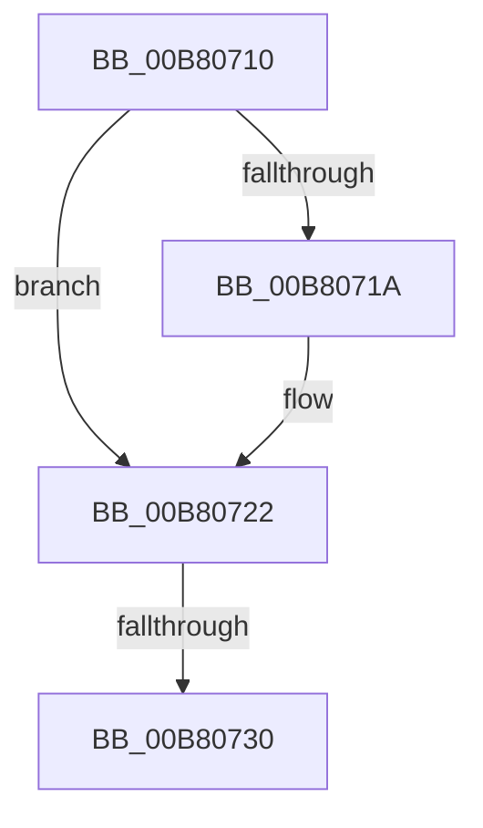

# sub_00B80710

- RVA: `0x00B80710`–`0x00B8075D` (길이 `77` bytes)
- VA: `0x0000000140B80710`
- 실행 섹션: `PAGELK`
- PDB 이름 있음: `아니요`; PDB Function 태그: `아니요`
- unwind 정보 RVA: `0x000AD8C8`
- 디코드: `15`개 명령, `77/77` bytes 표시
- 미해석 바이트: `0` (있으면 어셈블리에 `.byte`로 보존)

> 이 문서는 커널 이미지의 기계어와 PDB 기호를 분석해 생성했습니다. 4번과 5번은 함수 원형과 자료형을 바이너리 사용 방식에서 추정한 C 해석이며 원본 소스 복구 결과는 아닙니다.

## 1. Dependencies

- 직접 호출 지점: **2**; 고유 호출 대상: **2**
- 직접 호출자로 확인된 함수: **0**
- RIP 상대 이미지 참조: **0**

### Outgoing calls
- `0x00B8071D` → [KiDeleteXStateStack](../../text/5B/KiDeleteXStateStack_function_005B93C4.md) (function, `0x005B93C4`)
- `0x00B8074C` → [KiDeleteKernelShadowStack](../../page/A2/KiDeleteKernelShadowStack_function_00A25DC8.md) (function, `0x00A25DC8`)

### Direct callers
- 이 함수 시작 RVA로 연결되는 직접 call은 확인되지 않았습니다. 간접 호출은 완전히 역산할 수 없습니다.

### Static image references
- 디코드된 RIP-relative 메모리 참조가 없습니다.

## 2. Other-region calls and transfers

- 다른 실행 섹션으로 향하는 call: **2**
  - `0x00B8071D` → [KiDeleteXStateStack](../../text/5B/KiDeleteXStateStack_function_005B93C4.md) (`PAGELK` → `.text`)
  - `0x00B8074C` → [KiDeleteKernelShadowStack](../../page/A2/KiDeleteKernelShadowStack_function_00A25DC8.md) (`PAGELK` → `PAGE`)
- call이 아닌 외부 분기/꼬리 이동: **2**
  - `0x00B8072A` → [KeInitThread + 0x377](../B7/KeInitThread_function_00B78450.md) (`tail-transfer`)
  - `0x00B80758` → [KeInitThread + 0x377](../B7/KeInitThread_function_00B78450.md) (`tail-transfer`)

## 3. Assembly (complete function range)

```asm
00B80710  41 F7 04 24 00 00 80 00         test dword ptr [r12], 0x800000
00B80718  74 08                           je 0x140b80722
00B8071A  48 8B CF                        mov rcx, rdi
00B8071D  E8 A2 8C A3 FF                  call 0x1405b93c4
00B80722  40 38 B4 24 20 01 00 00         cmp byte ptr [rsp + 0x120], sil
00B8072A  0F 84 97 80 FF FF               je 0x140b787c7
00B80730  48 8B 87 08 04 00 00            mov rax, qword ptr [rdi + 0x408]
00B80737  48 89 44 24 20                  mov qword ptr [rsp + 0x20], rax
00B8073C  45 33 C9                        xor r9d, r9d
00B8073F  45 8B C6                        mov r8d, r14d
00B80742  48 8B 97 18 04 00 00            mov rdx, qword ptr [rdi + 0x418]
00B80749  48 8B CF                        mov rcx, rdi
00B8074C  E8 77 56 EA FF                  call 0x140a25dc8
00B80751  48 89 B7 08 04 00 00            mov qword ptr [rdi + 0x408], rsi
00B80758  E9 6A 80 FF FF                  jmp 0x140b787c7
```

## 4. C-style interpretation (structured pseudocode)

```c
__int64 __fastcall sub_00B80710(__int64 a1, __int64 a2, __int64 a3, int a4, __int64 a5, __int64 a6, __int64 a7, __int64 a8, __int64 a9, __int64 a10, __int64 a11, __int64 a12, __int64 a13, __int64 a14, __int64 a15, __int64 a16, __int64 a17, __int64 a18, __int64 a19, __int64 a20, __int64 a21, __int64 a22, __int64 a23, __int64 a24, __int64 a25, __int64 a26, __int64 a27, __int64 a28, __int64 a29, __int64 a30, __int64 a31, __int64 a32, __int64 a33, __int64 a34, __int64 a35, unsigned __int8 a36)
{
    __int64 result;
    unsigned __int64 v_stack_p20;

    if (((*(unsigned int *)(v_r12)) & (0x800000ULL)) != 0) {
        a1 = v_rdi;
        result = KiDeleteXStateStack(a1, a2, a3, a4);
    }
    v_stack_p20 = *(unsigned __int64 *)(v_rdi + 1032);
    a4 = 0;
    result = KiDeleteKernelShadowStack(v_rdi, *(unsigned __int64 *)(v_rdi + 1048), (unsigned int)((unsigned int)(v_r14)), a4);
    *(unsigned __int64 *)(v_rdi + 1032) = v_rsi;
}
```

## 5. (Beta) C Style

```c
int64_t sub_00B80710(int64_t Arg1, int64_t Arg2, int64_t Arg3, int32_t Arg4, uint64_t Arg5, uint64_t Arg6, uint64_t Arg7, uint64_t Arg8, uint64_t Arg9, uint64_t Arg10, uint64_t Arg11, uint64_t Arg12, uint64_t Arg13, uint64_t Arg14, uint64_t Arg15, uint64_t Arg16, uint64_t Arg17, uint64_t Arg18, uint64_t Arg19, uint64_t Arg20, uint64_t Arg21, uint64_t Arg22, uint64_t Arg23, uint64_t Arg24, uint64_t Arg25, uint64_t Arg26, uint64_t Arg27, uint64_t Arg28, uint64_t Arg29, uint64_t Arg30, uint64_t Arg31, uint64_t Arg32, uint64_t Arg33, uint64_t Arg34, uint64_t Arg35, uint8_t Arg36)
{
    int64_t result;
    uint64_t v_stack_p20;

    if (((*(uint32_t *)(local_r12)) & (0x800000ULL)) != 0) {
        Arg1 = local_rdi;
        result = KiDeleteXStateStack(Arg1, Arg2, Arg3, Arg4);
    }
    v_stack_p20 = *(uint64_t *)(local_rdi + 0x408);
    Arg4 = 0;
    result = KiDeleteKernelShadowStack(local_rdi, *(uint64_t *)(local_rdi + 0x418), (uint32_t)((uint32_t)(local_r14)), Arg4);
    *(uint64_t *)(local_rdi + 0x408) = local_rsi;
}
```

## 6. Execution-region graph

[열기: 2D/3D 그래프와 함수 탐색 컨트롤 패널](../../../control-panel.html?section=pagelk&rva=0x00B80710&view=graph)

- 2D 그래프는 위에서 아래로 흐르고, 3D 그래프는 빈 공간을 드래그해 회전합니다. Shift+드래그는 이동, 휠은 확대·축소, 함수 노드 선택은 대상 보고서 이동입니다.

### Static fallback


