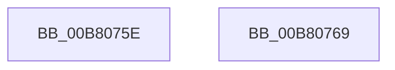

# sub_00B8075E

- RVA: `0x00B8075E`–`0x00B80771` (길이 `19` bytes)
- VA: `0x0000000140B8075E`
- 실행 섹션: `PAGELK`
- PDB 이름 있음: `아니요`; PDB Function 태그: `아니요`
- unwind 정보 RVA: `0x000AF4B4`
- 디코드: `5`개 명령, `19/19` bytes 표시
- 미해석 바이트: `0` (있으면 어셈블리에 `.byte`로 보존)

> 이 문서는 커널 이미지의 기계어와 PDB 기호를 분석해 생성했습니다. 4번과 5번은 함수 원형과 자료형을 바이너리 사용 방식에서 추정한 C 해석이며 원본 소스 복구 결과는 아닙니다.

## 1. Dependencies

- 직접 호출 지점: **1**; 고유 호출 대상: **1**
- 직접 호출자로 확인된 함수: **0**
- RIP 상대 이미지 참조: **0**

### Outgoing calls
- `0x00B8075E` → [PnpLockDeviceActionQueue](../../text/4A/PnpLockDeviceActionQueue_function_004A4388.md) (function, `0x004A4388`)

### Direct callers
- 이 함수 시작 RVA로 연결되는 직접 call은 확인되지 않았습니다. 간접 호출은 완전히 역산할 수 없습니다.

### Static image references
- 디코드된 RIP-relative 메모리 참조가 없습니다.

## 2. Other-region calls and transfers

- 다른 실행 섹션으로 향하는 call: **1**
  - `0x00B8075E` → [PnpLockDeviceActionQueue](../../text/4A/PnpLockDeviceActionQueue_function_004A4388.md) (`PAGELK` → `.text`)
- call이 아닌 외부 분기/꼬리 이동: **2**
  - `0x00B80764` → [IoBuildPoDeviceNotifyList + 0x49](../B7/IoBuildPoDeviceNotifyList_function_00B78B0C.md) (`tail-transfer`)
  - `0x00B8076C` → [IoBuildPoDeviceNotifyList + 0x517](../B7/IoBuildPoDeviceNotifyList_function_00B78B0C.md) (`tail-transfer`)

## 3. Assembly (complete function range)

```asm
00B8075E  E8 25 3C 92 FF                  call 0x1404a4388
00B80763  90                              nop
00B80764  E9 EC 83 FF FF                  jmp 0x140b78b55
00B80769  4D 8B 1B                        mov r11, qword ptr [r11]
00B8076C  E9 B2 88 FF FF                  jmp 0x140b79023
```

## 4. C-style interpretation (structured pseudocode)

```c
__int64 __fastcall sub_00B8075E(void)
{
    __int64 result;

    result = PnpLockDeviceActionQueue(a1, a2, a3, a4);
}
```

## 5. (Beta) C Style

```c
void sub_00B8075E(void)
{
    int64_t result;

    result = PnpLockDeviceActionQueue(a1, a2, a3, a4);
}
```

## 6. Execution-region graph

[열기: 2D/3D 그래프와 함수 탐색 컨트롤 패널](../../../control-panel.html?section=pagelk&rva=0x00B8075E&view=graph)

- 2D 그래프는 위에서 아래로 흐르고, 3D 그래프는 빈 공간을 드래그해 회전합니다. Shift+드래그는 이동, 휠은 확대·축소, 함수 노드 선택은 대상 보고서 이동입니다.

### Static fallback


