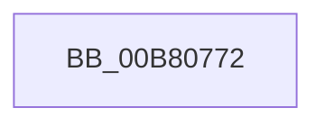

# sub_00B80772

- RVA: `0x00B80772`–`0x00B8079E` (길이 `44` bytes)
- VA: `0x0000000140B80772`
- 실행 섹션: `PAGELK`
- PDB 이름 있음: `아니요`; PDB Function 태그: `아니요`
- unwind 정보 RVA: `0x000B3A0C`
- 디코드: `12`개 명령, `44/44` bytes 표시
- 미해석 바이트: `0` (있으면 어셈블리에 `.byte`로 보존)

> 이 문서는 커널 이미지의 기계어와 PDB 기호를 분석해 생성했습니다. 4번과 5번은 함수 원형과 자료형을 바이너리 사용 방식에서 추정한 C 해석이며 원본 소스 복구 결과는 아닙니다.

## 1. Dependencies

- 직접 호출 지점: **0**; 고유 호출 대상: **0**
- 직접 호출자로 확인된 함수: **0**
- RIP 상대 이미지 참조: **0**

### Outgoing calls
- 직접 디코드된 call 명령이 없습니다.

### Direct callers
- 이 함수 시작 RVA로 연결되는 직접 call은 확인되지 않았습니다. 간접 호출은 완전히 역산할 수 없습니다.

### Static image references
- 디코드된 RIP-relative 메모리 참조가 없습니다.

## 2. Other-region calls and transfers

- 다른 실행 섹션으로 향하는 call: **0**
- call이 아닌 외부 분기/꼬리 이동: **1**
  - `0x00B80799` → [ExQuerySystemLockInformation + 0x8D](../B7/ExQuerySystemLockInformation_function_00B793DC.md) (`tail-transfer`)

## 3. Assembly (complete function range)

```asm
00B80772  49 8B C5                        mov rax, r13
00B80775  48 89 46 10                     mov qword ptr [rsi + 0x10], rax
00B80779  41 8B 40 40                     mov eax, dword ptr [r8 + 0x40]
00B8077D  89 46 18                        mov dword ptr [rsi + 0x18], eax
00B80780  41 8B 40 44                     mov eax, dword ptr [r8 + 0x44]
00B80784  89 46 1C                        mov dword ptr [rsi + 0x1c], eax
00B80787  41 8B 40 48                     mov eax, dword ptr [r8 + 0x48]
00B8078B  89 46 28                        mov dword ptr [rsi + 0x28], eax
00B8078E  41 8B 40 4C                     mov eax, dword ptr [r8 + 0x4c]
00B80792  89 46 2C                        mov dword ptr [rsi + 0x2c], eax
00B80795  48 83 C6 30                     add rsi, 0x30
00B80799  E9 CB 8C FF FF                  jmp 0x140b79469
```

## 4. C-style interpretation (structured pseudocode)

```c
__int64 __fastcall sub_00B80772(__int64 a1, __int64 a2, __int64 a3)
{
    __int64 v_rsi;

    *(unsigned __int64 *)(v_rsi + 16) = v_r13;
    *(unsigned int *)(v_rsi + 24) = (unsigned int)((unsigned int)(*(unsigned int *)(a3 + 64)));
    *(unsigned int *)(v_rsi + 28) = (unsigned int)((unsigned int)(*(unsigned int *)(a3 + 68)));
    *(unsigned int *)(v_rsi + 40) = (unsigned int)((unsigned int)(*(unsigned int *)(a3 + 72)));
    *(unsigned int *)(v_rsi + 44) = (unsigned int)((unsigned int)(*(unsigned int *)(a3 + 76)));
    v_rsi = (v_rsi) + (48);
}
```

## 5. (Beta) C Style

```c
int64_t sub_00B80772(int64_t Arg1, int64_t Arg2, void *Arg3)
{
    uint8_t *arg3 = (uint8_t *)Arg3;

    int64_t local_rsi;

    *(uint64_t *)(local_rsi + 0x10) = local_r13;
    *(uint32_t *)(local_rsi + 0x18) = (uint32_t)((uint32_t)(*(uint32_t *)(arg3 + 0x40)));
    *(uint32_t *)(local_rsi + 0x1C) = (uint32_t)((uint32_t)(*(uint32_t *)(arg3 + 0x44)));
    *(uint32_t *)(local_rsi + 0x28) = (uint32_t)((uint32_t)(*(uint32_t *)(arg3 + 0x48)));
    *(uint32_t *)(local_rsi + 0x2C) = (uint32_t)((uint32_t)(*(uint32_t *)(arg3 + 0x4C)));
    local_rsi = (local_rsi) + (48);
}
```

### 관측된 메모리 오프셋

구조체 형식이 확인되지 않은 접근은 인자 기준의 오프셋으로만 기록했습니다.

| 기준 인자 | 오프셋 표현 | 폭 (bit) | 접근 |
|---|---:|---:|---|
| `Arg3` | `+ 0x40` | `32` | `R` |
| `Arg3` | `+ 0x44` | `32` | `R` |
| `Arg3` | `+ 0x48` | `32` | `R` |
| `Arg3` | `+ 0x4C` | `32` | `R` |

## 6. Execution-region graph

[열기: 2D/3D 그래프와 함수 탐색 컨트롤 패널](../../../control-panel.html?section=pagelk&rva=0x00B80772&view=graph)

- 2D 그래프는 위에서 아래로 흐르고, 3D 그래프는 빈 공간을 드래그해 회전합니다. Shift+드래그는 이동, 휠은 확대·축소, 함수 노드 선택은 대상 보고서 이동입니다.

### Static fallback


