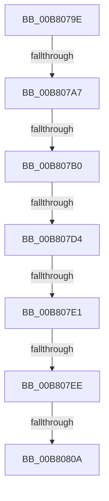

# sub_00B8079E

- RVA: `0x00B8079E`–`0x00B8081F` (길이 `129` bytes)
- VA: `0x0000000140B8079E`
- 실행 섹션: `PAGELK`
- PDB 이름 있음: `아니요`; PDB Function 태그: `아니요`
- unwind 정보 RVA: `0x000B4124`
- 디코드: `27`개 명령, `129/129` bytes 표시
- 미해석 바이트: `0` (있으면 어셈블리에 `.byte`로 보존)

> 이 문서는 커널 이미지의 기계어와 PDB 기호를 분석해 생성했습니다. 4번과 5번은 함수 원형과 자료형을 바이너리 사용 방식에서 추정한 C 해석이며 원본 소스 복구 결과는 아닙니다.

## 1. Dependencies

- 직접 호출 지점: **1**; 고유 호출 대상: **1**
- 직접 호출자로 확인된 함수: **0**
- RIP 상대 이미지 참조: **2**

### Outgoing calls
- `0x00B807C7` → [MiIsPfn](../../text/46/MiIsPfn_function_00462450.md) (function, `0x00462450`)

### Direct callers
- 이 함수 시작 RVA로 연결되는 직접 call은 확인되지 않았습니다. 간접 호출은 완전히 역산할 수 없습니다.

### Static image references
- `0x00B807D4` → RVA `0x00E37440` (`.data`; read)
- `0x00B807E1` → RVA `0x00E37478` (`.data`; read)

## 2. Other-region calls and transfers

- 다른 실행 섹션으로 향하는 call: **1**
  - `0x00B807C7` → [MiIsPfn](../../text/46/MiIsPfn_function_00462450.md) (`PAGELK` → `.text`)
- call이 아닌 외부 분기/꼬리 이동: **7**
  - `0x00B807A1` → [MiConvertHiberPhasePte + 0x6A](../B7/MiConvertHiberPhasePte_function_00B79520.md) (`tail-transfer`)
  - `0x00B807AA` → [MiConvertHiberPhasePte + 0x6A](../B7/MiConvertHiberPhasePte_function_00B79520.md) (`tail-transfer`)
  - `0x00B807CE` → [MiConvertHiberPhasePte + 0x6A](../B7/MiConvertHiberPhasePte_function_00B79520.md) (`tail-transfer`)
  - `0x00B807DB` → [MiConvertHiberPhasePte + 0x6A](../B7/MiConvertHiberPhasePte_function_00B79520.md) (`tail-transfer`)
  - `0x00B807E8` → [MiConvertHiberPhasePte + 0x6A](../B7/MiConvertHiberPhasePte_function_00B79520.md) (`tail-transfer`)
  - `0x00B80804` → [MiConvertHiberPhasePte + 0x6A](../B7/MiConvertHiberPhasePte_function_00B79520.md) (`tail-transfer`)
  - `0x00B8081A` → [MiConvertHiberPhasePte + 0x67](../B7/MiConvertHiberPhasePte_function_00B79520.md) (`tail-transfer`)

## 3. Assembly (complete function range)

```asm
00B8079E  F6 C3 01                        test bl, 1
00B807A1  0F 84 E3 8D FF FF               je 0x140b7958a
00B807A7  45 85 C0                        test r8d, r8d
00B807AA  0F 85 DA 8D FF FF               jne 0x140b7958a
00B807B0  48 B8 FF FF FF FF FF 00 00 00   movabs rax, 0xffffffffff
00B807BA  48 8B F3                        mov rsi, rbx
00B807BD  48 C1 EE 0C                     shr rsi, 0xc
00B807C1  48 23 F0                        and rsi, rax
00B807C4  48 8B CE                        mov rcx, rsi
00B807C7  E8 84 1C 8E FF                  call 0x140462450
00B807CC  85 C0                           test eax, eax
00B807CE  0F 84 B6 8D FF FF               je 0x140b7958a
00B807D4  48 3B 35 65 6C 2B 00            cmp rsi, qword ptr [rip + 0x2b6c65]
00B807DB  0F 84 A9 8D FF FF               je 0x140b7958a
00B807E1  48 3B 35 90 6C 2B 00            cmp rsi, qword ptr [rip + 0x2b6c90]
00B807E8  0F 84 9C 8D FF FF               je 0x140b7958a
00B807EE  48 8B 85 B8 00 00 00            mov rax, qword ptr [rbp + 0xb8]
00B807F5  8B D6                           mov edx, esi
00B807F7  48 8B 48 08                     mov rcx, qword ptr [rax + 8]
00B807FB  48 0F A3 11                     bt qword ptr [rcx], rdx
00B807FF  0F 92 C0                        setb al
00B80802  84 C0                           test al, al
00B80804  0F 85 80 8D FF FF               jne 0x140b7958a
00B8080A  48 83 E3 FE                     and rbx, 0xfffffffffffffffe
00B8080E  48 81 CB 04 04 00 00            or rbx, 0x404
00B80815  48 89 5C 24 30                  mov qword ptr [rsp + 0x30], rbx
00B8081A  E9 68 8D FF FF                  jmp 0x140b79587
```

## 4. C-style interpretation (structured pseudocode)

```c
__int64 __fastcall sub_00B8079E(__int64 a1, __int64 a2, int a3)
{
    __int64 result;
    __int64 v_rbx;
    __int64 v_rsi;
    unsigned __int64 v_stack_p30;

    v_rsi = (v_rbx) >> (12);
    v_rsi = (v_rsi) & (result);
    result = MiIsPfn(v_rsi, a2, a3, a4);
    result = (v_rsi < (*(unsigned __int64 *)(v_rip + 2845840))) ? 1 : 0;
    v_rbx = (v_rbx) & (-2);
    v_rbx = (v_rbx) | (0x404ULL);
    v_stack_p30 = v_rbx;
}
```

## 5. (Beta) C Style

```c
int64_t sub_00B8079E(int64_t Arg1, int64_t Arg2, int32_t Arg3)
{
    int64_t result;
    int64_t local_rbx;
    int64_t local_rsi;
    uint64_t v_stack_p30;

    local_rsi = (local_rbx) >> (12);
    local_rsi = (local_rsi) & (result);
    result = MiIsPfn(local_rsi, Arg2, Arg3, a4);
    result = (local_rsi < (*(uint64_t *)(v_rip + 0x2B6C90))) ? 1 : 0;
    local_rbx = (local_rbx) & (-2);
    local_rbx = (local_rbx) | (0x404ULL);
    v_stack_p30 = local_rbx;
}
```

## 6. Execution-region graph

[열기: 2D/3D 그래프와 함수 탐색 컨트롤 패널](../../../control-panel.html?section=pagelk&rva=0x00B8079E&view=graph)

- 2D 그래프는 위에서 아래로 흐르고, 3D 그래프는 빈 공간을 드래그해 회전합니다. Shift+드래그는 이동, 휠은 확대·축소, 함수 노드 선택은 대상 보고서 이동입니다.

### Static fallback


